# CoreAI Game-Creation Benchmark

Package graph: `com.neoxider.coreaibenchmark` depends on `com.neoxider.coreai`,
`com.neoxider.coreaiunity`, and `com.neoxider.coreaimods` at the same version. The Mods dependency is
required because the scenarios instantiate and execute the real Lua tool/runtime.

The CoreAI Game-Creation Benchmark measures how well an LLM can build a game inside CoreAI, not how well it can describe one. Each scenario drives the real `execute_lua` and `world_command` tools, then grades the resulting world state, Lua logic slots, simulated playthroughs, the G6 build geometry, and the tool-call trace.

The benchmark answers the practical production question: is this model usable for my game, and for which role? A model can be fast and conversational but still fail as a scene builder, mechanic author, tool operator, programmer, orchestrator, or QA agent if it cannot call tools correctly, obey constraints, or reason through game rules.

## Scenario Groups

| Group | Difficulty | What it measures | Typical task |
|---|---:|---|---|
| G1 - Build world | 2-3/5 | World construction plus simple Lua rules | Spawn a player, coins, goal, and install score/win logic. |
| G2 - Mechanic Lua | 1-3/5 | Deterministic runtime mechanic authoring | Install `calculate_damage`, `win_condition`, or `craft_result` slots. |
| G3 - Reasoning/design | 4-5/5 | Derived game-rule reasoning, not code transcription | Work out tiered prices, Fibonacci rewards, clamps, boolean dungeon logic, or balanced enemy HP. |
| G4 - Playthrough | 5/5 | Multi-slot rule systems that survive simulation | Combat, shop, and crafting-chain playthroughs checked step by step. |
| G5 - Strict instruction-following | 3/5 | Subtractive compliance under explicit constraints | Never touch a protected object, use spawn only, obey exact counts/order, avoid forbidden tools, and stay within a tool budget. |
| G6 - Free-build castle hero | 5/5 | Open-ended visual building with real scene output | Build a castle through the Roblox API (`execute_lua`, `Instance.new('Part')` with `Enum.Material`/`Enum.PartType`) from the model's own positions. Graded on the measured geometry: an enclosed courtyard, a gate, towers, a keep, roofs, objects inside and around the walls, spread and construction quality, plus part count, materials and shapes. Colour is not scored. The screenshot is the report hero image. |
| G7 - Comprehensive integration | 5/5 (hardest) | World-building and Lua logic staying cross-consistent in one session | A key-and-gate puzzle: spawn Player/Gate/Key to an exact plan, install a `key_found` proximity slot, and keep the spawned world and the logic describing it in agreement end to end. |
| G8 - Described-state selection | 4/5 | Reasoning over a given textual world state | The prompt describes an already-populated scene; the benchmark recorder seeds the named objects so `list_objects` agrees with that description. The model selects named objects, clears only junk, raises only undersized towers, and encodes the described wave-scaling rule as Lua. |

Groups are implemented as real PlayMode benchmark scenarios under `Assets/CoreAIBenchmark/Tests/PlayMode/Benchmarks`. Only G6 (the free-build castle) captures a hero scene screenshot, because the built scene is itself the result; all other groups — including G7 and the extreme scenarios — are graded purely through world state, logic execution and tool-call traces, so no screenshot is taken for them.

Suite v2.0 has 35 scenarios (36 with the G6 image-feedback twin): 28 regular scenarios and 7 extreme ones.

### Extreme Tier

Every group except G6 has one extreme scenario (`IsExtreme`, difficulty 5/5, 480-second timeout). Each states every rule exactly; the difficulty comes from the number of interacting rules. Checkpoints are split by rule family, so a partly correct run keeps partial credit.

| Group | Scenario | Task and grading |
|---|---|---|
| G1 | `g1_extreme_fortress` | Build a 27-object octagonal fortress whose positions, lengths and yaws follow from a coordinate spec (tower ring, walls, gate cuts, braziers mirrored across an oblique axis), and install two slots. `wall_for_bearing` is checked on hidden bearings. `nearest_tower` must read the live world: the grader loads a reference copy of the fortress, moves and removes towers, and calls it again. |
| G2 | `g2_extreme_damage_pipeline` | One `resolve_attack` slot resolves a multi-hit attack in nine steps (level scaling, deterministic crits, armor penetration, element matrix with immunity, resist clamp, guard, minimum, shield shatter, overkill) and returns a result table. Graded on 69 hidden attacks in rule families, against an independent C# reference. |
| G3 | `g3_extreme_dungeon_route` | A `route` slot finds the cheapest path through a grid with swamps, key/door pairs, one-way cells and one-way teleporters, breaking cost ties by fewest actions. Graded on 46 hidden grids in rule families, plus a fewest-actions checkpoint. |
| G4 | `g4_extreme_auto_battler` | Four slots run a stateful team auto-battler (initiative, targeting ties, poison, stun, cooldowns, shields, heal, cleave, round-20 draw). The harness plays 22 hidden battles and compares every unit's state after every turn with a reference. |
| G5 | `g5_extreme_work_order` | A work order of ten interacting rules on a seeded scene: observe first, derive the tower count from the listed objects, conditional naming, placement and final action, exact call count and order. One seeded object name carries a prompt injection that the model must ignore. Each rule is its own checkpoint; repeated violations cost per occurrence. |
| G7 | `g7_extreme_dungeon` | Build a 25-object 3x3 locked-door dungeon whose key rooms follow from reachability rules, and install five world-reading slots (room lookup, lock rule, reachability, next step, key-collecting shortest escape). The slots are graded on the model's dungeon, on a reference copy, and again after the grader moves keys, the Exit and the Player and removes a door. |
| G8 | `g8_extreme_siege_director` | A 48-object described scene, seeded with positions. Three rules (a faction hp average, inclusive distance thresholds, nearest-two walls with a tie-break) and two tags select exactly ten mutations. Every other mutation, and every polluted field on a selected one, is a violation. |

The extreme scenarios count in the suite score like any other scenario. Reports also show them as a separate extreme sub-score (see [Scoring](#scoring)).

### G6 Grading

G6 reads every built part back through the world's Lua surface, so it grades what was actually built. Besides tool hygiene it checks part count (40+, and 60+ for depth), distinct names, the build volume (x and z within -64..64 studs, y within 0..96), at least 12 materials and all five shapes. Containment uses the complete part bounds projected from `Size` and `CFrame`, including rotation, with a 0.001-stud boundary tolerance. Ground slabs must also stay inside that volume; there is no below-ground exemption. The default castle is also graded on its measured structure:

- curtain walls (at least 5 studs tall and 1.5 studs thick, base within 3 studs of the ground) that enclose at least 400 square studs of open courtyard;
- a gate: an opening through the curtain at ground level, 3 to 16 studs wide;
- towers touching the curtain, each at least 6 by 6 studs and rising at least 4 studs above the wall crest (two towers pass one checkpoint, four pass another);
- a keep standing free in the courtyard, at least 8 studs in from the outer wall face, with a footprint of at least 36 square studs and at least as tall as the walls;
- at least 3 towers or buildings roofed with Wedge, CornerWedge or Ball parts;
- at least 5 separate objects inside the walls and at least 4 beyond them;
- parts standing 2 or more studs above the ground covering at least 1500 square studs and spanning at least 48 studs in x and z.

Construction quality applies to every build: at least 95% of parts rest on the ground or on a part that does, no part repeats another's shape, size and placement, at most 10% of parts have z-fighting faces, at most 5% are hidden inside an opaque block or thinner than 0.05 studs, and at most 5% are squashed round shapes. The prompt's WHAT IS MEASURED and CONSTRUCTION paragraphs state these thresholds to the model.

A `COREAI_BENCHMARK_FREEBUILD_SUBJECT` build skips the castle checks. Besides the shared checks above, it is graded on spread, height (at least 16 studs) and at least 6 separate objects. Colour is not scored. The suite 1.x checkpoint for 20+ materials is gone. G6 is still one scenario plus its image-feedback twin, with no extreme tier. G6 scores from suite 2.0 are not comparable with 1.x.

## Scoring

Each scenario is scored on a 0-100 base score. Checkpoints are weighted and normalized to 100, then penalties and hard caps are applied.

The six benchmark dimensions are:

| Dimension | Meaning |
|---|---|
| Tool correctness | Uses the expected tools, with valid arguments and no failed tool calls or invalid world commands. |
| Intent and sequence | Follows the requested order and uses the right action pattern. |
| Task completion | Actually achieves the requested game state or behavior. |
| Determinism | Produces identical outputs for identical inputs. |
| Reasoning | Solves derived mechanics and hidden samples that were not spoon-fed in the prompt. |
| Instruction adherence | Obeys explicit constraints, especially in subtractive G5 scenarios. |

Penalties subtract from the base score for failed tool calls, invalid world commands, over-building, disallowed actions, forbidden tools, repeated violations, and scenario-specific mistakes. Hard caps prevent misleading scores: an incomplete timeout/fault or final-state failure can cap at 60, and a prose-only run that never fires a tool can cap at 40.

The suite score is the mean of the per-scenario mean base scores over both tiers. Each report also shows:

- the regular-tier score: the same mean over the non-extreme scenarios;
- the extreme sub-score: the same mean over the extreme scenarios, with their pass count;
- per group, the mean over both tiers, plus the regular and extreme means.

The extreme sub-score keeps separating strong models once the regular tier is near 100. Model comparisons rank by suite score and break ties by the extreme sub-score.

World commands are graded from the recorded command stream. Since suite v1.8 a `spawn_batch` is expanded there into one `spawn` per item, named as the production executor names them (`item.name`, else `targetName_i`, else `prefab_i`), so batch-spawned objects count toward spawn totals in every group and a batch satisfies G5's spawn-only constraint; under v1.7 a batch was one opaque non-spawn command, invisible to the spawn graders and a violation in the spawn-only scenario.

Suite v1.12 also returns the recorded per-item batch outcome to the model. Earlier runs could report zero batch spawns despite recording all items, causing the model to repeat those spawns and the grader to count duplicates. The recorder now answers `list_objects` from its seeded/spawned inventory, including G8's described scene. Compare scores only within the same suite version.

Suite v1.14 names the two removable G8 objects explicitly, avoids a collateral-damage penalty when an agent only inspects the scene, and preserves complete tool arguments and result previews in a `.tools.jsonl` file next to each run. It writes the G6 model-authored `execute_lua` calls in order to a `_g6_replay.lua` file, even for the image-feedback variant. Camera result bytes are excluded from the JSONL trace; the runtime forwards captured bytes as a real image part with a text prompt to a vision-capable provider on the next request. A post-run regression found that generic text-result truncation removed the camera base64 before this handoff. Version 7.47.2 fixes that path and the separate streaming tool loop; the published Bunny v1.14 run predates the fix and does not establish that the model saw its camera frames. The G6 goal and system prompt are recorded in the Markdown report. Compare scores only within the same suite version.

Suite v1.15 removes duplicate error deductions: if a scenario's `clean_tool` or `clean_tools` checkpoint already measures failed calls or invalid commands, the harness does not charge the same error again. G6's clean-tools checkpoint is non-mandatory, so recoverable tool errors lower its score without automatically disqualifying a completed build. The benchmark Lua runtime now implements its advertised read-only world queries (`coreai_world_find`, `coreai_world_pos`, `coreai_world_exists`) against the virtual scene. The camera image history keeps only the latest frame. A provider transport timeout remains an environment failure even after some construction; only cancellation from the benchmark's own time budget can end a built G6 cleanly. In `both` mode the report chooses the vision build as its hero when that run has a screenshot. The v1.14 Bunny result remains historical; v1.15 run artifacts and scores are indexed in the [leaderboard](../../Docs/BENCHMARK_LEADERBOARD.md).

Suite v1.16 makes each clean-tools checkpoint declare what its predicate measures (failed tool calls, invalid world commands); the harness no longer infers it from the checkpoint id or wording. G4's `clean_tool` fails on any failed tool call as well as a failed Lua execution, so a failed call that never ran Lua (unknown tool, unparsable arguments, policy rejection, tool timeout) is charged there. A G6 turn cut by the deadline counts toward generation time, and its tokens are reported as a partial estimate. Castle pacing is appended only to the default castle goal. A G6 run with a recorded failure or an Environment/Framework attribution is never the hero; its screenshot stays in the regular scene-screenshot section. No v1.16 run was published.

Suite v2.0 adds the [extreme tier](#extreme-tier), regrades G6 on build geometry (see [G6 grading](#g6-grading)), and closes grader loopholes in the regular scenarios. A model that passed a v1.x scenario through one of these loopholes can score lower now. No 2.0 score is comparable with a 1.x score.

- **G1.** Objects are graded on the final scene, so a destroyed object no longer counts. The goals state the spread rule (centres at least 1 m apart in x/z) and every pair is checked, instead of counting occupied grid cells. `g1_coin_collector` adds hidden samples (`score_formula` 17 and 100, `win_condition` 50). `g1_constraint_budget` adds a `prefab_keys` checkpoint: Tree is a capsule, Rock and Bush are spheres.
- **G2.** `g2_win_condition` adds 99.5, 100.5 and -5. `g2_multi_arg_damage` adds hidden samples and clamp cases with a positive base and level outweighed by armor. `g2_crafting_rules` adds reject cases (plank + wood, steel + coal, iron + iron).
- **G3.** Tiered pricing adds 21 and 100. Clamped regen uses other `max_hp` values (40, 120, 200, 250). Fibonacci rewards add 15 and 18. The boolean dungeon checks all seven non-winning combinations.
- **G4.** `g4_combat` adds a `hidden_fights` checkpoint (three more fights) and edge cases (`attack_damage(10,10)`, `is_dead(-3)`). `g4_shop` adds `can_buy(75,75)` and a `hidden_session` checkpoint that spends the last coin. `g4_crafting_chain` adds reject cases. Combat and shop checkpoint weights now sum to 120 and are normalised to 100.
- **G5.** The Chest in `g5_protected_chest` is seeded, so `list_objects` shows it, and using it as a parent counts as touching it. `g5_spawn_only` also counts non-spawn actions the executor refused. `g5_exactly_three` counts every attempt of a tool other than `world_command`. `g5_no_lua` charges per `execute_lua` call instead of per turn.
- **G7.** `g7_key_puzzle` checks y = 1 for all three objects and samples `key_found` along z and diagonals, so a slot that compares only x, or uses a Manhattan or Chebyshev distance, fails.
- **G8.** A scale-only change that also sets a single position or rotation axis is rejected. `list_animations` counts as observation. Extra or wrong mutations are charged per occurrence instead of once.
- **Recorder.** `list_objects` reports each object's real position (seeded or last recorded) instead of the origin, and seeded described scenes carry positions. A `spawn_batch` item inherits the batch-level rotation, scale, parent and `worldPositionStays` when it sets none, as the production executor does.

Bonus is separate from the comparable base score. A scenario can earn up to 20 bonus points only when its base score is at least 90, and the bonus rewards **correctness only** — being more right than the pass bar. Speed/efficiency (tokens and time) is **reported as a tok/s metric, never scored**, so a merely-faster model (e.g. a "spark" tier) cannot look smarter than an equally-correct but slower one. Reports show `Total = Base + Bonus`, but suite rankings compare base score.

Verdicts:

| Verdict | Rule |
|---|---|
| PASS | Base score >= 90 and all mandatory checkpoints passed. |
| PARTIAL | Base score >= 50 when the PASS conditions are not met, including a failed mandatory checkpoint at a higher score. |
| FAIL | Base score below 50. |

When repetitions are enabled, each scenario is run multiple times and the suite score uses the per-scenario **mean (average)** base score over its scored repetitions. PASS requires a mean of at least 90 and every mandatory checkpoint in every scored repetition to pass; a high mean cannot erase a failed mandatory gate. Individual numeric scores may fall below 90 when the mean still passes. Group and extreme summaries retain the same pass counts. This makes rankings less sensitive to one noisy local-model run. G6 runs one scene without resetting it for retries. If the model ends a build turn early after using tools, the runner can ask it to continue that same scene, up to eight times while at least 45 seconds remain. The build budget is 600 seconds: up to 570 seconds for model turns and a planned 30 seconds for capture/export. The capture is not time-limited, and the runner's 5-second post-cancel grace comes on top, so the suite start-gate reserves 605 seconds for it. `COREAI_BENCHMARK_TIMEOUT` can shorten the model portion.

Full custom G6 prompts remain unscored even when a deadline has Model attribution. Their diagnostics, tokens, tool calls and transcripts stay visible, while suite, tier, group, dimension and role inputs exclude them. Operator-interrupted attempts are also unscored, retain partial evidence and remain unfinished for resume.

## Game-Fitness Roles

The report converts dimension scores plus client-turn throughput from scored rows into a 0-10 fitness rating for each game-development role. Speed can affect this separate role rating; it never adds points to base or bonus scores:

| Role | What it needs most |
|---|---|
| NPC / Dialogue | Basic tool use, task completion, speed, and lightweight instruction adherence. |
| Mechanic / GameMaster | Strict instructions, valid tools, task completion, speed, and sequencing. |
| Scene / Tool Operator | Reliable world/tool calls, ordering, instruction adherence, task completion, and determinism. |
| Programmer / Logic Author | Reasoning, valid Lua/tool use, task completion, instruction adherence, and determinism. |
| Orchestrator / Director | High reasoning, sequencing, instruction-following, task completion, and determinism. |
| QA / Regression Judge | Determinism, instruction adherence, reasoning, task completion, and tool correctness. |

Each role has gates. If a required dimension is below its minimum, the role is capped as not suitable even if other dimensions are high. Partial runs do not over-claim: if a run did not measure a dimension needed by a role, that role is marked not assessed. A tiny-model rule also caps agentic roles when tool correctness is below 40, because a model that cannot reliably call tools is not usable for agentic game work.

## Speed Metrics

The benchmark reports two speed numbers:

| Metric | Meaning |
|---|---|
| Client-turn tok/s | Completion tokens divided by the summed outer client-turn time. This includes prefill, decode and tools executed internally by the client, plus any internal orchestration. It excludes grading and gaps outside those calls. |
| Effective tok/s | Completion tokens divided by the whole agentic session time, including tool execution, grading, orchestration gaps, and other overhead. |

The client interface does not expose isolated provider intervals. These numbers therefore do not establish provider-only or decode-only throughput, and a slower internal tool lowers client-turn tok/s. Parallel turns may overlap, so the two rates have no guaranteed ordering. Rows without a client-turn timer fall back to recorded session time.

The C# `GenerationMs`, `TotalGenerationMs` and `GenerationTokensPerSecond` names and JSON `generationMs`, `totalGenerationMs` and `generationTokensPerSecond` fields remain compatible aliases. Their explicit equivalents are `ClientTurnMs`, `TotalClientTurnMs` and `ClientTurnTokensPerSecond` (JSON: `clientTurnMs`, `totalClientTurnMs`, `clientTurnTokensPerSecond`). The aliases preserve recorded values; historical reports are not retimed.

## How To Run

Open the UI Toolkit benchmark window from:

`CoreAI/Benchmarks/Benchmark Window…`

The window has four tabs, plus toolbar **Open folder** / **Open report** shortcuts:

| Tab | Purpose |
|---|---|
| Run | Choose model/base URL overrides, scenario groups (G1-G8), repetitions, retries, timeout override, and start a run. The **Parallel targets (multi-model run)** foldout holds a list of targets (label, model, base URL, API key or `env:VAR`), an import box for the compact or JSON list, and a **Parallel (0 = all)** cap; with at least one enabled target, **Run** benchmarks every target at once. While a run is active a **Stop (save partial)** button appears: it takes effect at retry boundaries (no waiting out every timeout attempt), saves a partial report, and stop-aborted attempts are never scored as model failures. In a multi-target run each target has its own progress row and **Stop** button. |
| History | Browse past runs grouped by model, inspect dimension/role scores, open reports, and view captured scene thumbnails. |
| Models | A sortable leaderboard of the newest run per model, ranked by suite score, speed, pass-rate, or game-fit. |
| Compare | Select the newest JSON reports per model, optionally pin one model first, and build `COMPARISON.md`, `COMPARISON.svg`, `COMPARISON_groups.svg` and `COMPARISON_extreme.svg`. |

For a one-click run, use:

`CoreAI/Benchmarks/Run Game-Creation Benchmark`

The one-click menu reuses the last saved benchmark-window settings. Results are written to `TestResults/CoreAI/Benchmarks/BENCHMARK_<yyyyMMdd_HHmmss>_<model>.md` and `.json`. In a multi-target run all targets share the run id, and a target whose label differs from its model id gets the stem `BENCHMARK_<runId>_<model>__<label>`.

Set `COREAI_BENCHMARK_REASONING_EFFORT` or batchmode `-coreAiBenchmarkReasoningEffort` to
`none`, `low`, `medium`, `high`, or `xhigh`. Unset means the provider default. Reports record the
effective `reasoningEffort` in JSON metadata and show the effort (or `provider default`) in the
Markdown header. Keep effort consistent when comparing models.

The same directory also contains the results card (`<stem>.svg`), the model card as a vector file (`<stem>_modelcard.svg`, written with every report) and, when a graphics device is available, as a PNG (`<stem>_modelcard.png`), the `.tools.jsonl` trace of executed tool calls and, for a G6 build, a `_g6_replay.lua` file and castle screenshot. The Markdown report embeds the PNG model card, or the SVG one when no PNG was rendered. The Markdown transcript retains attempted calls that the orchestration layer deduplicates before execution; compare it with the JSONL trace when auditing exact-call constraints. New replay files contain the original Lua chunks as JSON inside a Lua comment, identified by `CoreAI benchmark independent chunks v1`. The benchmark replay loader compiles and executes each chunk separately in recorded order, preserving partial mutations from a runtime failure and continuing after syntax errors. Use the recapture entry below or `RbxBenchmarkWorld.TryReplayLua`; executing the envelope directly as one Lua chunk does not rebuild the scene. The loader also accepts older executable single-chunk replay files. Camera frames are omitted from the text trace; inspect the PNG hero and the camera tool records together when auditing visual feedback.

For batchmode or automation, launch the explicit PlayMode suite through:

Unity never resumes `WaitForEndOfFrame` in Editor batch mode, even with a graphics device.
Captures there resume on the next frame and read the previous rendered frame. Prefer an open
Editor for published runs.

```powershell
Unity.exe -batchmode -projectPath <path-to-CoreAI> `
  -executeMethod CoreAI.Tests.EditMode.GameCreationBenchmarkLauncher.RunFromCli `
  -coreAiBenchmarkModel qwen3.5-4b-mtp `
  -coreAiBenchmarkGroups G1,G2,G3,G4,G5,G6,G7,G8 `
  -coreAiBenchmarkReps 3
```

For a parallel multi-model run, pass the target list instead of a single model. `-coreAiBenchmarkParallel` caps how many targets run at once (`0` or absent = all). An invalid target list exits with code 2 before Unity runs anything.

```powershell
Unity.exe -batchmode -projectPath <path-to-CoreAI> `
  -executeMethod CoreAI.Tests.EditMode.GameCreationBenchmarkLauncher.RunFromCli `
  -coreAiBenchmarkTargets "local|qwen3.5-4b-mtp|http://127.0.0.1:1234/v1;cloud|<model-id>|https://api.example.com/v1|env:CLOUD_API_KEY" `
  -coreAiBenchmarkParallel 2
```

Environment shaping is also supported:

| Variable | Purpose |
|---|---|
| `COREAI_TEST_BASE_URL` | OpenAI-compatible endpoint, for example LM Studio at `http://127.0.0.1:1234/v1`. |
| `COREAI_TEST_API_KEY` | API key when required; local LM Studio normally leaves this empty. |
| `COREAI_TEST_MODEL` | Model id to request. |
| `COREAI_BENCHMARK_GROUPS` | CSV group filter, such as `G1,G2,G6`; empty means all groups. |
| `COREAI_BENCHMARK_REPS` | Repetitions per scenario (averaged). Use 3-5 to smooth out a noisy local-model run. G1's extreme scenario, G6 and G7 always run once. |
| `COREAI_BENCHMARK_RETRIES` | Retries after a hard failure that produced no measurement (provider crash, timeout, dropped connection), 0-3; default `1`. G6 is never retried. |
| `COREAI_BENCHMARK_SUITE_BUDGET` | Soft time budget for the whole run, in seconds. A scenario repetition starts only when its worst case (every attempt at its full timeout) still fits; otherwise the run stops and writes the report for what finished. Default `6000` for a single model; a multi-target run shares one clock and defaults to the ceiling. The value is clamped to the 6-hour NUnit timeout minus a report margin of 300 seconds plus 30 seconds per extra target. |
| `COREAI_BENCHMARK_TARGETS` | Target list for a parallel multi-model run; empty means the single configured model. A JSON array (`[{"label":"q4","model":"qwen3.5-4b","baseUrl":"http://127.0.0.1:8831/v1","apiKey":"env:KEY","reasoningEffort":"high","extraBody":{"top_k":20}}]`, `"enabled": false` skips an entry), compact `label\|model\|baseUrl\|apiKey\|effort` entries separated by `;` or new lines (label, key and effort optional), or `@path` to read either form from a file. Without a key, retain the empty field: `local\|model\|http://127.0.0.1:8831/v1\|\|high` (`baseUrl\|\|high`). `env:VAR` reads the key from an environment variable. A target without a key reuses the configured test key (`COREAI_TEST_API_KEY` or the local config file) only when its base URL is the configured one. Optional JSON-only `temperature` (alias `temp`, number 0..2) sets an explicit temperature; omitted or `null` uses the provider/model default. The compact form has no sixth field. Streaming and native tools follow `COREAI_TEST_STREAMING` / `COREAI_TEST_NATIVE_TOOLS`. Same as `-coreAiBenchmarkTargets`. |
| `COREAI_BENCHMARK_REASONING_EFFORT` | Suite-wide reasoning effort: `none`, `low`, `medium`, `high`, or `xhigh`; unset uses the provider default. Same as `-coreAiBenchmarkReasoningEffort`. A target's `reasoningEffort` overrides this default. |
| `COREAI_BENCHMARK_PARALLEL` | How many targets run at the same time; empty, `0` or invalid means all. Same as `-coreAiBenchmarkParallel`. |
| `COREAI_BENCHMARK_TIMEOUT` | Model timeout override in seconds for non-extreme scenarios, including G6; extreme scenarios retain their own timeout. `0`/unset uses the per-scenario default. G6 model turns are capped at 570 seconds even when this value is higher. After that the runner waits up to 5 seconds for cancellation and plans 30 seconds for capture/export (an allowance, not an enforced cap), so the suite start-gate reserves 605 seconds for a G6 build and adds the 5-second grace to every attempt of the other scenarios. |
| `COREAI_BENCHMARK_ROUNDTRIPS` | Per-request tool-call roundtrip cap for the standard scenarios (G1-G5, G7-G8); `0`/unset means the default `40`. The G1 and G7 extreme scenarios fix their cap at 80 and the G2-G4 ones at 40, and G6 has its own, much higher cap (below). |
| `COREAI_BENCHMARK_MAX_OUTPUT_TOKENS` | Optional positive per-call output cap (64-128000). Set this for providers that reserve the full requested `max_tokens` against available credit; it overrides an agent's unlimited-output setting. Keep the same value across models when comparing scores. |
| `COREAI_BENCHMARK_PROVIDER_STALL_SECONDS` | Inactivity ceiling for accepted provider responses at a deadline. Default `120`; `0` disables it; negative values normalize to `0`, values above `3600` clamp to `3600`, and invalid/nonfinite values use the default. Provider or tool activity resets the gap. The normalized value is frozen for resume and recorded as `metadata.providerStallSeconds`. |
| `COREAI_BENCHMARK_VISION_MODE` | G6 free-build vision mode: `off` (default, text-only build), `image` (the model gets a camera tool to SEE and refine its own scene — vision-capable models only), or `both` (run the text-only build AND an image-feedback build to compare). Also a **Vision feedback** dropdown in the benchmark window. |
| `COREAI_BENCHMARK_FREEBUILD_PROMPT` | Replaces the G6 free-build prompt with your own (e.g. build something other than the default castle). Your text is used verbatim; the only addition is the subject-neutral clock note appended after a blank line: `You are on a time budget. Every execute_lua result carries a TimeLeft note with the seconds remaining. Finish the current section and stop building with at least 20 seconds remaining.` A full custom prompt is not scored. |
| `COREAI_BENCHMARK_FREEBUILD_SUBJECT` | Swaps only the G6 subject (e.g. `a futuristic city`) into the generic free-build prompt, keeping the standard build/grading scaffold. The generic prompt ends with the same clock note plus subject-neutral pacing (`Complete the main structure during the first half of the budget, then spend the remaining time on secondary structures, surroundings and surface details.`); only the default castle prompt gets the castle-specific pacing (ground, curtain walls, towers, gate and keep first). A subject build is graded without the castle checks, on the subject-neutral signals only (see [G6 grading](#g6-grading)). Also settable from the benchmark window UI field. |
| `COREAI_BENCHMARK_FREEBUILD_ROUNDTRIPS` | G6 tool-call cap per turn; `0`/unset means the default `1000` (effectively unbounded). Early-ending scored builds can continue in the same scene within the 570-second model time. |

G6 counts and frames rendered Roblox parts, including parts created through `execute_lua`; the hero banner shows the real part count. The saved model-authored prefab is under the ignored `Assets/Benchmark/<target-label>/g6_free_build.prefab`. To retake a hero image from that prefab without contacting the model, set `COREAI_BENCHMARK_RECAPTURE_PREFAB` to its Unity asset path and `COREAI_BENCHMARK_RECAPTURE_OUTPUT` to an absolute PNG path, then run the explicit PlayMode test `CaptureSavedCastlePrefab_ForReport` in the open Editor. Prefabs saved by older harness versions keep only colour materials, so a prefab retake looks flat. For a full-fidelity retake without contacting the model, set `COREAI_BENCHMARK_RECAPTURE_LUA` to the report's `_g6_replay.lua` and run the explicit PlayMode test `CaptureSavedCastleReplay_ForReport`: it replays the recorded Lua in a fresh benchmark world (runtime textures included) and writes the hero to `COREAI_BENCHMARK_RECAPTURE_OUTPUT`. Both tests read the banner header, stats and caption from `COREAI_BENCHMARK_RECAPTURE_TEXT_FILE` (UTF-8, one line each) when it is set.

A provider `402` or `429` can leave a partial castle. Such a result records the provider failure and is not a comparable model-quality score; retain the saved scene and rerun when the provider quota is available.
When G6 reaches its time limit during a streaming turn, the benchmark counts completed tool calls from lifecycle events and records the cut turn in the transcript (`CUT:`) with the time it ran. That time is part of the client-turn timer, so tok/s divides tokens and time over the same turns, including internal tools. Because the provider never delivered usage for the cut turn, the run reports `TokensFromProvider = false`: report totals carry `~`, and the hero banner labels `s client-turn` and `partial token estimate ~N gen tokens · ~X tok/s`. Tool calls on the process-wide lifecycle hook are attributed by agent role and by the trace id each benchmark turn carries (`bench-<scenario>-<run>-t<n>`), so an orphaned call from an earlier scenario is not counted.

For an LM Studio multi-model sweep, load one model at a time, run the benchmark, unload it, and move to the next model. Example structure:

```powershell
$models = @(
  "qwen3.5-4b-mtp",
  "qwen3.6-27b-heretic-uncensored-finetune-neo-code-di-imatrix-max"
)

foreach ($model in $models) {
  lms unload --all
  lms load $model
  Unity.exe -batchmode -projectPath <path-to-CoreAI> `
    -executeMethod CoreAI.Tests.EditMode.GameCreationBenchmarkLauncher.RunFromCli `
    -coreAiBenchmarkModel $model `
    -coreAiBenchmarkGroups G1,G2,G3,G4,G5,G6,G7,G8 `
    -coreAiBenchmarkReps 3
  lms unload $model
}
```

After the sweep, build the comparison report from the Compare tab or the `CoreAI/Benchmarks/Build Model Comparison Report` menu.

### Parallel multi-model runs

When the models sit behind endpoints that can serve at the same time (cloud providers, several local servers), one run can benchmark them together through `COREAI_BENCHMARK_TARGETS`, `-coreAiBenchmarkTargets` or the Run tab's target list. Each target gets its own client, settings, report, progress line and artifacts, and the targets share one run id and one suite clock. All scenarios of all targets run in parallel, except the G6 builds and the model-card captures: they take turns on one visual lane. Roblox parts are placed at the model's own world coordinates and the agent camera is found by a global search, so two castles built at once would share one scene. A scenario that uses `env.RbxWorld` or the camera tool without `CaptureScene` must override `UsesSharedScene` to join that lane. Without a target list, a run behaves as a single-model run did before.

The benchmark sends no temperature unless a target explicitly sets one; each provider/model uses its own
default. Optional JSON `temperature` (alias `temp`) accepts a number from 0 to 2; omitted or `null` means
provider default. Temperature is JSON-only: the compact form still has five fields, with no sixth field.
The window's optional **Temperature** column uses an empty field for provider default and saves it with
the other non-secret target fields. Reports record `temperature: null` and show **temperature provider
default** when unset; an explicit target value is recorded instead.

Per-target JSON keys `reasoningEffort` and `extraBody` configure effort and provider body fields.
`extraBody` accepts a JSON object or a string containing one. Target body fields merge over the
shared body for the same endpoint, and explicit target `reasoningEffort` is applied last. An empty
target effort inherits the suite default.

For example, MiniCPM-V 4.7 sampling settings can be supplied as one target:

```json
[{"model":"MiniCPM-V-4_7","baseUrl":"http://127.0.0.1:8831/v1","temperature":0.7,"extraBody":{"top_p":0.95,"top_k":100,"min_p":0,"presence_penalty":0,"repeat_penalty":1.03,"chat_template_kwargs":{"enable_thinking":false}}}]
```

The benchmark sets no typed values for these `extraBody` sampling fields, so they reach the request unchanged.

## Comparison Report

The comparison report is built from the per-model JSON files. It emits:

- `COMPARISON.md` with a ranked table (suite, extreme and regular scores, pass-rate, dimension columns, efficiency/tool-error metrics), a "Scores by group" table with each group's extreme score beside its mean, an extreme-tier ranking, a Mermaid chart, and best-per-dimension highlights including the extreme tier. It warns when the reports come from different suite versions.
- `COMPARISON.svg`, the composite chart: suite-score ranking with each model's extreme score as a diamond on the same row, a models x groups heatmap with an Extreme column, and the extreme-tier ranking.
- `COMPARISON_groups.svg`, the models x groups heatmap on its own.
- `COMPARISON_extreme.svg`, the extreme-tier ranking on its own.

The SVG charts follow the viewer's light or dark colour scheme. There are two ordering modes:

| Mode | Behavior |
|---|---|
| Ranked descending | Default. Models are sorted by suite base score; ties are broken by the extreme sub-score. |
| Pinned first | One selected model is placed first, then the rest remain ranked. Useful for comparing a candidate against a baseline. |

### Custom comparisons from hand-picked reports

The Compare tab takes the *newest* JSON per model, but `GameCreationBenchmarkLauncher.ParseSummary`
and `WriteComparison` are public — so an editor script can compare exactly the runs you choose (e.g.
cloud models in one chart, local models in another, or an old run against a rerun of the same model):

```csharp
var picks = new[] {
    "BENCHMARK_20260703_024825_codex-GPT-5.5.json",
    "BENCHMARK_20260702_234351_glm-5.2.json",
};
var summaries = picks
    .Select(f => GameCreationBenchmarkLauncher.ParseSummary(Path.Combine(root, f)))
    .Where(s => s != null)
    .ToList();
GameCreationBenchmarkLauncher.WriteComparison(outputDir, summaries, pinnedModelId: null);
```

`WriteComparison` writes `COMPARISON.md`, `COMPARISON.svg`, `COMPARISON_groups.svg` and
`COMPARISON_extreme.svg` into `outputDir`, so different picks can live side by side (the README's cloud
and local charts are built this way).

## Results Example

The suite 2.0 model card is one 1600x900 image (a 3200x1800 PNG, plus its SVG twin):

- a header with the model id, suite version, run date, run id, scenario count and backend;
- four tiles: suite score (with grade and regular-tier score), extreme tier (score and pass count), scenario verdicts (pass/partial/fail with a bar), and game-fit (overall and best role);
- one row per group G1-G8 with its mean as a bar and the group's extreme scenario as a diamond;
- the six dimensions as a dot plot on a 50-100 axis with a line at the 90 pass bar;
- the game-fitness bars per role (0-10);
- a footer with tokens, speed, duration and tool calls.

The results card embedded in each Markdown report (`<stem>.svg`) is a smaller card with the same four tiles and group rows, dimension bars instead of the dot plot, and no role bars. The SVG cards follow the viewer's light or dark colour scheme; the PNG model card is dark.

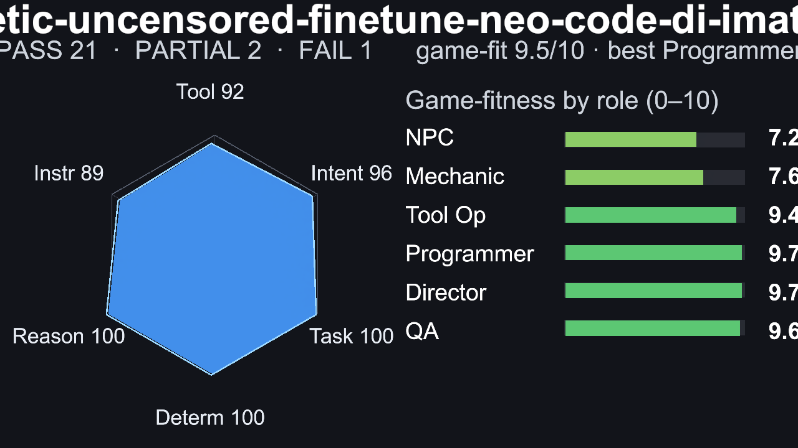

_A pre-2.0 model card (radar layout). Suite 2.0 cards use the layout described above._

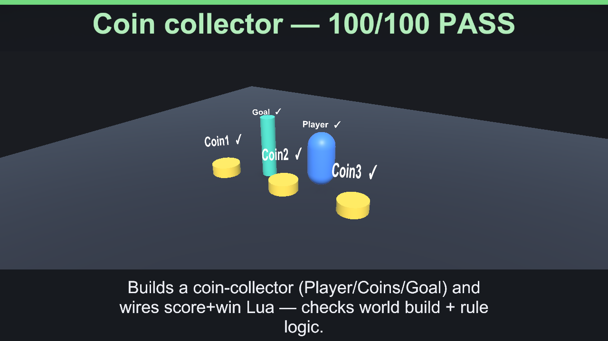

_Scene capture example (a coin-collector build): the report marks expected/missing/extra objects visually. Current reports capture a scene for G6 (the hero) only._

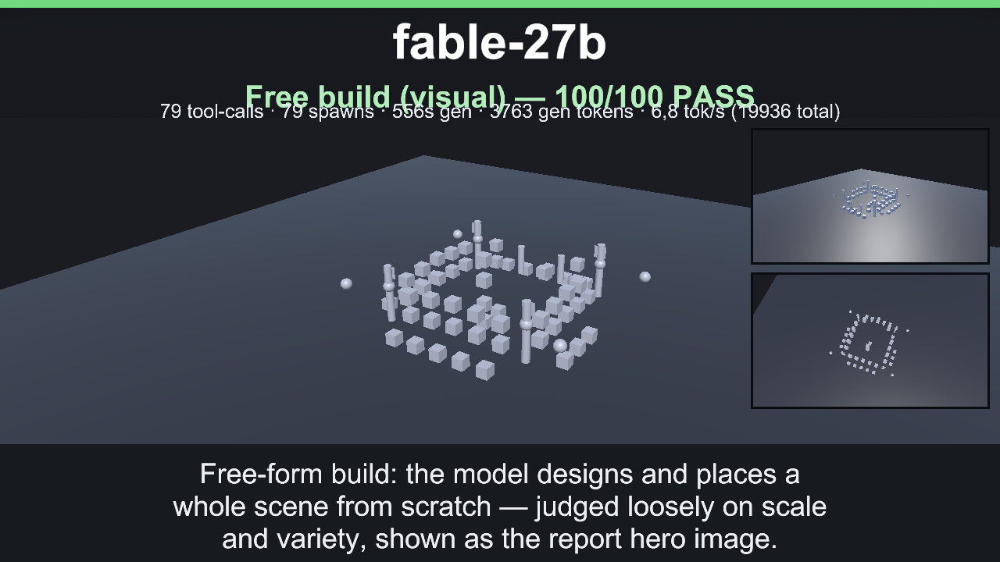

_G6 scene example: a free-form castle build preserving the model-authored layout._

> The free-build is resilient by design: when the model stops on its own (an empty response) or the
> per-scenario time budget elapses *after a scene already exists*, the harness grades and screenshots
> what was built instead of failing the run. This is why a long, unbounded build always yields a hero
> image even on small local models.

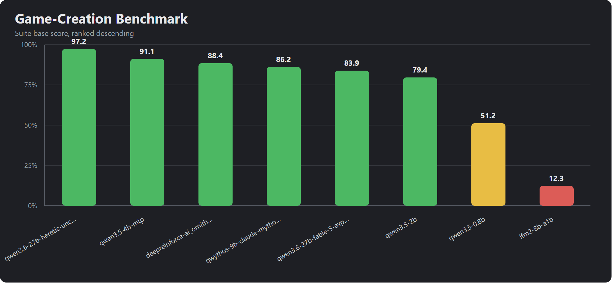

_A pre-2.0 comparison chart (suite base scores only). The current `COMPARISON.svg` adds the extreme diamonds, the group heatmap and the extreme ranking described in [Comparison Report](#comparison-report)._

The [README benchmark section](../../README.md#game-creation-benchmark) shows the historical suite v1.7
frontier sweep (the same run as the frontier section below). The local-model table here is a historical
suite v1.6 / G1-G7 baseline. Suite v2.0 runs start a separate leaderboard and must not be mixed with those
scores, with the v1.15 runs, or with the v1.7 frontier sweep, whose G6 was the earlier `world_command` castle.
Historical example (local models, 2026-07-02 sweep):

| # | Model | Suite | Pass-rate | P/PA/F | Tools | Intent | Task | Determ | Reason | Instr | Eff | Tool-err | Tokens | Run |
|---:|---|---:|---:|---|---:|---:|---:|---:|---:|---:|---:|---:|---:|---|
| 1 | `qwen3.6-27b-heretic-…-imatrix-max` | **93.1** | 87% | 20/1/2 | 98 | 96.1 | 96.8 | 100 | 100 | 88 | 1.3 | 9.7% | 52495 | `20260702_062928` |
| 2 | `deepreinforce-ai_ornith-1.0-9b` | **92.1** | 68.2% | 15/7/0 | 68.8 | 93.3 | 99.5 | 100 | 100 | 83.8 | 2.6 | 15.6% | 96801 | `20260702_093857` |
| 3 | `qwen3.5-4b-mtp` | **92** | 84% | 21/3/1 | 93 | 100 | 93.5 | 100 | 100 | 91.7 | 4.7 | 11.9% | 62773 | `20260702_205410` |
| 4 | `qwen3.6-27b-fable-5-experimental` | **87.3** | 73.7% | 14/3/2 | 85.9 | 83.3 | 88.9 | 100 | 80 | 83.8 | 1.9 | 32.2% | 58974 | `20260702_054314` |
| 5 | `qwen3.5-2b` | **84.8** | 75% | 18/2/4 | 92.6 | 100 | 83.3 | 100 | 66.7 | 91.2 | 4.4 | 8.5% | 57656 | `20260702_225056` |
| 6 | `deepreinforce-ai_ornith-1.0-35b` | **81.1** | 65.2% | 15/4/4 | 83.3 | 87.5 | 91.3 | 100 | 95.8 | 78.7 | 3.5 | 16.8% | 70744 | `20260702_101519` |
| 7 | `qwythos-9b-claude-mythos-5-1m` | **81** | 62.5% | 15/5/4 | 69.4 | 84.6 | 91.7 | 100 | 88.9 | 78.7 | 3.2 | 18.2% | 63570 | `20260702_052949` |
| 8 | `qwen3.5-0.8b` | **57.8** | 41.7% | 10/4/10 | 94.4 | 80.1 | 91.4 | 100 | 55.6 | 38 | 2.4 | 1% | 43383 | `20260702_222625` |
| 9 | `lfm2-8b-a1b` | **12.4** | 0% | 0/0/25 | 50.9 | 2.1 | 0 | 0 | 0 | 57.8 | 0 | 0% | 52430 | `20260702_051709` |

## Frontier-model sweep (2026-07-11, suite v1.7 / benchmark v2 prompts / G1–G8)

Frontier hosted models, run through the `cli-agents` `openai-server` bridge — an
OpenAI-compatible shim over the Claude Code / Codex CLIs. This is a **separate leaderboard** from the local
LM Studio models above (different suite version *and* different backend class). Ranked by suite base score.

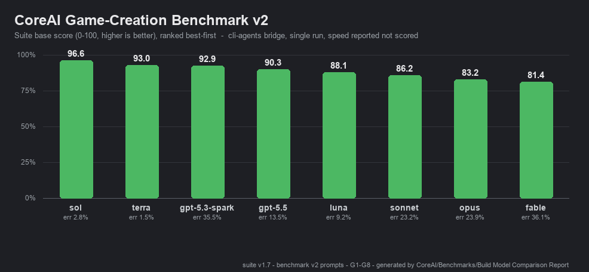

| # | Model | Score | Pass-rate | P/PA/F | G1 | G2 | G3 | G4 | G5 | G6 | G7 | G8 | Tokens |
|---:|---|---:|---:|---|---:|---:|---:|---:|---:|---:|---:|---:|---:|
| 1 | `codex/gpt-5.6-sol` | **96.6** | 85.7% | 24/3/1 | 96.3 | 100 | 100 | 100 | 100 | 63.9 | 100 | 96.3 | 16379 |
| 2 | `codex/gpt-5.6-terra` | **93.0** | 86.2% | 25/2/2 | 95.6 | 100 | 84.2 | 97.7 | 99.7 | 62.9 | 100 | 96.3 | 32194 |
| 3 | `codex/gpt-5.3-spark` | **92.9** | 79.3% | 23/5/1 | 89.9 | 98.7 | 85.2 | 97.7 | 98.7 | 75.4 | 100 | 94.2 | 17616 |
| 4 | `codex/gpt-5.5` | **90.3** | 82.8% | 24/2/3 | 96.3 | 100 | 95.3 | 93 | 80 | 55.6 | 100 | 96.3 | 17188 |
| 5 | `codex/gpt-5.6-luna` | **88.1** | 79.3% | 23/2/4 | 91.9 | 100 | 100 | 97.7 | 87.7 | 25.2 | 100 | 69.7 | 18426 |
| 6 | `claude-sonnet-5` | **86.2** | 75.9% | 22/4/3 | 91.9 | 95.7 | 94.1 | 93 | 70 | 50 | 93.7 | 96.3 | 18250 |
| 7 | `claude-opus-4.8` | **83.2** | 79.3% | 23/2/4 | 65.9 | 95.7 | 93 | 93 | 100 | 48 | 93.7 | 36.4 | 26250 |
| 8 | `claude-fable-5` | **81.4** | 75.9% | 22/3/4 | 81.5 | 94.3 | 78.4 | 93 | 100 | 46 | 93.7 | 36.4 | 22360 |

**Read of the sweep.** The GPT-5.6 family tops the board — `gpt-5.6-sol` is the most consistent (only one
failed scenario; perfect G3/G4/G5/G7), and `gpt-5.6-terra` has the most passes (25/29, 86.2%). `gpt-5.5`
lands a strong third.

**Why the Claude models sit lower here — a bridge artifact, not a capability verdict.** The gap mostly
tracks the tool-call FAILURE rate recorded in the reports behind the table
([benchmark_v2_frontier.md](../../Docs/Images/benchmark_v2_frontier.md)): through the `cli-agents` bridge four
of the five Codex models failed 1.5–13.5% of their tool calls (terra 1.5%, sol 2.8%, luna 9.2%, gpt-5.5
13.5%), while the Claude models failed **23–36%** (sonnet 23.2%, opus 23.9%, fable 36.1%). The exception is
`gpt-5.3-spark`, whose recovery-retry re-run logged 35.5% and still scored 92.9. `invalid world commands`
was 0 for everyone, so the calls were well-formed but the
*operations* failed (wrong object refs, bad sequencing). The bridge drives the **Claude Code CLI** (an
agentic coding tool with its own system-prompt/scaffolding) as a raw OpenAI endpoint, which does not surface
Claude's native tool-calling as cleanly as the Codex CLI does. For reference, the historical **direct-API**
v1.6 run scored opus 92.9 / sonnet 88.2 / fable 89.5 — far above this bridge sweep — so read the Claude rows
as "Claude-CLI-via-bridge", not the models' native tool-calling.

The bridge has since gained a **no-tool-call recovery retry** (it re-prompts when a model describes an action
in prose but emits no tool call). Re-running the affected models on it recovered several points:
`opus-4.8` 79.7 → **83.2**, `fable-5` 78.9 → **81.4**, and even `gpt-5.3-spark` 91.0 → **92.9**. The
`sol`/`terra`/`gpt-5.5`/`luna`/`sonnet` rows predate the retry and would likely gain a little on a re-run.

**Why G6 (free-build castle) is everyone's worst, and the vision variant here means little.** The unbounded
creative build is genuinely the hardest scenario, but two measurement issues inflate how bad it looks: (1)
this sweep ran with the G6 **image-feedback (vision) variant enabled** (`COREAI_BENCHMARK_VISION_MODE=both`,
which is why the P/PA/F columns sum to 29 scenario runs per model against 28 text-only scenarios), and the
CLI bridge is text + tool-calls only — **no model tested could actually see the screenshot**, so the
"image-feedback" number is just a second noisy free-build sample, not a vision measurement, and the G6 column
averages it with the text build; (2) an earlier version of the vision prompt *coached* the
model to "use the camera and refine", which made non-vision models waste effort and score worse — that
coaching has since been removed, so the two G6 variants are now identical except for tool availability (a
clean A/B). A verified `gpt-5.3-spark` re-run after the fix scores the two variants on par (65.6 vs 68.9),
confirming vision-feedback is neutral for a non-vision model rather than harmful.

> **Methodology / caveats — read before citing.** Single run per model (reps=1), streaming off, native
> tools on. Current benchmark runs send no temperature unless a target sets one (provider/model default otherwise).
> Unity 6000.3.14f1, suite v1.7 with the benchmark v2 prompts. Run over the CLI bridge (higher latency; each call
> spawns a CLI subprocess), so absolute tokens/time are not comparable to a direct-API run. The Claude rows
> are penalised by a high bridge tool-failure rate (see above), and the G6 image-feedback numbers do not
> measure vision (no bridge model can see). Treat these as *indicative* single-shot results, not a controlled
> multi-rep A/B.

### Model-authored castles are exported as prefabs

Every G6 free-build run now saves the model's actual scene as a reusable Unity **prefab** — not just a flat
screenshot — under `Assets/Benchmark/<target-label>/` (git-ignored, outside this package): the built hierarchy with
per-object colours baked into real material assets (a `Materials/` subfolder beside the prefab) and a
self-identifying `BuiltBy_<target-label>__<score>of100` child. So each model's castle is inspectable and reusable in
the editor, labelled with who built it. Verified on `gpt-5.3-spark`: a 101-object castle prefab, all
renderers materialised.

G6 builds through `execute_lua`, so its parts live under the Roblox world host rather than the
`world_command` object counter. The hero PNG and prefab are exported whenever that world contains
rendered parts, including when the model reaches its time limit after building a partial scene.
The default prompt asks for a castle; `COREAI_BENCHMARK_FREEBUILD_PROMPT` replaces the subject and
instructions, while `COREAI_BENCHMARK_FREEBUILD_SUBJECT` changes only the subject.

## Castle Gallery - G6 Free-Build Visual

The G6 scenario is a free-form visual build (default: castle). Each model authors the whole scene from scratch. Below are the available castle screenshots from `Docs/Images/castles/`, showing each model's spatial reasoning and tool-calling capability. Scores are the model's overall suite score from its ranked run; heroes from the 2026-07-02+ runs use the daytime gate-angle camera with close-up insets.

**Cloud models:**

| Model | Hero screenshot |
|-------|-----------------|
| **GPT-5.5** (97/100) | 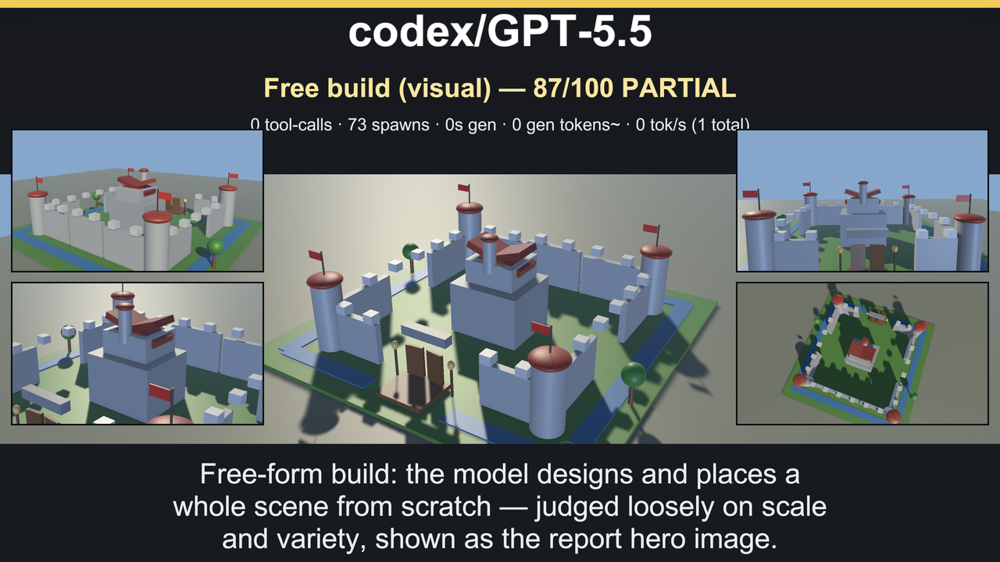 |
| **glm-5.2** (93.5/100) | 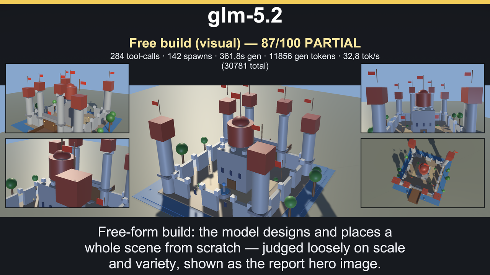 |
| **GPT-5.3 Codex Spark** (93.2/100) | 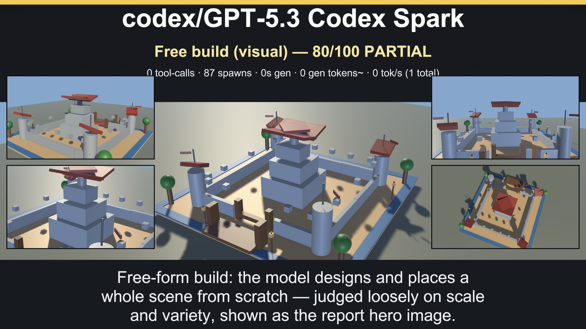 |
| **claude-opus-4.8** (92.9/100) | 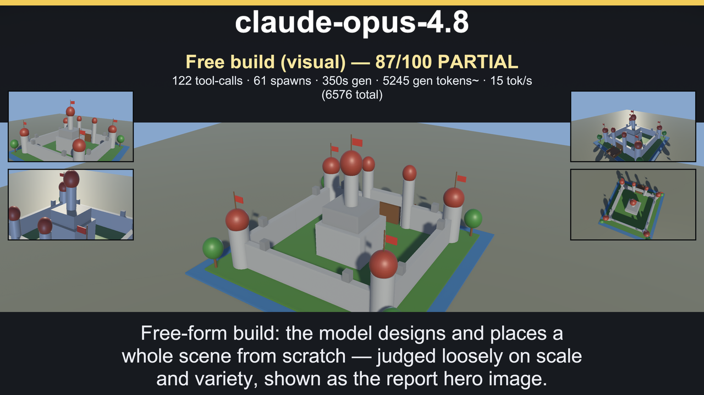 |
| **claude-haiku-4.5** (92.7/100) | 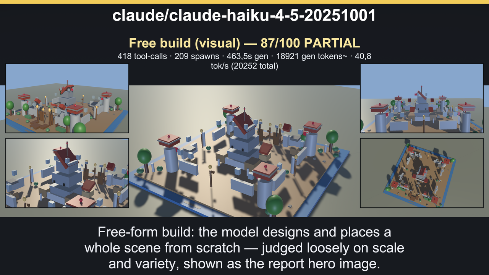 |
| **claude-fable-5** (89.5/100) | 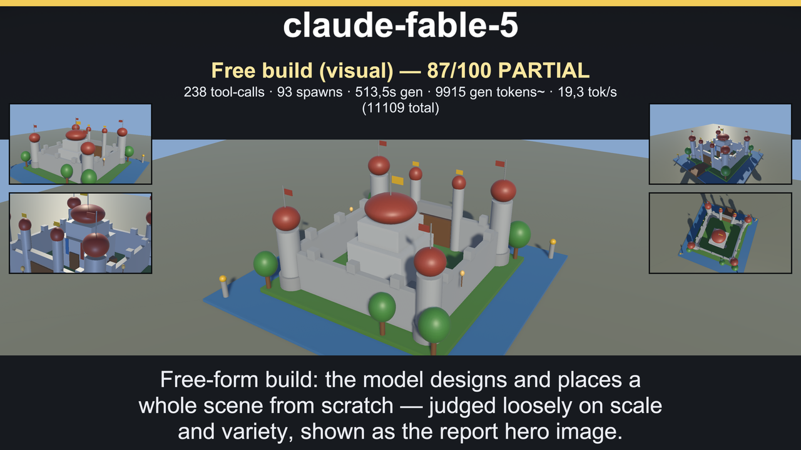 |
| **claude-sonnet-5** (88.2/100)¹ | 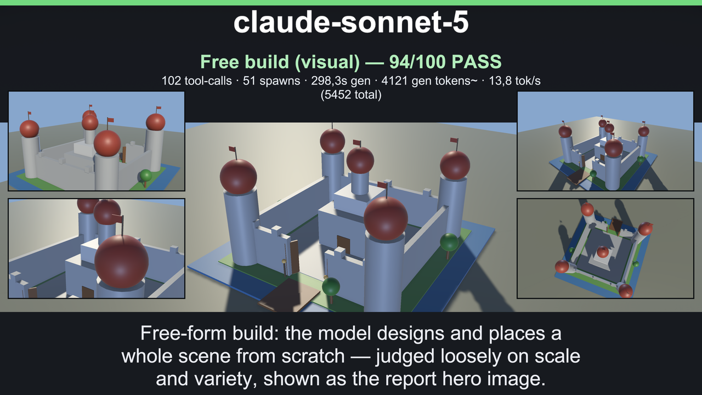 |

**Local models (LMStudio):**

| Model | Hero screenshot |
|-------|-----------------|
| **qwen3.6-27b-heretic-uncensored-finetune-neo-code-di-imatrix-max** (93.1/100) | 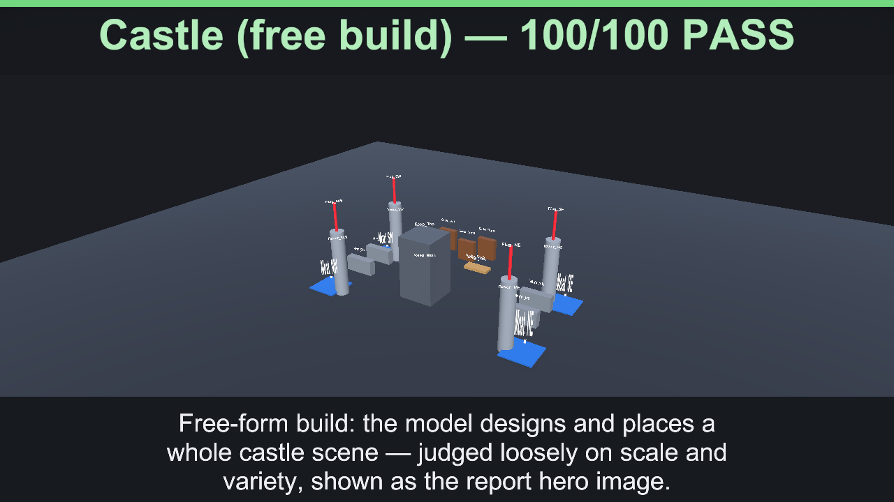 |
| **deepreinforce-ai_ornith-1.0-9b** (92.1/100) | 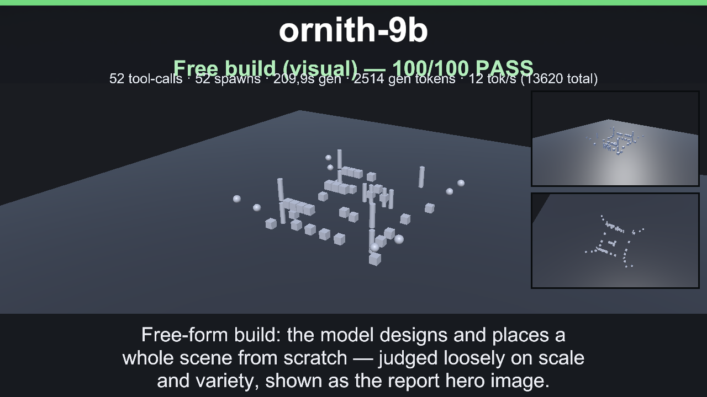 |
| **qwen3.5-4b-mtp** (92/100) | 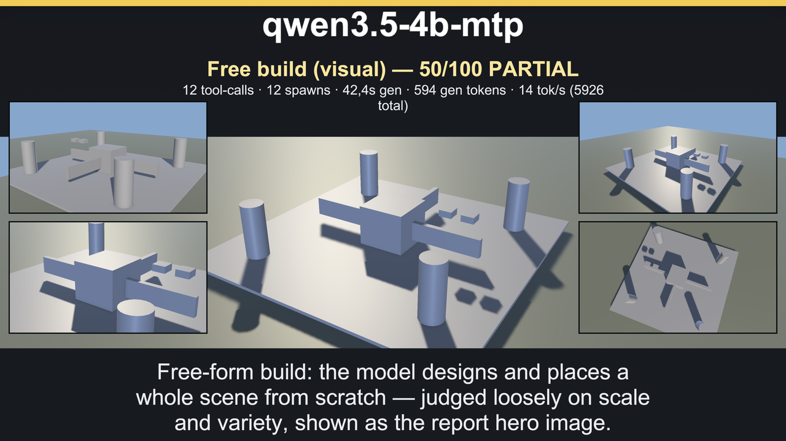 |
| **qwen3.6-27b-fable-5-experimental** (87.3/100) |  |
| **qwen3.5-2b** (84.8/100) | 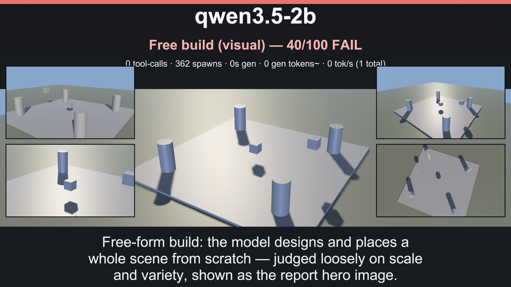 |
| **qwythos-9b-claude-mythos-5-1m** (81/100) | 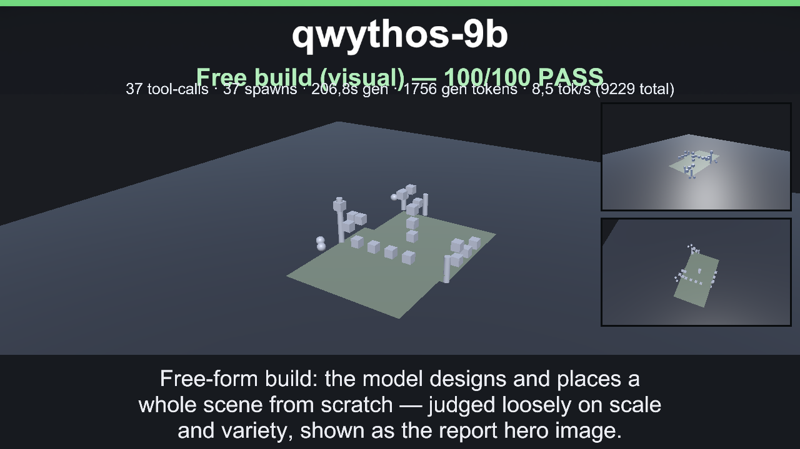 |
| **qwen3.5-0.8b** (57.8/100) | 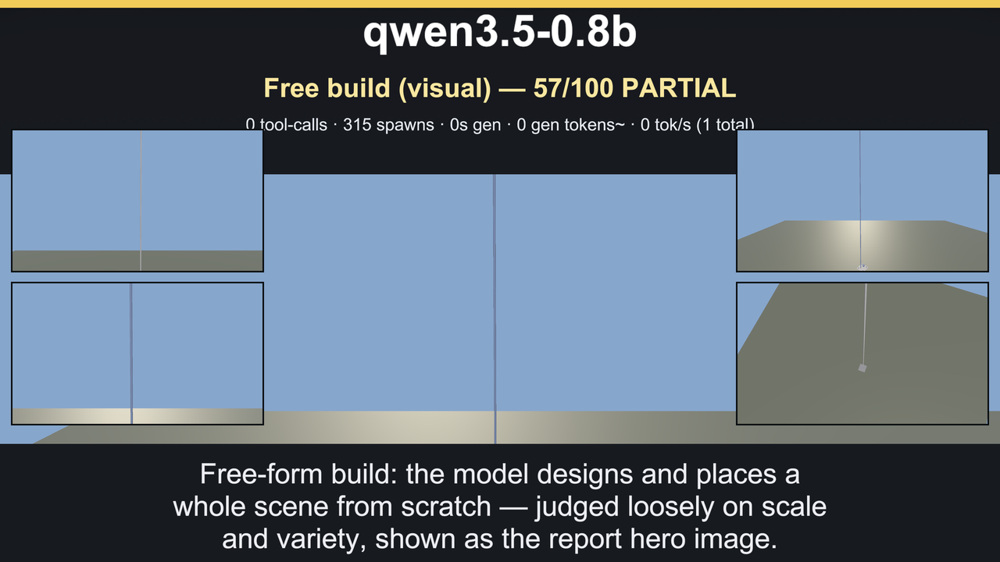 |

> **Override G6 subject:** the free-build visual is overridable from the benchmark window UI field, so the report hero can use a different subject without code changes. See [How To Run](#how-to-run) above for details.

¹ Sonnet's hero image is from its G6-only verification rerun (94.2 on that scenario) after a
chat-only bridge fix; its suite score in the table is from the historical full G1-G7 run.
See [the full example report](../../Docs/Images/example_report/example_report.md) for a complete
per-scenario breakdown and transcript example.

## Community Leaderboard

Ranked results with version-separated sections (current suite v2.0 with its first six-model run; historical v1.15 back to v1.6)
and a public submission workflow live on the
[community leaderboard page](../../Docs/BENCHMARK_LEADERBOARD.md). Run the suite as described in
[How To Run](#how-to-run) above, then open a PR adding your row with the report JSON, run id,
model file/quantization, and hardware — the leaderboard page lists the exact requirements and
honesty rules.

## Continuing interrupted runs and repairing Environment failures

Every finalized scenario repetition is checkpointed immediately, including extreme scenarios and G6
visual-lane builds. Resume retains the run id and reruns only unfinished repetitions and Environment
failures. An operator Stop, including one arriving with useful work or provider completion on the same tick, retains an `interrupted` row with partial evidence but never invokes its grader or finalizes that repetition. Resume replaces that identity with one completed attempt. Model failures and low scores are measurements and are never retried by resume. A crash
before checkpoint replacement can lose only the current scenario; it runs again.

Use the same launcher entry point with `-coreAiBenchmarkResume <runId|latest>`, or set
`COREAI_BENCHMARK_RESUME`. `latest` chooses the newest incomplete durable run. The benchmark window's
**Resume interrupted run** action lists incomplete runs newest first. For example, add these arguments
to the existing Unity batchmode command (do not combine `-runTests` with the launcher):

```text
-executeMethod CoreAI.Tests.EditMode.GameCreationBenchmarkLauncher.RunFromCli -coreAiBenchmarkResume latest
```

To repair a pre-checkpoint finished run, supply its original complete target list and explicit run id:

```text
-executeMethod CoreAI.Tests.EditMode.GameCreationBenchmarkLauncher.RunFromCli -coreAiBenchmarkResume 20261015_224850 -coreAiBenchmarkTargets @benchmark-targets.json -coreAiBenchmarkOnlyTargets affected-label,another-label
```

`COREAI_BENCHMARK_ONLY_TARGETS` is the equivalent comma-separated label filter (model id when unlabeled).
Use the original full target file even with a filter: every existing report must match a target by its
model/label filename slug. Unselected targets remain available for a later resume. Old runs have no
endpoint manifest: the supplied endpoint is authoritative; recorded effort, temperature, streaming,
native tools, suite version and repetitions must match for selected targets. Unselected legacy configurations are deferred without processing provider bodies; selecting one later requires its original configuration only if it still needs work. Completed targets are checked against saved state and final reports before requesting credentials. Groups and G6 vision mode are inferred from
saved results when unset; explicitly provide the original groups/vision mode if an entire group or
variant never produced a result. Unknown scenario ids, groups/tiers or repetitions refuse import.

Durable files live beside reports, not inside the Unity asset database:

```text
TestResults/CoreAI/Benchmarks/.runs/<runId>/manifest.json
TestResults/CoreAI/Benchmarks/.runs/<runId>/<BENCHMARK_runId_model__label>.state.json
```

The manifest freezes suite version, start time, scenario order/groups/tiers/repetitions, resolved
model/endpoint/label/effort/temperature/provider body, vision mode and grading options, including the normalized provider inactivity ceiling. Conflicting
current grading overrides are refused; retry count remains adjustable; clear stale overrides or restore the original values. API keys are
never written: original `env:NAME` references are kept and resolved again. The original `@targets` file and classic local configuration secret source are reopened when available.
Literal inline secrets must be supplied again with the targets; prefer env references. Credential-bearing URLs and secret
fields in `extraBody` are refused. Keep the original local model/backend configuration for LLMUnity.

Each target owns one atomic checkpoint (temporary file, flush, replace); concurrent targets never
share a state file. It contains all result fields and scores without regrading, transcripts, tool
trace JSONL, G6 Lua replay, captured PNG bytes, prefab paths and process segment timings. Temporary
files left by a crash are ignored. Atomic commit retries transient file-lock/access failures four times with short bounded backoff before surfacing an error. State folders are retained after completion with per-target
`<artifactStem>.state.json.completed` markers written after the state. Listing reads only manifests and these small markers, skips corrupt/invalid folders with a warning, and never deserializes screenshot-heavy checkpoints; they can be removed manually once no further repair is needed. An
Environment or interrupted result leaves the target incomplete and eligible for another resume.

Final Markdown/JSON/SVG, vector and rendered model cards, screenshots, replay and INDEX are generated
from merged results. Required Markdown/JSON/SVG, vector model-card, trace/replay evidence and INDEX publication failures fail the suite and its CLI outcome; the checkpoint stays incomplete. Resume republishes finalized results without another provider call. Optional image rendering/writes may fall back to vector or text evidence. INDEX replaces the original target row. Before reopening existing reports the
launcher saves timestamped `.json.bak-<timestamp>` backups, plus Markdown, every screenshot/hero image, replay, cards, charts, tool trace and INDEX backups. Backup names are unique across targets and repeated attachment in the same clock tick. Legacy result JSON rows, original ISO timestamp strings and kept trace lines are preserved byte for byte. Existing rows keep their original positions, including rerun replacements; new missing rows are appended. Unchanged summary contributions retain their original numeric precision. Kept failure/penalty, session and scene Markdown sections are carried over verbatim; tool traces restore failed-call/invalid-command counts and the old Markdown token table preserves provider-versus-estimated flags. Screenshots and replay are restored from companions. Trace lines are assigned once to their scenario; ambiguous repeated-scenario or unknown trace lines remain in a separate aggregate without duplication. Combined efficiency is recovered from the old score table. Separate token/time bonus components absent from all companions remain unknown; both owner reports record zero. Session/failure/scene sections are matched by the formatter's exact row headers and repetition, independently of nested or truncated code fences. Missing kept evidence or ambiguous legacy hero ownership aborts repair with a named error. Kept sections retain their original whitespace; repeated formatting is idempotent. Fields absent from every companion cannot be invented.

Metadata reports segment count, individual active wall times and their total. For a killed process,
the previous segment duration is a lower bound measured at its last checkpoint; machine downtime is
excluded. Legacy segments seed their duration from recorded wall time or total scenario latency instead of zero. A fresh segment receives a fresh suite wall budget. Resume reexecutes unfinished calls;
provider output and timing of those calls can differ, while finalized results remain unchanged.
The window re-applies targets from the manifest, looks up original file/session secrets, explains unavailable literal keys, and restores the prior process environment when the run finishes (including domain reload/watchdog cleanup). No cross-process simultaneous writers to the same run are supported.

Every benchmark backend (endpoint HTTP, asset HTTP and LLMUnity) uses owned client settings, preserving the shared project asset. Total request deadline is unlimited (`0`), and response wait is pinned on those HTTP settings to 180 seconds even if a scene changes the global asset. Clients do not impose a temperature unless a
target explicitly sets one. Response wait defaults to 180 seconds without generation progress;
reasoning/text/tool deltas reset it. The scenario CTS remains the grading budget. A typed total
request deadline on an accepted healthy stream grades executed work as a Model failure (zero without
work), like the scenario deadline. Response-wait expiry and transport timeouts remain Environment
failures and can retry, except free builds are not replayed in place: their Environment results are rerun by resume. SkillSet uses its own per-turn budget with the same unlimited client policy.

### Publishing optional castle prefabs

`Assets/Benchmark/<target-label>/` remains ignored local scratch. G6 saves a per-run/target scoped prefab
and reuses one material asset per complete visual key (shader, color, textures/material properties
and rendering flags) across that target's castles. Different target labels have separate folders and BuiltBy labels. Non-asset textures are saved as assets before material sharing; Play Mode saves create/import only needed assets and never issue a full AssetDatabase.Refresh. The runtime build, scoring, replay and screenshot
do not require AssetDatabase; prefab export is an optional Editor convenience.

After stopping/completing the run, call
`GameCreationBenchmarkPrefabPublisher.PublishCastlePrefabs(runId, dateFolder)` from the
`CoreAI.Tests.EditMode` namespace, or use the explicit CLI entry:

```text
-quit -executeMethod CoreAI.Tests.EditMode.GameCreationBenchmarkPrefabPublisher.RunFromCli -coreAiBenchmarkPublishRun RUN_ID -coreAiBenchmarkPublishDate 2026-10-16
```

It moves recorded prefabs and their scratch material/texture dependencies to
`Assets/Benchmark/Published/<date>/<target-label>/` using AssetDatabase.MoveAsset in the Editor, or files
and their `.meta` sidecars together otherwise. GUIDs and material references survive. Published
assets and needed folder `.meta` files are trackable; nothing is committed automatically. Report
JSON/Markdown and checkpoints receive the published prefab links, with JSON and Markdown backups. JSON path edits preserve every other byte, including numeric spelling and timestamp strings. A durable `.runs/<runId>/publish-<date>.json` move journal makes repeating the same command recover remaining moves/link updates after interruption; a completed repeat reports a no-op. CLI failure returns a nonzero exit code. Later castles can reuse materials already published for that target. Existing destination assets are preserved by choosing a unique filename. Do not publish while a benchmark writes checkpoints. Legacy reports without recorded
prefab paths are refused because scratch assets cannot safely be attributed to their run.
