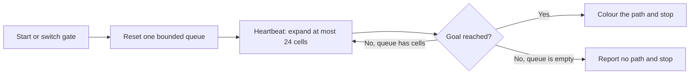

# Ready-to-run Lua mod examples

Open a scene with the CoreAI Hub and Mods scope, such as FullAccess, then open **Mods**.
Bundled examples are installed into that scope's source store without overwriting an existing
user revision. The eight examples below ship disabled. Enable one, inspect it, then open its
source in the mod editor and use **Save & run** to try a change. Several examples occupy the
area around the world origin, so start with one at a time.

These Lua resources ship inside the player and run through the existing Lua-CSharp runtime
and Rbx APIs. Their behavior runs from Lua without a model request.
Their headers request the standard `All` tier, which excludes `Full` reflection access. The host
still decides the effective capabilities.

| Example and source | What to try | Expected result |
| --- | --- | --- |
| [Orbit Gallery](../Runtime/Resources/CoreAIMods/sample_orbit_gallery.lua) | Enable it, then click the centre block. Change the orbit speed. | Twelve lights orbit at different heights; the button pauses and resumes the same clock. |
| [Waypoint Platform](../Runtime/Resources/CoreAIMods/sample_waypoint_platform.lua) | Change the four points or movement speed. | One platform visits the points in order; `Arrivals` and `TargetWaypoint` expose its progress. This follows authored points rather than finding a route. |
| [Tween Gate](../Runtime/Resources/CoreAIMods/sample_tween_gate.lua) | Watch an automatic cycle, then click the gold switch during a transition. | The gate changes height and transparency. A replacement tween cancels the previous one. |
| [Respawning Coins](../Runtime/Resources/CoreAIMods/sample_respawning_coins.lua) | Click a coin repeatedly, wait, then collect it again. | A coin counts once until it respawns. The same eight objects are reused; `Collected` and `Available` show the state. |
| [Saved Score](../Runtime/Resources/CoreAIMods/sample_saved_score.lua) | Click the block twice, then reload this mod. | `Score` and the block height retain the value through the configured mod state store. This is separate from saving the source file. |
| [Round Clock](../Runtime/Resources/CoreAIMods/sample_round_clock.lua) | Watch the beacon; edit phase durations or colours. | Warmup, play and rest cycle in order. `Phase`, `Remaining` and `Round` expose the state machine. |
| [Recycling Conveyor](../Runtime/Resources/CoreAIMods/sample_recycling_conveyor.lua) | Change the speed or the update budget. | Twelve crates move with four position updates per frame. Absolute-time positions preserve movement between updates. |
| [Lua Maze Solver](../Runtime/Resources/CoreAIMods/sample_maze_solver.lua) | Watch the search, then click the gold gate switch twice. | The first search finds a path; closing the passage produces no path; reopening it finds a path again. The same board is reused. |

## Bounded work in the maze example

The maze is a 16 by 10 grid. Lua implements breadth-first search with a queue and marks a cell
when it enters the queue, so each of the 160 cells can enter at most once per search.
`WORK_PER_FRAME` limits each Heartbeat callback to 24 expansions. Finishing a path requires at
most 160 parent links. A new search replaces its own queue and colours without creating a new
board or starting another background worker.

Inspect `Expanded`, `LastFrameWork`, `PathLength`, `Finished` and `Solved` on the
`LuaMazeSolver` folder. These counters make work limits observable. They are not an FPS or
device-performance guarantee. This example does not call the unsupported Rbx
`PathfindingService`; its complete grid search is in the Lua source.

## Editing, state and cleanup

Typing changes the draft only. Execution starts with an explicit command. Leave **Keep objects
on Save & run** turned off when replacing a sample so its previous startup objects are retired before
the new run builds its world. Unloading a sample disconnects its owned handlers and removes its
owned startup folder. It does not reset unrelated mods, camera settings or world objects.

`Saved Score` uses `store_get` and `store_set` under its own mod id. With an in-memory store,
reload retains the value only within that store's lifetime. Cross-session persistence depends
on the host's configured store and its durability contract; a successful in-memory reload is
not proof of browser durability. Unloading does not erase this mod's score.

The animated examples cap the consumed delta time at 0.1 seconds. This intentionally avoids
teleporting or processing a large catch-up burst after a pause. They demonstrate visual update
loops, not an authoritative real-time clock. The conveyor also budgets object updates, and the
coin example reuses objects instead of allocating replacements in its frame loop.

See [Lua access modes](../../CoreAI/Docs/LUA_ACCESS_MODES.md),
[the Lua game API](../../CoreAI/Docs/LUA_GAME_API.md) and
[the runtime code editor](../../../Docs/CoreAI/CODE_EDITOR.md) for integration and extension points.
