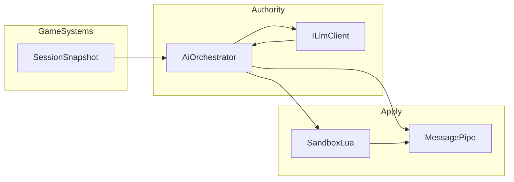

# CoreAI — Core SPEC (Dynamic Game Framework)

**Document version:** 0.24
**Repository:** CoreAI · **Author:** Neoxider (handle neoxider) — [github.com/NeoXider](https://github.com/NeoXider)
**UPM:** **`com.neoxider.coreai`** (`Assets/CoreAI`) — portable **`CoreAI.Core`** (plus the engine-free **`CoreAI.Benchmarking`** helper assembly): pure **C# without an engine** (`noEngineReferences`). **`com.neoxider.coreaiunity`** (`Assets/CoreAiUnity`) — **`CoreAI.Source`** (implementation for **Unity**), plus `Docs/`, `Tests/`, `Editor/`, `Resources/`, scene **`_mainCoreAI`**.
**Sample game:** `Assets/_exampleGame` (see also `Docs/ROGUELITE_PLAYBOOK.md` in the sample)
**Reference architecture (do not copy wholesale):** the author's earlier project "Last War" (Lua + MessagePipe bridge; see §8.3)
**AI role catalog (orchestration, placement, models):** [AI_AGENT_ROLES.md](AI_AGENT_ROLES.md)
**Developer practical guide (code map, Lua, tests):** [DEVELOPER_GUIDE.md](DEVELOPER_GUIDE.md)
**Quick start and Docs table of contents:** [QUICK_START.md](QUICK_START.md), [DOCS_INDEX.md](DOCS_INDEX.md) · **Example game in Unity:** [../../_exampleGame/Docs/UNITY_SETUP.md](../../_exampleGame/Docs/UNITY_SETUP.md)

---

## 1. Goals and non-goals

### 1.1 Goals

- A single **core** for games with **procedural and AI-driven** logic: rule changes, waves, modifiers, character effects.
- **One code path** for single-player and multiplayer: offline, the player is the local **authority** (host analogue).
- **Orchestration** of multiple model requests and scenarios: queue, priorities, timeouts, budget.
- **Safe execution** of optional code (Lua / Lua-CSharp) in a **sandbox** with whitelist and limits.
- **Application of AI decisions** only via explicit **commands and typed events** (primarily **MessagePipe**), without direct “text parsing” in gameplay systems.
- **Default “out of the box” pipeline:** a minimal scene and `CoreAILifetimeScope` shall bring up a working path (LLM or stub → orchestrator → tools → `ApplyAiGameCommand` on MessagePipe → `AiGameCommandRouter` on the main thread); the Lua sandbox joins through the optional `com.neoxider.coreaimods` package (`COREAI_LUA`). The game may override specific points as needed (prompts, LLM routing, whitelist API, policies).

### 1.2 Non-goals (v1)

- Anti-cheat and client trust in competitive PvP — a separate discipline.
- A full copy of the Last-War stack (ECS, gRPC, PlayFab, etc.) — **layer and DI ideas** only where appropriate.
- A guarantee of “perfect” Lua security — practical **defense in depth**, not a mathematical proof.

---

## 2. Glossary

| Term | Meaning |
|------|---------|
| **Authority** | The node that may invoke the LLM, the orchestrator, and **fix** the final session rules (host or local solo). |
| **Session snapshot** | Minimal telemetry DTO for prompt/logic (wave, core HP, party composition, mode flags, etc.). |
| **Command / game event** | Typed message on the bus (MessagePipe) that game code handles deterministically. |
| **Use case (dynamic)** | Unit of behavior, possibly AI-generated: data (JSON) and/or a Lua fragment under whitelist. |
| **Sandbox** | Isolated Lua-CSharp `LuaState` + globals policy + limits + registered C# delegates. |
| **AI orchestrator** | Service that accepts **tasks** from the game, assigns priorities, and prevents parallel calls from blocking the main thread without policy. |
| **Agent role** | Logical request type: **Creator**, **Analyzer**, **Programmer** (Lua), **AINpc**, **CoreMechanicAI**, etc. — see [AI_AGENT_ROLES.md](AI_AGENT_ROLES.md). |
| **Placement** | Where the role runs: **HostAuthoritative**, **LocalPerClient**, **Hybrid** — set by game configuration, not hard-coded in the core. |

---

## 3. Current repository state (normative snapshot)

> **Current architecture note:** the repository ships **seven lockstep UPM packages** —
> `com.neoxider.coreai` (portable core, no Lua), `com.neoxider.coreaiunity` (Unity host),
> `com.neoxider.coreaimods` (optional Lua sandbox + mod runtime, depends on the first two),
> `com.neoxider.coreaihub` (optional UI Toolkit Hub window), `com.neoxider.coreaibenchmark`
> (dev/test-only benchmark harness), `com.neoxider.coreaimcp` (optional in-game MCP server), and
> `com.neoxider.coreaimirror` (optional Mirror transport, `defineConstraints: ["MIRROR"]`). `CoreAI.Core` has no Lua VM reference at all — the Lua-CSharp sandbox
> and `execute_lua`/`manage_mods` tools live entirely in `CoreAI.Mods`. See [INSTALL.md](../../../INSTALL.md)
> and the root [README.md §Packages](../../../README.md#packages-and-what-is-optional) for the current
> package/dependency graph. The package boundary and positive-module contract below are normative.

### 3.0 Boundary between CoreAI and CoreAIUnity (normative)

| Layer | Package / assembly | Contents |
|------|-------------------|----------|
| **Engine-agnostic core** | **`com.neoxider.coreai`** → **`CoreAI.Core`** (`Assets/CoreAI/Runtime/Core/`) | Pure **C#**: contracts (`ILlmClient`, orchestrator, task queue), typed commands and extension points. **No** `UnityEngine` and no Lua VM implementation; game and Lua bindings are supplied by host/module packages. |
| **Unity implementation** | **`com.neoxider.coreaiunity`** → **`CoreAI.Source`** (`Assets/CoreAiUnity/Runtime/Source/`) | Concrete **Unity** implementation: VContainer, MessagePipe, LLMUnity / OpenAI HTTP, `MonoBehaviour` (`CoreAILifetimeScope`, entry points), Unity console logging, file stores, main-thread marshaling, UI wiring. Depends on **`com.neoxider.coreai`**. |

**Invariant:** all code referencing **`UnityEngine`** and Unity scenario integration resides in **`CoreAI.Source`** / package **`coreaiunity`** and in the optional module packages (`coreaimods`, `coreaihub`, `coreaimcp`, `coreaimirror`); Lua VM/sandbox implementations reside in **`CoreAI.Mods`** / package **`coreaimods`**; **`CoreAI.Core`** remains portable .NET/C#. **`RegisterCorePortable`** registers default **`InMemoryConversationSummaryStore`** and **`NullAgentMemoryStore`** unless the host suppresses them. **`CoreAILifetimeScope`** always calls **`RegisterCorePortable(suppressDefaultConversationSummaryStore: true, suppressDefaultAgentMemoryStore: true)`**, then publishes exactly one scoped summary and memory/transcript facade over the backing selected before build: `Persistent` uses **`FileAgentMemoryStore`** and **`FileConversationSummaryStore`** on every Unity player (including WebGL, where the engine's automatic **`persistentDataPath`** persistence flushes the files and **`CoreAiWebGlPersistence`** reports whether it is armed); `SessionOnly` uses process-only memory and summary stores. VContainer therefore never sees competing implementations, and SessionOnly creates no memory/summary files.

### 3.1 Packages (`Packages/manifest.json`)

- **VContainer**, **MessagePipe** + **MessagePipe.VContainer**
- **R3**, **UniTask**
- **Lua-CSharp** (bundled `Lua.dll` + `Lua.Annotations.dll` under `Assets/CoreAIMods/Plugins/`) is an implementation dependency of `com.neoxider.coreaimods`, not Core.
- **MCPForUnity** (`com.coplaydev.unity-mcp`) — editor automation used in this repository's project (§11); not a dependency of any CoreAI package.
- **LLM for Unity** ([LLMUnity](https://github.com/undreamai/LLMUnity), package `ai.undream.llm` in manifest) — local/remote inference (llama.cpp), `LLM` / `LLMAgent`, grammar/RAG per package documentation. It is optional. CoreAI runs the model as LLMUnity's built-in OpenAI-compatible server and calls it through **`OpenAiChatLlmClient`** (over `LlmUnityServerHttpSettings`) behind the core **`ILlmClient`**; **stub** mode is described in §5.2.

### 3.2 Assembly `CoreAI.Core` (`Assets/CoreAI/Runtime/Core/CoreAI.Core.asmdef`)

- `noEngineReferences: true`; no Lua, Unity, MessagePipe, or VContainer reference. Composition stays in host/module assemblies.
- Portable logic: AI/chat/tool contracts, queue and orchestrator, scripted/stub clients, memory/context,
  session snapshot DTO. The required Microsoft.Extensions.AI assemblies remain a Core dependency in all
  module configurations; Lua VM/sandbox code is not in this assembly.

### 3.3 Assembly `CoreAI.Source` (`Assets/CoreAiUnity/Runtime/Source/CoreAI.Source.asmdef`)

- References: **CoreAI.Core**, **VContainer**, **MessagePipe**, **MessagePipe.VContainer**, **UniTask**,
  **Unity.TextMeshPro**, **UnityEngine.UI**, **Unity.InputSystem**, **undream.llmunity.Runtime**. LLMUnity host code
  (agent provider, autostart, model bootstrap) compiles only with the package-generated `COREAI_HAS_LLMUNITY` and never
  on WebGL; the LLMUnity client path additionally needs the manual `COREAI_LLM` symbol.
- **R3** is in the project manifest but referenced only by the sample game (`CoreAI.ExampleGame`), not by CoreAI packages.

### 3.4 Composition and scene

- **`CoreAILifetimeScope`**: `RegisterCore()` — logger, MessagePipe, **`ApplyAiGameCommand`** and LLM/tool-event brokers, `IAiGameCommandSink`, audit log; portable routing contracts, chat/orchestration, queueing and scripted/stub clients are always registered. With **`COREAI_LLM`**, concrete provider-backed **OpenAI HTTP / MEAI / LLMUnity** clients, transports, readiness probes and resilience decorators compile and can be selected by **`LlmRoutingManifest`** + **`LlmClientRegistry`**. `RegisterLlmPipeline` adds **`AiOrchestrationQueueOptions`** (`MaxConcurrent` from `CoreAISettingsAsset.MaxConcurrentOrchestrations`, never below 4) and **`IAiOrchestrationMetrics`** (**`LoggingAiOrchestrationMetrics`** when `CoreAISettingsAsset.LogOrchestrationMetrics` is on, otherwise **`InMemoryAiOrchestrationMetrics`**). The scope registers the summary backing, then calls **`RegisterCorePortable(suppressDefaultConversationSummaryStore: true, suppressDefaultAgentMemoryStore: true)`**, then registers the memory backing — portable orchestration remains active in every configuration, while the Lua sandbox (`com.neoxider.coreaimods`, including the opt-in **`LuaCsAiEnvelopeProcessor`**) requires **`COREAI_LUA`**. The same `IAgentMemoryScopeProvider` partitions persistence and queue cancellation. **`ApplyAiGameCommand`** carries **`TraceId`**. Entry points, in order: **`AiGameCommandRouter`**, **`CoreAIGameEntryPoint`**, **`WorldStateEntryPoint`**, and **`LlmUnityAutostartEntryPoint`** when LLMUnity is installed and the platform supports a local model. Game feature scopes use **Parent** to this root.
- **Context budget and compaction:** **`IContextBudgetPolicy`** (`DefaultContextBudgetPolicy`) + **`ITokenEstimator`** (`CalibratingTokenEstimator`) allocate **`HistoryTokenBudget`** per role. **`ICoreAISettings.EnableLlmContextCompaction`** (default false) gates optional **`LlmAssistedConversationContextManager`** — auxiliary LLM call to fold evicted history into a rolling summary (per-role toggle via **`AgentMemoryPolicy.RoleMemoryConfig.UseLlmContextCompaction`**; **`Programmer`** defaults off). **`ConversationContextManagerFactories.Create(...)`** wires **`SelectingConversationContextManager`** when enabled. Timeout in WebGL: **`CancelAfterSlim`** (UniTask PlayerLoop) replaces `CancelAfter` (non-functional in Emscripten). Transport retries live in the HTTP adapter and the LLM decorators (`MeaiOpenAiChatClient`, `LoggingLlmClientDecorator`, `RetryingStreamingLlmClientDecorator`); the orchestrator adds no retry multiplier of its own (see [ARCHITECTURE](ARCHITECTURE.md) §Timeout & Retry Rule).
- **`CoreAIGameEntryPoint`**: initializes the global `CoreAIAgent` facade; with `CoreAIGameEntryPoint.AutoBootstrap` (default off) it also fires a bootstrap orchestrator task.
- Core scene: **`Assets/CoreAiUnity/Scenes/_mainCoreAI.unity`** (editor display name may be `_mainCoreAI`; add to Build Settings as **startup** for template development if needed).
- **Game Log Settings** (optional): assign a `GameLogSettingsAsset` on the scope (**CoreAI → Setup → Create Default Assets** creates one); without it the scope warns once and logs every category from level Info.

---

## 4. Target module architecture (`Assets/CoreAI/Runtime/Core`, `Assets/CoreAiUnity/Runtime/Source`)

**Portable core (`Runtime/Core/`, assembly `CoreAI.Core`):** `Audit/`, `Authority/`, `Config/`, `Messaging/`, `Session/`, and slices **`Features/<name>/`** — agent memory, prompts, orchestration/LLM contracts, LLM routing, chat, logging, permissions, Lua execution contracts, script versioning and data overlay.

**Unity layer (`Assets/CoreAiUnity/Runtime/Source/`, assembly `CoreAI.Source`):** `Api/` (static facades), `Composition/` (DI, entry points), `Infrastructure/` (persistent paths, WebGL persistence) and **`Features/<name>/`** (often split into `Infrastructure/` and `Presentation/`) — log, LLM adapters, MessagePipe, manifest/Resources prompts, file stores, world commands, UI (dashboard, chat, scheduler).

| Area (example) | Responsibility |
|----------------|----------------|
| `Source/Api/` | `CoreAi` and `CoreAiBackend` static facades |
| `Source/Composition/` | `CoreAILifetimeScope`, installers, subsystem registration |
| `Source/Features/Logging/Infrastructure/` | `IGameLogger`, sink, log settings |
| `Source/Features/Llm/Infrastructure/` | OpenAI HTTP, LLMUnity, routing, decorators |
| `Source/Features/AgentMemory/Infrastructure/` | `FileAgentMemoryStore` |
| `Source/Features/Lua/Infrastructure/` | File-backed Lua script and data overlay version stores |
| `Source/Features/Messaging/Infrastructure/` | `MessagePipeAiCommandSink`, `AiGameCommandRouter` (`ApplyAiGameCommand` → main thread), see §9.4 |
| `Source/Features/Prompts/Infrastructure/` | Manifest and Resources prompt providers |
| `Source/Features/Dashboard/Presentation/` | IMGUI dashboard, permissions asset |
| `Source/Features/Chat/` | UI Toolkit chat: `CoreAiChatPanel`, `CoreAiChatService`, `CoreAiChatConfig` (built-in roles **`PlainChat`** / **`SmartChat`**) |
| `Source/Features/PlayerChat/Presentation/` | `InGameChatPanel` (uGUI/TextMeshPro chat panel) |
| `Source/Features/Scheduling/Presentation/` | Scheduled task triggers |
| `Source/Features/World/` | World commands and the `world_command` / `component_command` / scene tools |

### 4.1 “Default behavior”

The template sets defaults:
- **LLM backend:** in `Auto` mode (the asset default) without a usable LLMUnity host or HTTP endpoint — `OfflineLlmClient`; `LocalModel` without a usable `LLMAgent`, and builds without `COREAI_LLM` — `StubLlmClient`.
- **Unity marshaling:** bus command handling is moved to the main thread in `AiGameCommandRouter`.
- **Lua sandbox:** whitelist API only, dangerous globals disabled, execution limits.
- **Persistence:** Programmer Lua versions and data overlay persist to disk in the Unity layer by default.

The game may, as needed:
- replace `ILlmClient` / enable `LlmRoutingManifest`
- add Lua functions through `ILuaCsGameRuntimeBindings` (`LuaCsApiRegistry`) — see [DEVELOPER_GUIDE §6](DEVELOPER_GUIDE.md#6-lua-for-the-programmer-agent)
- subscribe to `ApplyAiGameCommand` or `AiGameCommandRouter.CommandReceived` with its own logic

**Data flow (normative):**

1. The game publishes **facts** on the bus and/or updates the snapshot service.
2. **Only the authority** enqueues a task for the orchestrator (solo = local always yes).
3. The orchestrator calls the LLM when budget allows → receives a **structured** response.
4. Validation → conversion to **commands** → `IAiGameCommandSink.Publish` (`IPublisher<ApplyAiGameCommand>` in Unity) or a specialized command service.
5. Optionally: Lua runs in the sandbox through the `execute_lua` / `manage_mods` tools (`com.neoxider.coreaimods`); from Lua, **only** delegates leading to permitted commands/events are available.

### 4.2 Portable C# core without Unity (DLL / other engines)

`CoreAI.Core` is engine-agnostic: `CoreAI.Core.asmdef` sets `noEngineReferences: true` and references no other assembly
(only precompiled DLLs such as Microsoft.Extensions.AI, Newtonsoft.Json and System.Text.Json). `tools/portable/CoreAI.Core.csproj`
builds the same sources into a `netstandard2.1` `CoreAI.Core.dll` without Unity, and the CI job `portable-core` runs the
portable NUnit suite against it — see [tools/portable/README.md](../../../tools/portable/README.md).

**In the portable assembly:**

- Contracts and DTOs: session snapshot, commands, agent roles, validation results.
- **AI orchestrator** (queue, priorities, timeouts) on abstractions only: `ILlmClient`, `ILog` (project interfaces, not
  `UnityEngine.Debug`) and `ILlmAsyncMarshaler` for host-driven delays.
- **`ILlmClient`** implementations without Unity: `StubLlmClient`, and with `COREAI_LLM` the OpenAI-compatible
  `MeaiOpenAiChatClient` over `HttpClientOpenAiTransport`.
- Command and event publishing through host-implemented seams (`IAiGameCommandSink`, `IToolCallEventPublisher`)
  instead of MessagePipe.
- **Lua sandbox** — interpreter implementations, capability bindings, and globals policy live in **`CoreAI.Mods`**; Core
  exposes portable seams only.

**What remains in the Unity layer (`CoreAI.Source` and the module assemblies):** `LifetimeScope`, MonoBehaviour,
scenes, `GameObject`, **LLMUnity** ([LLMUnity](https://github.com/undreamai/LLMUnity)), `StreamingAssets`, the
in-game MCP server, and the adapters to the Core seams: `ILog` → `UnityLog`, `IAiGameCommandSink` →
`MessagePipeAiCommandSink`, `IToolCallEventPublisher` → `MessagePipeToolCallEventPublisher`.

**Consumers of the portable DLL:** authority server without a Unity client, **Godot 4 (.NET)**, console tests, CI tools, another engine with hosted CLR. **Do not** expect “one DLL for all engines without recompilation” for native C++ — only where a compatible .NET runtime exists.

### 4.3 Portable assembly (`CoreAI.Core`) dependencies: minimum vs “same stack”

**Rule:** **`CoreAI.Core`** references no other assembly (empty `references` in `CoreAI.Core.asmdef`). The “Unity stack”
(**VContainer**, **MessagePipe**, **R3**, **UniTask**) stays in **`CoreAI.Source`** and the module assemblies, which adapt it to
Core seams.

| Package | In `CoreAI.Core` | Comment |
|---------|------------------|---------|
| **VContainer** | **No** | DI composition lives in `CoreAI.Source` (`CoreServicesInstaller`, `CorePortableInstaller`, `LlmPipelineInstaller`) and module installers. Core types carry no DI attributes, so a registration that needs a specific constructor uses an explicit factory. |
| **MessagePipe** (+ VContainer) | **No** | Core defines the message contracts and the publishing seams (`IAiGameCommandSink`, `IToolCallEventPublisher`); Source implements them over MessagePipe. |
| **R3** | **No** | Core uses plain `event`s and callbacks. No CoreAI package assembly references R3 (only the sample game does). |
| **UniTask** | **No** | In Core — `Task` / `ValueTask`; the Unity layer uses UniTask for PlayerLoop integration and injects it into Core through `ILlmAsyncMarshaler`. |
| **Lua-CSharp** | **No (moved to `CoreAI.Mods`)** | Runs **without Unity** on .NET; sandbox and globals/whitelist policy now live in **`CoreAI.Mods`** (`com.neoxider.coreaimods`), not `CoreAI.Core`. Ships bundled as `Lua.dll` + `Lua.Annotations.dll` under `Assets/CoreAIMods/Plugins/` — no separate UPM package to install. |
| **Microsoft.Extensions.AI**, **System.Text.Json**, **Newtonsoft.Json** / **HttpClient** | **Yes** (precompiled references / BCL) | MEAI contracts are part of the public API; JSON parsing and the `ILlmClient` HTTP transport. |

**Why not pull everything into the portable assembly immediately:** each dependency implies versions, compatibility with **Godot / console / Linux server**, licenses, and size. A thinner Core simplifies **DLL extraction** and testing without the editor.

**Alternative “unified stack”:** if the non-Unity host target is **one** (e.g. ASP.NET only), you may explicitly record an **allowed set** (e.g. `Microsoft.Extensions.*` + MediatR) **instead of** duplicating MessagePipe — a separate decision, to be described in an ADR and not mixed with Unity UPM without bridges.

---

## 5. Networking and authority (policy)

- The **client is not treated as authoritative** for **global** AI outcomes (session rules, world, shared loot/craft in co-op): it shall not execute raw model output as truth for others.
- The **host** (or solo) is the **reference** for orchestration and for roles with **HostAuthoritative**; clients receive **replicated state** (Mirror via `com.neoxider.coreaimirror`, or another transport behind `INetworkBridge`).
- **Not all roles must exist in the game:** only **AINpc**, only **CoreMechanicAI**, or any subset is permitted — see [AI_AGENT_ROLES.md](AI_AGENT_ROLES.md) §5–6.
- **Placement:** some roles (e.g. **CoreMechanicAI** or visual **AINpc**) may be **LocalPerClient** or **Hybrid** per developer decision; the core defines the **contract** for policy; the game chooses (co-op fairness vs local “flavor”).
- Telemetry for **Analyzer** and **Creator** in multiplayer shall by default be collected **on the authority**; local metrics that do not affect rules — per game policy.

### 5.1 Recommended network stack for the template (library choice)

**Historical recommendation (superseded): Netcode for GameObjects (NGO).** The project decision recorded in `Docs/ROADMAP.md` Track B and `Docs/CoreAIMods/ROBLOX_API_ROADMAP.md` §2 is **Mirror** behind the engine-free `INetworkBridge` seam, now shipped as `com.neoxider.coreaimirror`; NGO remains an alternative transport behind the same seam. The paragraph below is kept as the original comparison. — Unity package (`com.unity.netcode.gameobjects`), free, evolves with editor versions, fits **host / server + clients**. For CoreAI: **on the host** run the AI orchestrator and LLM; clients receive **agreed** `NetworkVariable` / RPC / custom messages with wave and rule parameters. Optionally later — **Unity Gaming Services** (Relay, Lobby) without changing the base authority model.

| Option | Pros for the template | Cons / when not to use |
|--------|----------------------|------------------------|
| **NGO** | Official Unity path, documentation, listen-server (host-player), predictable updates under LTS/Unity 6 | More ceremony than Mirror; some advanced scenarios via packages/UGS |
| **Mirror** | Open source, many tutorials, listen server out of the box, cloud not mandatory | Not an “official” Unity package; support and compatibility are community-driven |
| **Fish-Networking** | Strong performance and features, free core | Separate ecosystem; learning and migration from NGO differ |
| **Photon (Fusion / PUN2)** | Ready relay/cloud, convenient for quick internet multiplayer | **Not fully free** at scale; Photon pricing and cloud coupling; often excessive at start for “AI on host only” |
| **Photon Quantum** | Fixed-tick simulation | Separate paradigm (ECS-like), licensing; often heavy for first `_exampleGame` pass |

**Original conclusion (superseded by the Mirror decision above):** for **free**, **capable within Unity**, and aligned with “**host authority for AI**” — **NGO**. **Mirror** is a reasonable alternative if you deliberately avoid the Unity Multiplayer ecosystem. **Photon** makes sense when you need **managed relay/matchmaking** and accept limits/pricing, not as a “simple free NGO replacement.”

Core interfaces allow **substituting** the transport (e.g. tests or another networking stack): `IAiNetworkPeer` (`IsHostAuthority`, `IsPureClient`; a scene supplies it through a `CoreAiNetworkPeerBehaviour`, default `DefaultSoloNetworkPeer`) and `IAuthorityHost` (`CanRunAiTasks`, composed by `NetworkedAuthorityHost` from the peer and the `AiNetworkExecutionPolicy` set on `CoreAILifetimeScope`). `AiOrchestrator` refuses a task when `CanRunAiTasks` is false. **Networking today:** Mirror via `com.neoxider.coreaimirror` (`MirrorNetworkBridge`, `CoreAiMirrorNetworkBridgeProvider`) behind `INetworkBridge`; `NullNetworkBridge` is the solo loopback.

### 5.2 Builds without AI models (HostAuthoritative)

When **all** LLM roles are concentrated on the **host**, a client build needs neither embedded models nor a mandatory LLM
runtime. Goals: demo and test builds, CI without a model, smaller distribution, “host without GPU / without downloaded
weights,” store policies “no network calls to LLM.” The template supports this:

- Without the manual compile symbol (**Scripting Define**) **`COREAI_LLM`** no provider-backed HTTP/MEAI or LLMUnity client
  code compiles; portable orchestration/chat, scripted/stub clients and MEAI public contracts remain, and routing resolves
  to **`StubLlmClient`** / **`OfflineLlmClient`**. Symbol **`COREAI_HAS_LLMUNITY`** is set **automatically** via
  `versionDefines` in asmdef when package `ai.undream.llm` is present; the LLMUnity client path compiles only when both
  symbols are present.
- **`Offline`** mode (`OfflineLlmClient`) yields **deterministic** responses per role; a custom heuristic `ILlmClient` can be
  registered instead.
- Requirement: the orchestrator in “no LLM” mode **shall not fail** — tasks complete with the stub/offline answer or a
  logged failure result; **MessagePipe** and game logic remain operational.
- Network clients still receive **replicated state**; the only difference is that the **source** of decisions on the host is
  not a neural net but a stub/designer data.

---

## 6. AI orchestrator (requirements)

- Register **only roles enabled in the game** from the catalog [AI_AGENT_ROLES.md](AI_AGENT_ROLES.md); each task (`AiTaskRequest`) carries `RoleId` and `Priority`; placement is the host's decision, enforced through `IAuthorityHost` (§5.1).
- **Task queue** with **priority** (`QueuedAiOrchestrator`: higher `Priority` first, FIFO within one priority): e.g. CoreMechanicAI (craft moment) > Creator (rule change) > AINpc (replica) > Analyzer (batch).
- **Timeout** per task and per LLM call (the chat-service idle deadline, `TimeoutLlmClientDecorator`); cancellation on session phase change (round end, pause, return to hub) through `CancellationScope`, `CoreAi.StopAgent` or the caller's token.
- **Parallelism cap:** `AiOrchestrationQueueOptions.MaxConcurrent` concurrent tasks.
- **Latest wins:** a new task with the same non-empty `CancellationScope` (in the same memory scope) cancels older active and pending work; there is no merge of similar requests.
- **Do not block** the main thread: asynchrony via **UniTask** (or equivalent) with explicit return to the main thread before applying to Unity API.

---

## 7. LLM and response contract

- Input: system prompt for the role + **Session Snapshot** + permitted **JSON Schema** / field description.
- Output: first validate **structure** (fields, types, ranges); failure → retry with error message (limited attempts) or task rejection.
- Free-form text **is not** a game command until validation and mapping to command types.
- **Model choice and placement (local / API)** per role is not rigidly fixed in this SPEC; see [AI_AGENT_ROLES.md](AI_AGENT_ROLES.md), section **“6. Model recommendations.”** `ILlmClient` may route roles to different endpoints or model sizes.
- **Build without models** (stub `ILlmClient`, heuristics) — see **§5.2**; primarily relevant when **HostAuthoritative** covers all AI on the host.

---

## 8. Lua sandbox (Lua-CSharp)

### 8.1 Security

- Remove or override dangerous **globals** (`os`, `io`, `require`, dynamic code loading — per Lua-CSharp version checklist).
- **Whitelist** of registered functions only; no arbitrary Unity API access from Lua for LLM-generated code.

### 8.2 Limits

- **MaxInstructions** (or equivalent in the Lua-CSharp version used). In the template this is implemented by an instruction-count hook in `LuaCsExecutionGuard` (step limit, executed wall-clock time and an allocation budget).
- **Timeout** policy for Lua chunk execution aligned with §9 (main thread).

### 8.3 Bridge to MessagePipe (Last-War motivation)

In the Last-War project (its `Assets/Scripts/LuaBehaviour/` folder, including the **`LuaMessagePipeAdapter`** idea; not part of this repository) Lua publishes/subscribes to events by type name. For CoreAI:

- Allow only an **explicit list** of command / DTO types (registry of names or ids).
- Publication from Lua → **one** C# delegate that maps to `IPublisher<T>` with type checking.
- Arbitrary types and reflection from Lua are prohibited.

**Built-in bridge example:** World Commands (`AiGameCommandTypeIds.WorldCommand`) — Lua publishes a command via whitelist `coreai_world_*`, the Unity layer handles on the main thread and applies scene changes. See `Docs/WORLD_COMMANDS.md`.

### 8.4 Tests

- EditMode: forbidden API call, instruction overrun, invalid event type — expected errors.
- EditMode: World Commands — Lua publishes `WorldCommand`, JSON envelope check (see `WorldBindingsStudUnitsEditModeTests` and `LuaToolEditModeTests` in `CoreAI.Mods.Tests`).

---

## 9. Execution threads (ADR)

### ADR-9.1 — Recommended default model

- **Lua and command application to Unity** — on the **main thread** (Lua-CSharp `LuaState` in the same thread as MessagePipe `Publish` / game state changes).
- **LLM calls** — **async** (`Task` / UniTask in Unity layer); result is validated and **marshaled to the main thread** before publishing commands and touching `UnityEngine` API.
- The **orchestrator** shall not block the network tick beyond policy: move heavy steps to async and split work across frames if needed.

### ADR-9.2 — Alternative (Lua on a worker)

Permitted **only** if **all** CLR callbacks from Lua enqueue work to the main thread and **do not** call `UnityEngine` directly. Requires explicit code review and EditMode tests for absence of races.

### ADR-9.3 — Alignment with template code (current)

Assembly **`CoreAI.Core`** does not reference Unity; main-thread marshaling is provided in **`CoreAI.Source`** (bootstrap, entry points, MessagePipe subscribers). Sandbox in Core remains thread-neutral — invoke from the game per ADR-9.1.

### ADR-9.4 — Unity guidance: LLM → commands → scene (main thread)

**Purpose of this subclause:** the async chain after the orchestrator **does not guarantee** execution on the Unity main thread; without explicit marshaling, subscribers may silently fail to apply effects (or behave nondeterministically).

1. **Where the background thread comes from**
   The default **`IAiOrchestrationService`** implementation is **`QueuedAiOrchestrator`** around **`AiOrchestrator`**. Outside WebGL, the continuation after `await _inner.RunTaskAsync(...)` inside the queue uses **`ConfigureAwait(false)`**, so after the LLM call (**`ILlmClient.CompleteStreamingAsync`** by default, **`CompleteAsync`** when streaming is off) the **`AiOrchestrator`** code (validation, memory, **`IAiGameCommandSink.Publish`**) often runs on the **thread pool**, not the main thread. WebGL players keep the Unity context on that await.

2. **What counts as “Unity code”**
   Any **`UnityEngine.*`** calls, work with **`GameObject` / `Component` / `Transform`**, **`Object.FindObjectsByType`**, **`Instantiate`**, scene state changes, and typical game structures (`Dictionary` + scene objects in one scenario) **shall** run on the **main** editor/player thread.

3. **What the template in the repository does**
   Subscriber **`AiGameCommandRouter`** on **`ApplyAiGameCommand`**, after delivery from MessagePipe, **does not** handle the command on the current thread immediately: it schedules work via **`UniTask.SwitchToMainThread()`**, then on the **main thread** calls **`ICoreAiWorldCommandExecutor.TryExecute`**, the static event **`CommandReceived`**, and log **`GameLogFeature.MessagePipe`**. It does not execute Lua from the envelope; Lua runs through the `execute_lua` tool, or through a host-registered `LuaCsAiEnvelopeProcessor`. Thus listeners such as **`ArenaCompanionAiListener`**, **`ArenaCreatorWavePlanner`**, and UI subscribed to **`CommandReceived`** receive callbacks in a Unity-safe context.

4. **For custom subscribers**
   - **Preferred:** subscribe to **`AiGameCommandRouter.CommandReceived`** (after router marshaling) **or** duplicate the same pattern (`await UniTask.SwitchToMainThread()` at the start of the handler).
   - **If** subscribing **directly** to **`ISubscriber<ApplyAiGameCommand>`** (parallel to the router): you **must** marshal handler body to the main thread the same way or via a queue + **`Update()`** on a `MonoBehaviour`.
   - **Without UniTask:** a command queue (`ConcurrentQueue<ApplyAiGameCommand>`) and drain in **`Update`/`LateUpdate`** — an acceptable explicit variant.

5. **Alternative “main thread immediately”**
   One could remove `ConfigureAwait(false)` in the queue or **`SwitchToMainThread`** **before** `Publish` in the orchestrator — that changes main-thread load and the **`CoreAI.Core`** contract (no UniTask there). Current **template canon:** marshaling **at the Unity layer boundary** in **`AiGameCommandRouter`** (see source `Assets/CoreAiUnity/Runtime/Source/Features/Messaging/Infrastructure/AiGameCommandRouter.cs`).

### ADR-9.5 — “Automatic default pipeline” (principle)

The template adheres to:
- **minimal scene** + `CoreAILifetimeScope` shall bring up a working path without manual DI wiring in code
- **safe defaults** (stub instead of crash, whitelist instead of reflection, Lua limits)
- configuration via **ScriptableObject assets** and/or explicit DI interfaces

This simplifies onboarding and reduces accidental main-thread/safety violations.

---

## 10. Integration with the `_exampleGame` sample

- Minimal run: arena, wave, score/health UI (see sample playbook).
- One **procedural hook** through the core: e.g. wave affix or enemy composition — only via bus commands after authority.
- Sample dependency: separate asmdef (`CoreAI.ExampleGame`) that uses the public API of `CoreAI.Core`, `CoreAI.Source` and `CoreAI.Mods`.

---

## 11. MCPForUnity

MCPForUnity (`com.coplaydev.unity-mcp`, [CoplayDev/unity-mcp](https://github.com/CoplayDev/unity-mcp)) is in this
repository's project manifest for editor automation; no CoreAI package depends on it.

### 11.1 Editor and scenes

- Inspect objects on `_mainCoreAI`, prefabs, composition regression after changes.

### 11.2 Test execution via MCP

- With the Unity Editor reachable by the MCP server, an agent session can run Unity Test Framework suites through the
  MCPForUnity tools: **`run_tests`** (mode `EditMode` and/or `PlayMode`, optional assembly / test-name filters), then
  **`get_test_job`** with the returned `job_id` (failed-test and detail flags on request).
- MCP **does not replace** the CI gate; the contributor test gate is defined in [CONTRIBUTING.md](../../../CONTRIBUTING.md).

---

## 12. Quality and CI

- The project **compiles** without duplicate VContainer packages (single source — UPM).
- **Tests:** new and changed core logic ships with **Unity Test Framework** tests (prefer **EditMode** for sandbox, DI,
  parsers; **PlayMode** for integrations as needed); every bug fix ships with a regression test.
- CI (see [CONTRIBUTING.md](../../../CONTRIBUTING.md#ci)): the engine-free `portable-core` / `portable-lua` jobs, the
  package-graph gate, the analyzer build, the EditMode suite in four compile configurations (`core`, `llm`, `lua`, `full`)
  and the `CoreAI.Tests.PlayMode.FastNoLlm` assembly.
- Global analyzers — do not break the template build without an explicit decision.

---

## 13. Package layout and distribution

- **`Assets/CoreAI/package.json`** — **`com.neoxider.coreai`**, no package dependencies (Lua lives in
  `com.neoxider.coreaimods`, bundled as `Lua.dll`). **`Assets/CoreAiUnity/package.json`** — **`com.neoxider.coreaiunity`**,
  depends only on **`com.neoxider.coreai`**; VContainer / MessagePipe / UniTask come from **CoreAI → Setup → Install Git
  Dependencies**; LLMUnity (`ai.undream.llm`) is optional (**CoreAI → Setup → Modules**).
- Monorepo: package sources live in the `Assets/CoreAI*` folders (**`CoreAI.Core`** in **`Assets/CoreAI/Runtime/Core/`**,
  **`CoreAI.Source`** in **`Assets/CoreAiUnity/Runtime/Source/`**; tests, **`Assets/CoreAiUnity/Resources`**, **Editor** and
  **Docs** in package **`CoreAiUnity`**). **Do not** register them in **`manifest.json`** via **`file:`** to a path inside
  **`Assets/`** (Unity UPM rejects it).
- External projects install by Git URL with **`?path=Assets/<package folder>`** (for example `?path=Assets/CoreAI`,
  `?path=Assets/CoreAiUnity`), optionally pinned to a `v<version>` tag — see [INSTALL.md](../../../INSTALL.md). All seven
  packages share one version (`tools/bump_version.py`).

---

## 14. Summary for context (copy-paste)

**Current packages:** seven lockstep UPM packages: `coreai`, `coreaiunity`, optional `coreaimods`, `coreaihub`, `coreaibenchmark`, `coreaimcp`, `coreaimirror`. **`CoreAI.Core`** in **`Assets/CoreAI`** keeps portable orchestration/chat/tool contracts, queueing, scripted/stub clients and required MEAI references in every build. **`CoreAI.Source`** in **`Assets/CoreAiUnity`** supplies Unity composition, persistence, chat UI and, under **`COREAI_LLM`**, provider-backed HTTP/MEAI/LLMUnity implementations. Lua-CSharp lives only in `coreaimods` and requires **`COREAI_LUA`**. **Networking:** Mirror via `com.neoxider.coreaimirror` behind `INetworkBridge`; `NullNetworkBridge` is the solo loopback (§5.1). **Roles:** [AI_AGENT_ROLES.md](AI_AGENT_ROLES.md). **Guide:** [DEVELOPER_GUIDE.md](DEVELOPER_GUIDE.md). **Tests:** four EditMode matrix legs (`core`, `llm`, `lua`, `full`) plus non-live PlayMode. **Defines:** `COREAI_LLM` (providers), `COREAI_LUA` (Lua), `COREAI_HAS_LLMUNITY` (automatic package presence). **UI Toolkit:** custom elements use `[UxmlElement]` / `[UxmlAttribute]` (Unity 6000.0+; the only UXML path left in Unity 6.6+).

---

## 15. Document revision history

| Version | Changes |
|---------|---------|
| 0.1 | Draft from DGF plan |
| 0.2 | Sync with CoreAI repository, phases A–E, Last-War, no LLM in manifest |
| 0.3 | §5.1 network choice: NGO default, Mirror / Fish-Net / Photon comparison |
| 0.4 | §5 refinement: role subset, placement; §6 orchestrator + link to AI_AGENT_ROLES.md |
| 0.5 | §7 link to AI_AGENT_ROLES §6 (models local/API); catalog v1.1 |
| 0.6 | §5.2 roadmap: builds without LLM on host, stub ILlmClient, optional define |
| 0.7 | §3.1 LLMUnity in manifest; §11.2 mandatory MCP test run (`run_tests`/`get_test_job`); §12; B3 LLMUnity adapter |
| 0.8 | §4.1 portable C# core / DLL without Unity, adapter layer |
| 0.9 | §4.2 Core vs Source dependency policy (MessagePipe/R3/UniTask/VContainer) |
| 0.10 | §4.2: VContainer allowed in CoreAI.Core when compatible with noEngineReferences |
| 0.11 | §4.1–4.2: Lua VM explicitly as Core dependency (no Unity) — historical; the Lua sandbox later moved to `CoreAI.Mods` (see 0.24) |
| 0.12 | §9 ADR-9.1–9.3; in code: `CoreAI.Core` assembly, `ILlmClient` + stub + LLMUnity in Source, MVP orchestrator, `ApplyAiGameCommand` + MessagePipe, Lua sandbox, `CoreAI.Tests`, `COREAI_NO_LLM` |
| 0.13 | Link to [DEVELOPER_GUIDE.md](DEVELOPER_GUIDE.md); §3.4: OpenAI HTTP, `LuaAiEnvelopeProcessor`, entry point order, Lua bindings |
| 0.14 | §3.4: `LoggingLlmClientDecorator`, LLM timeout, `TraceId` on request/command, `GameLogFeature.Llm`, §14 summary |
| 0.15 | §Phase F: core UPM (`package.json`, dependencies including AI Navigation); plan F1–F3 |
| 0.16 | Header: repository author Neoxider (GitHub link) |
| 0.17 | §3.4: LLM routing, orchestrator queue, metrics; phase F1–F2 (UPM move Core/Source into package) |
| 0.18 | Package **`com.neoxider.coreai`**, code in **`Assets/CoreAI`**; Git UPM **`?path=Assets/CoreAI`** (as NeoxiderTools); monorepo without **`file:`** in manifest |
| 0.19 | Template host folder renamed to **`Assets/CoreAiUnity`** (instead of `_source`); paths in docs and **NeoxiderSettings** updated |
| 0.20 | §9 **ADR-9.4:** explicit main-thread guidance after LLM (`QueuedAiOrchestrator` + `ConfigureAwait(false)`), role of **`AiGameCommandRouter`** and **`UniTask.SwitchToMainThread`**, checklist for custom MessagePipe subscribers |
| 0.21 | Sources only in **`Assets/CoreAI`** and **`Assets/CoreAiUnity`**; duplicates removed from **`Packages/`**; **`manifest`**: no **`file:`** to `Assets/` |
| 0.22 | §3.4: v1.5.x composition additions — context budget policy, `EnableLlmContextCompaction`, `SelectingConversationContextManager`, WebGL `CancelAfterSlim` timeout, single-layer retry |
| 0.23 | §3.0 invariant: **`CoreAILifetimeScope`** registers **`FileAgentMemoryStore`** on WebGL player (**v1.6.19+**); the engine's automatic **`persistentDataPath`** persistence flushes it to IndexedDB; portable **`NullAgentMemoryStore`** only when host does not suppress default |
| 0.24 | Historically the Lua VM was migrated to **Lua-CSharp**, a managed/AOT-safe runtime for IL2CPP and WebGL; it shipped as `Lua.dll` + `Lua.Annotations.dll` under `Assets/CoreAIMods/Plugins/`, and the former third-party dependency and auto-define were removed. In that version Lua compiled by default and was disabled via `COREAI_NO_LUA`; since 7.0 only the positive `COREAI_LUA` opt-in applies. |
