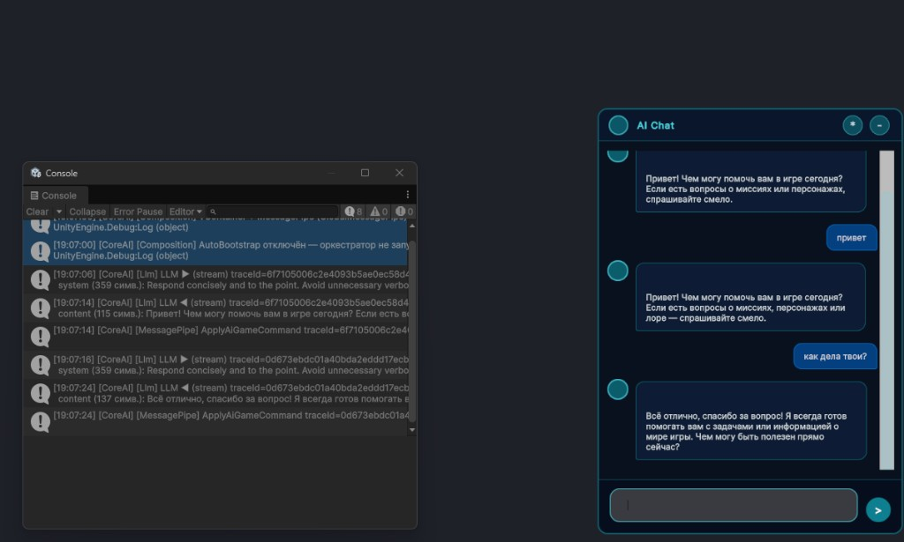

# 🗨️ CoreAI Universal Chat Module

Built-in AI chat for any Unity game. Works out of the box with UI Toolkit.

Regardless of UI, you can call the LLM from any script via the static **`CoreAi`** facade — see [COREAI_SINGLETON_API.md](../../../../Docs/COREAI_SINGLETON_API.md) (cheat sheet, beginner FAQ, tips for experienced developers).

**Sending in two modes**

- **Chat panel** — the player types in the field and presses the button or **Enter**. **Shift+Enter** inserts a newline by default; legacy Shift+Enter-to-send is still available through `CoreAiChatConfig`.
- **Code without the panel** — “send” = `CoreAi.AskAsync("...")` / `CoreAi.StreamAsync` with the same text. Under the hood it uses the same `CoreAiChatService` as the panel while there is a single `CoreAILifetimeScope` in the scene.

The “UI vs code” table is in [COREAI_SINGLETON_API](../../../../Docs/COREAI_SINGLETON_API.md) (subsection *Sending messages: convenient from UI and from code*).

## Example (Play Mode + Console)



`CoreAiChatPanel` (right) during Play Mode, with Unity Console (left) showing `[CoreAI] [Llm]` stream traces and `[CoreAI] [MessagePipe]` `ApplyAiGameCommand` after the reply completes.

## Quick start (1 click)

The menu `CoreAI → Setup → Create Chat Demo Scene` creates a ready scene `Assets/CoreAiUnity/Scenes/CoreAiChatDemo.unity` with all required objects (camera, light, EventSystem, `CoreAILifetimeScope`, UI Toolkit host + `CoreAiChatPanel` with default `CoreAiChatConfig_Demo`). Press Play and chat with the model.

## Manual setup (2 steps)

### 1. Create a config
`Assets → Create → CoreAI → Chat Config`

Configure in the Inspector:
- **Role ID** — agent role (`PlainChat`, `SmartChat`, `Teacher`, your custom one)
- **Header Title** — chat header
- **Welcome Message** — welcome message
- **Session / history** — see [session restore](#persisted-chat-session)
- **Programmatic submit** — see [`SubmitMessageFromExternalAsync`](#programmatic-chat-submit)
- **Enable Streaming** — streamed generation of replies
- **Enable Stop Generation** — when off, the send button is disabled while the AI is replying and never switches to `X`; Esc does not stop the active request.
- **Show Clear Button** — when off, the header clear button is hidden. `CoreAiChatPanel.ClearChat(...)` remains available from code.
- **UI Text Overrides** — optional copy for panel controls: `SendButtonText` (default `>`), `StopButtonText`,
  send/stop tooltips, clear/collapse/open-chat labels and tooltips, and the FAB fallback text. Empty strings are
  respected; older runtime options that do not implement `ICoreAiChatTextOptions` use package defaults.
- **Use fullscreen chat** — stretch the panel to nearly the full screen with margins; off by default (floating bottom-right window using **Chat Width** / **Chat Height**, default **650×910** logical px). Existing `.asset` files keep their serialized width/height until you change them in the Inspector.
- **Send On Shift+Enter** — legacy mode. Off by default: Enter sends, Shift+Enter inserts a newline.
- **Max Message Length** — see [message length limit](#message-length-limit)
- **Hotkeys** — see [below](#chat-hotkeys)
- **Enable Camera Tool** (on by default) — gives every chat agent the runtime camera tool (`camera_capture` / `camera_look` / `camera_list`) so a vision-capable model can see its own work; silently skipped when the agent-vision service is unavailable.
- **Errors** — `Error Message Prefix`, `Timeout Message`, `No Response Message` for the bubbles the panel adds itself.

### 2. Add to the scene

1. Create a UI Toolkit host GameObject:
   - Unity 6.5+: add `PanelRenderer`.
   - Unity 6.3/6.4: add `UIDocument`.
2. Assign UXML: `Packages/com.neoxider.coreaiunity/Runtime/Source/Features/Chat/UI/CoreAiChat.uxml`
3. Add the `CoreAiChatPanel` component
4. Assign your `CoreAiChatConfig`
5. **Done!** The chat uses the current CoreAI backend

`CoreAiChatPanel` supports both host components. On Unity 6.5+ it listens for `PanelRenderer` UI reloads through
`RegisterUIReloadCallback`. On older Unity 6.x versions it uses the existing `UIDocument.rootVisualElement` path.
The custom `CoreAiChatMessageBubbleElement` uses the `[UxmlElement]` / `[UxmlAttribute]` serialization path
(available since Unity 6000.0 and the only one left in Unity 6.6+, where the engine removed legacy UXML
factories and traits), so the package baseline stays at Unity 6000.0+.

### WebGL (browser build)

Browser requests run under the same-origin / CORS / HTTPS rules: streaming goes through the `fetch` bridge, buffered requests through `UnityWebRequest` (see [Streaming and LLM modes](#streaming-and-llm-modes)). After every awaited LLM step the panel returns to the Unity main thread before it touches UI Toolkit (typing indicator, streaming state, bubbles) — `CoreAiWebGlUiThreadMarshaling.SwitchToMainThreadForUiOptional`, a no-op in the single-threaded WebGL player. `CoreAiChatPanelNonStreamingPlayModeTests` covers the non-streaming external-submit path.

**Oversized-message render cap.** A model can occasionally emit a very long reply (for example thousands of characters of leaked reasoning). Drawing one such message into a single bubble overflows UI Toolkit's GPU vertex/index buffer in WebGL (`GfxDevice::CopyBufferRanges: range reads out of bounds` → `RuntimeError: memory access out of bounds` → the build crashes). Every message bubble — assistant and user, live or restored — is capped at **4000 characters** (`MaxAssistantRenderChars`, internal) before it is built: the text is truncated, a dangling ` ``` ` code fence is closed, and an ellipsis is appended. The cap is **render-only**: the full message still lives in chat memory/history and is sent to the backend; only the drawn text is bounded. A clipped live bubble logs a warning with the total, drawn and not-drawn counts (a restored one logs at Info), and a streamed reply logs once when it reaches the cap. A host that subclasses the panel may also cap earlier in its own bubble override; this is the package-level backstop for every consumer.

<a id="message-length-limit"></a>

**Message length limit.** `ICoreAiChatOptions.MaxMessageLength` (`CoreAiChatConfig` → *Input*, default 2000, `0` = no limit) bounds only what the user **types**. Longer input is cut, logged as a warning with the typed length, the sent length and the dropped count, and reported through the public event **`CoreAiChatPanel.OnMessageTruncated(int originalLength, int maxLength)`** so the host can tell the user their message was shortened (a throwing handler is logged and does not stop the send). Host-submitted text — `SubmitMessageFromExternalAsync` / `SubmitMessageFromExternalResultAsync` (briefings, task statements, hint requests) — is **never** cut by this limit (before 7.46.0 it was).

## Custom roles — not locked to “one persona” (`CoreAiChatConfig.RoleId`)

The panel is **not** hardwired to a single teaching or player role. Routing uses the **`Role ID`** field on your **`CoreAiChatConfig`**: it must match a role you registered with **`AgentBuilder`** and **`ApplyToPolicy(AgentMemoryPolicy)`** during composition (typically in your **`LifetimeScope`** setup). Requests from the UI go through the **same orchestrator / MEAI pipeline** as `CoreAi.OrchestrateAsync` / `CoreAiChatService` with the same `roleId`.

<a id="chat-cancellation-scope"></a>

The stock request (`BuildAiTaskRequest`, and the string overloads of `CoreAiChatService`) carries the
actor context that the scene's `IActorIdentityProvider` returns for the role and sets
`CancellationScope` to that actor's connection session id. `QueuedAiOrchestrator` isolates admitted
work by actor, connection and role; roles may be shared by different players. To stop one connection,
call `IActorAiTaskCancellation.CancelActorTasks(actorContext, roleId)` on the orchestrator. Omitting
the role cancels that connection's roles together, including work with an empty logical scope.
`CoreAi.StopAgent(roleId, actorContext)` and `CoreAiChatService.StopAgent(roleId, actorContext)` use
that actor-specific capability; they do not fall back to global cancellation on a custom orchestrator
that lacks it. The panel retains the admitted actor for Stop and also cancels its owned request token.
Global scope/role cancellation remains an administrative orchestration operation.

The host owns account/connection transitions and presentation lifetime. Recreate a panel at an
ownership transition or explicitly retire every cached role before admitting the next owner's work.
`ClearChat(false, false)` clears the active role's view without deleting persisted history or memory;
it does not reset every role cache. `ActorContext.SessionId` is a connection cancellation identity;
`AgentMemoryScope.SessionId` is a separate opaque persistence partition chosen by the game. See the
repository guide `Docs/CoreAI/MULTIPLAYER_SESSIONS.md` for composition and cleanup examples.

**What you do as a host game**

1. Register the role (prompt, tools, memory, chat history, etc.).
2. Point the chat asset at that role id (e.g. `Merchant`, `Teacher`, or your own string).
3. Optionally **subclass `CoreAiChatPanel`** and override **`BuildAiTaskRequest`** to inject `AllowedToolNames`, `ForcedToolMode`, `RequestSystemInstructions`, and other per-turn policy — see [Custom `AiTaskRequest` (tool policy)](#custom-aitaskrequest-tool-policy) below. Per-role runtime context (`## World State`) comes from an `IAgentRuntimeContextProvider` set with `AgentMemoryPolicy.SetRuntimeContextProvider(roleId, provider)`.

**Game-specific panels** (e.g. a project that only adds lesson-slot policy for one role) apply those rules **only in their overrides**; other roles keep the default minimal `AiTaskRequest` unless you add logic for them.

### `AgentMode.ToolsOnly` in chat

`ToolsOnly` is a normal **`AgentBuilder.WithMode(AgentMode.ToolsOnly)`** setting. The chat **does not block** it: the panel still sends an `AiTaskRequest` with the configured `roleId`, and the orchestrator loads that role’s tools and mode from **`AgentMemoryPolicy`**.

**Product / UX expectations**

- The model is steered toward **calling tools** rather than long free-form chat replies. Visible assistant text may be sparse; you may see **tool rounds** (tool call → result → next step) depending on prompts and backend.
- If the UX goal is rich dialogue **and** tools, **`ToolsAndChat`** is usually a better fit. Use **`ToolsOnly`** when the scenario is intentionally **tool-centric** (e.g. scripted flows where the bubble is secondary to spawned UI or commands).

See also [Streaming + Tool Calling](#streaming-and-llm-modes) — streaming/tool behaviour follows the agent’s **`AgentMode`** hierarchy documented there.

### Example — register two custom roles

```csharp
// In LifetimeScope Configure(), after you have SpawnQuizTool or your own ILlmTools:

AgentMemoryPolicy policy = …; // from container or resolved from CoreAI bootstrap

AgentConfig merchant = new AgentBuilder("Merchant")
    .WithMode(AgentMode.ToolsAndChat)
    .WithSystemPrompt("You are a merchant. Prefer tools …")
    .WithTool(/* your ILlmTool */)
    .WithChatHistory(2048) // optional override; builders default to history on with a 30-message cap
    .Build();

AgentConfig blueprintBot = new AgentBuilder("BlueprintBot")
    .WithMode(AgentMode.ToolsOnly)
    .WithSystemPrompt("Respond only via registered tools.")
    .WithTool(/* blueprint tool */)
    .Build();

merchant.ApplyToPolicy(policy);
blueprintBot.ApplyToPolicy(policy);
```

Create two **`CoreAiChatConfig`** assets (or duplicate one) with **Role ID** = `Merchant` or `BlueprintBot`, assign each to separate **`CoreAiChatPanel`** instances **or** switch configs at runtime if your game drives one panel.

<details>
<summary>English: short version</summary>

The panel is **not bound** to a single role: **`CoreAiChatConfig`** sets **Role ID**, the same one you registered through **`AgentBuilder`**. The orchestrator and MEAI are the same for UI and programmatic calls. **`ToolsOnly`** is technically allowed for chat; the panel does not trim the agent mode. For UX, expect tools to dominate rather than conversation. Game code can add policy for its own mode in **`BuildAiTaskRequest`**.
</details>

**Tests:** In this repo, **`CoreAiChatPanelBuildRequestEditModeTests`** and **`CoreAiChatPanelBuildRequestPlayModeTests`** assert the default/minimal **`AiTaskRequest`** and **`BuildAiTaskRequest`** subclass injection (no LLM). **`CoreAiChatServiceIntegrationPlayModeTests`** exercises **`CoreAiChatService`** against a configured backend and multiple role modes (requires a live LLM backend, HTTP or LLMUnity; ignored when none is available). **`CoreAiChatServiceEditModeTests`** (no scene) cover **`TryGetPersistedChatHistory`**, and **`CoreAiChatPanelEditModeTests`** the **`FormatPersistedMessageForUi`** rules the panel uses when **`Load Persisted Chat On Startup`** is on. **`CoreAILifetimeScopeConversationStoreEditModeTests.RegisterAgentMemoryStore_ResolvesScopedMemory_AndKeepsFileTranscriptStore`** asserts that **`CoreAILifetimeScope.RegisterAgentMemoryStore`** exposes scoped decorators over the private **`FileAgentMemoryStore`** backing for **`IAgentMemoryStore`** and **`IConversationTranscriptStore`**. **`AiOrchestratorHistoryFileStoreEditModeTests.RunTaskAsync_WithFileStore_AndPersistChatHistory_WritesDiskReadableByNewStore`** asserts that after **`RunTaskAsync`** with **`PersistChatHistory`** the **`FileAgentMemoryStore`** JSON is readable by a **second** store instance (same as “restart” without Play Mode). **`ChatHistoryPlayModeTests.ChatHistory_PersistentBetweenSessions_Works`** (LLM) checks that a new orchestrator + store still receives prior chat context when the model is asked to recall an earlier secret (requires LLM / ignores when unavailable).

<a id="persisted-chat-session"></a>

## Session restore (history after restart)

By default **`CoreAiChatPanel`** on enable (`OnEnable`) loads saved chat history for the **`Role ID`** from the config into the message list.

| Field in **Chat Config** | Purpose |
|--------------------------|---------|
| **Load Persisted Chat On Startup** | When enabled (default **yes**) — before the welcome message, history is read from **`IAgentMemoryStore`** (`FileAgentMemoryStore`, layout v2: `persistentDataPath/CoreAI/AgentMemory/<stem>.history.jsonl`, one JSON line per record next to the `<stem>.json` memory document; `<stem>` is the role id, or `scope-v1-<sha256>` with a memory scope provider). |
| **Max Persisted Messages For Ui** | How many **last** messages to show on load (default **50** on the asset); **0** = all the store returns. |

**Editor — wipe disk state:** **CoreAI → Delete All Persistent Saves...** removes **`persistentDataPath/CoreAI`** (exit Play Mode first). Helpful when debugging persisted chat or agent memory.

**WebGL:** the same **`FileAgentMemoryStore`** path applies; Unity maps **`persistentDataPath`** to browser storage (IDBFS). Pushing those writes to IndexedDB is the **engine's** job: the web template must pass **`config.autoSyncPersistentDataPath = true`** to **`createUnityInstance()`**, and Unity then persists on every write, rename and delete. CoreAI does not drive **`FS.syncfs`** by hand — Unity 6.3 deprecated that path and its completion callback never fired, so awaiting it only produced false failures for data that was in fact durable. **`CoreAiWebGlPersistence.Sync()`** now answers one question immediately: is that automatic persistence armed? A build cannot ship without it (**`CoreAIWebGlPersistentDataSyncBuildGuard`**), and a page that somehow lacks it gets a visible error instead of a silent loss. Conversation **summaries** for compaction stay in-memory on WebGL (see **`CoreAILifetimeScope`**); only agent memory / chat JSON uses the file store.

**Requirements:** for persisted restart restore, **`WithChatHistory`** and **`PersistChatHistory`** must be enabled in `AgentMemoryPolicy`. Runtime chat history is on by default for `AgentBuilder` and built-in role policy entries (`MaxChatHistoryMessages = 30`), but disk restore still requires `PersistChatHistory`. Built-in chat roles support persisted restore out of the box: **`PlainChat`** (history + no MemoryTool) and **`SmartChat`** (history + MemoryTool). For custom chat roles (e.g. `Teacher`), call `AgentBuilder.WithChatHistory(..., persistBetweenSessions: true)`; otherwise history is not written to disk. Use `AgentBuilder.WithoutChatHistory()` for token-sensitive roles that should not receive recent raw turns.

**Welcome message:** if after load the scroll area **already has** messages, **Welcome Message** is not added (to avoid duplicating “Hello!” on top of the dialog). If there is no history, the welcome message is shown as before.

**Repeated `OnEnable`:** before hydration the list is **cleared**, then the store is read again — duplicates do not accumulate when toggling the panel object.

**Extension:** override **`HydrateStartupMessagesFromStore`** or **`TryAppendPersistedChatHistoryFromStore`** if you need a custom message source.

**Clearing:** every clear path (the header **`coreai-chat-clear`** button, `ClearChat()`, `ClearChat(bool, bool)`) first calls `protected virtual void OnChatClearing(bool clearChatHistory, bool clearLongTermMemory)`, before generation is stopped and the scroll is emptied. A host that inserts its own rows into the feed (inline cards, widgets) closes their state there, so nothing stays live without a row in the tree. An exception from the override is logged and the clear still happens.

**Custom persistence:** chat hydration reads whatever `IAgentMemoryStore.GetChatHistory` returns (default: `FileAgentMemoryStore`). To use **PlayerPrefs** or **cloud** for the same contract (session + MemoryTool), see [`Docs/MEMORY_STORE_CUSTOM_BACKENDS.md`](../../../../Docs/MEMORY_STORE_CUSTOM_BACKENDS.md).

## Panel collapse (FAB)

On narrow screens (width ≤ 720 or height ≤ 560) the chat **starts collapsed** by default: only the circular **`coreai-chat-fab`** button is visible in the bottom-right. The **`coreai-chat-collapse`** button (`—`) in the header collapses the panel back to the FAB.

- **Persistence:** collapsed/expanded choice is stored in `PlayerPrefs` under `CoreAI.Chat.Collapsed` (integer: `1` = collapsed). If the key is unset, the mobile layout defaults to collapsed.
- **API from code:**
  - `bool IsCollapsed { get; }`
  - `void SetCollapsed(bool collapsed, bool persist = true)` — expand before a cutscene or collapse after; with `persist: false` the state is not written to `PlayerPrefs`.
- **FAB icon:** the open-chat hotkey (default **C**); when the open shortcut is off, **FAB Fallback Text** (default `...`).
- **UXML:** elements `coreai-chat-collapse` (in `coreai-chat-header`) and `coreai-chat-fab` (root, before `coreai-chat-root`). After `#coreai-typing-indicator`, the template includes optional **`coreai-long-request-hint`** (`Label`, `picking-mode="Ignore"`) — a **“still working”** line shown **≥ ~3 s after the LLM turn starts** while no streaming bubble is active, as in-flight feedback for long turns. **Stop** and **StartStreaming** clear it immediately. Text comes from **`CoreAiChatConfig.LongRequestHintFormat`** (default `Response is still being generated... ~{elapsed}s`); placeholder **`{elapsed}`** = whole seconds since the hint line became eligible (starts at the configured minimum, then counts up). Empty format string disables the line. If you fork UXML and omit this name, `CoreAiChatPanel` skips the feature (`Q` returns `null`).
- **USS:** `.coreai-chat-header-btn`, `.coreai-collapsed` on the container, `.coreai-chat-fab` / `.coreai-chat-fab-icon`. **ScrollView:** default theme uses **no right padding** on `.coreai-chat-scroll` and zero horizontal **margin/padding** on `unity-scroll-view__content-and-vertical-scroll-container` and the vertical scroller so the **scrollbar track sits flush with the panel’s inner right edge** (no “floating” gap inside the bar).

Custom layout: if you **copy** UXML into your project, add the same element names or override bindings in a subclass of `CoreAiChatPanel` (override `BindUI` and call `base.BindUI()` or duplicate the logic).

<a id="chat-hotkeys"></a>

## FAB / Esc hotkeys (configured in `CoreAiChatConfig`)

All toggles are in the **CoreAI → Chat Config** asset on the panel (`CoreAiChatPanel.config`):

| Field | Purpose |
|-------|---------|
| **Enable Open Chat Keyboard Shortcut** | When off — collapsed (FAB) chat opens **only by clicking** the FAB, no key. |
| **Open Chat Hotkey** | `KeyCode` to open collapsed chat (default **C**). For **A–Z**, both key code and typed character are considered (without Ctrl / Cmd / Alt). |
| **Enable Escape Chat Shortcuts** | When off — **Esc** is not handled by the panel (useful if Esc is fully reserved for FPS / pause). |
| **Chat Requires Visible Cursor** — see [cursor gating](#chat-cursor-gating) | When on (**default**) — the open hotkey and Esc only react while the mouse cursor is visible and unlocked. When off — hotkeys work regardless of cursor state. |

### From code (on top of config)

`CoreAiChatPanel` has **runtime overrides** (they take precedence over `CoreAiChatConfig` until cleared):

| Method / property | Purpose |
|-------------------|---------|
| `SetRuntimeEscapeChatShortcutsEnabled(false)` | Fully disable Esc for chat (stop generation + collapse) without changing the asset. |
| `SetRuntimeEscapeChatShortcutsEnabled(null)` | Follow **Enable Escape Chat Shortcuts** in config again. |
| `SetRuntimeOpenChatKeyboardShortcutEnabled(bool?)` | Enable/disable the key to open collapsed chat. |
| `SetRuntimeOpenChatHotkey(KeyCode?)` | Change the open key at runtime. |
| `ClearRuntimeHotkeyOverrides()` | Clear all three overrides. |
| `EffectiveOpenChatKeyboardShortcutEnabled`, `EffectiveOpenChatHotkey`, `EffectiveEscapeChatShortcutsEnabled` | Effective behavior (config + overrides). |

Example: give Esc only to the player while the world map is open:

```csharp
void OnWorldMapOpened()
{
    chatPanel.SetRuntimeEscapeChatShortcutsEnabled(false);
}

void OnWorldMapClosed()
{
    chatPanel.SetRuntimeEscapeChatShortcutsEnabled(null); // or true
}
```

**Default behavior (both flags on):**

- While chat is **collapsed** — the configured key opens the panel (handled in `OnRootKeyDown` at `TrickleDown` from the current UI Toolkit root).
- While chat is **expanded** — **Esc** stops active generation if a request/stream is in progress (only when **Enable Stop Generation** is on; otherwise Esc does nothing during a turn), and otherwise **collapses** the panel to the FAB.
- Additionally **`Update()`** polls **Legacy `Input.GetKeyDown`** only when the UITK root has **no** focused element (`Root.focusController.focusedElement == null`) — so it coexists with character control when focus is not in UI. On **WebGL**, the same `Update()` still resets `WebGLInput.captureAllKeyboardInput`.

**Limitation:** if *Player Settings* use only the **New Input System** without Legacy, `Input.*` is unavailable — the `Update` branch is skipped silently; keys still work while keyboard focus is in the UITK tree (or add your own input layer / `Both` in Active Input Handling).

**Gameplay integration:** when `SetCollapsed` changes the state, `protected virtual void OnCollapsedStateChanged(bool collapsed)` is called — in a subclass you can hook pause, cursor, etc., without pulling game controllers into CoreAI.

Subclasses that override **`Update()`** must call **`base.Update()` first** (otherwise you lose the WebGL fix, hotkey polling, and the **long-request hint** tick).

<a id="chat-cursor-gating"></a>

### Cursor gating (first-person / locked-cursor games)

By default (**`ChatRequiresVisibleCursor` = true**), the open hotkey and Esc only react while
**`UnityEngine.Cursor.visible`** is true and **`UnityEngine.Cursor.lockState`** is not **`Locked`**. This
keeps the chat out of the way while a first-person controller owns the mouse: with the cursor locked and
hidden (the common FPS convention), pressing the open hotkey does not pop the chat over gameplay, and a
gameplay key that happens to match the hotkey is not intercepted.

- **Mid-turn lock:** if the cursor gets locked/hidden while the chat input has keyboard focus (e.g. the
  player re-enters gameplay), the panel releases that focus on the next frame so movement keys never type
  into the chat. It does **not** auto-refocus when the cursor becomes visible again — the player has to
  reopen chat explicitly (click the FAB or press the open hotkey).
- **`Confined`** lock mode still counts as "visible" (the cursor is clamped to the window, not hidden), so
  chat hotkeys keep working under `CursorLockMode.Confined`.
- **Runtime override:** `SetRuntimeChatRequiresVisibleCursor(bool?)` / `EffectiveChatRequiresVisibleCursor`,
  same precedence and `ClearRuntimeHotkeyOverrides()` participation as the other hotkey overrides above.
- Set `ChatRequiresVisibleCursor = false` (asset or `CoreAiChatOptions`) to let chat hotkeys react
  regardless of cursor state.

**CoreAI Hub:** `CoreAiHubWindow` mirrors this with its own `requireVisibleCursor` field (default on),
gating both Escape and its optional `toggleHotkey`. The Hub's chat tab additionally disables the embedded
panel's own Escape handling (`SetRuntimeEscapeChatShortcutsEnabled(false)`) so Escape always belongs to
the Hub — otherwise Escape would collapse the chat *inside* its tab instead of the Hub itself. A page can
implement `CoreAI.Hub.IHubEscapeHandler.TryHandleEscape()` to consume Escape before the Hub falls back to
collapsing. **`HubChatPage`'s default is to never consume Escape**: pressing it always collapses the Hub
immediately, and any in-progress generation keeps running in the background — the answer still appears
normally once the Hub is expanded again. Set `HubChatPage.StopGenerationOnEscape = true` (constructor
parameter or property, also forwarded by `HubBuiltInPages.RegisterAll(..., chatStopGenerationOnEscape: true)`)
to opt into the first Escape stopping an in-flight turn instead (consuming that key-press; a second Escape
then collapses the Hub).

## Runtime options vs config asset

`CoreAiChatConfig` is a Unity authoring asset, not the mutable runtime contract.
It keeps private `[SerializeField]` fields, Inspector labels, avatar `Sprite`, hotkey `KeyCode`, layout and UI copy.
Portable chat behavior is represented by `ICoreAiChatOptions` / `CoreAiChatOptions` in `Assets/CoreAI`.

Use the asset when designers configure the panel in the Inspector:

```csharp
CoreAiChatOptions snapshot = chatConfig.ToOptions();
```

Use runtime options when tests, bootstrap code or a host app needs to change role/routing/history/streaming/tool diagnostics/input limits without creating or mutating a `ScriptableObject`:

```csharp
chatPanel.SetRuntimeOptions(new CoreAiChatOptions
{
    RoleId = "SmartChat",
    ShowToolCallsInChat = false,
    EnableStreaming = true,
    EnableStopGeneration = false,
    ShowClearButton = false
});

chatPanel.ClearRuntimeOptions(); // fall back to assigned CoreAiChatConfig or built-in defaults
```

### Agent/role dropdown (switch the responding agent at runtime)

Set `AllowAgentSwitching = true` (on the `CoreAiChatConfig` asset or a `CoreAiChatOptions` snapshot) to
show a role dropdown in the chat header. The user can switch the responding agent live
(`Creator`, `Builder`, `Analyzer`, `Programmer`, `AINpc`, `CoreMechanicAI`, `PlainChat`, `SmartChat`, `Merchant` —
`BuiltInAgentRoleIds.AllBuiltInRoles`); the choice affects new messages only, and each role keeps its own
history/memory on the service side. Prefer a light, tool-free role like `SmartChat` for plain chat (no tool
schemas in the prompt → faster first token) and `Programmer` when the user asks for code/mechanics.

It can also be turned on from code at runtime (the FullAccess Hub demo's `FullAccessHubDemoController` and
the Hub chat page do this):

```csharp
chatPanel.EnableAgentSwitching();
```

### What the model receives (telemetry envelope)

The user message is composed by `AiPromptComposer.BuildUserPayload`. It is wrapped in a small JSON envelope
— `{"telemetry":{...},"hint":"<your text>","ai_task_source":"..."}` — **only when the game has published
telemetry** for that turn. Autonomous agents (e.g. the RogueliteArena `Creator`/`Analyzer`) read the
`telemetry` field to plan from live game-state. When there is no telemetry (plain chat, or any turn without
game-state) the composer sends the **raw hint text** instead, so a conversational model is never handed a
confusing JSON wrapper. Telemetry comes from the registered `ISessionTelemetryProvider`; the stock
`SessionTelemetryCollector` takes values through `SetTelemetry(key, value)` (string, int, float or bool).
Roles with a custom user-template are unaffected (the template controls their shape).

**History stays clean, state stays fresh.** Only the raw user intent (`AiTaskRequest.Hint`) is persisted to
an agent's chat history — never the composed envelope — so stale telemetry snapshots don't pile up across
turns. Live state reaches the model two fresh ways: the current turn's payload (ephemeral, not stored) and,
preferably, an on-demand `game_state` tool the agent calls when it needs current values. Enable the tool per
role with `CoreAi.RegisterGameStateTool(roleId)`; it reads the live `ISessionTelemetryProvider` and returns
`{"telemetry":{...}}`. This mirrors how production agents fetch state via tools instead of baking it into
every message.

Rule for tests: create `CoreAiChatOptions` for mutable behavior. Use `ScriptableObject.CreateInstance<CoreAiChatConfig>()` only for asset defaults, Inspector serialization or `ToOptions()` / `ApplyOptions(...)` mapping tests. Do not write private config fields via reflection.

<a id="programmatic-chat-submit"></a>

## Programmatic submit from code (cutscene, quest, world button)

Get a reference to the panel (`GetComponent<CoreAiChatPanel>()`, scene singleton, etc.) and call:

```csharp
using System;
using System.Threading;
using System.Threading.Tasks;
using CoreAI.Chat;

// Normal path: user bubble in chat + LLM request (same as after typing in the field)
string reply = await chatPanel.SubmitMessageFromExternalAsync(
    "Tell me about the quest",
    cancellationToken: CancellationToken.None);

// Silent call: do not duplicate text in UI, orchestrator only
CoreAiChatExternalSubmitOptions opt = new CoreAiChatExternalSubmitOptions { AppendUserMessageToChat = false };
reply = await chatPanel.SubmitMessageFromExternalAsync("Secret context for the model", opt);

// Narrative in UI only, no LLM (simulated assistant reply)
CoreAiChatExternalSubmitOptions fake = new CoreAiChatExternalSubmitOptions
{
    AppendUserMessageToChat = true,
    SimulatedAssistantReply = "Welcome to the city!"
};
reply = await chatPanel.SubmitMessageFromExternalAsync("…", fake);
```

| Field `CoreAiChatExternalSubmitOptions` | Default | Purpose |
|---------------------------------------|---------|---------|
| **`AppendUserMessageToChat`** | `true` | Add a **user** bubble with the request text before the turn. |
| **`SimulatedAssistantReply`** | `null` | If set to a non-empty string — **LLM is not called**; an assistant bubble with this text is appended (after think strip and `FormatResponseText`). |
| **`Attachments`** | `null` | `IReadOnlyList<AiAttachment>` sent with the message: images for a vision-capable model, text-like files inlined into the prompt. With at least one attachment the text may be blank; the user bubble then shows one `[attachment: name type size]` line per file and `OnMessageSending` is skipped. The list and bytes are not copied — keep them unchanged until the submit completes. |
| **`DeadlineCancellationToken`** | `default` | The host's own deadline, kept apart from the caller token. When it fires while the caller token is alive the turn ends as `Timeout` (`ResolveTimeoutMessage`) and the metrics record `DeadlineCancellation`; the panel passes it to `CoreAiChatService` separately. A deadline armed on the caller token itself (`CancelAfter` on the token you pass) is reported as a cancellation. An already-elapsed deadline admits nothing (no user bubble, no `OnUserMessageSent`, no service call). The token's source must outlive the turn. |

```csharp
// Host deadline: a timeout, not a cancellation
using CancellationTokenSource deadline = new CancellationTokenSource(TimeSpan.FromSeconds(45));
CancellationToken playerStopToken = CancellationToken.None; // or your own stop source
CoreAiChatExternalSubmitOptions timed = new CoreAiChatExternalSubmitOptions { DeadlineCancellationToken = deadline.Token };
reply = await chatPanel.SubmitMessageFromExternalAsync("Summarize the lesson", timed, playerStopToken);
```

**Return value:** assistant reply string (including simulated), or `null` if the panel is inactive or busy with another request, the input is empty (blank text without attachments, or text that `OnMessageSending` emptied), or the turn failed or was interrupted (timeout **or** cancellation — the string API returns `null` for both).

**Typed result:** `SubmitMessageFromExternalResultAsync` takes the same arguments and returns a `CoreAiChatExternalSubmitResult` for this one call. It never retries an admitted turn (it may already have run tools); presenting the failure is up to the caller.

| Member | Meaning |
|--------|---------|
| `Admitted` | `true` once this call owns a panel turn. Admission is not success. |
| `TurnGeneration` | The panel turn generation this call owns; `0` when nothing was admitted. |
| `Rejection` | Why nothing was admitted: `None` (admitted), `Busy`, `Inactive`, `EmptyInput`, `Filtered` (`OnMessageSending` emptied the text), `Cancelled` (caller token or deadline already fired), `ServiceUnavailable`, `TypedResultsUnavailable` (the orchestrator exposes no typed results). |
| `Completion` | `LlmCompletionResult`: `Ok`, `ErrorCode` (`Timeout`, `Cancelled`, `EmptyResponse`, provider codes…), `Error`, final `Content`, token usage, executed tool calls and HTTP metadata. |

**Interrupted turns:** a timeout (library timeout, the service idle deadline, or a fired `DeadlineCancellationToken`) goes to `ResolveTimeoutMessage(false)`; any cancellation (your caller token, the panel's stop source, `CoreAi.StopAgent` from elsewhere) goes to `ResolveCancelledMessage()`, whose default `null` adds nothing to the chat. A UI Stop reaches neither hook. An already-elapsed deadline shows `ResolveTimeoutMessage(false)` once and returns `null`; an already-cancelled caller token does nothing at all. To tell timeout and cancellation apart in code, use **`SubmitMessageFromExternalResultAsync`** and read `Completion.ErrorCode` (`Timeout` / `Cancelled`); it rejects an already-fired token or deadline before admission with the same codes. Details: [ARCHITECTURE — Timeout & Retry Rule](../../../../Docs/ARCHITECTURE.md#timeout--retry-rule-v151).

**Hooks:** `OnMessageSending` is still invoked for non-blank text; for a real reply — `OnResponseReceived` / **`OnAiResponseCompleted`**.

## Stopping generation (Stop)

`CoreAiChatConfig.EnableStopGeneration` controls whether the player can stop an active AI turn from this UI. It is **on by default**. When disabled, the send button keeps the normal `>` label, stays disabled while the request is running, does not receive `.coreai-chat-send-button-stop`, and Esc does not cancel the active request. Code can still call lower-level cancellation APIs if the host game owns that flow.

There is no separate “stop” button in the **header** — stop only via the send button and Esc (below). The send button stays enabled while it shows `X`, and the active request CTS is cancelled even if `CoreAi.StopAgent(roleId)` is unavailable.

- **Send (Enter) vs stop:** While a turn is in progress, pressing **Enter** (or your configured send shortcut in the text field) does **not** stop generation — it is ignored until the turn completes. **Stop** is only the send button while it shows **`X`**, plus **Esc** when **Enable Escape Chat Shortcuts** is on. This prevents accidental cancellation during the orchestrator tail (e.g. chat history append + `ApplyAiGameCommand`) after the last streamed token.
- **Busy until enumerator ends:** The panel treats the request as active until the streaming **enumerator** fully finishes (not merely when the model emits a terminal chunk). That keeps the UI and orchestrator in sync with `QueuedAiOrchestrator` / `AiOrchestrator` post-stream work.

During active generation `CoreAiChatPanel` switches the send button to stop mode:

- button label: `X` instead of `>`;
- tooltip: `CoreAiChatOptions.StopButtonTooltip` (the shipped default is a Russian-language "Stop generation (Esc)"; override it through **UI Text Overrides**);
- style: red (`.coreai-chat-send-button-stop`).

Stop the current reply in two ways:

- press the send button again (in `Stop` mode);
- press `Esc` while the chat is generating (if **Enable Escape Chat Shortcuts** is on in `CoreAiChatConfig`).

The public `StopAgent()` runs the same stop. Under the hood it advances `CurrentTurnGeneration`, calls `CoreAi.StopAgent(roleId)` (falling back to `CoreAiChatService.StopAgent`), cancels the token of the request the panel owns (this ends the turn, queued or running), and replaces the panel's root cancellation source. Text already streamed stays in the bubble; no extra cancellation message is added.
After stop, `CoreAiChatPanel` immediately clears streaming UI (`FinishStreaming` / `HideTypingIndicator`) and resets `_isSending` / `_isStreaming`; covered by `CoreAiChatPanelEditModeTests` and `CoreAiChatPanelStopPlayModeTests`.

Disabling the panel advances `CurrentTurnGeneration` before dropping the UI references (and cancels any
request still active at that point). The old streaming or buffered continuation is therefore stale even if the
same GameObject is enabled again immediately: it cannot append a timeout/error/answer into the rebound
tree, release a successor bubble, reset the successor's busy state, or steal focus. Lifecycle teardown
itself resets the old busy state, so the re-enabled panel can start a new turn without waiting for the
cancelled provider call to unwind.

That is the default (`protected virtual bool CancelsActiveRequestOnDisable => true`). A host where disabling
the panel only means "the person left focus" overrides it to `false`: then disable touches neither the
generation, the request nor the busy flags, and the turn runs to the end — its answer reaches history, it calls
`OnResponseReceived`, and once the tree is bound again the segment still streaming opens a new bubble. The UI
tree is released on disable either way.

Lifecycle and turn ownership are installed before public busy notifications. Consequently:

- `SubmitMessageFromExternalAsync` returns `null` without calling a provider while the component is inactive;
- `OnDisable` marks the lifecycle inactive before cancellation can publish `BusyStateChanged(false)`, so a
  reentrant submit from that callback is rejected;
- `BusyStateChanged(true)` observes the new generation and active request CTS already installed. Calling
  `StopAgent()` synchronously from that callback cancels ownership before provider entry;
- a `BusyStateChanged(false)` handler raised by `StopAgent()` may immediately submit a successor turn. Stop
  has no cleanup tail after that notification, so it cannot clear the successor's busy state, CTS, or bubble.

The real browser path (visible streaming, Stop on a long stream, a working turn after Stop) is verified by WebGL player tests on the `CoreAiChatDemo` scene: see [Verifying WebGL streaming](../../../../Docs/STREAMING_ARCHITECTURE.md#verifying-webgl-streaming).

### Persisted history + assistant display

- **Hydrated user messages:** If the store contains the composer JSON shape (`{"telemetry":...,"hint":"...","ai_task_source":"..."}`), the UI shows only the **`hint`** string in the user bubble (same text the player typed conceptually).
- **Assistant bubbles:** Leading spaces and newlines at the start of a reply are trimmed for display so the first line does not sit under a blank “gap”.

<a id="chat-feed-scrolling"></a>

## Message feed: scrolling, jump-to-latest button, unread badge

The feed works like a messenger. By default an assistant message **never moves the view**: whatever the reader is looking at stays in place and new messages grow below. When an answer lands below the visible edge, a round **jump-to-latest** button (`↓`) over the bottom of the feed shows it, and its badge counts the assistant messages that arrived meanwhile.

- **Your own actions go to the bottom** in every policy: a message you send, restored history (persisted or the per-role cache after an agent switch) and the jump-to-latest button. Standing at the bottom again hides the button and marks everything read.
- **The button** is shown exactly while the feed is away from the bottom (8 px tolerance). Clicking it scrolls to the bottom and makes the feed follow again (`FollowFeedAfterLearnerAction`).
- **The badge** counts assistant messages that were appended while the reader could not see them (up to `99`): message bubbles and each streamed reply bubble. Restored history, your own messages and tool-call rows never count. Under `KeepPosition` a message counts even when you stood at the bottom, because the feed does not move to show it; the count resets whenever the feed stands at the bottom after layout (for example when the new message still fits on screen).
- **Your scroll is never undone.** The panel remembers every scroll value it sets itself; any other change is the reader's. Scrolling away from the bottom cancels pending snaps (for example the settle passes of a scroll to the bottom) and holds the view until your next own action — a sent message, the button, or returning to the bottom. In every policy except `Bottom` this hold also stops turn anchors and reveals.

**Scroll policy** — the **Scroll Anchor** field on `CoreAiChatPanel` (serialized `scrollAnchor`), or override `protected virtual ChatScrollAnchor ScrollAnchor` (the inspector value is then ignored):

| `ChatScrollAnchor` | What assistant content does to the view |
|--------------------|------------------------------------------|
| `KeepPosition` (**default**) | Never moves it; the button and badge announce new messages. |
| `FollowIfAtBottom` | Follows new content (including the streamed tail) while the reader stands at the bottom; stops the moment they scroll up. |
| `AssistantMessageStart` | Pins the top of the turn's first assistant row to the top of the viewport and does not chase the streamed tail. |
| `Bottom` | Classic chat: every message and streamed chunk pins the view to the bottom. |

`CoreAiChatPanel.MovesViewForAssistantContent(anchor, readerAtBottom)` states the rule as a pure function.

**Markup.** The feature is opt-in by markup: the default `CoreAiChat.uxml` has a `Button` named `coreai-chat-scroll-to-latest` and a `Label` named `coreai-chat-unread-count` (inside `coreai-chat-scroll-to-latest-wrap`). A custom UXML without the button simply has none. With `KeepPosition` and no button there is no sign that an answer arrived below the edge, so the panel logs one warning at bind: add the button and badge, or choose `FollowIfAtBottom`. The default show/hide toggles the `coreai-chat-scroll-to-latest--visible` USS class (animated by USS transitions) and lets a hidden button ignore clicks.

**Hooks for subclasses and hosts:**

| Member | Purpose |
|--------|---------|
| `UnreadMessageCount` | Current badge value (`0` without a button). |
| `ApplyScrollToLatestVisibility(VisualElement, bool)` | Override to show/hide the button and badge with your own animation. |
| `OnScrollToLatestRequested()` | Override to react to the button; the default calls `FollowFeedAfterLearnerAction()`. |
| `FollowFeedAfterLearnerAction()` | Public. Call it when the reader acts inside the feed without sending a message (answers an embedded card, presses a button in a message): the feed goes to the bottom and follows again. |
| `NoteAssistantContentArrived()` | Call **before** adding your own assistant row (a card, an interactive block) so it counts as unread like a message. |
| `IsRestoringHistory` | Override to return `true` while you re-render already delivered history through `AddMessage`, so it never becomes unread. |
| `ScrollForNewAssistantRow`, `ScrollToRevealRow`, `ScrollToTurnAnchor` | Scroll helpers that follow the active policy and the reader's hold, for host-inserted rows and re-layout (a label replaced by rendered markdown). `ScrollToRevealRow` scrolls the minimum needed to show a whole row. |
| `ScrollToBottom()` | Always goes to the bottom (coalesced, with settle passes for late layout). |

The jump-to-latest button keeps working when a host takes the chat tree out of its panel and re-inserts the same tree without `BindUI` (a tab switch). `CoreAiChatFeedScrollBehaviourEditModeTests` and `ChatScrollAnchorEditModeTests` cover the behaviour.

## Clearing context from UI

The **`C`** (Clear) button in the header (`coreai-chat-clear`) calls `ClearChat()`:

- stops an active turn, then clears messages in the UI;
- by default clears only chat history (`clearChatHistory: true`, `clearLongTermMemory: false`);
- shows the **Welcome Message** again.

`CoreAiChatConfig.ShowClearButton` controls only the visible header button. It is **on by default**. When disabled, the button is hidden from the panel, but the public `ClearChat(...)` methods below still work for code-driven resets, admin panels, scene transitions, or tests.

The circular **FAB** shows the open-chat hotkey (default **C**) as its icon when collapsed — that is the **open-chat** affordance, a different control from the header clear button.

For manual granular control, use the overload:

```csharp
// Short-term context only (same as default clear button)
chatPanel.ClearChat(clearChatHistory: true, clearLongTermMemory: false);

// Full reset: short-term context + long-term memory
chatPanel.ClearChat(clearChatHistory: true, clearLongTermMemory: true);

// Long-term memory only
chatPanel.ClearChat(clearChatHistory: false, clearLongTermMemory: true);
```

## Prompt architecture (4 layers + tail)

| Layer | Source | Example |
|-------|--------|---------|
| 1 | `ICoreAISettings.UniversalSystemPromptPrefix` (**General → Universal Prompt Prefix**) | "Keep answers short. Do not discuss forbidden topics." |
| 2 | Role base prompt: `AgentPromptsManifest`, `Resources/AgentPrompts/System/<RoleId>.txt`, or the built-in fallback | `Resources/AgentPrompts/System/Teacher.txt` |
| 3 | `AgentBuilder.WithSystemPrompt()` | "You are teaching a student about: for loops" |
| 4 | Full role tool contract (every tool registered for the role, canonical order) | `AgentBuilder.WithTool(...)`, skills, built-ins |

The four layers form the byte-stable, cacheable system prefix. Memory, pending memory updates, the conversation summary, per-request instructions and runtime context (`## World State`) are sent afterwards, in the ordered tail of `LlmCompletionRequest.ChatHistory`, never in that prefix. Exact layout: [DEVELOPER_GUIDE §3.5](../../../../Docs/DEVELOPER_GUIDE.md#35-prompt-layers-what-the-model-actually-sees).

`WithSystemPrompt(...)` replaces the current builder-owned Layer 3 fragment by default. Use `AppendSystemPrompt(...)` or `WithSystemPrompt(..., SystemPromptWriteMode.Append)` only when several code-owned prompt fragments should be intentionally combined.

### Overriding universalPrefix

By default **universalPrefix applies to all roles**. For a fully custom prompt without shared rules, use `.WithOverrideUniversalPrefix()`:

```csharp
// Regular agent — prefix + base + additional (+ tool contract)
new AgentBuilder("Teacher")
    .WithSystemPrompt("You are a Python teacher.")
    .Build();

// Custom agent — WITHOUT universalPrefix (base + additional only)
new AgentBuilder("JsonParser")
    .WithSystemPrompt("You are a strict JSON parser.")
    .WithOverrideUniversalPrefix()  // ← prefix skipped
    .Build();
```

## Streaming and LLM modes

| Mode | Mechanism | Real streaming? |
|------|-----------|-----------------|
| **LocalModel** | LLMUnity's built-in OpenAI-compatible server (`LlmUnityServerPort`) via `OpenAiChatLlmClient`, SSE (`stream: true`) | ✅ Yes (not available on WebGL) |
| **ClientOwnedApi** | OpenAI-compatible SSE (`stream: true`) | ✅ Yes; in the WebGL player only with `WebGlNativeStreaming` (see below) |
| **ClientLimited** | Local limits → OpenAI-compatible SSE | ✅ Yes; in the WebGL player only with `WebGlNativeStreaming` |
| **ServerManagedApi** | Backend proxy using an OpenAI-compatible streaming endpoint | ✅ Yes when the backend streams SSE; same WebGL rule |
| **Offline** | Deterministic local response | Single final chunk |

For one global mode use `CoreAISettingsAsset`. For mixed-role chat setups use `LlmRoutingManifest`, for example `SmartChat → ServerManagedApi` and `Analyzer → ClientLimited`.

> ⚠️ **WebGL player.** `UnityWebRequest` does not deliver SSE incrementally, so streaming in the player goes through
> the native **fetch** + **ReadableStream** bridge (`CoreAiSseFetch.jslib` → `FetchSseOpenAiTransport`), switched by
> **`CoreAISettingsAsset.WebGlNativeStreaming`** (default **on**; assets created before v1.6.13 may still have it off).
> With the flag off, **`CoreAiChatService.IsStreamingEnabled`** returns **`false`** in the player and the chat uses
> **non-streaming** HTTP even when `CoreAiChatConfig.EnableStreaming` is on — logs show **`LLM <`** **without**
> **`(stream)`**, and the full reply lands at once. Either way the browser's **CORS** / same-origin rules apply to your
> LLM host. See [`STREAMING_ARCHITECTURE.md`](../../../../Docs/STREAMING_ARCHITECTURE.md#2-transport-details) and
> [`WEBGL_BUILD_TROUBLESHOOTING.md`](../../../../Docs/WEBGL_BUILD_TROUBLESHOOTING.md).

### Streaming + Tool Calling (single-cycle)

If in a streaming response the model first emits tool-call JSON, CoreAI runs a single cycle:

1. receives the stream and detects tool-call payload;
2. runs the matching tool;
3. appends the tool result to dialog history;
4. continues generation with the next streaming step.

Tool JSON is not rendered in assistant bubbles: the player only sees the final readable assistant reply.

#### Optional in-chat tool diagnostics (`CoreAiChatConfig.ShowToolCallsInChat`)

- **Default:** `ShowToolCallsInChat` is **off** (Inspector: **UI - Streaming** header on the chat config asset).
- When **on**, `CoreAiChatPanel` subscribes to **`CoreAi.OnToolExecuted`** and appends a separate muted row for calls whose **`roleId`** matches the panel’s **`RoleId`** (same rule as other chat routing).
- Rows are **not** written to `IAgentMemoryStore` / persisted chat history — session UI only.
- Customize text via **`CoreAiChatPanel.FormatToolExecutedForChat`** in a subclass, or keep the default formatter **`CoreAiToolCallChatFormatter.BuildDisplayText`** (truncated JSON for args/result).
For gameplay systems, analytics, or tests that need tool lifecycle data without rendering chat rows, use the public observability API:

```csharp
IDisposable sub = CoreAi.SubscribeToolCalls(record =>
{
    if (record.Status == "completed")
    {
        Debug.Log($"{record.Info.RoleId} used {record.Info.ToolName}");
    }
});
```

`CoreAi.GetToolCallHistorySnapshot()` returns recent started/completed/failed records, and `CoreAi.ClearToolCallHistory()` clears that diagnostic buffer.

Tool rounds inside a streamed turn apply to roles with tools (`AgentMode.ToolsAndChat`, `AgentMode.ToolsOnly`). Whether a turn streams at all follows the hierarchy below for every `AgentMode`.

### Streaming settings hierarchy

Priority order (highest to lowest):

1. **UI flag** — `CoreAiChatConfig.EnableStreaming` (chat panel Inspector). If off → always non-streaming; other layers ignored.
2. **Per-agent override** — `AgentBuilder.WithStreaming(true/false)` (registered in `AgentMemoryPolicy`). When set, it wins over the global flag in both directions.
3. **Global** — `ICoreAISettings.EnableStreaming` — **`CoreAISettings` Inspector → Essentials → Global streaming** (default **on**).
4. **WebGL player** (`UNITY_WEBGL && !UNITY_EDITOR`) — incremental SSE needs **`CoreAISettingsAsset.WebGlNativeStreaming`** (native fetch bridge; Inspector: **Advanced Settings → WebGL** tab, **Native SSE (fetch)**). **`CoreAiChatService.IsStreamingEnabled`** checks this first; it reads the flag from the DI-registered **`CoreAISettingsAsset`** when present, otherwise from **`CoreAISettingsAsset.Instance`**, so streaming is not accidentally disabled when the scope asset and the Resources default differ.

```csharp
// Example: chat agent always streams regardless of global setting
new AgentBuilder("SmartChat")
    .WithSystemPrompt("You are a friendly assistant.")
    .WithStreaming(true)
    .Build();

// Example: parser agent never streams (needs full JSON at once)
new AgentBuilder("JsonParser")
    .WithSystemPrompt("You are a strict JSON parser.")
    .WithOverrideUniversalPrefix()
    .WithStreaming(false)
    .Build();
```

Programmatic check of effective value:

```csharp
CoreAiChatService chatService = CoreAiChatService.TryCreateFromScene();
bool useStream = chatService.IsStreamingEnabled("SmartChat", uiFallback: true);
```

### Think-block filtering

Reasoning models (DeepSeek, Qwen3) emit `<think>...</think>` blocks. CoreAI automatically:
- **When streaming**: shared stateful filter `CoreAI.Ai.ThinkBlockStreamFilter` removes blocks **even if open/close tags are split across SSE chunks**. While the model “thinks”, the typing indicator is shown.
- Some OpenAI-compatible reasoning models may stream hidden reasoning without the opening `<think>` tag and only emit `</think>` before the final answer. Before any visible text has been shown, the shared filter treats the buffered prefix in front of that orphan closing tag as hidden reasoning and drops it; once text is on screen, a lone `</think>` hides nothing.
- **Non-streaming**: regex strips `<think>` blocks from the final reply.
- **Tool calls**: not shown in chat (handled inside the MEAI pipeline, including streaming single-cycle).
- **Buffered / tool streaming markers:** `MeaiLlmClient` may emit **`LlmStreamChunk.BufferedStreamingNoToolBinding`** (no `Text`). With **`BufferedStreamingUseToolProgressHint`**, `CoreAiChatPanel` shows the short static line from **`CoreAiChatConfig.StreamingToolProgressHint`** (tool call or hybrid JSON hold). Without that flag (e.g. unbound iteration waiting for the model step), the panel keeps the default animated typing dots — including after a hint-only chunk when no assistant prose has appeared yet.

> Call the chat and streaming APIs from the **Unity main thread** (a coroutine, `async void`, `UniTask`, or a normal async method started from UI code), not inside `Task.Run`. The WebGL transports and the endpoint readiness / tool-channel probes create `UnityWebRequest`s, and Unity allows that only on the main thread.

## Extension via inheritance

### Custom `AiTaskRequest` (tool policy)

By default `CoreAiChatPanel` builds a **minimal** `AiTaskRequest`: `RoleId`, `RoutingProfileId` (the API profile picked in the panel, if any), `Hint`, `SourceTag="Chat"`, the role's `ActorContext` and `CancellationScope` = the actor's session id. If your game needs **the same tool policy on every chat path** (player input, `SubmitMessageFromExternalAsync`, tests that drive the panel), override **`BuildAiTaskRequest(string userText, string roleId)`** and copy in `AllowedToolNames`, `ForcedToolMode`, `RequiredToolName`, `RequestSystemInstructions`, `MaxToolCallRoundtrips`, etc. — exactly as you would for `CoreAi.OrchestrateAsync` / `CoreAi.StreamChunksAsync(AiTaskRequest, …)`.

`CoreAiChatExternalSubmitOptions` does **not** include a per-submit request mutator; use a subclass override or build the `AiTaskRequest` yourself and call `CoreAiChatService` / `CoreAi` directly when you must bypass the panel’s builder.

```csharp
public class LessonChatPanel : CoreAiChatPanel
{
    protected override AiTaskRequest BuildAiTaskRequest(string userText, string roleId)
    {
        AiTaskRequest req = base.BuildAiTaskRequest(userText, roleId);
        // e.g. copy AllowedToolNames / ForcedToolMode from your lesson/session layer
        // MyLessonPolicy.Apply(req);
        return req;
    }
}
```

```csharp
public class MyGameChatPanel : CoreAiChatPanel
{
    // Intercept send (validation, modification)
    protected override string OnMessageSending(string text)
    {
        if (text.Contains("bad word")) return null; // cancel
        return text;
    }

    // Post-process reply (markdown, analytics)
    protected override string FormatResponseText(string rawText)
    {
        return MarkdownRenderer.Render(rawText);
    }

    // Fully custom message layout
    protected override VisualElement CreateMessageBubble(string text, bool isUser)
    {
        VisualElement bubble = base.CreateMessageBubble(text, isUser);
        // Add your classes, animations, icons...
        return bubble;
    }
}
```

## Programmatic use (no UI)

### Option 1 — static `CoreAi` facade (recommended)

```csharp
// Synchronous-style await
string answer = await CoreAi.AskAsync("Hello!", roleId: "Teacher");

// Streaming (chunks as generated)
await foreach (string chunk in CoreAi.StreamAsync("Tell me about Python", "Teacher"))
    myTextLabel.text += chunk;

// Smart — picks mode, calls onChunk
string full = await CoreAi.SmartAskAsync(
    "Question", "Teacher", onChunk: c => myTextLabel.text += c);

// Full orchestrator pipeline (history + authority + publish command):
string json = await CoreAi.OrchestrateAsync(
    new AiTaskRequest { RoleId = "Creator", Hint = "spawn JSON" });

// Streaming orchestrator:
await foreach (LlmStreamChunk chunk in CoreAi.OrchestrateStreamAsync(
    new AiTaskRequest { RoleId = "Creator", Hint = "explain" }))
{
    if (!string.IsNullOrEmpty(chunk.Text)) statusLabel.text += chunk.Text;
    if (chunk.IsDone) break;
}
```

Details: [`COREAI_SINGLETON_API.md`](../../../../Docs/COREAI_SINGLETON_API.md).

### Option 2 — direct service access

```csharp
CoreAiChatService chatService = CoreAiChatService.TryCreateFromScene();

// Non-streaming
string response = await chatService.SendMessageAsync("Hello!", "Teacher");

// Streaming: join with StreamedMessageJoiner so a reply after a tool round starts a new paragraph
await foreach (LlmStreamChunk chunk in chatService.SendMessageStreamingAsync("Tell me about Python", "Teacher"))
{
    myTextLabel.text = StreamedMessageJoiner.Append(myTextLabel.text, chunk.Text, chunk.StartsNewMessage);
}
```

Every call runs under the service's idle deadline (**LLM Timeout (sec)**, re-armed by tool activity and stream chunks). A host deadline goes on its own token through the `AiTaskRequest` overloads — never merge it into the caller token, or a timeout is reported as a cancellation:

```csharp
// using System; using System.Threading; using CoreAI.Ai;
AiTaskRequest request = new AiTaskRequest { RoleId = "Teacher", Hint = "Explain loops", SourceTag = "Chat" };
CancellationToken stopToken = CancellationToken.None; // or your own stop source
using CancellationTokenSource deadline = new CancellationTokenSource(TimeSpan.FromSeconds(60));

string text = await chatService.SendMessageAsync(request, stopToken, deadline.Token);
// Typed result: chatService.SendMessageResultAsync(request, stopToken, deadline.Token)
// Streaming:    chatService.SendMessageStreamingAsync(request, stopToken, deadline.Token)
```

The service sets `request.CallerCancellationToken` to the caller token and `request.DeadlineCancellationToken` to the idle deadline joined with yours. A fired deadline while the caller token is alive ends the turn with `LlmOperationTimeoutException` (buffered and streaming) and is recorded as `DeadlineCancellation`; a caller stop stays a cancellation even if the deadline fired too. The two-argument overloads behave as before.

## uGUI / Canvas integration

`CoreAiChatPanel` is only the ready UI Toolkit view. The chat logic does not require UI Toolkit:
host games can build their own uGUI / Canvas screen and call the same CoreAI runtime services.

Recommended split for a Canvas implementation:

- Keep `CoreAILifetimeScope`, settings assets, role registration, tools, memory and backend routing exactly the same.
- Do not add `CoreAiChatPanel`, `PanelRenderer`, or `UIDocument` to the Canvas chat object.
- Create a project-local `MonoBehaviour` presenter for your uGUI view (`TMP_InputField`, `Button`, `ScrollRect`,
  message item prefab, stop/clear buttons).
- On Send, call `CoreAiChatService.TryCreateFromScene()` and then `SendMessageAsync(...)` or
  `SendMessageStreamingAsync(...)`, or use the static `CoreAi` facade directly.
- For text output use TextMeshPro (`TMP_Text` / `TextMeshProUGUI`), not legacy `UnityEngine.UI.Text`.
- For Stop, cancel the `CancellationToken` you passed to `SendMessageAsync` / `SendMessageStreamingAsync`
  to stop that request, or call `StopAgent(roleId)` to stop all turns for the role, including actor-context
  turns (see [cancellation scope](#chat-cancellation-scope)). For reset, call
  `CoreAi.ClearContext(roleId, clearChatHistory, clearLongTermMemory)`.

Minimal uGUI presenter shape:

```csharp
using CoreAI;
using CoreAI.Chat;
using TMPro;
using UnityEngine;
using UnityEngine.UI;

public sealed class MyCanvasChatPresenter : MonoBehaviour
{
    [SerializeField] private TMP_InputField input;
    [SerializeField] private Button sendButton;
    [SerializeField] private TMP_Text output;
    [SerializeField] private string roleId = "SmartChat";

    private CoreAiChatService chatService;

    private void Awake()
    {
        chatService = CoreAiChatService.TryCreateFromScene();
        sendButton.onClick.AddListener(Send);
    }

    private async void Send()
    {
        string text = input.text;
        if (string.IsNullOrWhiteSpace(text) || chatService == null)
        {
            return;
        }

        input.text = string.Empty;
        output.text += $"\nYou: {text}";

        string answer = await chatService.SendMessageAsync(text, roleId);
        output.text += $"\nAI: {answer}";
    }
}
```

For streaming, replace the final `SendMessageAsync` call with `await foreach` over
`chatService.SendMessageStreamingAsync(text, roleId)` and add each `chunk.Text` to the current assistant
`TMP_Text` with `StreamedMessageJoiner.Append(current, chunk.Text, chunk.StartsNewMessage)`. If the game needs per-turn tool policy, build an `AiTaskRequest` and pass it to the service overload,
the same way `CoreAiChatPanel.BuildAiTaskRequest(...)` does for the UI Toolkit panel.

## Agent setup

```csharp
// In your LifetimeScope:
AgentConfig config = new AgentBuilder("Teacher")
    .WithSystemPrompt("You are a Python teacher for school students.")  // Layer 3
    .WithChatHistory(4096, persistBetweenSessions: true)
    .WithMemory()
    .Build();
config.ApplyToPolicy(policy);
```

## VContainer / MessagePipe integration

In VContainer projects the recommended architecture (the presenter and use case are your own classes; CoreAI
does not ship them):

```
CoreAiChatPanel (UI) → events → your presenter (VContainer IStartable)
    → MessagePipe → your application use case
```

`CoreAiChatPanel` raises `OnUserMessageSent` and `OnAiResponseCompleted`; your presenter subscribes to them
and routes via `MessagePipe`.

## Custom styles

Create your own `.uss` file and assign it to `CoreAiChatPanel.customStyleSheet`.
All CSS classes use the `coreai-` prefix to avoid clashes:

| Class | Description |
|-------|-------------|
| `.coreai-chat-container` | Chat container |
| `.coreai-chat-container.coreai-collapsed` | Container hidden (FAB mode) |
| `.coreai-chat-header` | Header |
| `.coreai-chat-header-btn` | Header buttons (clear, collapse) |
| `.coreai-chat-fab` | Floating “open chat” button |
| `.coreai-chat-fab-icon` | Icon inside FAB |
| `.coreai-ai-message` | AI bubble |
| `.coreai-user-message` | User bubble |
| `.coreai-streaming-active` | Active streaming; public constant: `CoreAiChatPanel.StreamingActiveUssClassName` |
| `.coreai-chat-send-button` | Send button |
| `.coreai-typing-message` | “Typing…” indicator |
| `.coreai-long-request-hint` | Optional status line under the typing row (long in-flight turns; see collapse / UXML section) |
| `.coreai-chat-scroll-to-latest` / `.coreai-chat-scroll-to-latest-wrap` | Jump-to-latest button and its wrapper (see [message feed](#chat-feed-scrolling)) |
| `.coreai-chat-unread-count` | Unread badge on the jump-to-latest button |
| `.coreai-chat-scroll-to-latest--visible` | Added to the button and badge while shown; `CoreAiChatScrollToLatest.VisibleClassName` |

**Bubble width:** default **`.coreai-chat-message`** uses **`max-width: 494px`** in the stock USS (scaled with the larger window). Override in a custom `.uss` if your layout needs a different cap.

## Events

```csharp
CoreAiChatPanel chatPanel = GetComponent<CoreAiChatPanel>();
chatPanel.OnUserMessageSent += (text) => Analytics.Track("chat_message", text);
chatPanel.OnAiResponseCompleted += (response) => Analytics.Track("ai_response", response);
chatPanel.OnMessageTruncated += (typed, max) => Debug.Log($"Message cut from {typed} to {max} chars");

// Public busy contract.
chatPanel.BusyStateChanged += isBusy => sendQueueGate.SetBusy(isBusy);
chatPanel.ToolRoundStarted += (iter, lastTool) =>
    Debug.Log($"⌛ tool round #{iter}, last tool: {lastTool}");

bool busyNow = chatPanel.IsBusy;
int turn = chatPanel.CurrentTurnGeneration;

// Force-unlock input without cancelling the active HTTP request:
chatPanel.ResetBusyStateWithoutCancellation();

// Your own watchdog gave up on this turn (e.g. a shorter host-side timeout than the package's
// HTTP timeout) — abandon it for real: bumps the turn generation, cancels the in-flight request,
// and resets busy state. Returns false if nothing was actually in flight (and after OnDestroy).
// For a deadline you know up front, prefer CoreAiChatExternalSubmitOptions.DeadlineCancellationToken.
bool wasAbandoned = chatPanel.AbandonCurrentTurn();
```

### Public busy API — quick reference

| Member | Type | Purpose |
| --- | --- | --- |
| `IsBusy` | `bool` (get) | `true` while sending / streaming / stopping / clearing. |
| `BusyStateChanged` | `event Action<bool>` | Fires on the UI thread on every `IsBusy` transition (not on every flag mutation). On `true`, generation + active CTS already belong to the new turn; on `false`, reentrant successor submission is supported while lifecycle is active. |
| `CurrentTurnGeneration` | `int` (get) | Monotonic ownership counter, incremented on turn start, Stop/abandon, and panel disable (when `CancelsActiveRequestOnDisable` is `true`, the default). Compare across awaits to detect that ownership moved to a newer turn/lifecycle. |
| `ToolRoundStarted` | `event Action<int, string>` | Fires before each LLM iteration inside a turn (after a tool result). Args: 1-based iteration index, last executed tool name (or `null`). |
| `ResetBusyStateWithoutCancellation()` | `void` | Clears all four busy flags **without** cancelling the active HTTP/streaming request and **without** moving the turn generation (in contrast to `StopAgent()` / `AbandonCurrentTurn()`). The turn itself keeps running and still owns the transcript when it finishes. |
| `AbandonCurrentTurn()` | `bool` | For a host's own watchdog that gives up on the current turn independently of this panel's HTTP timeout. Bumps `CurrentTurnGeneration` (so the in-flight turn's own completion/error path recognises itself as stale and stops touching the transcript), cancels the active request the same way the Stop button does, and calls `ResetBusyStateWithoutCancellation()`. Returns `true` only if a turn was actually in flight — this is what stops a host's own "no answer" message from being followed by a second, redundant error bubble once the real request eventually fails. After the panel's `OnDestroy` it is a no-op that returns `false` (as is `StopAgent()`). |
