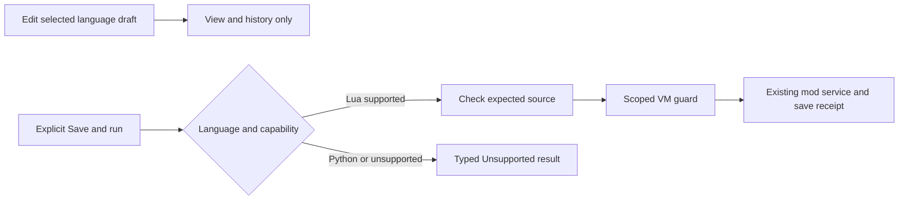

# Runtime code editor and interpreter API

Open **Hub → Mods**, select a mod and open its source. Lua is the default language.
The runtime editor provides line numbers, syntax colours, indentation guides, selection,
completion, independent undo/redo and scrollable source. Typing and moving the caret only
change the draft. **Save & run** explicitly sends the Lua draft to the configured mod service.

The **Language** selector switches between Lua and a Python editing buffer. Each language
retains its own text, selection, scroll position and undo history while the editor remains
open. Python execution is an explicit unsupported stub: it cannot execute Lua, save a mod,
invoke a backend or change the world. Switching back restores the Lua draft.

## Editing and saving

- **Ctrl+Z** undoes; **Ctrl+Y** or **Ctrl+Shift+Z** redoes.
- **Tab / Shift+Tab** indent or unindent; Enter uses the selected language's indentation rules.
- Bracket pairing and completion commits participate in the editor's undo history.
- Enter respects multiline Lua literal/comment context. Typing an automatically inserted closing
  quote advances the caret; escaped quotes remain literal input.
- **Ctrl+Space** opens completion. Completion is checked against the current document and caret.
- **Copy / Paste** operate on the visible language's text. Pasting does not run code.
- **Keep objects on Save & run** controls the existing mod reload mode. Leave it off for a clean
  replacement of the previous run's startup objects.

The editor checks the expected stored source before saving. If another edit changed it,
the draft stays intact and the page asks for explicit review before overwriting.
This is a source precondition check on the synchronous service path, not an atomic
compare-and-swap across arbitrary external writers. Hosts that allow concurrent writers must
serialize their own store updates or provide the corresponding transactional service.

A successful live run and a confirmed source save are distinct outcomes. Unconfirmed
persistence keeps the draft dirty. A failed or cancelled run can already have produced some
effects; do not infer a rollback from the result status. Closing a changed Lua or Python draft
requires an explicit discard decision. Python buffers are not persisted by this adapter.

## Bounded presentation and execution

Source is limited to 262,144 UTF-16 code units. Expensive decoration and completion analysis
are bounded separately. Large documents fall back to plain text; history, line decorations
and guide elements have finite limits. Syntax output is separate from the editable source,
and only changes targeted at that source are treated as edits. Tabs and nonbreaking spaces
inside source literals are preserved; line endings are normalized to LF.

The standard Lua adapter applies a per-invocation guard to the initial load/reload chunk:
100 ms and 500,000 instructions by default, capped by any stricter host budget. It does not
change other mods' budgets or the global runtime settings. An initial yield ends this short
invocation; later scheduler resumes use the host's normal budgets and do not retain the
editor command's cancellation token. Hosts must configure their ongoing handler budgets too.

VM guards are cooperative. They cannot preempt an arbitrary blocking native C# callback,
and this guard does not bound every possible source-compilation or storage operation. Keep
host callbacks bounded and avoid synchronous network/storage waits on a player loop.
The adapter does not create a worker thread or use `Task.Run`, including on WebGL.

## Replaceable ports

`CoreAI.CodeEditing` belongs to portable **CoreAI.Core**. It contains document/language models,
text utilities, history, `ICodeInterpreter`, `ICodePlaygroundRuntime`, requests and typed results.
A plain .NET host can use those contracts and supply its own interpreter and view.
The UITK surface and the CoreAI Mods adapter live in **CoreAI.Mods.Hub**.

`ICodeLanguageProfile` supplies the language id, display name, comments, completion words,
highlighting and Enter behaviour. Adding a language does not implicitly enable its execution.
An interpreter advertises `CodeRuntimeCapabilities`; the existing Mods adapter supports
**SaveAndRun**. A standalone **Run** request returns `Unsupported` with no service effects.
A different host adapter can support run-only execution explicitly.

For the standard adapter, obtain an `IHubModService` from the host's existing composition,
construct `LuaCodePlaygroundRuntime`, call `Initialize`, then submit a `CodeRunRequest` with
`SaveAndRun` and a `CodeSourceExpectation`. The service must implement
`IBudgetedHubModService`; the production Lua service forwards this to the currently captured
runtime's optional `IBudgetedLuaModRuntime`. Missing support produces a typed unsupported
outcome without an unbounded fallback.

Results retain document, language, mod, revision and run identities. Check `Matches(request)`
before displaying a delayed result in another document. Closing or detaching the view retires
its pending focus/completion work; restore a language draft through the view's owning session.
Call `Stop(runId)` for the active
request and dispose the adapter/view at the end of the page lifetime.

The concrete `LuaCodePlaygroundRuntime.Run(request, cancellationToken)` returns a `CodeRunResult`
after the guarded operation on the caller thread. Hub Save uses this synchronous entry point with
a `SaveAndRun` request. The same adapter's `RunAsync` preserves the `ICodeInterpreter` contract
by returning that result in an already completed task. Hosts using the generic interpreter port
call `RunAsync`; other adapters may complete asynchronously. The standard Lua adapter creates
no background worker or deferred execution.

Try the [bundled Lua examples](../../Assets/CoreAIMods/Docs/LUA_MOD_EXAMPLES.md) for small,
editable programs with visible behaviour, bounded work and owned cleanup.
