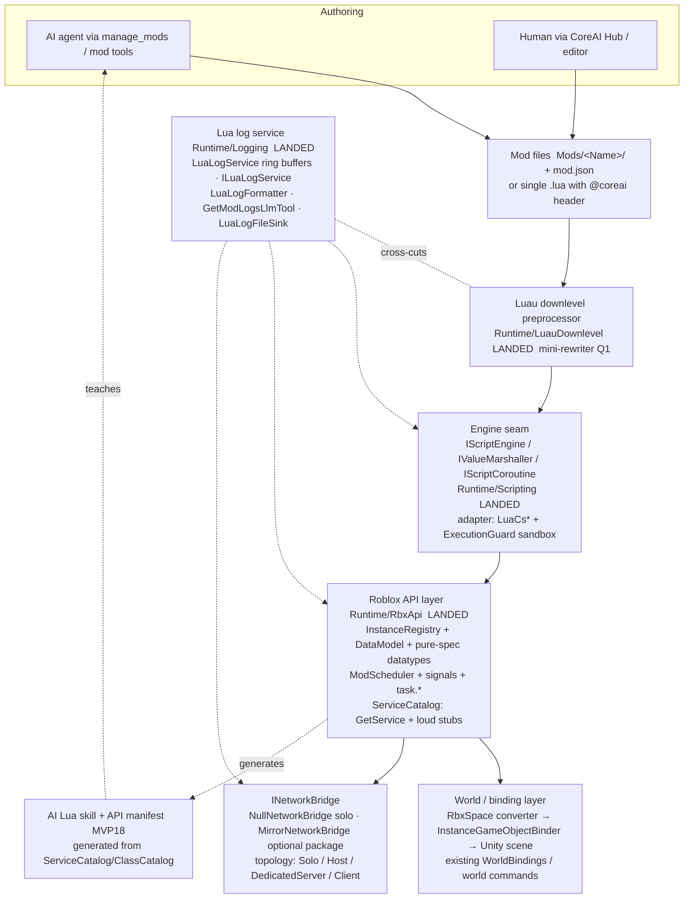

# CoreAI MVP ladder and the Roblox-like Mod API — Definitive Roadmap (MVP0..MVP19)

CoreAI's mod system evolves into a **Roblox-shaped Lua API**. Rationale: LLMs know the Roblox API
better than any custom game API (training-data volume), so an AI that writes mods in this dialect
hallucinates less and ships working code faster. Humans get a familiar, documented API for free.

This document is the single plan of record, and its §4 is the one MVP ladder of record for the whole
framework — the Roblox API, multiplayer, the framework consolidation and the Studio (renumbered
2026-09-24; §4.1 maps the old numbers). It supersedes the previous MVP1..MVP4 seed roadmap;
"Standing decisions" below are carried over in substance and refined where the detailed design
forced a choice. MVP0 (the engine abstraction seam) has **landed (2026-07-22)** and **MVP1
landed in 6.3.0 with the §5.1.8 acceptance gate green**, including the pulled-forward input and
camera slice (§MVP1); the Lua log service core has **landed** in
`Assets/CoreAIMods/Runtime/Logging/`, editor Lua/Luau syntax highlighting has **shipped
(editor-side)**, and the three normative Roblox-behavior reference docs are **complete** in
`Docs/CoreAIMods/RobloxReference/` (§2.1).
Since then **MVP2's functional surface has landed** (scheduler, deferred signals, services framework,
loopback remotes, the shared JSON contract, the clocks, the Model pivot slice, and the complete 45-item
`Enum.Material` catalog; two items keep it open — the G10 capacity gate and `BindToRenderStep`, §MVP2),
so has the "Gameplay services I" slice (the old MVP8), and **MVP3 (the world/place package) is
closed (2026-09-25, released in 7.47.0)** on the Unity EditMode/PlayMode `FastNoLlm` gate; its contract
and acceptance evidence are in [`WORLD_PACKAGE.md`](WORLD_PACKAGE.md). Audits of MVP1, MVP2, the gameplay
services and the multiplayer foundation (2026-09-24) were followed by fix waves and three audit rounds
over them, recorded in the rung sections below and in `TODO.md`; they shipped in 7.47.0. As of release
7.56.0 (2026-10-28) MVP4 (script contexts) has not started: the releases after 7.47.0 (7.47.1–7.56.0) are
fixes and features outside the ladder (both changelogs). On 2026-11-11 the order of work changed to
demo-gated milestones with twenty new packages (§4.0); the rungs keep their ids.

**Architecture (normative)**: every deliverable in this ladder is built to
`Docs/ARCHITECTURE_RULES.md` — engine-free Domain assemblies (`noEngineReferences: true`),
inward-only references with the Unity adapter as the sole engine boundary, interface-first
DI via installers, UniTask + CancellationToken discipline, and a per-module
architecture-fitness test (the seam-honesty test is the template). Reviewers reject work
that violates it.

**Versioning (LOCKED; historical record)**: the Roblox-like Lua mod API was a breaking change to the
mod contract, so it shipped as a **major** bump — the CoreAI package family went **5.9.0 → 6.0.0**,
with the five packages that existed then bumped together. Today all **seven** packages
(`com.neoxider.coreai`, `coreaiunity`, `coreaimods`, `coreaihub`, `coreaibenchmark`, `coreaimcp`,
`coreaimirror`) move in lockstep (ROADMAP.md §4, mod-system.md §8); the current release is in each
package's `package.json` and the changelogs. `mod.json` `api_version` is a **separate contract line
starting at 1**, independent of the package version (§MVP18).

**Roblox API parity (LOCKED — user, 2026-07-23):** the Lua-facing API replicates Roblox **1:1** —
identical class / method / property / event / enum names and semantics — so copy-paste Roblox
scripts run unchanged. Keyboard/mouse input is Roblox `UserInputService` exactly
(`InputBegan`/`InputEnded`/`InputChanged`; `InputObject` with `KeyCode`/`UserInputType`/`Position`/
`Delta`; `Enum.KeyCode`/`Enum.UserInputType`; `IsKeyDown`/`GetKeysPressed`/`GetMouseLocation`/
`MouseBehavior`). No CoreAI-invented dialect on the Roblox surface. Unity implementations (New Input
System, primitives, physics, camera) are only **swappable backends behind seams** — the Lua names and
behavior must match Roblox regardless of backend. **Exception:** FullAccess (the Unity-native
`unity_*` reflection surface) is a **separate module with its own skill** and may diverge. Legacy
CoreAI-isms (`input_*` poll, `coreai_world_*`) stay for back-compat but are NOT the canonical Roblox
surface. Applies to every current and future rung.

**Round-trip parity (owner, 2026-09-24):** scripts, models and places are interchangeable with Roblox in
**both** directions — a Roblox script or model runs here unchanged, and what is made here exports and
runs in Roblox. It is the explicit DoD of MVP14, prepared by MVP4 (script instances, `require`,
`RunContext`) and MVP13 (Luau stdlib extensions, coercion parity, the Luau-only export lint, the
welds/constraints subset); the gaps RT1–RT13 are listed under §MVP14.

**Measured Lua slice (2026-09-29):** the exact
[`RobloxCoreAiParity.lua`](../../Assets/CoreAIMods/Tests/EditMode/RbxApi/Acceptance/RobloxCoreAiParity.lua)
fixture passed in Roblox Studio `RunScript` and in CoreAI's Unity EditMode acceptance world.
Both produced `before=2;after=1;clone=ProbeCopy;position=-2,4,9` after creating a
brick `Part`, cloning it, setting its `CFrame`, checking the clone's size/material/anchor state,
and destroying the original. A [visual variant](RobloxCoreAiParityVisual.lua) leaves the clone
visible: [Roblox Studio](../Images/Parity/roblox-studio-parity.jpg) and
[CoreAI Unity](../Images/Parity/coreai-unity-parity.png). The Unity binder maps studs to metres
at 0.28 and flips the world Z axis, so its backing GameObject is at
`(-0.56, 1.12, -2.52)` while Lua still reads `(-2, 4, 9)`. The two brick textures and lighting
are visibly different; this fixture verifies the listed Lua behavior and properties, not
pixel-identical rendering or the complete Roblox API.

**Castle quest slice (2026-09-30):** the
[`CastleQuestParity.lua`](../../Assets/CoreAIMods/Tests/EditMode/RbxApi/Acceptance/CastleQuestParity.lua)
fixture ran unchanged in Roblox Studio and the open Unity Editor. Both reported
`parts=51>47;coins=3;key=true;health=2;gate=true;win=true;gateY=14`. It covers a
four-tower castle and a deterministic coin, key, trap, gate, and victory route. The
[comparison record](CASTLE_QUEST_PARITY.md) includes Studio and Unity images, the
X-axis cylinder correction, reproduction steps, and the physical-contact limit.

---

## 1. Principles

Two principles override Roblox fidelity whenever they conflict:

1. **AI-first authoring.** The primary mod author is the in-game LLM (humans second). API choices,
   docs, error messages, and logs are optimized for machine consumption and self-repair loops.
   Every error a mod can trigger carries: mod id, script, line, a stable error code, and a
   *suggested fix* — because the reader is an agent that will immediately try to patch the mod.
   The AI's skill document **is** the documentation: one artifact teaches the LLM and the human, and
   (from MVP18) embeds the machine-readable implemented-vs-stub manifest generated from code.
2. **Realtime.** The game is created and modified *while it runs*. Hot reload, live logs, and in-play
   AI debugging are core features, not tooling extras. There is one mode (plan decision D9): play and
   creation happen in the same running world, with no Studio and no Play/Stop switch, and nothing
   rewinds a world other players are in. Every feature must answer "does this work in a built player on
   device, mid-session?" (see `AGENTS.md` — RUNTIME-first).

Derived rules:

- **Loud stubs.** Anything not implemented yet ships as an **explicit stub** that fails with a
  structured `NOT_IMPLEMENTED` Lua error naming the roadmap phase and a workaround — never
  silently. Stub code carries `// TODO: MVP<n> — <what completes it>`. The stub-error format is
  stable and machine-parsable from day one (§5.2.7). (One documented exception: DEV-5,
  `task.synchronize`/`task.desynchronize`.)
- **Current Roblox shapes.** API names and signatures follow the *current* official Roblox
  reference (verified July 2026; footnotes §9): `task.*`, `RunService.PreSimulation/PostSimulation/
  PreRender`, `Instance` members incl. attributes and tags, `DataStore` async methods,
  `RemoteEvent`/`UnreliableRemoteEvent`. Deprecated legacy names (`wait`, `spawn`, `RenderStepped`,
  `Stepped`) are provided as aliases because tutorial-corpus scripts use them, with a
  once-per-mod deprecation note in the mod log.
- **Multiplayer-shaped from day one.** Single-player is "a server with one local client"
  (Roblox's own model). All networking APIs exist from MVP2 in local-loopback form behind
  `INetworkBridge`; the Mirror bridge (`com.neoxider.coreaimirror`, since 7.42.0) replaces the
  loopback when a scene switches it on, without changing any mod-facing API; host mode is MVP5.
  The bridge is topology-aware from the first interface draft (§2, Network topology).
- **WebGL is first-class** (`AGENTS.md`). It must stay green as a **solo player** (Null loopback
  bridge), as a **pure client** against a dedicated server (MVP8), and as a **creator-mode client**
  of a server (plan decision D6); it never hosts. Every rung's Definition of Done includes the WebGL
  acceptance checklist (§6.5): no threads, no blocking waits, no sync-over-async, and after a
  persistence write `CoreAiWebGlPersistence.Sync()` must report the engine's automatic
  `persistentDataPath` persistence as armed (`false` is a failure; `FS.syncfs` is never driven by
  hand).

## 2. Standing decisions (researched 2026-07; items marked LOCKED are user-confirmed)

- **VM**: keep Lua-CSharp, now v0.5.8 (2026-11-11; bundled `Lua.dll`/`Lua.Annotations.dll` in
  `Assets/CoreAIMods/Plugins`; Lua 5.2, double-only numbers — near-Luau semantics). No MoonSharp return,
  no native Luau on the client (WebGL). Plan decision D8 (2026-09-24): keep Lua-CSharp with a cheaper
  guard first; native Luau **on the server only**, behind `IScriptEngine`, is the fallback if spike S1
  shows the guarded VM cannot meet the MVP9 budget. Stock upstream build: the local `NotifyTop` patch we
  carried on 0.5.5 landed upstream as PR #331, and our WebGL coroutine deadlock report (issue #327)
  as PR #329.
- **Luau syntax**: pure-C# downlevel preprocessor at mod ingestion (strip type annotations, rewrite
  `+=`/`continue`/string interpolation/`if`-expressions/`//`). Parser: the targeted
  **mini-rewriter**, chosen and **implemented on disk** (`Assets/CoreAIMods/Runtime/LuauDownlevel/`:
  `LuauLexer.cs`, `LuauRewriteParser.cs`, `LuauDownleveler.cs`); Loretta is reconsidered only if
  construct coverage proves insufficient (Q1 closed). darklua's rule set is the reference spec.
  Standalone (no VM dependency).
- **Engine abstraction**: all interpreter access goes through neutral interfaces so the VM can be
  swapped later — `IScriptEngine`, `IScriptState`, `IValueMarshaller`, `IScriptFunctionRegistry`,
  `IScriptCoroutine` (with `Kill()`), `IScriptExecutionGuard`, `IExecutionBudget`, plus the value
  contract (`ScriptValueKind`, `IScriptTable`, `ScriptCallContext`, `ScriptCallResult`,
  `ScriptSandboxProfile`, `ScriptRuntimeException`) — **landed** in
  `Assets/CoreAIMods/Runtime/Scripting/` with the `LuaCs*` adapters in `Scripting/LuaCs/`.
  Script values cross the seam as **opaque `object` handles** classified via
  `IValueMarshaller.GetKind` (`ScriptValueKind`); there is no `ScriptValue` wrapper type.
  The existing `LuaCs*` classes (`LuaCsModRuntime`, `LuaCsSecureEnvironment`,
  `LuaCsExecutionGuard`, `LuaCsCoroutineHandle`/`Runner`) become the single adapter layer. The
  Roblox API layer in this roadmap is written **only** against the neutral interfaces.
- **Multiplayer transport**: **Mirror** over kcp, plus a WebSocket transport for WebGL clients,
  behind `INetworkBridge` (plan decision D4, 2026-09-24). CoreAI's own optional package
  `com.neoxider.coreaimirror` (`Assets/CoreAIMirror/`, compiled only with the `MIRROR` define) is
  the bridge: raw Mirror message handlers with CoreAI's own envelopes, shipped since 7.42.0; the
  engine-free replication core has shipped since 7.39.0. NeoxiderTools' `Neo.Network` is **not** the
  bridge (owner decision 2, `dev-docs/MVP25_ONLINE_PLAN.md` §7): a framework package cannot depend on
  a separate product. The first draft (2026-07) borrowed its patterns as a design reference only —
  `NetworkEventDispatcher` ≈ `FireServer`→`FireAllClients`, `NetworkActionRelay` ≈ `FireClient`,
  `NetworkPropertySync` ≈ replicated properties, `NeoNetworkSpawner` ≈ server spawn,
  `NeoNetworkPlayer` ≈ `Players.LocalPlayer`, `NetworkContextActionRelay` ≈ the paired
  request/response of `RemoteFunction`. Host mode, world-state replication and the dedicated server
  are MVP5, MVP6 and MVP8.
- **Network topology (LOCKED)**: supported targets are **host mode** (listen server: server +
  local client in one desktop process) and **dedicated server** (headless, no local client).
  Implementation order: **Null loopback (solo) → host → dedicated** — host mode first because it
  is the fastest dev loop and mirrors Roblox Studio play-testing; dedicated server follows as its
  own MVP step (mostly headless bootstrap + CLI). WebGL can never host or listen: in browsers the
  modes are **solo**, **pure client** of a dedicated/remote server, and **creator-mode client** of a
  server (plan decision D6 — a Creator's edits travel as intents, so no hosting is needed); WebGL is a
  first-class target (`AGENTS.md`). `INetworkBridge` stays topology-agnostic
  (`Solo | Host | DedicatedServer | Client`) and **never** assumes "the server always has a local
  client" (e.g. `PreRender` must be skippable server-side; `Players.LocalPlayer` is nil on a
  dedicated server, Roblox parity).
- **Identity**: one `InstanceRegistry` owns identity from day one. Every Instance gets a stable
  `instanceId`; the record reserves fields for the Mirror `netId` and the CoreAI world-command name
  so the three identity spaces (Roblox Instance ref / Mirror netId / CoreAI name-string) reconcile
  in one place. This is the pre-payment on the most expensive future bridge. Details §3.3.
- **Coordinates (LOCKED)**: Roblox datatypes (`Vector3`, `CFrame`) are implemented as **pure math
  exactly to Roblox spec** — right-handed, `LookVector = -Z`, every constructor/operator/`lookAt`/
  `ToWorldSpace` per the official docs; mods never touch a Unity `Transform`. Exactly **one
  conversion boundary** exists: the static `RbxSpace` class (§5.1.4, D2). Nothing outside it
  converts — enforced by a lint-style test.
- **Units / scale (LOCKED, supersedes the earlier 1:1 default)**: scale is a single configurable
  constant inside `RbxSpace`; **default 1 stud = 0.28 m**. Rationale: the AI author's trained
  priors (`WalkSpeed 16`, `JumpPower 50`, `Gravity 196.2`, part sizes) produce correct *game
  feel* at 0.28 without re-teaching — copy-paste corpus achieves feel-parity, not just
  math-parity (Roblox gravity 196.2 studs/s² = 54.9 m/s² ≈ 5.6 g is the intended snappy feel).
  1 stud = 1 m remains available for meter-integrated games. Corpus tests run at 0.28 as primary
  + 1:1 smoke. Implementation rule: mod-driven rigidbodies get gravity applied **per-body**
  (custom force, `Rigidbody.useGravity = false`), never via global `Physics.gravity`, so
  Roblox-physics mods coexist with a host game running Earth gravity. The AI skill teaches the
  active scale (the "Rbx API" skill; §MVP18).
- **Assets under scale (LOCKED)**: **only numbers convert at the API boundary; assets are never
  rescaled.** (1) Primitives (`Part` Block/Ball/…) use Unity unit primitives; the binder sets
  `localScale = Size × RbxSpace.MetersPerStud`. Shapes Unity lacks (Wedge, CornerWedge, the
  Roblox-oriented Cylinder) get our own meshes authored **normalized to 1 unit = 1 stud** — the
  only stud-authored assets allowed; the same scaling formula applies. (2) Existing
  meter-authored prefabs (host game, NeoxiderTools) are **never** rescaled — that breaks
  physics/colliders/animations/NavMesh and is a forbidden operation; mods read them with a
  meters→studs conversion at the API boundary (a 1.8 m human reads as ~6.4 studs — plausible
  Roblox proportions), and spawning game prefabs via our InsertService-analog keeps authored
  size. (3) The meter-authored character controller stays metric; the Humanoid adapter converts
  numbers (`WalkSpeed` studs/s → m/s, `JumpPower`, …); part mass/density scales by volume
  (×0.28³). That adapter is now a supported extension point rather than a plan: a host registers an
  `IRbxCharacterMotorProvider` and drives Rbx characters with its own controller, with CoreAI's own
  motor answering for whatever the provider declines — see
  [CHARACTER_MOTOR_BRIDGE.md](CHARACTER_MOTOR_BRIDGE.md). (4) Switching the scale config (0.28 ↔ 1:1)
  must require touching **zero assets** — only the `RbxSpace` constant (tested: §5.1.8).
- **Host integration profile**: embedding CoreAI mods into an **existing meter-scale Unity game** is a
  first-class scenario. A per-project host profile (ScriptableObject: `RbxSpace` scale [default
  0.28], capability defaults, which host services/objects are bound, the per-world `ClientWritePolicy`
  — `RobloxParity` [default] / `Strict`, resolved through the single authority-resolver seam so future
  partial-authority rules are a resolver swap, §MVP6; co-building is a host grant, not an `Open` mode
  (owner decision 3) — plus the per-role human tool-surface config and the Players-may-fly flag from
  the roles/locomotion decisions below) makes integration "drop a config and it works".
  `RbxSpace`'s configurable scale **is** the meter-world adapter — no second conversion layer
  exists or is planned. It is part of MVP10's `CoreAiProfile` (§MVP10): since composability became
  normative (`Docs/ARCHITECTURE_RULES.md` §2.1) presets are a foundation item, not a late one.
- **Roles: Creator / Player (LOCKED — studio == game)**: every connected player has a per-world
  **player role** — **Creator** (the host's default in their own world; grantable to others = the Team
  Create analog) or **Player** (joiner default). The player role Creator is not the built-in agent
  role `Creator` (the `world_command` designer, `Docs/CoreAI/AGENT_ROLES_AND_TOOLS.md`); documents say
  "player role" or "agent role" wherever both could be meant, and in code the player role is its own
  type on `RbxPlayer` (MVP11). The role gates the **human-driven** AI tool
  surface (Hub chat: `manage_mods`, `execute_lua`, save/load world), configurable per world in
  the host integration profile — from fully locked down to full sandbox. **Critical
  separation: game-sanctioned AI creation is NOT role-gated** — a mod calling the reserved
  `AIService` (e.g. ability-crafting gameplay where the AI generates a new ability as part of
  game logic) runs under the **mod's** capability grants/quotas set by the creator and works
  for pure Players; generated content carries the origin tag `ai:<modId>` and the normal
  budgets/quarantine apply. Role is an input to the authority resolver (§MVP6) — the player
  dimension. None of it is built yet: `RbxPlayer` has no `Role` field
  (`Assets/CoreAIMods/Runtime/RbxApi/Instances/Networking/RbxPlayers.cs`); the role, its tool gating
  and the grant UI are MVP11. Regardless of role, the chat/agent interaction itself is always
  non-blocking — play and task the AI in parallel (§MVP11, async agent workflow).
- **Locomotion: Humanoid / Fly (orthogonal to role)**: `Humanoid` = the normal character;
  `Fly` = free-fly, the in-game analog of the Studio camera. A Creator defaults to Fly while
  building; whether Players may fly is a per-world host-profile config (a cheat in most games,
  normal in creative worlds). Not built yet: Fly as a locomotion mode is MVP7, the Fly camera of the
  Studio is MVP12.
- **Event mode (LOCKED)**: **Deferred** signal behavior only, matching Roblox's current direction
  (templates default to `Enum.SignalBehavior.Deferred` [^10]) — details §5.1.4 (D4).
- **Clocks (LOCKED)**: the scheduler (`task.wait`, `task.delay`) and the frame pipeline run on
  **scaled game time** (they respect `Time.timeScale` — pause/slow-mo pauses/slows mods), and the
  real-time surface ships alongside with Roblox names: `os.time()`, `os.clock()`,
  `workspace:GetServerTimeNow()`, `time()` (`DateTime` is a loud backlog stub, M2-15). Full
  clock-mapping table in §5.2.6 (D9).
- **Hot reload (LOCKED)**: reloading a mod restarts its scripts with clean state; mod-created
  Instances are destroyed by default (opt-out `preserveInstances` flag per mod; as shipped, the
  previous run's startup objects are destroyed and the opt-out is the per-reload
  `ModReloadMode.KeepObjects`); mod stores **always** survive. Full survival matrix in §6.3.
- **Mod manifest (LOCKED)**: `mod.json` carries `api_version` from day one; the loader
  version-gates mods against the host's mod-API version (§MVP18).
- **One JSON contract (LOCKED)**: a single table↔JSON mapping (`HttpService:JSONEncode/JSONDecode`
  parity — arrays vs dictionaries, null handling, number formatting) implemented once and shared
  by DataStore marshalling **and** remote payload serialization (§5.2.4).
- **Skill = docs (LOCKED)**: the in-game LLM's Lua skill and the human-facing API docs are one
  artifact; every rung that grows the API surface updates it as part of its DoD (§4, implicit item
  (b)). Today it is the hand-written "Rbx API" skill; the generated API manifest embedded in it is
  MVP18.
- **Test hierarchy (LOCKED convention)**: the layout and the rule-citing conformance-test naming
  convention in §6.6; every MVP DoD references it.
- **One-shot execution + ownership ledger (LOCKED)**: `execute_lua` is a first-class **runtime**
  feature (conscious deviation from Roblox's Studio-only command bar — DEV-12): it runs in the
  full Roblox API environment, under the same sandbox and budgets, keeps no persistence of its
  own, and returns results. Instances created by a one-shot are **world-owned by default** —
  they persist, are saved with the world, and survive mod reloads (explicit cleanup only) — but
  carry origin tags (`origin: console:<invocationId>`) enabling selective cleanup/undo ("remove
  everything from invocation N"); an optional `execute_lua` **preview** scope is ephemeral
  (auto-cleanup). One unified ownership ledger, two lifecycle policies: **mod-owned**
  (auto-teardown on reload; a `persistent` flag promotes to world-owned) vs **world-owned**
  (console default) — the same `TeardownModEffects` pipeline serves both.
- **World file / place package (LOCKED)**: a shareable zip (`world.json` + `Mods/` +
  `manifest.json` carrying `format_version` + `api_version`; all JSON per the `RobloxJson`
  contract) containing the world-owned instance tree (with owner/origin metadata), world
  settings (gravity, `RbxSpace` scale), and mod sources. Mod-ephemeral state is **not**
  saved — mods restart clean on world load, per the hot-reload contract (§6.3). **One
  serializer** serves disk save **and** the multiplayer join snapshot the host streams to
  connecting clients (the MVP5/MVP6 join flow is designed to reuse it). Save/load work at
  runtime without restart (load = `TeardownModEffects` for all mods → restore tree → start the
  world's mods); AI tools `save_world`/`load_world`. Evolves CoreAI's existing WorldState save.
  MVP1 consequence (explicit): `InstanceRegistry` records are serializable with stable ids from
  day one. Detailed in §MVP3.
- **Two-tier backups (LOCKED)**: **manual saves** — player-owned named slots in `Saves/Manual/`,
  never auto-overwritten; AI tools can create but never overwrite or delete them, and an
  AI-initiated restore requires player confirmation — vs **autosaves** — a rolling ring (~10)
  in `Saves/Auto/<timestamp>-<trigger>.world`, with a snapshot taken **before** every AI
  mutation (mod load/reload, world-mutating `execute_lua`) and trigger metadata recorded. Both
  tiers use the place-package format. Complements the `ILuaScriptVersionStore` source rollback;
  principle: **undo is never the only recovery path**.
- **Quarantine error policy (LOCKED; core implemented 2026-07-22 — replaces auto-unload/auto-disable;
  see `mod-system.md` §5a; `mod:<id>` chunk names still pending per §5.2.7)**:
  at the error threshold a mod **stops dispatching but stays loaded and addressable**; reload
  clears quarantine. Events: `ModQuarantined` and `ModTearingDown(modId, reason)`; the
  `TeardownModEffects(modId, reason)` pipeline clears logic-slot overrides and (future) owned
  instances/coroutines, and is the single teardown entry point shared by hot reload, quarantine
  escalation, and world load. Script chunk names become `mod:<id>` — the §5.2.7 error contract
  depends on it.
- **AI-call reservations (LOCKED — cheap now, from the AIService feasibility audit)**:
  (i) `LuaCapabilities` gains `Ai = 1<<5` (excluded from `All`, like `Full`) when `AIService`
  lands (MVP11), and `Data = 1<<6` for DataStore access (§MVP16); `LuaCapabilities.cs` currently
  ends at `Full = 1<<4`, so both bits are free;
  (ii) MVP2's `ModScheduler` wait system is built on a generic
  "resume a Lua thread when a host `Task`/callback completes" primitive (`ScheduleWaitUntil`),
  with time waits as the special case — DataStore `GetAsync` (MVP16) and the future `agent:Ask`
  both need it (§5.2.2); (iii) conventions from day one: `AiTaskRequest.SourceTag =
  "Mod:<modId>"`, `CancellationScope = "Mod:<modId>"`, hot-reload teardown calls
  `CancelTasks(scope)`; chat-history keying reserved as `(roleId, sessionKey)`.
- **Frame-budget reservation**: `IExecutionBudget` and the scheduler interfaces carry a
  **per-frame / per-mod slice** concept (accounting + skip/downgrade + `BUDGET_EXCEEDED`
  warning) from the first interface draft, even though slice *enforcement* lands later (MVP9)
  — retrofitting accounting seams is expensive; reserving them is free (§5.2.3).

### 2.1 Normative references (behavior rulebooks)

Three normative documents in `Docs/CoreAIMods/RobloxReference/` specify the target Roblox
behavior in numbered, testable rules. **Policy: the implementation follows these rules;
deviations must be recorded as explicit decisions** (table below). The plan cites rule IDs
instead of restating semantics.

| Doc | Scope | Rule IDs |
|---|---|---|
| `01_SCRIPTS_AND_SCHEDULER.md` | script types/contexts, require, task scheduler, frame order, signals, Instance lifecycle | R1.x–R7.x, plus UNCERTAIN items U1–U7 |
| `02_MULTIPLAYER_REPLICATION.md` | replication model, remotes, authority, serialization/limits appendices | M1.x–M7.x |
| `03_SERVICES_AND_DATA.md` | services, DataStore semantics + emulation table | S1.x–S7.x |

Uncertainty policy: each U1–U7 item in the scheduler doc gets an explicit recorded stance during
MVP2 design review (testable stances become conformance tests; a stance later contradicted by
verified Roblox behavior is re-filed as a deviation below).

Conscious deviations (running list — additions require an entry here):

| ID | Roblox behavior (rule) | CoreAI decision | Why |
|---|---|---|---|
| DEV-1 | cyclic `require` hangs forever (R3.7; the `ModuleScript` class page); the scripting guide (`scripting/module.md`) says it errors with `Requested module was required recursively` | raise `CYCLIC_REQUIRE: Requested module was required recursively: A -> B -> A` naming the cycle path (MVP4 step C4, `DEV1_CyclicRequireRaisesError`); a thread that requires a module another thread is still loading waits instead (`DEV1_ConcurrentRequireOfALoadingModuleWaits`) | hangs are hostile to AI self-repair; an error is patchable. Matches the guide, differs from the class page |
| DEV-2 | `SignalBehavior.Immediate` exists | Deferred only; setter is a loud stub | D4; budget enforcement and reentrancy safety |
| DEV-3 | no per-slice instruction budgets | budget kills + quarantine per mod (§2, quarantine policy) | sandbox safety in a live game |
| DEV-4 | fixed stud scale | configurable `RbxSpace` scale (default 0.28 m) | host-game integration |
| DEV-5 | `task.synchronize/desynchronize` switch Parallel Luau contexts; `RBXScriptSignal:ConnectParallel` runs the handler in parallel | no-op + once-per-mod log note; `ConnectParallel` is `Connect` (serial) with the same once-per-mod note | Parallel-annotated scripts are otherwise runnable; throwing would fail working code |
| DEV-6 | global gravity | per-body gravity forces, host `Physics.gravity` untouched | mods coexist with the host game's physics |
| DEV-7 | destroyed instances stay readable (`Parent` nil + locked, R5.8/R6.2) | member access on a destroyed instance raises `INSTANCE_DESTROYED` — **except** inside destruction-queued handlers (`Destroying`/`AncestryChanged`), which read a **tombstone** (`Name`, `ClassName`, `Parent == nil`; connections gone). A `Parent` change notification raised by the destruction itself is tombstone-readable too, and `BasePart` properties read inside those handlers return the part's last-known values (both part sinks keep the most recent 2,048 destroyed parts; older ones are forgotten) | loud errors drive AI self-repair; the tombstone keeps R5.8's observable post-destruction state |
| DEV-9 | legacy `wait`/`spawn`/`delay` have a ~29 ms floor + load-dependent throttling (R4.9) | preserve the **0.029 s minimum delay**, but omit load-dependent throttling | the real floor preserves timing compatibility; deterministic scheduling avoids machine-load-dependent behavior |
| DEV-10 | `GetAsync`/`UpdateAsync` return a `DataStoreKeyInfo` second value (S1.4/S1.7 — S1.4 is `GetAsync`'s `(value, DataStoreKeyInfo)` tuple; S1.7 is `UpdateAsync`'s transform contract) | **retired in MVP16 (single player)**: the second value is a real `DataStoreKeyInfo` (`Version` = the key's write count as a string, `CreatedTime`, `UpdatedTime`, `GetUserIds()`, `GetMetadata()`); only the latest version of a key is kept, so the version calls stay loud stubs (DEV-103) | the latest-version model is cheap; a version history is not |
| DEV-11 | `GetAsync` results are cached for 4 s (S1.5) | cache **not emulated** — every `GetAsync` reads the store | the local store is fast; emulating the cache would only add staleness surprises |
| DEV-12 | command-bar/one-shot execution is Studio-only | `execute_lua` one-shots are a first-class **runtime** feature (full API env, same sandbox/budgets; §2 one-shot decision) | Realtime principle — the game is authored while it runs |
| DEV-13 | a Lua string is a byte string; non-ASCII text built from UTF-8 byte sequences (e.g. `'\195\169'` for "é") is one Unicode codepoint by Luau's own character-counting (`utf8.len`), even though `#s` counts the 2 raw bytes | crossing the C#/Lua boundary maps each byte to one `System.Char` (UTF-16 code unit) — a non-ASCII codepoint spanning 2+ UTF-8 bytes becomes that many C# chars, not one; pinned by `RoundTrip_UnicodeStrings_SurviveEncodeDecodeUnescaped` (`RbxJsonContractEditModeTests`) | the VM boundary marshals bytes, not codepoints; a mod author, or C# code reading a Lua string (logs, `GetAttribute`, `JSONEncode` output), must not assume `String.Length`/indexing on a crossed string matches Luau's `utf8.len`/perceived character count for non-ASCII text |
| DEV-15 | "The name of an instance cannot exceed 100 characters" — the mirror states the cap, not what an over-long assignment does | an over-long `Name` keeps its first 100 characters (never splitting a surrogate pair) | truncation instead of an error keeps a world saved before the cap existed restorable |
| DEV-16 | `Humanoid.MaxHealth = math.huge` stores infinity (a common "invincible" idiom) | accepted, but stored as the largest finite double, so `Health == math.huge` is false (compare with `MaxHealth`); `TakeDamage(math.huge)` still kills; NaN is refused | a non-finite value cannot be saved in a world package; the idiom keeps working without making the world unsavable |
| DEV-14 | members carrying `security: PluginSecurity` are unreachable from a running game — they exist for Studio and plugins, and the shipped experience never sees them (e.g. `ScriptContext:SetTimeout`, which limits how long a script may run without yielding) | the same members are reachable at RUNTIME, gated to the elevated actor tier (`ActorContext.Grants.IsUnrestricted`); an ordinary mod is refused exactly as it is for any other privileged member | CoreAI's Studio is the running game itself (the in-game creator mode, MVP12): authoring and playing are ONE application, so "Studio-only" has no separate place to live. Mapping these to "unavailable" would delete a control the creator legitimately needs while the game runs; mapping them to "anyone" would let a mod raise its own execution budget. The elevated tier is the only honest reading, and it is the same tier that already gates the rest of the privileged surface. Sibling of DEV-12, which made the same call for one-shot execution |
| DEV-17 | `tostring(number)` prints Luau's shortest round-trip text (`1e+21`, `inf`, `nan`, `0.1`), and a number passed where a string is expected becomes that text | this VM's `tostring` formats with .NET rules (`1E+21`, `Infinity`, `NaN`; 15 significant digits on Mono), and the argument coercion of both surfaces (`LuaCsValueMarshaller`) inherits it, so `part.Name = 1e21` is `"1E+21"`; the sandbox's own `tonumber` also refuses `"inf"`/`"nan"`/hex floats that the host-side coercion accepts | temporary, not a decision to keep: one Luau-style formatter for `tostring` and the coercion, and one parser for `tonumber`, are open in `TODO.md` (audit R3 C1-06); until then scripts that turn very large, non-finite or long-fraction numbers into names, attribute keys or store keys see different text than in Roblox |
| DEV-18 | `HumanoidStateType.Flying` has no locomotion of its own: the Humanoid is not animated, as with `PlatformStand`, while the player flies | `Humanoid:ChangeState(Enum.HumanoidStateType.Flying)` gives real flight: the motor flies, and `Move` keeps the height while flying; the default control script toggles it on a double-tapped Space and the world chat has `/fly` | creative flight in a block world without a CoreAI-only API; the owner decision "Fly from Lua" in `TODO.md` takes this as its default |
| DEV-19 | `MouseBehavior.LockCurrentPosition` locks the cursor where it is at the time of locking | the cursor is locked at the centre of the window | Unity's cursor lock always centres; there is no lock in place |
| DEV-20 | for mouse-wheel input `InputObject.Position.Z` says whether the wheel moved forward (positive), backward (negative) or not at all; the mirror gives no magnitude | `Position.Z` is exactly 1 or -1 per wheel event; a smooth or multi-notch scroll collapses to its sign | the mirror documents only the sign |
| DEV-21 | the mirror does not say what `Humanoid:Move` does to a running `MoveTo` | a non-zero `Move` ends a running `MoveTo`, and `MoveToFinished` fires with `false` | player input wins over a scripted walk; the behaviour is ours |
| DEV-22 (retired, MVP4 step C6) | the control scripts are LocalScripts, so `Players.LocalPlayer` is always set where they run | while `LocalPlayer` is nil (a solo world before MVP4's client context) `coreai_player_controls` drives the first player | solo play needs controls before MVP4 brings real client contexts; retire when MVP4 lands; retired by MVP4 step C6: `coreai_player_controls` 1.1.0 declares `context: client` and drives `Players.LocalPlayer` only |
| DEV-23 | the top bar reserves a GUI inset (`GuiService:GetGuiInset`, `ScreenGui.IgnoreGuiInset`), so the Screen and Viewport variants of the camera queries differ | the inset is always zero, so `ScreenPointToRay` and `ViewportPointToRay` (and the `WorldTo*` pair) give the same answer; the core-GUI switches are recorded but nothing is drawn (DEV-72) | CoreAI draws no top bar |
| DEV-24 | `UserInputService.TextBoxFocused` / `TextBoxFocusReleased` pass the focused `TextBox`, and `GetFocusedTextBox()` returns it | while one of CoreAI's own text fields (the chat, the Hub) has the keyboard the text-focus signals pass nil and `GetFocusedTextBox()` returns nil; a focused GUI `TextBox` is passed and returned (added late on 2026-11-11, not run in Unity yet) | CoreAI's own text fields are not script-visible TextBoxes |
| DEV-25 | every `CameraType` (Fixed, Attach, Watch, Track, Follow, Custom, Scriptable, Orbital) has its own behaviour in the PlayerModule | only `Custom` (orbit, zoom, first person) and `Scriptable` behave; the other types leave the camera to scripts | first slice; the play loop needs `Custom` |
| DEV-26 | zoom and the pull-in in front of an obstacle are smoothed by the PlayerModule's spring and Poppercam | zoom and pull-in are instant | first slice; spring-smoothed zoom is open in `TODO.md` |
| DEV-27 | the camera focus follows the subject Humanoid with `Humanoid.CameraOffset` applied | the focus is the root part plus 1.5 studs straight up; `Humanoid.CameraOffset` is a stub | first slice; the offset is open in `TODO.md` |
| DEV-28 | the default PlayerModule also turns the camera from the arrow keys | the arrow keys walk and never turn the camera | first slice |
| DEV-29 | in first person the character turns with the camera (`Humanoid.AutoRotate`) and the local character is hidden (`LocalTransparencyModifier`) | in first person the character does not turn with the camera; its body is hidden through `BasePart.LocalTransparencyModifier`, driven by the default camera module (added late on 2026-11-11, not run in Unity yet) | first slice |
| DEV-30 | the camera scripts write `UserInputService.MouseBehavior` every frame while they need it | the camera writes `MouseBehavior` only when its own wish changes, so a script's own setting stands until then | a mod that sets the cursor keeps it without fighting the camera each frame |
| DEV-31 | `Camera.CameraSubject` is assigned to the local Humanoid at spawn, and `Changed("CameraSubject")` fires | `CameraSubject` resolves to the local Humanoid when it is read; the engine does not assign it at spawn, so no `Changed("CameraSubject")` fires | no client spawn sequence exists before MVP4/MVP7 |
| DEV-32 | `Camera.ViewportSize` is the size of the client's window | a headless `InMemoryCameraRig` reports 1920x1080; a rig without a lens reports (1, 1) and refuses `FieldOfView` writes | headless worlds and tests need a defined viewport |
| DEV-33 | the Player camera properties (`CameraMode`, the zoom distances) replicate from the server to the client | they are not replicated yet | replication of player state is MVP7 |
| DEV-34 | first-person mouse look starts with the cursor locked | on WebGL first-person look applies before the browser grants pointer lock, from the cursor's position difference | a browser grants pointer lock only after a user gesture; the look must not wait for it |
| DEV-35 | (not in the mirror) the `Ray` tostring text, the Poppercam pull-in opacity threshold, the camera turn rates and the thumbstick dead zone | taken from observation (`Ray` prints `{origin}, {direction}`), from Poppercam (0.95) and from the PlayerModule (turn rates, dead zone) | the mirror gives no numbers; these sources are the closest available and are recorded so a change is visible |
| DEV-36 | thumbstick input arrives as `Gamepad1` to `Gamepad8` | thumbstick events report only `Gamepad1` | first slice |
| DEV-37 | smooth terrain: occupancy shapes the surface between cells | blocky cells: any occupancy above 0 draws a full cube | a block world is the M1 target; smoothing is not in this subset |
| DEV-38 | terrain water has swimming and is hit by rays unless `RaycastParams.IgnoreWater` is set | water is a transparent block with no collider and no swimming, and rays pass through it as if `IgnoreWater` were always true | first slice |
| DEV-39 | `Terrain` inherits `BasePart`, so `IsA("BasePart")` is true, the BasePart members exist and parts touching it fire `Touched` | `Terrain` sits under `PVInstance`: `IsA("BasePart")` is false, the BasePart members are absent, and parts touching it fire no `Touched` | every BasePart path (binder, part sink, serializer, tweens) would give it a 4x1x2 part body |
| DEV-40 | `Terrain:FillBlock` fills an oriented box with smooth terrain; the mirror gives no cell rule | it fills the cells whose centres are inside or on the box; one call sweeps at most 4,194,304 cells and skips cells outside the bounds | a block world needs a predictable cell rule and a bounded call |
| DEV-41 | occupancy is a number from 0 to 1 | occupancy is stored in 1/255 steps, and any positive value keeps at least one step | one byte per cell in the chunk store and the package entry |
| DEV-42 | a non-Terrain material in a Terrain call is an error (the mirror gives no text) | it raises `BAD_ARGUMENT` with CoreAI's wording | the structured error format of §5.2.7 |
| DEV-43 | the engine's own terrain extents and memory | fixed bounds and budgets: desktop ±32,768 studs across and ±4,096 up and down, 16.7 M cells, 16,384 chunks; WebGL ±8,192 and ±2,048, 4.19 M cells, 4,096 chunks; a region call outside the bounds raises `BAD_ARGUMENT`, and a write past the cell or chunk budget raises `BUDGET_EXCEEDED` and changes nothing | a WebGL tab has a hard memory ceiling, and a budget error is something the AI can repair |
| DEV-44 | the mirror documents a limit of 4,194,304 voxels for the voxel calls (`ReadVoxels`, `WriteVoxels`) | `FillRegion` and `ReplaceMaterial` use the same limit | one limit for every region call |
| DEV-45 | `WriteVoxels` takes 3D arrays of materials and occupancies | elements must be EnumItems and numbers; occupancy is clamped and NaN is refused | a cell store must never hold a value it cannot draw or save |
| DEV-46 | water is a terrain channel with its own properties (`ReadVoxelChannels`/`WriteVoxelChannels`, material colours, `WaterColor`, `WaterWaveSize` and the other `Water*` properties) | water is one material cell; the channel calls, material colours and `Water*` properties are stubs | first slice |
| DEV-47 | (not in the mirror) what a fractional cell or count argument does | whole-number arguments truncate; error texts are CoreAI's | the coercion rule of the rest of the surface |
| DEV-48 | `Terrain` is an instance of the place: saved with it and replicated like any other instance | Terrain is runtime infrastructure: it is not in the package tree (its cells have their own entry, `Terrain/voxels.bin`), and it is never replicated as an instance, because each side creates its own; cell replication is planned as a chunk-delta record of the MVP6 wire (record kind 4 is reserved, not built) | replicated as an ordinary instance, a client would be told to create a second Terrain beside its own |
| DEV-49 | `Enum.Material.Water` (like `Air`) is Terrain-only and not browsable for parts (`Material.yaml`) | `Part.Material = Enum.Material.Water` draws animated water on a BasePart | parts are the only water outside the voxel Terrain, and a block world's part-built water must look the same as its terrain water |
| DEV-50 | `OutdoorAmbient` is the hue of outdoor areas and `Ambient` the hue of areas occluded from the sky | `OutdoorAmbient` maps to the trilight sky and equator colours, `Ambient` to the ground colour | the closest mapping onto Unity's trilight ambient, which has no sky-occlusion term |
| DEV-51 | the sun follows `ClockTime` and `GeographicLatitude`; the mirror documents neither the day of the year nor the axes | the equinox: the sun rises at 06:00 due east at +X and sets at 18:00 due west, and north is -Z | a fixed, documented model is testable; the mirror leaves both open |
| DEV-52 | (not in the mirror) how daylight fades around sunrise and sunset | daylight is a smooth step from -6 to +6 degrees of sun elevation; at night the outdoor ambient keeps 15%, `Ambient` is unchanged, and the sun light is off | the mirror gives no curve; the floor keeps a night readable |
| DEV-53 | `Lighting` always drives the place's lighting | lazy application: the sink is not called until a script, a tween or a restore drives Lighting, so a host scene keeps its own lighting | CoreAI runs inside host games that own their lighting |
| DEV-54 | `PointLight.Range` is capped by the engine (the API dump's `ExtendLightRangeTo120` flag implies 60 studs, 120 with the flag) | the range is capped at 60 studs | the cap the dump implies without the flag; the flag is not modelled |
| DEV-55 | `Lighting.Brightness` is the intensity of the sun or moon light; the mirror gives no clamp | it is stored unclamped and drawn as at least 0 | a round trip keeps what the script wrote |
| DEV-56 | (not in the mirror) what a malformed `TimeOfDay` string does | it raises `BAD_ARGUMENT` | a loud error is something the AI can repair |
| DEV-57 | Luau's math functions report `invalid argument #n to '...'` | the sandbox keeps its `bad argument` prefix; the reason texts match Luau's | one prefix for every sandbox argument error |
| DEV-58 | every light is drawn by the engine | a light budget per tier (64 on desktop, 8 on WebGL): the nearest lights stay on, the rest are switched off, logged once | per-pixel lights are expensive, most of all on WebGL; nearest-N is a CoreAI policy |
| DEV-59 | `Lighting:GetMoonDirection()` and `GetMoonPhase()` describe the moon | both are stubs; there is no moon | the day-cycle slice; the rest of the Lighting API is M2 |
| DEV-60 | Roblox has `TextGenerator` but no agent service | CoreAI-only `game:GetService("AIService")`: `CreateAgent`, `Ask`, `Say`, `Hear`, `Replied`/`Addressed`, without the `Async` suffix Roblox gives yielding methods; the service is detached (`Parent` is nil), so world packages and replication never see it; behind `AllowAgentsFromLua` and `LuaCapabilities.Ai` | NPC agents need per-NPC memory, addressing and budgets that `TextGenerator` does not have; the MVP13/MVP14 export lint must flag `AIService` |
| DEV-61 | `ContextToken` carries a summary of the conversation and restores its state in a later request | the token is an in-memory host handle (256 conversations of 16 exchanges, the least recently used dropped); it does not survive a restart, and an older token branches the conversation | no server-side conversation store exists |
| DEV-62 | `GenerateTextAsync` documents `UserPrompt`, `ContextToken`, `MaxTokens` and `JsonSchema`; the mirror does not say what an unknown key does | unknown request keys and unknown agent config keys are refused | a typo must fail loudly instead of being ignored |
| DEV-63 | `Temperature` and `TopP` values outside their ranges are clamped; the mirror does not say whether a read returns the clamped value | they are clamped on write, so a read returns the clamped value | the stored value is the one used |
| DEV-64 | with `JsonSchema` the response conforms to the requested format | the schema is enforced by validating the response afterwards against a subset of its keywords | a check after the fact works with any provider |
| DEV-65 | generated text in an experience is subject to Roblox's moderation (the mirror's `TextGenerator` page does not describe it) | pass-through unless the host plugs a filter in | moderation belongs to the host game and its platform |
| DEV-66 | requests are limited to 100 per minute, scaling up with the number of concurrent users | a fixed 100 per minute per world | a solo world has no concurrent-user count |
| DEV-67 | `TextGenerator` is an ordinary instance any script can create and call | `Instance.new("TextGenerator")` and its property writes need `WorldEdit`, and `GenerateTextAsync` must run on a scheduler thread | the sandbox's rules for every instance and every yielding call |
| DEV-68 | (not in the mirror) the text of a failed `GenerateTextAsync` | the failure text uses CoreAI's structured error format | the AI self-repair contract (§5.2.7) |
| DEV-69 | Roblox has no markup: interfaces are instance trees (`ScreenGui`, `Frame`, `TextLabel`, ...) built in Studio or with `Instance.new` and styled by properties and `StyleSheet`/`StyleRule` | `game:GetService("UxmlService")` builds screens from UXML and USS text while the game runs (`UiScreen`, `UiElement`, `Clicked`/`ValueChanged`/`Submitted`), behind the `Ui` capability, owned by the creating mod | the AI writes UI text far more reliably than instance trees, and a text change shows in the next frame; the MVP13 export lint should flag `GetService("UxmlService")` and every `UiScreen`/`UiElement` member; the Roblox GUI classes (MVP15) stay the compatible entrance on the same factory |
| DEV-70 | each client draws its own player's `PlayerGui`, and every LocalScript sees `Players.LocalPlayer` | the `PlayerGui` drawn is this machine's player's; a mod loaded as that player's actor reaches it through `LocalPlayer`, while a host-loaded mod sees `LocalPlayer` as nil and uses `Players` or `StarterGui` | solo before MVP4: mods are not yet split into client and server contexts |
| DEV-71 | on each spawn (`ResetOnSpawn`) `PlayerGui` is refilled with copies of `StarterGui`, LocalScripts included | a respawn replaces only the copies; a child added to `StarterGui` after the spawn is copied on the next frame; destroying an original removes its copies; scripts are never copied | a mod loads into a running session and does not re-run on respawn |
| DEV-72 | `StarterGui:SetCoreGuiEnabled` switches the built-in chat, player list, backpack and top bar | the switches are recorded; of the core GUI only the player list is drawn (the `leaderstats` list, MVP16, DEV-104), the others draw nothing | CoreAI has its own chat and Hub and no top bar |
| DEV-73 | every `Font`/`FontFace` family draws in its own typeface | every family draws in the host font; `Font` gives bold and italic | first slice |
| DEV-74 | text is measured: `TextScaled` fits the box, `AutomaticSize` grows to the text, `TextBounds` and `TextFits` report the measurement | text is not measured: `TextScaled` is an estimate, `AutomaticSize` fits children only, and `TextBounds`/`TextFits` raise `NOT_IMPLEMENTED` | first slice; the engine-free layout does not measure text |
| DEV-75 | `RichText` supports font, size, colour, stroke, line breaks and more | `RichText` draws `<b>`, `<i>`, `<u>` and `<s>` only | first slice |
| DEV-76 | `rbxassetid://` images load, and nine-slice (`SliceCenter`), `UIGradient` and `HoverImage`/`PressedImage` draw | `rbxassetid://` images draw nothing; nine-slice, `UIGradient` and the hover and pressed images are not drawn | there is no Roblox asset service; first slice |
| DEV-77 | `ZIndexBehavior.Global` orders every element of a `ScreenGui` by `ZIndex` | `Global` draws as `Sibling` | first slice |
| DEV-78 | a `ScrollingFrame` scrolls with the wheel, by dragging and by touch, and draws scroll bars | resolved on 2026-11-11 (not run in Unity yet): the wheel, a touch drag and the bars scroll it and `CanvasPosition` follows; what still differs is DEV-88 to DEV-92 | the first slice scrolled only from a script |
| DEV-79 | whether input over a GUI object counts as game-processed depends on the object (`Active`, buttons), not on scripts listening to it | listening to `MouseEnter` makes an object take the pointer, so input over it is game-processed | a hover listener needs the pointer in the runtime UI host |
| DEV-80 | a mixed table of numeric and string keys can lose elements, and a table's identity and metatable are not kept | a mixed array/dictionary table or a cyclic table raises `BAD_ARGUMENT`; values are copied with the RemoteEvent codec | a loud error instead of silently dropped elements |
| DEV-81 | (not in the mirror) a size limit for a bindable payload | more than 64 KiB raises `PAYLOAD_TOO_LARGE` | the RemoteEvent codec's limit |
| DEV-82 | (not in the mirror) what a function passed to `Fire` or `Invoke` becomes | a function arrives as nil, even at the top level | functions cannot be copied between mods |
| DEV-83 | the PlayerModule's TransparencyController sets `LocalTransparencyModifier` on every part of the local character, also on a part added later (it watches `DescendantAdded`) | the default camera sets it on the parts the character has when the value or the character changes; a part added while the value holds keeps its own modifier until then | a steady camera writes and allocates nothing per frame |
| DEV-84 | (not in the mirror) what happens when a `TextChatCommand` alias is already a command | an alias the chat already answers (one of the game's own commands, or another command's) stays with its first owner: a command whose `PrimaryAlias` is taken is not added at all, its `SecondaryAlias` included, and is reported once in the world log; a taken `SecondaryAlias` alone is dropped | the game's own commands (`/undo`, `/fly`, ...) must keep working, and a loud refusal is something the AI can repair |
| DEV-85 | `TextChatService.CreateDefaultCommands` (default true) puts default `TextChatCommand`s in a `Folder` named `TextChatCommands` inside `TextChatService` | `CreateDefaultCommands` is recorded; no folder of default commands is created | CoreAI's own chat commands already answer in the in-world chat |
| DEV-86 | a `TextSource` is a speaker in a `TextChannel` and sits inside it as a descendant (TextSource.yaml) | `Triggered` passes a `TextSource` with no parent, and there are no `TextChannel`s (the messaging half of `TextChatService` raises `NOT_IMPLEMENTED`, planned for P2) | the commands part needs only the sender's `UserId` |
| DEV-87 | a `SelectionBox` around a `Model` draws the model's box, which `Model:GetBoundingBox` describes as oriented by the `PrimaryPart` and "matches the selection box rendered in Studio" | the box around a `Model` is aligned to the world axes and holds every part of the model | first slice; a part's own box follows its `CFrame` |
| DEV-88 | a `ScrollingFrame`'s bar is three images (`TopImage`, `MidImage`, `BottomImage`) tinted by `ScrollBarImageColor3` | the bar is a flat bar in `ScrollBarImageColor3` at `1 - ScrollBarImageTransparency`, without arrow buttons, so the default bar is plain white; the image members and their `*Content` twins raise `NOT_IMPLEMENTED` | the default images are `rbxasset://` textures CoreAI does not ship, and a flat bar keeps the thickness and colour a script sets |
| DEV-89 | `ScrollingFrame.ElasticBehavior` (default `WhenScrollable`) lets a touch scroll overshoot the canvas and spring back | the canvas always stops at its ends, as with `Never`; reading or writing `ElasticBehavior` from Lua raises `NOT_IMPLEMENTED` (the value is still kept in a saved world) | UI Toolkit's elastic mode also bounces the mouse wheel and moves the offset outside the canvas, which `CanvasPosition` would then report |
| DEV-90 | `AbsoluteCanvasSize` is `CanvasSize`, or the larger of `CanvasSize` and the children with `AutomaticCanvasSize` (ScrollingFrame.yaml) | it is also never smaller than `AbsoluteWindowSize` | the canvas is the host's scroll range and clips the children drawn on it; a canvas smaller than the window would hide children the window shows |
| DEV-91 | (not in the mirror) whether a `CanvasPosition` outside the canvas is kept | the layout keeps `CanvasPosition` between 0 and `AbsoluteCanvasSize - AbsoluteWindowSize` on each axis: a write past the end reads back clamped after the next layout, and the property signal fires; a screen not laid out yet clamps nothing | the window cannot show past the canvas, and the property "reflects the current positional offset" (ScrollingFrame.yaml) |
| DEV-92 | `CanvasPosition` "doesn't do anything if scroll bars aren't visible" (ScrollingFrame.yaml) | a script's `CanvasPosition` moves the canvas whenever the canvas is larger than the window, also with `ScrollingEnabled = false` or `ScrollBarThickness = 0`, when no bar is drawn; only the player is stopped | a script-driven carousel or log needs it, and the mirror does not say what "doesn't do anything" means |
| DEV-93 | `Lighting.EnvironmentDiffuseScale` and `EnvironmentSpecularScale` default to 0 (Lighting.yaml, and the API dump's class default); the material pages recommend 1 for realistic reflections (MaterialVariant.yaml, SurfaceAppearance.yaml) | both are 1 in a new world | at 0 every world would lose the sky light and sky reflections it has always had; the author states Roblox's place templates ship 1, which the mirror does not document |
| DEV-94 | `DataStoreService` is a service of the DataModel (`game.DataStoreService`) and its stores are instances | the service, its `DataStore` objects and `DataStoreKeyInfo` are detached (`Parent` nil, never in a world package, never replicated, no instance quota) and read-only from Lua; `GetService` returns them and `IsA` follows the mirror's ancestry | like `AIService` (DEV-60): a world package must never carry data, and the world skeleton stays unchanged |
| DEV-95 | data stores belong to the experience (universe) and are shared by all its places and servers | one namespace per composition (its mod store id) and per world id: worlds without an id (the default world, its packages, autosaves and undo snapshots) share the game's data, a world with its own `world_id` keeps its own; a host replaces the rule (`RbxDataStoreOptions.Namespace`); data is never part of a world package and `/undo` never reverts it | a solo game has no universe; the store id is what already separates one game's (and one demo's) saves from another's |
| DEV-96 | only server `Script`s may use DataStores (a LocalScript errors), and Studio has no access unless *Enable Studio Access to API Services* is on (S1.26) | in a single-player world every script may use them, and Play Mode in the editor uses the game's own data | there is no client/server split before MVP4 and no separate Studio (DEV-12, DEV-14); the server-only rule is planned for the multiplayer milestone |
| DEV-97 | request budgets accrue per minute, a server gets a one-time startup burst, and requests wait in queues by method family | each budget (Read, Write, Remove, List) is a token bucket that refills at the mirror's per-minute rate, holds at most one minute and starts full; one queue of 30 per budget (UpdateAsync waits in the Write queue and takes a read and a write; a nil return gives the write back); plus at most 30 waiting requests per mod | the mirror gives the rates and the queue size, not the burst or the accrual cap; one mod must not fill every queue |
| DEV-98 | a game's storage is limited by its lifetime users (500 MB + 1 MB per user) | a world keeps at most 64 MiB of characters (8 MiB on WebGL), 16,384 keys (4,096 on WebGL) and 256 stores; a write past them raises `BUDGET_EXCEEDED` | a sandboxed mod must not fill the disk or a browser's storage; the host changes the caps in `RbxDataStoreOptions` |
| DEV-99 | a `SetAsync` that returned has reached the backend | a returned write is in memory at once and is written to disk within about a second (writes to one store are coalesced) and when the world or the game closes; a crash in that second loses it | a write queue that coalesces keeps a busy store from stalling frames |
| DEV-100 | `UpdateAsync` may call its function several times when another server wrote the key in between (S1.9), and the function "cannot yield" (S1.10) | the function runs once (there is no other server) inside a raw coroutine: `task.wait` in it raises, a `coroutine.yield` fails the call with `the update function cannot yield`, and neither writes anything | a single store has no write conflict; the coroutine makes S1.10 a refusal instead of a hang |
| DEV-101 | the error texts are Roblox's (`102: Key name exceeds the 50 character limit.`); the mirror gives no text for an empty or too long name or scope, a non-integer `IncrementAsync` value or delta, or a full world | every DataStore error is CoreAI's structured line with Roblox's code and text inside it (`BAD_ARGUMENT: 102: ...`, `BUDGET_EXCEEDED: 302: ...`, `PAYLOAD_TOO_LARGE: 105: ...`, `NOT_AUTHORITY: 501/502: ...`, `WORLD_DETACHED: 401: ...`); the texts the mirror does not give are CoreAI's and carry no number; `105` says `4MB` | standard retry code finds the Roblox code and the word throttled; the AI self-repair contract keeps its CODE and fix (§5.2.7) |
| DEV-102 | a string stored in a data store must be valid UTF-8, or the write fails | a string with a lone UTF-16 surrogate (the one kind of text with no UTF-8 form) is refused with `104: Can't store a string that is not valid UTF-8 text in DataStore.`; any other string is stored as the characters Lua holds (DEV-13), so a Lua byte string that is not valid UTF-8 is stored and read back unchanged | the VM boundary maps bytes, not codepoints; refusing byte strings would refuse values that round-trip exactly, while a lone surrogate cannot be written to a file the same way on every runtime |
| DEV-103 | `GetOrderedDataStore`, `ListKeysAsync`, the version calls, `ListDataStoresAsync`, the options objects (`DataStoreSetOptions`, `DataStoreIncrementOptions`, `DataStoreGetOptions`, `DataStoreOptions`), `SetRateLimitForRequestType` and the deprecated `OnUpdate` exist | the stores' extra calls, the options objects and any options argument are loud stubs planned for the rest of MVP16; `SetRateLimitForRequestType` and `OnUpdate` are unsupported (the host sets the budgets; `OnUpdate` is deprecated); `GetRequestBudgetForRequestType` answers 0 for ordered-store and deprecated request types | a single-player leaderboard has one row; tutorial code for coins needs none of them |
| DEV-104 | the player list always shows (names alone without stats), is clickable, toggles with Tab, orders columns by `IsPrimary`/`Priority` and abbreviates large numbers | it is drawn only while a listed player has a stat, at the top right 56 px down and 14 px in, under every mod screen (sort order -100), ignores the pointer, shows at most 4 columns and 12 rows (then `+N more`), sorts rows by the first stat highest first then by name, ignores `IsPrimary`/`Priority`, and prints numbers in full (invariant culture); `RbxPlayerListOptions` changes the style and the caps | the mirror has no leaderboards page (03_SERVICES_AND_DATA S2.5 is the source); in a solo game a list of one name is noise, and the list must never cover a mod's HUD or the chat |
| DEV-105 | Terrain is drawn smooth, and a Grass voxel shows grass on every surface | Blocky cells draw a Grass cell as a grass block: grass on top, Ground on the sides under a 3/16-cell grass band, Ground underneath (`TerrainFaceMaterialRules.BlockWorld`, the default; `TerrainFaceMaterialRules.None` restores grass on every face) | A block world must read as earth under turf. A drawing rule only: `ReadVoxels`, raycasts and saved worlds still report Grass; Parts with `Material.Grass` are unchanged |
| DEV-106 | `table.freeze` makes the table read-only: every write raises "attempt to modify a readonly table" | `table.insert`, `table.remove`, `table.sort`, `table.clear`, `table.move` into it, `rawset` and `setmetatable` raise it; a plain assignment `t.k = v` still writes (`Freeze_DoesNotRefuseAPlainAssignment_Dev106`) | the Lua 5.2 VM has no read-only tables: `__newindex` does not run for an existing key, and a proxy that moved the contents out would hide them from every raw reader (`next`, `#`, the marshaller); checking every assignment would slow every table write |
| DEV-107 | `gcinfo()` and `collectgarbage("count")` report the Luau heap of the script's VM | they report the managed heap of the whole process, in whole kilobytes | Lua-CSharp allocates on the .NET heap and keeps no heap of its own |
| DEV-108 | `getfenv(f)` returns the environment of `f` or of a stack level, which `setfenv` can change per function | every function of a script shares one environment, and `getfenv` returns it for no argument, a level that exists or a function; `setfenv` raises `NOT_IMPLEMENTED` (unsupported) | Lua 5.2 binds a function's environment to its `_ENV` upvalue, which a library cannot rebind |
| DEV-109 | a string is a byte string and `utf8` works on bytes (DEV-13); `utf8.charpattern` is `"[%z\x01-\x7F\xC2-\xF4][\x80-\xBF]*"` | typed text is UTF-16 and text built from bytes is UTF-8: `utf8` reads a code point from either (a valid UTF-8 run of chars 0x80-0xFF, a Latin-1 char, a surrogate pair or a single char; only an unpaired surrogate is invalid), its positions are char positions, `utf8.char` builds UTF-16 text, `charpattern` also admits chars above 0xFF and low surrogates, and `graphemes` uses a short rule set (combining marks, variation selectors, emoji modifiers, ZWJ sequences, flags) without Hangul jamo | the strings the engine and the Hub display are UTF-16; positions must be the ones `string.sub` takes |
| DEV-110 | `os.date` without `"!"` formats the local time of the machine | it formats UTC, as `os.time` reads a date table as UTC; `%Z` is `UTC`, `%z` is `+0000`, `%c` is the glibc C-locale form | every machine computes the same date, and `os.time(os.date("*t", t))` is `t` |
| DEV-111 | `debug.info(f, "n")` names a Lua function, and a level counts every call because Luau makes no tail calls | `n` is nil for every Lua function (this VM keeps no function names) and a tail call replaces its caller's level | Lua-CSharp compiles Lua 5.2, which has tail calls and no function names in its prototypes |
| DEV-112 | a bad argument reads "invalid argument #n to 'f' (...)" | every library function of the sandbox reads "bad argument #n to 'f' (...)", as Lua-CSharp's own do | one wording for the whole library; scripts rarely match on it |
| DEV-113 | `table.create`, `table.move` and `string.split` build what memory allows | one call builds at most 1,048,576 elements and is refused past it with a `sandbox:` line; `table.create` without a value is never refused (it only reserves room); a library loop is charged the instructions of the Lua loop it replaces | the allocation budget is sampled between instructions, and one call that fills 10^9 slots is one instruction |
| DEV-114 | `coroutine.wrap`'s function prepends its caller's position to a string error, and `coroutine.close` of a coroutine that died with an error returns `false` and the error | the error value passes unchanged, and `close` returns `true` for every suspended or dead coroutine | the sandbox's guarded resume returns the body's error as it was; Lua-CSharp keeps no error on a dead thread |
| DEV-115 | every Terrain material is drawn with its own smooth-terrain textures | a blocky cell is drawn with a painted 16-texel block tile per face (Mud as tree bark), a corner shade where blocks meet and calm water | a block world must read as blocks, and Terrain has no log material; a drawing rule only: `ReadVoxels`, raycasts and saved worlds keep the material, Parts keep the catalog, and `TerrainBlockLook.PhotoSets` restores the photographed look. TODO: a world's own choice through `MaterialVariant` |
| DEV-116 | with the default `FogEnd` of 100000 a place shows no fog | a world that never sets `FogStart`, `FogEnd` or `FogColor` keeps the host look's haze; the world's own fog wins once it sets any of them | the default look belongs to the host game, and a world that says nothing about fog should not switch it off |
| DEV-117 | the order of `FogStart` and `FogEnd` is not documented | when `FogEnd` is at or before `FogStart`, everything past `FogStart` is fully fogged | Unity's linear fog needs an end after its start |
| DEV-118 | an R6 character collides with its Torso and Head and floats its root at `HipHeight` | the root rests on the floor and the character collides through one body capsule from the feet to the head's top (radius 0.4 of the root's width), while `HumanoidRootPart.Size` stays 2x2x1; `HipHeight` is not implemented | the root box let the body through blocks and caught on the edge of a block's top, so a character never got onto a one-block step |
| DEV-119 | a character's parts have ordinary friction | the body capsule is frictionless while the character walks, jumps, flies or is in the air, and grips (friction 1) while it stands with no input | wall friction slowed wall slides and ate jumps, and without friction a standing character would drift; a script that moves a standing character by velocity meets that grip and gets about half the speed it writes |
| DEV-120 | a body inside a solid Terrain cell stays where the solver leaves it | a character whose feet are inside a solid cell is lifted to the top of that column, up to four cells | a chunk collider is a surface only, so a body inside a block would otherwise stay stuck there |
| DEV-121 | the `Swimming` state exists; its speeds are not documented | a swimmer moves at 0.75 of `WalkSpeed`, rises at 0.6 of `WalkSpeed` while Jump is held and sinks at 1.5 studs a second with no input; it swims once its middle is under the surface and wades while its feet are on the bottom with the head out | numbers had to be chosen; these let a character climb onto a one-block bank from the surface |
| DEV-122 | Humanoids push each other through physics | characters block each other and never push: a walker stops against another character or slides along it | one character must never shove another into a block or off a ledge, and the result must be the same every time |
| DEV-123 | a `MoveTo` walker pushes through others or times out after 8 s | a `MoveTo` blocked by another character ends after 1 s with `MoveToFinished(false)` | characters block each other, so the script needs the choice back quickly |
| DEV-124 | `UserInputService.TextBoxFocused` fires only for a TextBox | it also fires, with nil, while a host screen holds the keyboard (the Hub opened over the world), and `TextBoxFocusReleased(nil)` when it lets go | the world must ignore keys behind a host screen, and scripts learn about it through the event they already have for lost keyboard input |
| DEV-125 | a script that sets its own `Enabled` to false stops at its threads' next resumption point (R1.10) | it finishes its current resume and stops before the next frame; any stop or start a change of `Enabled`, `RunContext`, parent or destruction causes is applied at the start of the next frame (MVP4 step C2; pinned by `R1_10_AScriptThatDisablesItself_StopsByTheNextFrame`) | no mod's code ever runs inside another script's property write, and a stop never tears down the thread that is running; the difference is only "before the next frame" against "at the next yield" |
| DEV-126 | a ModuleScript runs once per side of the client-server boundary, and every script on that side gets the same returned value (R3.2, R3.3; `LuaGlobals.yaml`, `require`) | a module runs once per requiring script: two scripts on one side each run it and get their own copy of its table; the first time a module loads into a second script on the same side, one note per module says so (MVP4 step C4, SC-11; pinned by `DEV126_TwoScriptsGetTwoCopiesAndOneNote`) | every script keeps its own Lua state, so a module table shared between scripts would hand one author's closures to another's code and break instance-proxy identity; share state through attributes or value objects. Revisited with folder mods (design note Q2) |
| DEV-127 | `require(assetId)` loads a published `MainModule` on the server (R3.5) | a number raises `BAD_ARGUMENT: require(assetId) loads a published model, which CoreAI does not have` (MVP4 step C4; pinned by `R3_5_RequireByAssetId_IsRefusedLoudly`) | CoreAI has no asset catalog; put the module in the world and require the instance |
| DEV-128 | a server script that touches client-only members (`UserInputService`, render signals, the camera) gets nothing (input never fires, the camera is the server's own), and a client script sees `ServerStorage` and `ServerScriptService` empty | a `server` or `client` script that uses a member of the other side raises `CONTEXT_VIOLATION` naming the rule and the fix (MVP4 SC-13, design note SC-b; pinned by `SC_13_UserInputServiceFromAServerScript_IsContextViolation_AndFromAClientScriptWorks`, `SC_13_ServerStorageFromAClientScript_IsContextViolation_AndFromAServerScriptWorks`, `SC_13_FindersOnGameReachingAServerContainer_FromAClientScript_AreContextViolation`); a legacy script keeps the old rules | single-player shares one registry, where a silent or empty answer would teach coupling that breaks in host mode; an error is something the AI can repair |
| DEV-129 | a cloned `Script` runs as soon as it is parented where scripts run | a clone of a script is unbound and runs nothing; the cloning mod is told once (MVP4 SC-17, design note SC-c; pinned by `SC_17_ACloneOfARunningScript_IsUnbound_RunsNothing_AndIsNotedOncePerMod`, and `require` of a cloned ModuleScript raises `has no source`, `Clone_OfModuleScript_IsUnbound_RequireFailsNamed`) | one source runs once (SC-1); clones that run are MVP13's script templates |
| DEV-130 | `Script.Source` needs the `PluginOrOpenCloud` capability and `BaseScript.RunContext` is written at `PluginSecurity`, so no game script reads or writes either | `Source` is readable with the unrestricted tier, and `Source` and `RunContext` are written only by the host's console (`execute_lua`), inside its gate; a mod gets `NOT_AUTHORITY` (MVP4 SC-2, SC-4, design note SC-d; pinned by `SC_2_SourceRead_FromARestrictedMod_IsNotAuthority`, `SC_2_SourceWrite_FromAHostMod_IsNotAuthority_AndChangesNothing`, `SC_4_RunContextWrite_FromAMod_IsNotAuthority`) | the in-game creator is the console (DEV-12, DEV-14); a mod writing scripts would bypass the gate and the version grants |
| DEV-131 | a `LocalScript` or client `Script` in `StarterPlayerScripts`/`StarterCharacterScripts` is copied into every player's `PlayerScripts` or character, and the copies run | a client `Script` there runs in place once per client (Roblox also runs the original); a `LocalScript` there is a template and does not run until MVP14 copies it (MVP4 SC-9, design note SC-e; pinned by the `ScriptRunRulesEditModeTests` container cases) | per-player copies need per-copy runs, MVP13/MVP14 work |

---

## 3. Architecture overview

### 3.1 Layer diagram



Rules of the arrows:

- Mods never touch Unity types directly; the Roblox API layer is pure C# over the engine seam and
  talks to Unity only through the binder (`InstanceGameObjectBinder`) and existing world bindings
  (`Assets/CoreAIMods/Runtime/WorldBindings/`). All spatial values cross through `RbxSpace`
  (§5.1.4, D2) — the single conversion boundary.
- The Roblox API layer never references `Lua.*` types — only `Runtime/Scripting` interfaces. This
  keeps a future VM swap (or a second VM for tests) a one-adapter job.
- Networking calls never leave the Roblox API layer except through `INetworkBridge`. In solo play
  the `NullNetworkBridge` loops server→client calls back locally through the deferred queue, so
  `RemoteEvent` code written for multiplayer runs unchanged.
- Logging is a cross-cutting sink: preprocessor diagnostics, VM errors, `print`/`warn`/`error`,
  budget kills, stub hits, and network-bridge drops all land in the same per-mod ring buffer
  (`LuaLogService`).
- The skill/manifest is **generated from** the same catalogs that implement `GetService` and the
  class registry — documentation cannot drift from code (§MVP18; until then the hand-written skill is
  updated with every rung).

### 3.2 Execution contexts (Roblox-style single+multi)

Three script contexts, declared per script (§MVP4; by folder for folder mods, §MVP18), semantics per
R1.x/R2.x. Today the side is still derived from the actor's grant; MVP4 makes it declared:

| Context | Roblox analogue | Solo | Host mode | Dedicated server | Pure client (incl. WebGL) |
|---|---|---|---|---|---|
| `server` | Script in ServerScriptService | runs (local "server") | runs | runs | never |
| `client` | LocalScript in StarterPlayerScripts | runs (local "client") | runs (host's own client) | never | runs |
| `shared` | ModuleScript in ReplicatedStorage | on require, both sides | both sides | server side | client side |

In solo play the same process hosts both contexts, but they still communicate **only** via
remotes/replication (loopback). This is enforced from MVP4 so mods do not accidentally develop
solo-only coupling that breaks in host mode (MVP5). Note the host-mode column: host = server + one local
client in one process, but that is a *topology*, not an API assumption — a dedicated server runs
the `server` column with no local client at all.

### 3.3 Identity model (the three-spaces problem)

Three identity spaces must reconcile:

1. **Roblox space** — Lua holds `Instance` references; scripts also address by name-path
   (`workspace.SpawnPad`).
2. **Mirror space** — replicated objects are addressed by `netId` (uint) on the wire.
3. **CoreAI space** — existing world commands and world-query tools address objects by
   name strings (`WorldBindings/LuaCsWorldRuntimeBindings.cs`, `WorldQuerySceneWalker`).

`InstanceRegistry` (MVP1) is the single owner. One record per instance:

```
InstanceRecord {
  InstanceId  Id;         // ulong, monotonic per session, never reused; 0 = invalid
  uint        NetId;      // 0 until replication binds it (MVP6); server-assigned
  string      WorldName;  // CoreAI world-command name; null until bound to a world object
  RbxInstance Instance;   // the live Lua-visible proxy
  string      OwnerModId; // teardown owner; null = host/world-owned
  string      OriginTag;  // ownership ledger (§2): "mod:<id>" | "console:<invocationId>" | null (host)
}
```

Invariants (testable from MVP1):

- Lookup by any of the three keys returns the same record (`TryGet` / `TryGetByNetId` /
  `TryGetByWorldName`).
- `Id` is allocated at registration and stable until `Destroy`; it appears in every log line and
  error concerning the instance, so the AI can correlate logs ↔ tree ↔ world queries.
- MVP6 rule reserved now: on a Mirror client, spawn messages carry the server's `InstanceId` so
  client-side registries mirror server ids 1:1 (no translation table in mod code, ever).
- The id space is **partitioned by an authority bit from MVP1** (e.g. the top bit:
  server-assigned vs locally-assigned); only server-space ids ever cross the wire — the
  network marshal/spawn paths (MVP5 on) reject locally-assigned ids.
- Records are **serializable with stable ids from day one** — the world-file serializer (§2,
  world file; §MVP3) round-trips them without a remap table.
- Host/world objects discovered by CoreAI world queries get lazily wrapped: first Lua access
  creates the record with `WorldName` set and `OwnerModId = null` (positions read through the
  `RbxSpace` inverse, §5.1.4 D2 — consistent both ways).

---

## 4. MVP ladder (the ladder of record)

**Decided 2026-09-24 (tech lead) and re-ordered 2026-11-11 at the owner's request (the owner may
override).** This section is the one plan of record for CoreAI — the Roblox API, multiplayer, the
framework, the agent harness and the flagship's play-and-create loop. `Docs/ROADMAP.md` §4 carries the
same plan as a one-screen table, `TODO.md` files open work under the same rung and package names, and
`PLAN.md` says where the work stands today. Any other plan (the dev-docs MVP2.5 plans included) is
history and defers to this section.

Rules of the ladder:

- **Ordered by milestones (plan decision D10).** §4.0 is the order of record: five product milestones,
  each ending with playable demos and a release (`Docs/ROADMAP.md` §4). Rungs (MVPn) and packages (Pn)
  are stable ids, not an order. A rung or package depends only on what its "Reuses" line names and ends
  testable on its own; packages of one milestone run in parallel where their files do not overlap.
- **The flagship has one mode (plan decision D9).** There is no Studio and no Play/Stop split: creation
  tools are in-play actions over the same Instance operations as the AI and mods.
- **Every rung states** its goal, what is done so far (with paths), what remains, how it is tested, a
  measurable Definition of Done (DoD), what it reuses, and what belongs in the packages versus the
  flagship product. Paths without a root are relative to `Assets/CoreAIMods/Runtime/`.
- **Implicit DoD items for every rung from MVP4 on and for every package:**
  (a) the WebGL acceptance checklist (§6.5) passes;
  (b) if the rung grows the Lua-visible surface, the "Rbx API" skill (`RbxApi.txt` and
  `BuiltInRbxApiSkillText.cs`, byte-identical) and `Assets/CoreAI/Docs/RBX_API.md` change in the same
  commit — and from MVP18 on the generated API manifest is regenerated and CI-diffed too;
  (c) composability (`Docs/ARCHITECTURE_RULES.md` §2.1): every block the rung adds can be configured,
  replaced or left out without editing package code, a block that claims to be replaceable has a
  replace-with-fake test, and a preset the rung introduces has a boot test;
  (d) convenient by default (`Docs/ROADMAP.md` §5, principle 10): what the rung adds works in a fresh
  world without configuration, and a host game can switch the default off.
- **Product split (plan decision D7).** The flagship — a realtime play-and-create game with no Studio
  (plan decision D9) — lives in its own Unity project and consumes the packages through UPM. This repository keeps the packages, presets, samples,
  bot clients and test harnesses. Each rung says which side each part lands on.

Effort: **S** ≈ ≤2 agent-days · **M** ≈ ≤1 agent-week · **L** ≈ multi-week, parallelizable · **XL** ≈
several L-sized milestones; an XL rung is split into milestones when it starts.

Test methods: **EM** Unity EditMode · **PM** PlayMode `FastNoLlm` · **PT** portable engine-free suite
(`tools/portable/Tests`) · **PL** portable Lua tier (`tools/portable/LuaTests`) · **MP** two or more OS
processes (Standalone builds, or Multiplayer Play Mode virtual players — `com.unity.multiplayer.playmode`
2.0.2 is installed) · **LT** load test with bot clients · **MS** a manual scene in a sample or the
flagship, with recorded evidence.

### 4.0 Milestones (the order of record, 2026-11-11)

| Milestone | Outcome | Rungs and packages | Gate | Demos |
|---|---|---|---|---|
| **M0 Ready to play** | A new project reaches a working world and an honest model connection in minutes | P3 (one-click world), P11 stage 1, spikes S1 and S2, the open MVP3 player checks, one live-model run with a valid provider key | From a fresh checkout: one menu, one key, the first AI-made object; a missing module fails loudly | the one-click world |
| **M1 Block world** | The Minecraft-style demo, solo: walk and fly, build with blocks and by chat, talk to NPCs, switch on the autopilot | P1, P2, P3, P4, P6, P7, P8 stage 1, the day-cycle slice of P9, P12, P13, P18, P19, P20; MVP4, the solo half of MVP15 and the Luau math slice of MVP13 alongside | The Block world demo — Lua end to end, interface included — passes its recorded script in the editor and in a WebGL player; the P19 budgets hold; the bundled sample mods and published demos run on the defaults | Block world |
| **M2 Whole games from chat** | A complete small game — HUD, sound, saving — made by talking; the harness upgrades | The solo halves of MVP16 and MVP17; MVP13; the self-repair and manifest parts of MVP18; P5, P8 stage 2, the rest of P9, P10 stage 1, P11 stage 2, P14, P15, P16, P17 | A person who writes no code gets a playable game with HUD, sound and saving in 15 minutes; a "whole game" benchmark tier measures it | an obby and a tycoon from templates, an NPC town, an application that is not a game on the same harness |
| **M3 Together** | Several players create in one room | MVP5, MVP6, the network half of MVP7, MVP11, the network halves of MVP15–MVP17 | Four players in a room, two prompting the AI at once; every edit visible within 1 tick + RTT; the world survives joins and leaves | Block world co-op |
| **M4 Platform** | Dedicated servers, scale, Roblox import, asset import, hardening | MVP8, MVP9, MVP10, MVP14 (import first), the rest of MVP18, MVP19, P10 stage 2, the flagship's own project | The rungs' own DoDs | the flagship |

Packages added on 2026-11-11 (detail after §MVP19): **P1** player controls and camera · **P2** in-world
chat and agent HUD · **P3** instant edit loop and one-click world · **P4** voxel Terrain · **P5** in-play
creation tools · **P6** Block world demo · **P7** default look and the Hub Graphics page · **P8**
materials v2 · **P9** Lighting API · **P10** new materials and asset import · **P11** truthful results
and the Connect-API doctor · **P12** gameplay LLM API and talking NPCs · **P13** decision models ·
**P14** orchestrator mode · **P15** roles, tools, skills and prompts as data · **P16** tool review and
camera v2 · **P17** benchmark touch-ups · **P18** runtime UI from Lua (UXML and USS) ·
**P19** honest performance: measurement, budgets, optimization · **P20** mod folders.

A split rung keeps one section: its **Order** line says which half belongs to which milestone.

### 4.1 Numbering: old → new

The ladder was renumbered on 2026-09-24. Landed rungs keep their names; the new rungs are numbered in
execution order.

| Old | Old title | Now | Where its content went |
|---|---|---|---|
| MVP0 | Engine abstraction seam | **MVP0** (landed) | unchanged |
| MVP1 | Instance/DataModel core | **MVP1** (landed) | unchanged |
| MVP2 | Scheduler, signals, clocks, services | **MVP2** (surface landed; two items open) | unchanged |
| MVP2.5 | "MVP3 + MVP8 + MVP11 + MVP12" and the 7.3.0 persistence release | **MVP2.5** (history) | its parts are MVP3, Gameplay services I, MVP5 and MVP6 |
| MVP3 | World file + two-tier backups | **MVP3** (closed 2026-09-25) | + spikes S1/S2 (open follow-ups) |
| MVP4 | RBXL import/export | **MVP14** | widened to rbxl/rbxlx/rbxm/rbxmx both ways + the round-trip parity gate |
| MVP5 | Mod system UX | **MVP4** + **MVP16** + **MVP18** | contexts, `require`, script instances and `CONTEXT_VIOLATION` → MVP4; `game:BindToClose` → MVP16; folder mods, `api_version`, enable/disable, hot-reload latency and the AI tools → MVP18 |
| MVP6 | AI Lua skill = the documentation | **MVP18** | generated manifest + CI diff; until then every rung updates the hand-written skill |
| MVP7 | Editor tooling | **dropped** | highlighting shipped; the runtime Studio (MVP12) replaces the rest |
| MVP8 | Gameplay services I | **Gameplay services I** (landed slice, name kept) | Fly → MVP7/MVP12; `Role` on `Player` → MVP11 |
| MVP9 | DataStoreService | **MVP16** | + leaderstats |
| MVP10 | Input services | **MVP7** + **MVP15** | `Humanoid:Move`, default controls and ContextActionService-lite → MVP7; touch buttons and the rest → MVP15 |
| MVP11 | Mirror bridge core (host mode) | **MVP5** | + join snapshot, inbound rate limit, version handshake |
| MVP12 | Replication | **MVP6** | + binary delta codec |
| MVP13 | Dedicated server | **MVP8** | + WebGL client, dedicated-server preset |
| MVP14 | GUI subset | **MVP15** | + remaining input |
| MVP15 | Audio / FX / animation | **MVP17** | unchanged scope |
| MVP16 | In-game console + AI self-repair | **MVP18** + **MVP10** + **MVP11** | console and runtime self-repair → MVP18; host integration profile → MVP10; task queue and HUD → MVP11 |
| MVP17 | Performance + WebGL hardening | **MVP9** + **MVP19** | slice enforcement and the scale work → MVP9; the rest → MVP19 |
| — | (new) | **MVP7, MVP9, MVP10, MVP11, MVP12, MVP13** | networked characters, scale, composable framework, roles, Studio, model packages and templates |

Old numbers stay where history lives: test class prefixes (`Mvp1*`, `Mvp2*`, `Mvp3*`, `Mvp8*`), the
dev-docs files (`MVP2_*`, `MVP8_ACCEPTANCE_MANIFEST.md`, `MVP25_*`), the CHANGELOG entries, and — until
they are retagged (`TODO.md`) — the phase names in the loud stubs of `RbxApi/Instances/ServiceCatalog.cs`
and `ClassCatalog.cs` (`MVP9`, `MVP10`, `MVP11`, `MVP14`, `MVP15`), the `MVP5` phase of
`game:BindToClose` in `RbxDataModel.cs`, and the "Rbx API" skill that quotes them. Read them through
this table: a stub that names "MVP9" means DataStore, which is MVP16 now.

### 4.2 The rungs at a glance

Ids, sizes and the status at 7.50.2; the milestone of each rung and the packages P1–P17 are in §4.0, the
current status in `Docs/ROADMAP.md` §4.

| # | Rung | Status (7.50.2, 2026-10-15) | Size | Test | Old |
|---|---|---|---|---|---|
| MVP0 | Engine abstraction seam | landed 2026-07-22 | M | EM | MVP0 |
| MVP1 | Instance/DataModel core | landed in 6.3.0 | L | EM, PT | MVP1 |
| MVP2 | Scheduler, signals, clocks, services | surface landed; G10 and `BindToRenderStep` open | L | EM, PL | MVP2 |
| MVP2.5 | Online foundation + persistence release | landed 7.3.0–7.43.0 (history) | — | EM | MVP2.5 |
| — | Gameplay services I | landed slice | L | EM, PM, PL | MVP8 |
| MVP3 | World/place package + two-tier backups (+ spikes S1/S2) | **closed 2026-09-25 (7.47.0)**: Unity EditMode and PlayMode `FastNoLlm` 0 failed, audits 1–3 done; S1/S2 and the IL2CPP/WebGL player checks are open follow-ups | S | EM, PM, manual WebGL | MVP3 |
| MVP4 | Script contexts & client runtime | **next**, not started | M | PL, EM, PT | MVP5 (part) |
| MVP5 | Host mode over a real socket + join snapshot | planned | L | EM, MP, MS | MVP11 |
| MVP6 | World-state replication + write authority | planned | L | PT, EM, MP | MVP12 |
| MVP7 | Networked characters & controls | planned | L | PM, MP, EM | MVP10 (part) + new |
| MVP8 | Dedicated server + WebGL client | planned | M–L | MP, LT | MVP13 |
| MVP9 | Scale to ~100 players per room | planned | XL | LT, PT, EM | MVP17 (part) + new |
| MVP10 | Composable framework: one root, presets, host profile | planned | M | EM, PM, MP | MVP16 (part) + new |
| MVP11 | Roles (Creator/Player) & per-player AI over the network | planned | M | EM, MP | new |
| MVP12 | Studio mode core | planned | XL | PM, EM, MP, MS | new (replaces MVP7) |
| MVP13 | Model packages, template library, Luau parity prerequisites | planned | M–L | PT, PL, EM, PM | new |
| MVP14 | Roblox interchange + round-trip parity gate | planned | L | PT, PL, EM, MS | MVP4 |
| MVP15 | GUI + remaining input | planned | L | PM, PL, MP | MVP14 + MVP10 (rest) |
| MVP16 | DataStore + leaderstats | planned | M | EM, PL, LT | MVP9 |
| MVP17 | Audio / FX / animation | planned | M | PM, MP | MVP15 |
| MVP18 | Mod UX rest, skill manifest, console + self-repair | planned | M–L | EM, PL, PM | MVP5 (rest) + MVP6 + MVP16 |
| MVP19 | Performance, WebGL and mobile hardening | planned | M | LT, manual WebGL/Android | MVP17 (rest) |

### 4.3 Spikes, scale targets and risks

Three spikes turn the largest unknowns into measured numbers before the rungs that depend on them:

| Spike | Where | What is measured | What it decides |
|---|---|---|---|
| **S1** VM cost | open MVP3 follow-up; gates the next networked rung | Guarded VM throughput and per-resume cost in an IL2CPP **Linux server** build and a Standalone Mono x64 build, on the `tools/vmbench` workload and the `tools/ScaleHarness` N=100 workload | Whether the cheaper guard (plan decision D8 (a)) is enough for MVP9, or the server-only native Luau fallback (plan decision D8 (b)) is needed |
| **S2** bytes per update | open MVP3 follow-up; gates the next networked rung | Bytes per CFrame patch through `Scripting/LuaCs/LuaCsRbxNetworkCodec.cs` (JSON) vs a hand-packed binary record | The bytes-per-patch bar of MVP6's binary delta codec |
| **S3** big snapshot | MVP5 | A 5 MB join snapshot over real kcp | The snapshot chunk size and the reliable-message path |

S1 and S2 are recorded measurements (no pass/fail); their numbers go into `TODO.md`.

**Scale targets (plan decisions D5 and D11).** These numbers were frozen on 2026-09-24 as the gated
product goal. Since 2026-11-11 they are the aspiration: spike S1 is measured first, and the room size
MVP9 gates on is chosen from it; M3 gates on a small room (2–8 players). Nothing is published before the
staircase passes on the reference machine:

| Target | Value |
|---|---|
| Players per room | 100 |
| Server tick | 30 Hz; p99 frame ≤ 33 ms, of which server Lua ≤ 8 ms |
| Downstream per client | average ≤ 50 KB/s, p99 ≤ 100 KB/s |
| Upstream per client | ≤ 10 KB/s |
| Join | ≤ 10 s on LAN |
| Place | 10,000 instances; 30 min run, 0 disconnects, retained heap delta ≤ 100 MB |
| Reference machine | 8-vCPU Linux server |

Today's instance ceilings are 16,384 per desktop world and 2,048 per actor
(`LuaExecution/LuaCsModRuntime.cs`), 4,032 per WebGL world, and 100,000 in the package format
(`Docs/CoreAIMods/WORLD_PACKAGE.md`); MVP9 raises the desktop ceilings with measurement.

The ranked risks (R1–R13) and their mitigations are in `Docs/ROADMAP.md` §6; each mitigation is placed
in a rung below.

### 4.4 Why the order changed on 2026-09-24

- **Multiplayer moved ahead of breadth.** The owner put multiplayer completion first; its skeleton
  (the Mirror bridge, the replication core, the authority model) already existed, so finishing it is
  the shortest path to a playable online product.
- **Script contexts were pulled forward (MVP4).** They are the one hard dependency of host mode: the
  server cannot tell client code from server code while the side is derived from grants
  (`Scripting/LuaCs/LuaCsRbxInstanceBindings.cs`), so the join snapshot would leak server sources.
- **Networked characters became their own rung (MVP7).** `Humanoid:Move` and default controls are
  needed for a playable networked character, so they left the old input rung.
- **RBXL interchange moved after model packages (MVP13 → MVP14).** Round-tripping Roblox content needs
  script instances, `require`, `RunContext`, the Luau stdlib extensions and an export lint first; a
  file format built before them would carry scripts it cannot represent.
- **The Studio became a rung (MVP12)** and replaced the editor-tooling rung, because the flagship needs
  an in-game creator mode and the RUNTIME-first rule puts it in the player, not the Unity editor.
- **The framework consolidation became a rung (MVP10)** once composability became normative
  (`Docs/ARCHITECTURE_RULES.md` §2.1); it lands before roles and the Studio, whose gating is profile
  data.

History — the ordering rationale of the first ladder (2026-07), kept as the record; the numbers are the
old ones, and 4.1 maps them:

- **Networking loopback stubs moved from "MVP1" to MVP2.** `RemoteEvent`/`RemoteFunction` are
  signal-and-yield objects; they cannot exist before `RBXScriptSignal`, the scheduler, and
  `INetworkBridge` (all MVP2). Shipping them earlier would mean stubbing the stubs.
- **World file (MVP3) and RBXL import/export (MVP4) land immediately after MVP2 (user
  decision).** Opening real Roblox maps is a headline capability that exercises the MVP1/MVP2
  surface broadly; the native place package comes first because import produces `world.json` —
  and keeping it a small dedicated rung isolates the RBXL converter from serializer churn.
  (Superseded: RBXL is MVP14 now, above.)
- **Mod-system UX and log wiring moved after the API core (MVP5).** Hot-reload teardown rules are
  meaningless before instance ownership exists (MVP1: `OwnerModId`) and connection lifetimes exist
  (MVP2). The preprocessor is a parallel track that merges here; the log core has already landed.
- **The AI skill is its own early MVP (MVP6), right after the mod-system MVP.** It must exist
  *before* the service breadth arrives, because every later MVP appends to it; and it needs MVP2's
  catalogs (the manifest source) plus MVP5's authoring workflow (which it teaches). Motivation is
  a real incident, not theory: a small 4B model hand-animated a 2-second movement with raw
  `execute_lua` loops instead of using `TweenService` — wrong-tool-choice errors are prevented by
  the skill, not by the API. (Since then the hand-written skill has grown with every rung; the
  generated manifest is MVP18.)
- **Input (MVP10) split from gameplay services (MVP8).** UserInputService interacts with CoreAI's
  cursor gating and the Hub's focus model — an isolatable risk that should not block Players/
  Humanoid work.
- **Host mode before dedicated server (MVP11 → MVP13).** Locked topology order: host mode is the
  fastest dev loop (one desktop process, mirrors Roblox Studio play-testing); the dedicated
  server is mostly headless bootstrap + CLI on top of an already-working bridge, so it lands as
  its own step after replication. (Unchanged: MVP5 → MVP8 now.)
- **The seed's "MVP4 tooling" is split**: editor tooling (MVP7) vs. in-game console + self-repair
  (MVP16), because the latter depends on the Mirror-era log routing and the mature tool surface.
  (Editor tooling is dropped now; the console is MVP18.)

### 4.5 Why the order changed on 2026-11-11

- **One mode, no Studio (plan decision D9).** The owner's flagship is a realtime game like Roblox in
  which everything is instant and convenient by default. A creator mode with a switch into play is the
  friction Roblox has; here creation tools are in-play actions, so the XL Studio rung (MVP12) became
  the smaller P5 and its panels moved to the backlog.
- **Demo-gated milestones replaced the sequential ladder (plan decision D10).** Between 2026-09-25 and
  2026-10-28 nine releases shipped and no rung moved, and under the old order the first complete game —
  one with a HUD, sound and saving — stood behind twelve rungs (GUI was MVP15, DataStore MVP16, audio
  MVP17). A milestone now ends with a demo a player can run.
- **The Block world leads.** One Minecraft-style demo exercises what the flagship promises: default
  controls with a fly toggle, an in-world chat, realtime edits by blocks and by chat, a scene that looks
  right, NPCs that talk and an autopilot on a decision model. Each of those was missing or unconvincing
  in the 2026-11-11 repository survey.
- **Solo halves before the network.** GUI, sound and saving land as solo halves in M2 and get their
  network halves in M3. MVP4 keeps them network-ready: Solo already runs the three script contexts over
  loopback remotes, so a solo half is written against the contexts it will have in a room.
- **Scale after measurement (plan decision D11).** Roblox runs 200 to 700 players per server; the
  flagship does not differ by scale. The 100-player goal stays an aspiration until spike S1 says what
  the guarded VM costs on Mono and IL2CPP.
- **Import before export (plan decision D12).** Import brings Roblox authors and their places in;
  export needs a manual Roblox Studio gate per release.
- **Interfaces are text (plan decision D14).** The owner wants game UI as UXML and USS that Lua can
  change while the game runs, so the [R4] interpreter became package P18 in M1 and the Block world draws
  its own hotbar from Lua. The Roblox GUI classes (MVP15) follow as a compatibility layer on the same
  element factory.
- **Measured speed (P19).** The owner asked for honest optimization: frame-time and allocation
  measurements in built players come before any optimization and before any claim.
- **Everything before multiplayer comes first** (owner, 2026-11-11): M1 and M2 — single-player worlds,
  mods, the Block world, whole games from chat and the harness upgrades — are finished and measured
  before M3 starts.
- **Decision models joined chat (plan decision D13).** Models that answer typed questions with
  probabilities appeared in September 2026 and one protocol is already spoken by the common runtimes;
  NPC behaviour and a player autopilot need exactly that
  (`dev-docs/COMPETITIVE_SCAN_2026-11-11.md`).

### MVP0 — Engine abstraction seam *(landed 2026-07-22)*

- **Done**: no code outside the adapter references `Lua.*`; the Roblox layer builds on neutral
  interfaces only. The contract lives in `Scripting/`: `IScriptEngine`, `IScriptState`,
  `IValueMarshaller`, `IScriptFunctionRegistry`, `IScriptCoroutine` (with `Kill()`),
  `IScriptExecutionGuard`, `IExecutionBudget`, `ScriptValueKind`, `IScriptTable`, `ScriptCallContext`,
  `ScriptCallResult`, `ScriptSandboxProfile`, `ScriptRuntimeException`; the `LuaCs*` classes form the
  single adapter in `Scripting/LuaCs/` (`LuaCsScriptEngine`, `LuaCsScriptState`,
  `LuaCsValueMarshaller`, `LuaCsScriptCoroutine`, …); the `LuaCsApiRegistry` leak is closed;
  `LuaCsCoroutineHandle`/`Runner` are exposed through `IScriptCoroutine`.
- **DoD (met)**: `CoreAI.Mods.csproj` compiles with the seam in place; the EditMode tests are green; a
  grep for `using Lua;` outside the `Scripting/LuaCs/` and `Infrastructure/` adapters returns nothing
  (`ScriptingSeamHonestyEditModeTests`).

### MVP1 — Instance/DataModel core (detail: §5.1) *(landed in 6.3.0)*

- **Done**: the engine-free datatypes, the `InstanceRegistry`/`RbxDataModel` core, the `RbxSpace`
  conversion boundary, the `IInstanceBackingBinder`/`InstanceGameObjectBinder` materialization slice,
  and the Lua surface (`Instance.new`/`game`/`workspace`, datatype globals, Part spatial properties
  pushed through `IPartPropertySink`) are in `RbxApi/` and `Scripting/LuaCs/LuaCsRbx*.cs`, wired by
  `Composition/CoreAiModsInstaller.cs`. Shipped in 6.3.0 with the §5.1.8 acceptance gate green
  (build/query/clone/destroy, the `RbxSpace` round trip, golden fixtures, the conversion lint),
  `Part.Shape` (Ball/Cylinder/Wedge meshes; CornerWedge has its own mesh now) and two slices pulled
  forward so mini-games are playable on this base: a Roblox-1:1 `UserInputService` (behind the
  swappable `IInputSource` seam) and `workspace.CurrentCamera` (over a swappable camera rig).
- **DoD (met)**: the §5.1.8 list is green, including the `RbxSpace` round-trip property tests, the
  golden fixtures and the conversion lint; a mod builds, queries, clones and destroys an instance tree
  that materializes as GameObjects and is visible to CoreAI world queries. The audit fix waves of
  2026-09-24 (M1-xx, A3-xx; `TODO.md`) shipped in 7.47.0.

### MVP2 — Scheduler, signals, clocks, services framework (detail: §5.2) *(surface landed; two items open)*

- **Done**: `ModScheduler`, `task.*` plus the legacy aliases, general deferred signal dispatch,
  yieldable signal handlers, `ServiceCatalog` with member-access loud stubs, the shared JSON contract
  and the `HttpService` JSON members, loopback `RemoteEvent`/`UnreliableRemoteEvent`/`RemoteFunction`,
  absent-child `WaitForChild` yield (with the 5 s infinite-yield warning and the timeout overload), the
  `Model`/`PVInstance` pivot slice, and the complete materials catalog — all 45 `Enum.Material` items
  render (catalog-driven `RbxTextureMaterialProvider`: thirty-six packaged CC0 sets, any item
  overridable from a project-local 2K–4K catalog via the Editor menus; the rest procedural via
  `RbxProceduralMaterialProvider`) with an opaque magenta diagnostic material for an unmapped id, plus
  `MaterialVariant`/`MaterialService` for a game's own textures. The clocks (`time`, `os.time`,
  `os.clock`, `tick`, `workspace:GetServerTimeNow`) run on the injectable `IRbxClockSource` port, so a
  game can redefine time and monotonicity is testable without the machine clock; `os` holds exactly
  `time` and `clock`. The RunService topology queries (`IsServer`/`IsClient`/`IsStudio`/`IsRunning`)
  answer through the swappable `IRbxRuntimeTopology` seam (`RbxApi/Instances/RbxRuntimeTopology.cs`).
  The Tier-A corpus gate is green: `TierACorpusEditModeTests` enforces the 30% floor and the frozen
  catalog clears it roughly threefold. The observability seam the frame gate needs
  (`ILuaCsGuardObserver`) has landed.
- **Open (MVP2 is not closed)**: (1) the **G10 capacity gate** fails on the AI backend, not on CoreAI —
  at the measured 17.4–38.5 s provider p95 on one lane, forty requests cannot be served inside a 60 s
  window; the arithmetic in `dev-docs/MVP2_ACCEPTANCE_MANIFEST.md` calls for 12–25 backend lanes, and a
  single provider response already exceeds the 5 s p95. That is a model and hardware decision, and it
  belongs with the LLM-capacity risk R7 (MVP11). (2) `RunService:BindToRenderStep`/
  `UnbindFromRenderStep` are still MVP2-phased loud stubs: implement them on the render phase with
  Roblox's priority order, or re-phase the stubs and amend §5.2.4 (`TODO.md`). Neither blocks MVP4.
- **DoD**: the §5.2.9 list is green, including frame order per R4.2 and deferred dispatch per
  R5.4–R5.7; stances for U1–U7 recorded (§2.1); **corpus gate ≥30%** of Tier A (§6.4) — met.

### MVP2.5 — Online foundation + persistence release *(landed 7.3.0–7.43.0; history)*

MVP2.5 was the name of the bundle "MVP3 + MVP8 + MVP11 + MVP12" in `dev-docs/MVP25_ONLINE_PLAN.md` and
`dev-docs/MVP25_BUILD_PLAN_2026-09-04.md` (both history now). What landed under it:

- **Persistence release 7.3.0**: save/load of the world state, the predecessor of the MVP3 package.
- **Authority model** (in process): `WorldAclAuthorizer` (`RbxApi/Instances/WorldAcl.cs`),
  `WriteGrantLedger`, `IntentGateway`, `MutationIntent` and `ClientWritePolicy {RobloxParity, Strict}`
  (`RbxApi/Instances/Replication/`), `InstanceRegistry.Authority` separating server from replica; shown
  by the `Assets/CoreAI.Demos/OnlineAuthority` demo.
- **Replication phase 0** (7.39.0): member-level change reporting, `ReplicationDirtySet`,
  `ReplicationStream`, `ReplicationApplier` and the guarded filter, tested registry-to-registry
  (`dev-docs/REPLICATION_PHASE0.md`).
- **Mirror bridge core** (7.42.0–7.43.0): `com.neoxider.coreaimirror` with `MirrorNetworkBridge`,
  `CoreAiMirrorAuthenticator`, `CoreAiMirrorSessionHost` and the scene provider
  (`Assets/CoreAIMirror/Runtime/`); remotes over Mirror's real handlers, proven over an in-memory
  transport; `Player:Kick()` closes the connection.

Its unfinished parts are rungs now: the world package is MVP3, the gameplay slice is "Gameplay services
I" below, host mode and the join snapshot are MVP5, world-state replication is MVP6.

### Gameplay services I *(landed slice; the old MVP8)*

- **Done**: the minimum service set that makes classic tutorial scripts (kill bricks, pickups, doors,
  speed pads) run with Roblox game feel at the default scale. `Players` (`LocalPlayer`, nil on a
  dedicated server; `PlayerAdded`/`PlayerRemoving`, `GetPlayers`, `GetPlayerByUserId`,
  `GetPlayerFromCharacter`; solo = one synthetic `Player`), `Player` with `Character`/`CharacterAdded`
  and the `leaderstats` convention over `IntValue`/`StringValue`/`NumberValue`
  (`RbxApi/Instances/Networking/RbxPlayers.cs`, `RbxApi/Instances/RbxValueObjects.cs`); characters built
  by `RbxApi/Instances/Networking/RbxCharacterFactory.cs` and driven by
  `RbxApi/Binding/UnityRbxCharacterMotor.cs`, with `IRbxCharacterMotorProvider` for a host's own
  controller ([CHARACTER_MOTOR_BRIDGE.md](CHARACTER_MOTOR_BRIDGE.md)); `Humanoid` basics
  (`RbxApi/Instances/RbxHumanoid.cs`: `Health`, `MaxHealth`, `WalkSpeed`, `JumpPower`/`JumpHeight`/
  `UseJumpPower`, `MoveDirection`, `TakeDamage`, `MoveTo`/`MoveToFinished`, `Died`, `HealthChanged`);
  `BasePart.Touched`/`TouchEnded` through CoreAI's own `RbxApi/Binding/RbxContactRelay.cs` (not a
  NeoxiderTools dependency); `Debris:AddItem`; `TweenService`, `TweenInfo`, `Tween:Play/Pause/Cancel`
  and `Completed`; `workspace:Raycast`; per-body gravity (DEV-6); `CollectionService` tag queries and
  signals. After the 2026-09-24 audit fix waves (7.47.0): TweenService advances in O(1) per step,
  refuses non-finite goals, contains a faulting tween, plays `Reverses` as two legs, never fires
  `Touched` for a tweened move, and charges each tween to the creating actor with at most 256 finished
  tweens kept per actor; `Humanoid:TakeDamage`/`MoveTo`/`ChangeState`, `Debris:AddItem` and the Tween
  calls need `WorldEdit` and write authority; `CanCollide = false` behaves as in Roblox; `Died` fires
  only inside the Workspace; `MoveTo` ends with `false` when a script, a `PivotTo` or a tween moves the
  `HumanoidRootPart`; a character `Model` is `Archivable = false`; `ClickDetector.MouseClick` passes the
  clicking player; `Player:Kick(message)` carries its text to the client. Per-item evidence:
  `dev-docs/MVP8_ACCEPTANCE_MANIFEST.md`.
- **Moved out**: the `Role` field on `Player` (never built) → MVP11; Fly locomotion (never built) →
  MVP7 (Fly as a locomotion mode) and MVP12 (Fly camera for Creators); `Humanoid:Move` → MVP7.
- **Open**: the 1:1-scale smoke half of gate P8.2 is not covered (no PlayMode test runs
  `RbxSpace.Configure(1)`), and the character motor has known limits (`TODO.md`, "Left on MVP2.5").
- **DoD**: kill-brick, touch-pickup-with-leaderstats and door-tween corpus fixtures pass at 0.28 scale
  (primary) and 1:1 (smoke — the open half above); a dropped part falls with Roblox-feel acceleration
  under per-body gravity while the host scene keeps Earth gravity; **corpus gate ≥60%** of Tier A+B
  (enforced by `TierACorpusEditModeTests` over the frozen Tier-B catalog); the skill's TweenService
  section and its wrong→right pair are verified.

### MVP3 — World/place package + two-tier backups + spikes S1/S2 *(closed 2026-09-25, 7.47.0)* (S)

- **Goal**: the world is a savable, shareable artifact — the single serializer that disk save, backups
  and the multiplayer join snapshot share (§2, world file / backups) — released, with the two unknowns
  that most affect scale measured.
- **Done so far**: the deliverables below are built and covered by EditMode tests; the contract, its
  validation limits and the WebGL execution budget are in [`WORLD_PACKAGE.md`](WORLD_PACKAGE.md). The
  `.world` ZIP container, `FileRbxWorldPackageStore` (create-once manual slots, capped at 64 / 256 MiB
  per store, and the two-phase durable autosave ring), `ConfirmedWorldMutationGate` in front of every
  `execute_lua` and every mutating `manage_mods` action (`Infrastructure/LuaCsGameToolExecutor.cs`),
  `RbxWorldRuntimeSessionController` transactional session replacement
  (`Infrastructure/RbxWorldPackageContracts.cs`), the `save_world`/`load_world`/`list_autosaves`/
  `load_autosave` tools with the confirm-before-restore flow and JSON failure statuses, and the
  built-player **Hub → World Loads** page. The W3.5 tail: a player-confirmed load is recorded as a
  durable startup selection (`Saves/Startup`) and restored at boot through the same staged swap, with
  the default world on any failure and a Hub reset button. Also closed: restore as one host-enveloped
  operation, the ACL floor, restored trees charging the instance quota, a refusal of world loads while
  network sessions are live (the entry guard of MVP5), at most 256 distinct mod sources per world, a
  confirmed load under the shared gate, and — since audit round 2 — mods restarting and restoring in
  their load order (`LuaModManifest.LoadOrder`, A1-02). Audit rounds 2 and 3 (B1–B3, C1–C3) then
  hardened the startup selection (it follows mod source changes from any path at once and world-tree
  changes at most every 5 s, never records physics or camera motion, and keeps the previous entry, with
  a note to the caller, for a world the restore would refuse), the mod-source admission (one rule for
  session and store), the sandbox (a 128-level weighted C-call cap, nested runs held to what their
  enclosing run has left) and the remote budgets (two pools per sender, deferred listeners). Two causes
  of the Unity crash the owner hit while editing a mod on the Hub were found and fixed: the Luau
  downleveler recursed without a bound on deeply nested source (now refused at 200 levels, the VM
  parser's own limit, `LuauDownlevel/LuauRewriteParser.cs`), and the Hub Mods and Logs tabs rebuilt on
  every notification, off the main thread (now once per panel update, on it); the IL2CPP/WebGL stack
  checks are on the Unity checklist. A reload now cleans the previous run's startup objects by default
  (`ModReloadMode`, `mod-system.md` §5c), and two budget trips in a row quarantine a mod and suspend its
  stored package. Round 3's sandbox fixes (C3F, `055aed29`) made nested-run steps reach every ancestor,
  took the enclosing run to be the innermost run executing on the OS thread (so `mods_call` continues its
  caller's call count and allowance), refused yields through every counted call (Luau parity) and gave
  the guard's trip lines the `sandbox: ` prefix. Audit rounds 1–3 are complete. Portable suites on Linux
  at `055aed29` (TRX-counted): engine-free 2137 passed / 0 failed / 3 skipped; Lua tier 1837 passed /
  0 failed / 38 not executed (engine-bound cases Inconclusive by design). **MVP3 closed on 2026-09-25 and shipped in
  7.47.0** on the Unity gate (Unity 6000.3.14f1, the tree released): EditMode full 6550 total / 6539
  passed / 0 failed / 11 skipped, the `core` leg 5266 / 0 failed, `llm` 6234 / 0 failed, `lua` 5582 / 0
  failed, the `MIRROR` leg 6550 / 0 failed (its first run had four loopback-HTTP flakes in
  `LlmToolChannelEditModeTests.UnityHttpAdapters_*`, clean on rerun, a watch item in `TODO.md`);
  PlayMode `FastNoLlm` 95 total / 94 passed / 0 failed / 1 skipped (the batchmode `WaitForEndOfFrame`
  skip); portable engine-free 2172 passed / 0 failed, Lua tier 1848 total / 1846 passed / 0 failed / 2
  not run. The live-model PlayMode suite is not green: the last run of this branch had 165 total / 156
  passed / 4 failed, all four live-model timeouts while the LM Studio server was unresponsive (they
  passed on the 7.45.0 tree the day before); it is to be re-run. Decision (tech lead, 2026-09-25): MVP3
  is closed on the Unity EditMode/PlayMode `FastNoLlm` gate; spikes S1/S2 and the player-build checks
  move to open follow-ups that gate the next networked rung, not MVP3's product scope.
- **Open follow-ups** (they gate the next networked rung, not MVP3's product scope; tracked in
  `TODO.md`):
  - The IL2CPP/WebGL player checks: the native-stack mod `local function f() pcall(f) end f()` ends in
    "C stack overflow", a `__concat` chain, three Save & run of `sample_castle3d`, the budget guard on
    IL2CPP.
  - The real WebGL page-reload smoke of the world package (save → reload the page → the bytes and the
    startup selection survive).
  - **S1** and **S2** (§4.3); record the numbers in `TODO.md`.
  - One full live-model PlayMode run on a settled tree (four live timeouts on an unresponsive LM Studio
    server at the close; the runs on 7.47.1–7.47.3 were partial, every failure passing a targeted rerun
    or retained as a model failure).
  - The MVP3 tail items in `TODO.md` ("Persistence (MVP3 tail)").
- **Test**: EM, PM, manual WebGL; S1 and S2 as recorded measurements.
- **DoD**: EditMode 0 failed and PlayMode `FastNoLlm` 0 failed on Unity 6000.3.14f1 (met 2026-09-25);
  the release exists (7.47.0). The WebGL reload and the S1 and S2 numbers were part of this DoD until the
  2026-09-25 decision moved them to the open follow-ups above. The original DoD — save →
  load round-trips the world-owned tree with stable ids (golden comparison); mods restart clean on
  load; a manual slot is provably untouchable by AI tools (negative test); the autosave ring rotates and
  records triggers; a save is durable on WebGL (since Unity 6.3 the engine's automatic
  `persistentDataPath` persistence, reported by `CoreAiWebGlPersistence.SyncAsync`) — is proven item by
  item:
  (a) golden round trip — `WritePackage_AuthoredWorld_MatchesLiteralGoldenJson`,
  `ReadPackage_HandWrittenLiteralPackage_RestoresLiteralIdsParentsRevisionsAndPartState`;
  (b) clean restart — `ConfirmedPackageLoad_SwapsEveryFacadeAndRestartsOnlyActiveModsOnce` (active mods
  start once; the outgoing scheduler has `LiveThreadCount == 0`);
  (c) manual slots untouchable, restore only after player confirmation —
  `SaveWorldTool_SecondSaveToSameSlot_IsRefusedAsResultAndKeepsFirstBytes`,
  `WorldPersistenceSurface_ExposesNoDeleteOverwriteRemoveOrReplacePath`,
  `ProgrammerRole_WorldTools_AreExactlySaveLoadListAndLoadAutosave`, and the positive confirm in
  `StartupSelection_ConfirmedManualLoad_RestartRestoresSameTreeAndExactSources`;
  (d) ring and triggers — `FileStore_DefaultAutosaveCapacity_IsTenAndRotatesOnlyTheOldest`,
  `ListAutoSaves_HyphenatedTriggers_RoundTripExactly`, `ListAutoSavesTool_ReturnsExactNameTriggerTimestampAndSize`,
  `ConfirmedBackup_GatedExecuteLua_WritesExactlyOneExecuteLuaAutosaveToFileStore`;
  (e) persistence after save — `FileStores_WithoutInjectedHook_DefaultToCoreAiWebGlPersistenceSyncAsync`
  (the real-browser reload is an open follow-up above);
  (f) invalid names as JSON results — `SaveWorld_InvalidSlot_IsRefusedAsResult_WithoutCallingService`,
  `LoadWorld_InvalidSlot_IsRefusedAsResult_WithoutCallingService`,
  `LoadAutoSave_InvalidName_IsRefusedAsResult_WithoutCallingService`.
  Rung-zero envelope, ACL floor, startup selection and load order: the full list is in
  [`WORLD_PACKAGE.md`](WORLD_PACKAGE.md#acceptance-status-mvp3).
- **Deliverables (as designed)**:
  1. Place-package format: zip of `world.json` + `Mods/` + `manifest.json` (`format_version`,
     `api_version`), all JSON via `RobloxJson`; the world-owned instance tree (with owner/origin
     metadata from the ownership ledger), world settings (gravity, `RbxSpace` scale) and mod sources.
     Mod-ephemeral state is **not** saved — mods restart clean on world load (§6.3 contract).
  2. **One serializer** for disk save and the join snapshot of MVP5/MVP6 — the join flow is designed
     against this component from the start.
  3. Runtime save/load without restart: load = `TeardownModEffects` for all mods → restore tree →
     start the world's mods.
  4. AI tools `save_world`/`load_world` (§6.2); evolves CoreAI's existing WorldState save.
  5. Two-tier backups (§2): `Saves/Manual/` named slots (AI tools can create but never
     overwrite/delete; an AI-initiated restore requires player confirmation) + a rolling
     `Saves/Auto/<timestamp>-<trigger>.world` ring (~10), a snapshot taken before each AI mutation (mod
     load/reload, world-mutating `execute_lua`) with trigger metadata.
- **Reuses**: MVP1 (registry with stable, serializable ids). As built, the package codec is
  `Infrastructure/RbxWorldPackageSerializer.cs` over Newtonsoft.Json DTOs, not the Lua-facing JSON
  contract of MVP2 (`Scripting/LuaCs/LuaCsRbxJson.cs`) that deliverable 1 planned.
- **Package/flagship**: packages only.

### MVP4 — Script contexts & client runtime (M)

- **Order (2026-11-11)**: milestone M1, alongside the Block world packages. Nothing in M1's demo waits for it; everything in M2
  and M3 does.
- **Goal**: every script declares `server | client | shared`; the process topology, not the actor's
  grant, decides which side runs it; a client process runs only client and shared code against a
  replica registry. This is the one hard dependency of multiplayer: without declared contexts the join
  snapshot would ship server sources to clients, and a host-mode server script written by a restricted
  actor would run as "client".
- **Done so far**:
  - **2026-11-11 to 2026-11-12:** the design note `dev-docs/MVP4_SCRIPT_CONTEXTS_DESIGN.md` (SC-1 to SC-19;
    plan decision D1 (c) kept; its status line and §5 are the current record). Written: A1 (the engine-free
    script model, `ScriptContextRuleTable`, `ScriptRunRules`, the `require` graph and policy), A2 (header keys
    `context:` and `parent:`, `LuaModManifest.Context`, kept by every package writer) and A3 (a replica
    restore keeps server ids and revisions), green in Unity EditMode; with portable tests only so far: B1
    (creatable `Script`, `LocalScript` and `ModuleScript` instances, `Enum.RunContext`), B2 (the package
    format version 2 reader: a `script` block per script node) and C1 — a declared mod gets a durable,
    world-owned script instance at its `parent:` or default placement (a legacy mod keeps the synthetic
    one), the writer saves version 2 only when a world needs it, a version 2 world restores a declared
    source without an instance as detached, `manage_mods list` and the Hub report `context`, `script_path`
    and `run_state`, a `context: shared` source loads as a ModuleScript that never runs on its own, a class
    change replaces the instance (SC-4), and a start is gated by the SC-9 predicate (a client script never
    starts on a dedicated server, a server script never on a pure client, nothing in `ServerStorage`, a
    disabled script not at all; legacy mods keep today's rule), and C2 — `Enabled`, `Disabled`,
    `RunContext` and `Source` are real Lua members (`Source` readable at the unrestricted tier, `Source` and
    `RunContext` writable from the host console only), and a running script stops or starts at the next
    frame when its instance is disabled, moved or destroyed, and C3 — a declared script's side comes from
    its context (`IsNetworkServer`, `RunService:IsServer/IsClient`, `Players.LocalPlayer`, the remote sender),
    so a restricted author's server script runs as the server on a host; server- or client-only members
    used from the other side raise `CONTEXT_VIOLATION` (remotes, `UserInputService`, render signals, the
    camera, server containers, `store_*`, cross-side `mods_call`/`mods_get`); a replica mints no Player;
    a client script waits for the local player. Legacy mods keep every pre-MVP4 rule. C4 (portable tests only so
    far) — `require` of a `context: shared` ModuleScript by instance or by Roblox path string (`./`, `../`,
    `@self/`, `@game/`, `..`): the module runs once per requiring script, inline on the requiring thread (a
    yielding module makes the requirer wait, a second thread waits for the first), must return exactly one
    non-nil value, and every later `require` in that script returns the same value (R3.1 to R3.3, R3.5, R3.6);
    two scripts get two copies (DEV-126) and a server and a client script each run it (R3.4); a cycle raises
    `CYCLIC_REQUIRE` with the path (DEV-1); a module error is raised at the `require` line with the module's own
    chunk and line, logged in the module's log and charged to the requirer, and stays failed for that script
    (R3.8); asset ids are refused (DEV-127), so are another actor's modules (`NOT_AUTHORITY`) and server-only
    modules from a client script (`CONTEXT_VIOLATION`); a module reload or revert restarts the scripts that
    required it (SC-18); every mod chunk is named `mod:<id>` and errors are attributed to the chunk that raised
    them (SC-19); the console may require modules. C5 (portable tests only so far) — the join payload
    (`RbxClientJoinPayload.CaptureForRecipient`: the capture filtered by the replication filter for one recipient,
    only `client`/`shared` sources bound to a visible instance, a visible server script unbound) and the client
    composition (`RbxClientWorldComposition`: stages into a replica registry, refuses a payload holding a server or
    legacy source or anything under ServerScriptService/ServerStorage, mints no Player, starts client scripts once
    the replicated local player exists), proven in process. C6 (portable tests only so far) — `logic_define`/
    `logic_reset` are server-side, the finders on `game` (`FindFirstChild*`, `WaitForChild`) refuse a client script
    the server containers, a declared script's `events_emit` reaches only its own side, packages add their side-only
    rows with `LuaCsRbxApiBindings.AddContextRule` before the first script; the acceptance fixture
    `Mvp4ScriptContextsAcceptanceEditModeTests` (DoD 1 to 3; DoD 4 is C1-4's golden) and the corpus gate
    `TierACorpus_Mvp4Gate_AtLeastHalf_NoFixtureRegresses` (DoD 5); P1's control script is a `context: client`
    script (DEV-22 retired); the Rbx API skill teaches contexts and `require`; DEV-128 to DEV-131 record SC-b to
    SC-e. Left: a console `Source` write on a script no mod is bound to (SC-2) is still NOT_IMPLEMENTED (design
    note, C6 "Start here"); a host event still reaches client scripts.
  - *The survey this package started from (release 7.56.0); the lines above supersede it where they
    differ:*
  - `RbxNetworkTopology {Solo, Host, DedicatedServer, Client}` (`RbxApi/Instances/Networking/INetworkBridge.cs`)
    and the `IRbxRuntimeTopology` seam (`RbxApi/Instances/RbxRuntimeTopology.cs`).
  - `IsNetworkServer`/`RequireNetworkSide` (`Scripting/LuaCs/LuaCsRbxInstanceBindings.cs`) — derived
    today from the topology and the actor's grant (`Topology != Client && IsHost`).
  - `InstanceRegistry.Authority` with `RegistryAuthority.Replica` (`RbxApi/Instances/InstanceRegistry.cs`).
  - Non-creatable `Script`/`LocalScript` descriptors (`RbxApi/Instances/ClassCatalog.cs`) and one
    synthetic `script` per mod under ServerScriptService (`Scripting/LuaCs/LuaCsRbxApiBindings.cs`).
  - `LuaModManifest.LoadOrder` (`LuaExecution/LuaModManifest.cs`) and the Luau downlevel at every load
    (`LuaExecution/LuauSourceGate.cs`, line numbers preserved).
- **To do**:
  - **Script instances (plan decision D1 (c))**: `Script`, `LocalScript` and `ModuleScript` become real,
    creatable instances whose `Source` is a view over the mod source store (versioned stores, revert,
    quarantine and the world package's `Mods/` stay the only storage); `Enabled` and `RunContext` are
    real members; `script.Parent` is the containing instance. This removes the round-trip blockers
    RT1–RT3 (§MVP14) before any template or importer depends on the script model.
  - A declared context in the `@coreai` header, `LuaModManifest` and the package's
    `Mods/NNNN/manifest.json` (decide whether this needs a `format_version` bump); an old package
    without contexts loads as `shared` or is refused — the rung decides which, with a test.
  - Rewrite `IsNetworkServer` on the declared context plus the topology.
  - `require` for `shared` modules with Roblox caching (R3.2/R3.4: one execution per VM, cached table
    identity) and `CYCLIC_REQUIRE` for a cycle (DEV-1).
  - Enforce the §3.2 matrix: a server-only API from a `client` script raises `CONTEXT_VIOLATION` naming
    the rule (old MVP11 deliverable 5).
  - Stop minting `Player`s on a replica (`TODO.md`, "Left on MVP2.5": `EnsureNetworkActor` never checks
    `registry.Authority`).
  - A client composition that stages a replica world through `IRbxWorldSessionHost`
    (`HeadlessRbxWorldSessionHost` in `Infrastructure/RbxWorldPackageContracts.cs` is the model).
- **Test**: PL (context enforcement, the R3_x `require` conformance tests named per §6.6, e.g.
  `R3_2_RequireExecutesOnce`, `DEV1_CyclicRequireRaisesError`), EM (composition, script instances in
  the tree), PT (manifest and package round trip with contexts).
- **DoD**:
  - A server-only API called from a `client` script raises `CONTEXT_VIOLATION`, and its negative twin
    (the same call from a `server` script) passes.
  - Solo runs all three contexts talking through loopback remotes only.
  - `script.Parent` of a `Script` inside a `Part` is that part, and `script.Parent.Touched` works from it.
  - An old package without contexts loads (or is refused) exactly as decided, pinned by a test.
  - The Tier-A corpus pass rate does not drop; **corpus gate ≥50%** of Tier A (§6.4).
- **Reuses**: the MVP2 scheduler and sandbox, the MVP3 package.
- **Package/flagship**: packages only.

### MVP5 — Host mode over a real socket + join snapshot (L) *(the old MVP11)*

- **Order (2026-11-11)**: milestone M3 (small rooms); spike S3 runs at its start.
- **Goal**: a desktop host (server plus local player) and remote clients play one world over kcp, and
  a joining client receives the world. Topology order stays Null loopback (solo) → host → dedicated
  (MVP8).
- **Done so far**:
  - **2026-11-11, part 1 written in `Assets/CoreAIMirror`** (the Mirror assemblies need the `MIRROR`
    define, which this project does not set, so none of it has compiled or run in Unity; a strict compile
    of a copy of the tree with `MIRROR` defined, 45 assemblies and 0 errors outside Unity, is the only
    check, and no Mirror test has run): host mode serving the host's own local client as its Player, per-connection
    inbound limits (`CoreAiMirrorInboundLimits`, drop and count), the protocol handshake
    (`CoreAiMirrorProtocol.Version = 1`), a deferred refusal notice, the roster, and a two-process kcp
    harness that measures S3 (never built or run). The matching To-do items below stay until the Mirror
    tests run. Migration: host mode serves the local client by default (`CoreAiMirrorHostModePolicy.Refuse`
    keeps the old refusal), and 7.56.0 peers are refused by name.
  - *The survey this package started from (release 7.56.0); the lines above supersede it where they
    differ:*
  - `MirrorNetworkBridge : INetworkBridge` (`Assets/CoreAIMirror/Runtime/MirrorNetworkBridge.cs`) with
    authenticated admission (`CoreAiMirrorAuthenticator`), the session host (`CoreAiMirrorSessionHost`)
    and the scene provider (`CoreAiMirrorNetworkBridgeProvider`): readiness handshake, server clock
    anchors, kick and supersede notices, per-channel payload limits, reliable sends held until
    admission, in-process delivery for server-local actors (`LocalDeliveries`) —
    [Mirror README](../../Assets/CoreAIMirror/README.md), Sessions.
  - The world-session staging bridge (`StagedNetworkBridge`, forwarding the clock since audit round 2)
    and the world-load guard `network_sessions_active`.
  - In-memory Mirror tests (`Assets/CoreAIMirror/Tests/EditMode/OfflineMirror.cs`).
  - The MVP3 serializer — the snapshot source (`Infrastructure/RbxWorldPackageSerializer.cs`,
    `RbxApi/Instances/InstanceTreeSerializer.cs`).
- **To do**:
  - Host mode: serve Mirror's host-mode local connection as the host's own `Player` (today it is refused
    loudly, `CoreAiMirrorSessionHost.HostModeConnectionsRefused`), and rewrite
    `KnownLimitation_HostMode_AServerBridgeDoesNotServeTheLocalClient` as the positive test.
  - A filtered join snapshot over the wire: no ServerStorage/ServerScriptService, no `server` sources
    (MVP4), owner/ACL metadata stripped at capture (MP-20 remainder); chunked; decoded as a stream.
  - **S3**: a 5 MB snapshot over real kcp (§4.3).
  - A roster message; an **inbound rate limit** on decode/dispatch with drop-and-count (Mirror README,
    Known limits); a deferred refusal notice so a refused client learns why; a protocol version
    handshake.
  - Live-session handoff when a world loads at runtime, or keep the `network_sessions_active` refusal
    and document it as the contract.
  - Server→client encode-side filtering (`FireClient(player, ServerStorage.X)` still sends the
    reference; only the decode side filters).
  - Make the client registry a replica once the join snapshot fills it (MP-11, deferred to this rung by
    the audit fix waves because it would break the remote demos before a snapshot exists), and decide
    whether registration admission (the instance quota) skips replica applies.
  - The first MP harness (Multiplayer Play Mode or two Standalone players).
  - **Preset "player-host co-op"** with a boot test (implicit item (c)).
- **Test**: EM (`OfflineMirror` rules), MP (host + 2 clients), MS (sample scene "remote chat + kill
  brick").
- **DoD**:
  - Two processes, host + 2 clients, on localhost kcp.
  - The join snapshot of a 2,000-part world applies in ≤3 s and the client tree equals the server's
    filtered tree (golden by ids).
  - The `RemoteEvent` chat fixture and a `RemoteFunction` round trip with its timeout pass.
  - A custom client flooding 10,000 remotes/s leaves the server's p99 frame < 33 ms, with the drops
    counted.
  - A client of another CoreAI version is refused with a reason.
  - All solo tests pass without `MIRROR`; the player-host preset boots in its test.
- **Reuses**: MVP3 (snapshot = world-file serializer), MVP4 (contexts decide what a client receives).
- **Package/flagship**: packages (bridge, presets, sample scene, MP harness); matchmaking and hosting UX
  are flagship.
- **Design detail carried from the old MVP11** (wire behaviour per the M-rules in
  `02_MULTIPLAYER_REPLICATION.md`, including its serialization/limits appendices):
  1. `MirrorNetworkBridge : INetworkBridge` behind the `MIRROR` define; `NullNetworkBridge` remains the
     no-define/solo path. Topologies of this rung: `Host` + `Client`; the `DedicatedServer` bootstrap is
     MVP8 (the interface already carries it). As built, CoreAI uses Mirror's raw message handlers with
     its own envelopes, not `NetworkIdentity` components, and NeoxiderTools' `Neo.Network` is **not**
     the bridge (owner decision 2, `dev-docs/MVP25_ONLINE_PLAN.md` §7); the `Neo.Network` classes the
     first draft named (`NetworkEventDispatcher`, `NetworkActionRelay`, `NetworkContextActionRelay`) were
     patterns only.
  2. `RemoteEvent` over the wire: `FireServer` → client-to-server message, `FireClient(player, ...)` →
     that player's connection, `FireAllClients` → every admitted connection. `UnreliableRemoteEvent` on
     the unreliable channel with a loud `PAYLOAD_TOO_LARGE` over the limit (Roblox's documented drop
     threshold is 1,000 B, [^6-note]). As built, the limit is per channel: an unreliable payload is
     capped at 1,000 B, or at the transport's datagram when that is smaller; a reliable remote or
     `RemoteFunction` payload at the codec's 64 KiB, or at the transport's reliable message size when
     that is smaller.
  3. `RemoteFunction` request/response over paired messages, with timeout → Lua error, matching the
     "InvokeClient is hazardous" guidance [^7].
  4. Payload marshalling per the M-doc serialization appendix — the wire envelope is the **identical
     MVP2 loopback envelope** (§5.2.4: `LuaCsRbxNetworkCodec` over the shared JSON contract
     `LuaCsRbxJson`, with tagged datatype/`InstanceId` entries; table-key
     stringification — conformance tests like `M3_8_TableKeysStringified` per §6.6); Instances marshal
     as `InstanceId` and resolve through the registry on the far side (nil + warning if unknown).
  5. `Players` becomes real: one `Player` per admitted connection, `PlayerAdded`/`PlayerRemoving` from
     connect/disconnect (built; identity through `Players.IdentitySource`, set by
     `AttachWorld(Func<LuaCsRbxApiBindings>)`).
  6. `workspace:GetServerTimeNow()` stays Unix-epoch seconds (D9 table): the bridge side is
     `INetworkBridge.ServerClockOffsetSeconds` plus `IsServerClockSynchronized`, fed by the server's
     clock anchors (`CoreAiServerClockMessage`); the world side re-bases at the first synchronization and
     slews afterwards (built).
  - Old MVP11 DoD, kept inside the DoD above: host + client playtest — chat-via-RemoteEvent fixture,
    server-authoritative kill brick, `RemoteFunction` round trip with timeout; all solo corpus fixtures
    still pass with `MIRROR` absent.
  - State of the bridge before this rung (7.47.0: 7.45.0 plus the fix waves): one connection per
    actor with the newest winning on reconnect (teardown keyed by connection); one admission attempt per
    connection and an admission deadline (10 s); per-channel payload limits; client handlers that do not
    require Mirror authentication; stale answers, malformed envelopes and orphaned requests dropped and
    counted; kcp2k's negative connection ids handled (MP-25); `AttachWorld` wiring
    `Players.IdentitySource`, and a server world refusing a transport-admitted actor without one
    (`NOT_AUTHORITY`); client-authored `Instance` references resolving only if the sender can see them
    (MP-01); a 64 KiB packet decoded without hundreds of megabytes (MP-02); NaN/±Infinity as bare
    numbers (MP-17); the readiness handshake (MP-09); a server clock from the server's own Unix-time
    anchors (MP-06); kick and supersede notices with `Player:Kick(message)`'s text (MP-22); a per-sender
    budget of 32 live handler threads (MP-10); a disconnected actor's mods unloaded once their running
    code returns (M2-24). After audit rounds 1–3: what a remote-started handler causes — its `task.*`
    threads (A4-01), the signal handlers its writes and fires start (B1-02) and the threads a `:Wait()`
    it resumed creates — is charged to the sender in a second, induced budget (128 per sender, 192 for
    all senders, host reserve 64), apart from the 32 remote-admission threads, and a listener that finds
    it full is deferred in a bounded per-sender queue, not dropped (C1-01..03,
    `ModScheduler.ConfigureInducedThreadBudget`); a `RemoteFunction` caller gets a fixed line that names
    no host mod when the callback does not return (B1-05) and the callback's own error value when it
    fails (B3-06); a failed load or reload puts back the `OnServerInvoke`/`OnClientInvoke` callbacks its
    chunk replaced (B1-03); unreliable sends are dropped and reliable ones held until admission
    (A4-04, B1-07), an admission belongs to its connection (B1-08), the server's clock hold reaches
    clients (A4-08, A4-13, B1-10) — also from a world loaded from a package (B1-01) — a host's own
    `DisconnectActor` ends the connection (A4-09), Mirror's host-mode local client is refused loudly
    (A4-10), and unresolved-value reports are throttled (A4-02, A4-12, B1-06). Mixed CoreAI versions
    must not run together (a missing message fails loudly with Mirror's default `exceptionsDisconnect`;
    an added field is not detected).

### MVP6 — World-state replication + write authority (L) *(the old MVP12)*

- **Order (2026-11-11)**: milestone M3.
- **Goal**: server-created and server-changed instances and part properties replicate to clients;
  client writes follow `ClientWritePolicy`, and host grants travel as intents. The identity promise
  (§3.3) is cashed in.
- **Done so far**:
  - **2026-11-11, the codec core written:** `ReplicationWireEncoder`/`ReplicationWireDecoder` (format 1:
    Spawn, Patch and Remove with delta-coded ids and revisions, a per-packet string table, quantized
    CFrames), a malformed-input decoder that never throws, and the per-tick `ReplicationPublisher` with
    coalescing (`dev-docs/REPLICATION_CODEC.md`). An engine-free DoD-shaped run measures 18.88 B per patch
    for free motion and 13.57 B on a grid; the codec, malformed, S2 and publisher fixtures are green in
    Unity EditMode. Not wired to the bridge, so nothing is measured on a wire; no fragmentation over the
    packet cap.
  - *The survey this package started from (release 7.56.0); the lines above supersede it where they
    differ:*
  - Replication phase 0 (`RbxApi/Instances/Replication/`): `ReplicationDirtySet`, `ReplicationStream`
    (ordered Spawn/Patch/Remove per recipient), `ReplicationApplier` (duplicate/gap/violation handling,
    resync in place with `BeginResync(worldSequence)`), `GuardedReplicationFilter` — tested
    registry-to-registry (`dev-docs/REPLICATION_PHASE0.md`).
  - `WriteGrantLedger`, `IntentGateway`, `MutationIntent`, `ClientWritePolicy {RobloxParity, Strict}`;
    the `Assets/CoreAI.Demos/OnlineAuthority` demo (in process).
- **To do**:
  - A per-tick `ReplicationPublisher` with coalescing; it replaces the synchronous `FireAllClients`
    fan-out (`Scripting/LuaCs/LuaCsRbxApiBindings.cs`).
  - A **binary, revision-stamped delta codec below the bridge**, sized against S2.
  - Member-level marks for `BasePart` and camera state and tweens, removing the whole-node limit (today
    part and camera properties do not reach a replica as patches, so their `Changed` never fires there).
  - `SendIntent`/`IntentReceived` on `INetworkBridge`.
  - Strip owner/ACL metadata at capture for a client (if MVP5 did not already).
  - The authority-resolver seam `(instance, member) → WriteVerdict`.
  - Retire `ReplicationDirtySet`'s actor-id overload once every caller holds a `ReplicationStream`.
- **Test**: PT (codec, dirty set, stream), EM (resolver, grants), MP (3 processes).
- **DoD**:
  - A server mod moves 200 parts at 20 Hz; clients match ids, names and CFrames within 1 tick + RTT.
  - A late joiner converges.
  - `RobloxParity`, `Strict` and grant tests pass over the wire (below).
  - The 100-instance churn soak runs 10 min with no violation and within its rate budget.
  - A measured average of ≤24 B per CFrame patch on the wire, unless S2 sets another bar before the
    rung starts.
- **Reuses**: MVP3 (the join snapshot is the world-file serializer), MVP5 (bridge and snapshot).
- **Package/flagship**: packages only.
- **Design detail carried from the old MVP12**: instance trees and properties replicate; semantics per
  the M-rules (authority, ownership, replication order). Server-side `Instance.new` under
  `workspace`/`ReplicatedStorage` replicates to clients; property sync for the whitelisted mutable set
  (`Name`, transform/CFrame, `Color`, `Transparency`, `Anchored`, attributes), dirty-flagged and
  batched per tick; the `instanceId ↔ netId` binding in `InstanceRegistry` (server assigns, clients
  mirror). Client-write behaviour is a configurable per-world **`ClientWritePolicy`**:
  **`RobloxParity` (default)** — a client mod writing to a server-owned replicated instance succeeds
  **locally**, never replicates, and the next server sync overwrites it (M2.6/M1.5; local-only VFX are a
  feature, not an error) — default because the Roblox corpus and the AI's priors assume it;
  **`Strict`** — such writes are rejected with `NOT_AUTHORITY` (+ the "use a RemoteEvent" hint), for
  competitive games. There is **no `Open` policy** (owner decision 3,
  `dev-docs/MVP25_BUILD_PLAN_2026-09-04.md` §D): creative/co-build worlds use a **host grant**
  (`WriteGrantLedger`) — under either policy, a client write covered by a grant for `(instance, action)`
  is not applied locally but sent as a `MutationIntent` that the server checks, applies and replicates;
  nothing a client sends selects authority. Under every policy `NOT_AUTHORITY` also fires on an explicit
  replication attempt (a client calling a server-only bridge operation). The policy is resolved through
  a single **authority resolver** `(instance, property/action) → WriteVerdict { ApplyLocalOnly |
  Replicate | Reject }`, so future partial-authority rules (per instance / property / player — "clients
  may move furniture but not delete walls") are a new resolver, not a replication rewrite; they are a
  backlog item. Per-connection rate limits on remotes and property writes; late-joiner snapshot replay
  **reuses the MVP3 serializer**, never a second tree-serialization path. Old DoD, kept: the server mod
  builds a tree and the client sees identical ids/names/positions; under `RobloxParity` a client write
  to a server-owned instance stays local and is overwritten by the next sync (M2.6) while an explicit
  replication attempt raises `NOT_AUTHORITY` and is logged; a test for `Strict`, one for a host grant
  (the write travels as an intent, is applied by the server and replicates) and one asserting the
  policy enum has exactly two values; conformance tests cite M-rule ids (§6.6).

### MVP7 — Networked characters & controls (L)

- **Order (2026-11-11)**: split. The solo half — `Humanoid:Move`, the default control script and camera,
  ContextActionService-lite and Fly — is package P1 in M1; the network half — character replication,
  own-character authority and `GetNetworkPing` — is M3.
- **Goal**: each player walks, jumps and sees the others move smoothly — the base of any Roblox-like
  game.
- **Done so far**: `RbxCharacterFactory`, `RbxHumanoid` (`MoveTo`, `Jump`, `WalkSpeed`, `Died`),
  `UnityRbxCharacterMotor` and `IRbxCharacterMotorProvider` (`RbxApi/Binding/`); `UserInputService`
  over `UnityNewInputSource`; `workspace.CurrentCamera`, `CameraSubject` and the position-only
  `RbxCameraFollower`.
- **To do**:
  - `Humanoid:Move` (a loud stub phased `MVP10` in `ClassCatalog.cs`).
  - A default control script and camera (a ControlModule/PlayerModule-lite, as Lua in a `client`
    context).
  - ContextActionService-lite (below).
  - Character replication at tick rate with interpolation.
  - Own-character authority per **plan decision D3 (b)**: the client owns its own character, the server
    validates it (speed and teleport limits); every other part stays server-owned.
  - `Player:GetNetworkPing`.
  - Fly as a locomotion mode (Creators use it in MVP12).
- **Test**: PM (solo WASD moves the character, at 0.28 and at 1:1 — this also closes the uncovered
  1:1 half of gate P8.2), MP (3 players), EM (validation rules with negative twins).
- **DoD**:
  - Solo input-to-motion ≤1 frame.
  - Networked: remote characters render with ≤100 ms added latency on LAN and no visible teleport
    jitter (position error p95 ≤0.5 stud).
  - The server corrects a speed hack (a sustained move above 1.5× `WalkSpeed`), with a negative twin.
  - **Corpus gate ≥70%** of Tier A+B (§6.4), with the sprint-on-shift and click-to-place fixtures
    passing with the Hub open and closed.
- **Reuses**: Gameplay services I (characters, Humanoid), MVP4 (client context), MVP6 (replication).
- **Package/flagship**: packages (control scripts, validation, interpolation); character art and feel
  tuning are flagship.
- **Design detail carried from the old MVP10 (input services)**: mods read input the Roblox way
  without fighting CoreAI's own input/cursor model. `UserInputService` already landed in MVP1
  (`InputBegan`/`InputChanged`/`InputEnded(input, gameProcessedEvent)`, `IsKeyDown`,
  `GetMouseLocation`, `MouseBehavior`, `InputObject`, `Enum.KeyCode`/`UserInputType`/
  `UserInputState`); `TouchTap` and touch buttons go with MVP15. `ContextActionService`:
  `BindAction(actionName, functionToBind, createTouchButton, ...inputTypes)`, `BindActionAtPriority`,
  `UnbindAction`, `SetTitle`, `SetImage`; the handler receives `(actionName, inputState, inputObject)`
  and may return `Enum.ContextActionResult.Pass/Sink` [^13]. **Cursor-gating aware**: when the CoreAI
  Hub or chat has focus, `gameProcessedEvent = true` (Roblox's meaning: the engine consumed it) — mods
  keep receiving events and can filter, exactly as Roblox tutorials teach. Input services exist only
  in contexts that have a client (never on a dedicated server), bridged to the Unity Input System
  through one adapter so the host game's input stack stays authoritative. Old DoD: sprint-on-shift and
  click-to-place fixtures pass with the Hub open and closed (above); a touch button appears on a touch
  device (MVP15).

### MVP8 — Dedicated server + WebGL client (M–L) *(the old MVP13)*

- **Order (2026-11-11)**: milestone M4.
- **Goal**: the same bridge and mod stack runs headless on Linux; desktop and WebGL clients join.
- **Done so far**: `HeadlessRbxWorldSessionHost` (`Infrastructure/RbxWorldPackageContracts.cs`); the
  `RendersFrames` topology flag and `Players.LocalPlayer = nil` on a dedicated server;
  `Logging/LuaLogFileSink.cs`; `com.unity.dedicated-server` 2.0.2 installed (`Packages/manifest.json`).
- **To do**:
  - A Dedicated Server build-target bootstrap and CLI (port, world/place, mod set, max players,
    admission provider).
  - Headless log routing plus remote log fetch for the AI.
  - A WebSocket transport, multiplexed with kcp, for WebGL clients (plan decision D4: Mirror/kcp +
    WebSocket behind `INetworkBridge`).
  - Enforce `Players.MaxPlayers` at admission (today a property that is never checked,
    `RbxApi/Instances/Networking/RbxPlayers.cs`).
  - **Preset "dedicated server"** with a headless boot test.
- **Test**: MP (Linux server + desktop + WebGL), LT-lite (10 bots, 1 h — the bot client starts here and
  grows in MVP9).
- **DoD**:
  - The Linux binary hosts 2 desktop clients and 1 WebGL client through the MVP5–MVP7 fixtures.
  - A 1 h soak with 10 bots: retained heap delta ≤50 MB and 0 disconnects.
  - Solo and host modes are unaffected; the dedicated-server preset boots headless in its test.
- **Reuses**: MVP5–MVP7.
- **Package/flagship**: packages (bootstrap, CLI, preset, WebSocket transport); server hosting and
  operations are flagship.
- **Design detail carried from the old MVP13**: headless bootstrap (the Unity dedicated-server build
  target / `-batchmode -nographics`), a CLI/config surface (port, world/save selection, mod set,
  capability grants); the `DedicatedServer` topology live end to end: `Players.LocalPlayer = nil`,
  `client` scripts never load, `PreRender` never fires, input/GUI services absent (§3.2/§5.2.3);
  headless log routing (no Hub): `LuaLogFileSink` + remote log fetch for the host-side AI; a **WebGL
  pure client validated against the dedicated server** (the browser connects out and never hosts —
  plan decision D6). Old DoD: the dedicated binary hosts 2 clients (one desktop, one WebGL) through the
  client fixture set; a 1-hour soak without leaks; solo/host modes unaffected.

### MVP9 — Scale to ~100 players per room (XL)

- **Order (2026-11-11)**: milestone M4. The 100-player numbers are the aspiration; the room size this rung gates on is chosen
  after spike S1 (plan decision D11).
- **Goal**: one room holds 100 players within the budgets of the scale targets (§4.3), proven by a
  load test.
- **Done so far**: `tools/ScaleHarness` (loopback, CoreCLR) and the staircase method
  (`dev-docs/SCALE_CHARACTERIZATION.md`); `AiOrchestrationQueueOptions.ForActorCount`
  (`Assets/CoreAI/Runtime/Core/Features/Orchestration/AiOrchestrationQueueOptions.cs`); the per-sender
  handler cap; the per-recipient filter seam (`RbxApi/Instances/Replication/ReplicationFilter.cs`);
  `tools/vmbench` and the S1 numbers.
- **To do**:
  - **Bot client**: a headless client that speaks the real protocol and drives characters and remotes;
    100 bots from 2–4 processes.
  - **Interest management**: a distance/cell `IReplicationFilter` plus per-tier send rates (a
    StreamingEnabled-lite; the Roblox names stay loud stubs until built).
  - **VM guard cost** (risk R1): an adaptive batch with a bounded allocation exposure, or per-thread
    allocation accounting; per-mod slice enforcement on the accounting seams reserved since MVP2 (§2,
    frame-budget reservation; the old MVP17 item); if S1 says the guard cannot reach the budget, the
    server-only native Luau fallback behind `IScriptEngine` (plan decision D8 (b)).
  - Retire the known O(N) paths (`TODO.md`, "MVP5/MVP6 scalability debt": `ProcessPreSimulation`
    visiting every instance, the O(live) thread-quota scan, synchronous fan-out, one mutation gate held
    across an operation).
  - Raise the instance ceilings with measurement.
- **Test**: LT (frozen workload, staircase 20/50/100, 3 repeats), PT/EM for the filters.
- **DoD**: the scale targets of plan decision D5 (§4.3), frozen before measuring, met on the reference
  8-vCPU Linux server:
  100 bots in a 10,000-instance place for 30 min — 30 Hz tick with p99 frame ≤33 ms (server Lua
  ≤8 ms); downstream average ≤50 KB/s and p99 ≤100 KB/s per client; upstream ≤10 KB/s; join ≤10 s on
  LAN; 0 disconnects; retained heap delta ≤100 MB. The staircase results are published.
- **Reuses**: MVP5–MVP8, S1, S2.
- **Package/flagship**: packages (bot client, filters, harness); room sizing and matchmaking are
  flagship.

### MVP10 — Composable framework: one composition root, presets, host profile (M)

- **Order (2026-11-11)**: milestone M4. The first preset — the one-click play-and-create world — lands in M0 with P3, and the
  role table and the tools per role move into data in P15 (M2).
- **Goal**: building blocks (`AGENTS.md`, `Docs/ARCHITECTURE_RULES.md` §2.1). One entry point assembles
  any product from presets, and every preset boots in a test. This rung consolidates what MVP5 and MVP8
  started with their own presets and must land before MVP11–MVP12, whose role and tool gating is
  profile data.
- **Done so far**:
  - Installers and DI ports: `IActorIdentityProvider`, `IActorAdmissionProvider`,
    `IRbxCharacterMotorProvider`, `IBundledModSource`, the network-bridge provider
    (`RbxApi/Binding/RbxNetworkBridgeProviderBehaviour.cs`), `HubPageRegistry`
    (`Assets/CoreAI/Runtime/Core/Features/Hub/HubPageRegistry.cs`).
  - Configuration assets: `AgentPromptsManifest`, `LlmRoutingManifest`, `SkillSetAsset`,
    `CoreAISettingsAsset`, `AiPermissionsAsset`, `CoreAiPrefabRegistryAsset`.
  - No presets exist yet: the player-host (MVP5) and dedicated-server (MVP8) presets come with those
    rungs. The solo AI sandbox is today's default composition (two lifetime scopes,
    `CoreAILifetimeScope` and `CoreAiModsLifetimeScope`), not yet a named preset.
  - The principle is normative (`Docs/ARCHITECTURE_RULES.md` §2.1); existing violations are tracked in
    `TODO.md` under the grandfathering rule.
- **To do**:
  - A `CoreAiProfile` asset composing agent roles, tools per role, skills, LLM routing, capability
    tiers, Hub pages, stores, world settings and scale, topology, admission and the
    `ClientWritePolicy`. It absorbs the **host integration profile** (§2; the old MVP16 deliverable).
  - One scope, or one root that builds both scopes.
  - Presets: solo AI sandbox, player-host co-op, dedicated N-player server, client, embed-in-my-game.
  - Remove the process-wide statics from the main paths, or document the ones that stay:
    `CoreAISettings.Instance` (set by `CoreAILifetimeScope`, read at ~115 sites), the static scale of
    `RbxSpace` (one scale per world, so one process can host two rooms), and the static `CoreAi` locator
    (`Assets/CoreAiUnity/Runtime/Source/Api/CoreAi.cs`).
  - Retire `AiNetworkExecutionPolicy.AllPeers` as the default in favour of the bridge topology.
  - Tool enable/disable per role as data (today every Lua/world tool is wired to the `Programmer` role in
    `Composition/CoreAiModsInstaller.cs`).
  - Fix the editor setup menus that hard-code `Assets/<package>` paths and break on a Git-URL install
    (`TODO.md`).
- **Test**: EM (profile → container validation), PM (each preset boots), MP (host and dedicated
  presets).
- **DoD**:
  - Five presets each boot in a test (PM, or headless for the server) with 0 errors.
  - Every block of the composability audit (`Docs/ROADMAP.md` §3, Track E) has a replace-with-fake test.
  - The difference between two presets is data only.
  - An architecture-fitness test forbids a new `static Instance` in feature code
    (`Docs/ARCHITECTURE_RULES.md` §2).
- **Reuses**: MVP5 and MVP8 presets, every existing installer.
- **Package/flagship**: packages (profile, presets, boot tests); the flagship is one more preset plus
  its own code (plan decision D7).
- **Design detail carried from §2 and the old MVP16 (host integration profile)**: embedding CoreAI mods
  into an existing meter-scale Unity game is a first-class scenario. A per-project profile
  (ScriptableObject: the `RbxSpace` scale [default 0.28], capability defaults, which host services and
  objects are bound, the per-world `ClientWritePolicy` resolved through the authority-resolver seam, the
  per-role human tool surface and the Players-may-fly flag) makes integration "drop a config and it
  works"; the configurable `RbxSpace` scale **is** the meter-world adapter.

### MVP11 — Roles (Creator/Player) & per-player AI over the network (M)

- **Order (2026-11-11)**: milestone M3 for roles, gating and the network chat channel. `AIService` moves to P12 stage 2 (M2), the
  task queue to P14 (M2) and the HUD status to P2 (M1).
- **Goal**: every connected player has a per-world **player role** — Creator or Player (§2, roles
  decision) — and their AI chat runs server-side under their identity, gated by that role.
- **Done so far**: the actor-keyed chat factory `ActorKeyedInGameLlmChatServiceFactory`
  (`Assets/CoreAI/Runtime/Core/Features/Orchestration/InGameLlmChatServiceFactory.cs`) and
  `AttachChatFactory` in the Rbx bindings; per-actor quotas; the in-process
  `Assets/CoreAI.Demos/MultiplayerFoundation` demo; the autosave gate before every AI mutation; the
  `AIService` name reserved as a stub (`RbxApi/Instances/ServiceCatalog.cs`); background generation
  (Esc collapses the Hub, generation continues).
- **To do**:
  - A `Role` on `RbxPlayer` plus a grant/revoke API and UI (the Team Create analog).
  - Tool-surface gating per role, as profile data from MVP10.
  - A network chat channel (request/stream/cancel) over the bridge.
  - `AIService` with an `Ai` capability bit (`Ai = 1<<5`, excluded from `All`, §2 AI-call reservations)
    and the origin tag `ai:<modId>`.
  - The **async agent workflow** (carried from the old MVP16): a task queue, so new instructions enqueue
    instead of blocking or derailing the current work, and an unobtrusive HUD status ("agent building:
    X…" plus a completion notification) that needs no open Hub.
  - Resolve the "Creator" name collision: `Creator` is also a built-in **agent** role (the
    `world_command` designer, `Docs/CoreAI/AGENT_ROLES_AND_TOOLS.md`). Documents say "player role
    Creator" and "agent role Creator"; in code the player role is its own type on `RbxPlayer`, never an
    agent role id.
  - Re-measure G10 (MVP2) with role gating and the task queue in place (risk R7).
- **Test**: EM (gating matrix with negative twins), MP (a Player cannot call `manage_mods`; a granted
  Creator can).
- **DoD**:
  - With 3 players, role gating holds on every human-facing tool.
  - A Creator's AI edit replicates as an intent.
  - A Player's AIService-driven mod still works under the mod's grants.
  - Chat privacy between actors holds over the wire.
- **Reuses**: MVP6 (intents), MVP10 (profile data).
- **Package/flagship**: packages (roles, gating, chat channel, AIService); the grant UI's polish is
  flagship.

### MVP12 — Studio mode core (XL)

- **Order (2026-11-11)**: backlog (plan decision D9). The flagship has no Studio mode: selection, transforms, painting and undo
  are in-play tools in P5 (M2), and the fly camera is P1 (M1). The Explorer and Properties panels,
  Play/Stop and the `RunService:IsStudio` semantics stay below as the record.
- **Goal**: an in-game creator mode and a switch between creating and playing, in one application —
  runtime-first (`AGENTS.md`): every panel works in a built player. This reverses the old non-goal
  "a Studio-like 3D editing UI" (§7) and replaces the old MVP7 (editor tooling).
- **Done so far**: the Hub shell and `HubPageRegistry`; a runtime Lua editor
  (`HubIntegration/HubModEditorPage.cs`, `HubIntegration/LuaSyntaxHighlighter.cs`); the click pick
  source (`RbxApi/Binding/IClickPickSource.cs`, `UnityClickPickSource.cs`); the world package as the
  snapshot (staged swap); the autosave ring, revert and origin tags (`RbxApi/Instances/OriginTag.cs`);
  `world_command`/`execute_lua`; grants and intents in process (`WriteGrantLedger`, `IntentGateway`;
  over the wire in MVP6). Roles come with MVP11.
- **To do**:
  - A runtime Explorer (a UI Toolkit tree over `InstanceRegistry` with live `ChildAdded`/`Destroying`)
    and a Properties panel driven by `ClassCatalog` and the binding member tables.
  - Selection and highlight (`SelectionBox`/`Highlight` are backlog stubs today); multi-select.
  - Move/rotate/scale gizmos that write through Instance operations as intents.
  - Insert from a basic parts palette.
  - An undo/redo command stack over registry mutations, per player and network-aware.
  - The Fly camera.
  - **Play/Stop (plan decision D2 (c))**: live edit stays the default for Creators; Play/Stop is an added
    "test run" — capture the edit state, run it in a per-creator isolated session, restore on Stop. In a
    room with other players present it is never a world rewind.
  - `RunService:IsStudio/IsRunning/Run/Stop` semantics (today constants in `RbxRuntimeTopology.cs`), with
    a DEV entry; re-check DEV-14 (PluginSecurity members reachable at runtime by the elevated tier)
    against the creator mode once it exists.
  - Scripts shown in the tree (MVP4's script instances).
  - A selection-aware AI copilot context ("this part").
- **Test**: PM (UI Toolkit panels, gizmo operations, undo), EM (command stack), MP (2 Creators
  co-editing, 1 Player playing), MS.
- **DoD**:
  - A Creator builds a 50-part obby with gizmos only, presses Play, dies on a kill brick, presses Stop,
    and the edit state is byte-identical to before Play (golden).
  - Undo/redo holds 100 steps.
  - A second Creator's edits appear within 1 tick + RTT.
  - A Player cannot open creator mode.
- **Reuses**: MVP3 (snapshot), MVP6 (intents), MVP11 (roles).
- **Package/flagship**: the mechanisms (Explorer, Properties, gizmo, selection, undo services, Play/Stop)
  go in the packages as Hub pages or a new package; the final UX polish goes in the flagship (risk R10).
- **Carried from §7 (the reversed non-goal)**: manual building is architecturally cheap because manual
  operations go through the same Instance operations and authority resolver as the AI and mods — a UI
  layer, not a new system.

### MVP13 — Model packages, template library, Luau parity prerequisites (M–L)

- **Order (2026-11-11)**: milestone M2.
- **Goal**: save or insert any subtree plus its scripts as a model; place templates come from a local
  library and the AI starts from them; close the script-level gaps a Roblox round trip needs before any
  file format is built (MVP14).
- **Done so far**: the world package codec and validation (`Infrastructure/RbxWorldPackageSerializer.cs`,
  `RbxApi/Instances/InstanceTreeSerializer.cs`); the single-mod bundle (`ExportMod`,
  [MOD_SHARING.md](MOD_SHARING.md)); `FileRbxWorldPackageStore`; the Luau downlevel at load
  (`LuaExecution/LuauSourceGate.cs`); one argument/property coercion rule on both surfaces (B2-12,
  RBX-COERCE: numbers ↔ numeric strings, integer truncation, strict booleans, Enum Name/Value on instance
  members; `Scripting/LuaCs/LuaCsValueMarshaller.cs`). Script instances and contexts come from MVP4.
  2026-11-11: the Luau math slice of RT5 (`math.noise`, `math.clamp`, `math.round`, `math.sign`,
  `RbxPerlinNoise`), written with P9 and green in Unity EditMode (`LuauMathLibraryEditModeTests`).
  2026-11-11, the rest of RT5: Luau's `table` (`find`, `clear`, `create`, `clone`, `freeze`/`isfrozen`, `move`,
  `maxn`, deprecated `getn`/`foreach`/`foreachi`), `unpack`, `string.split`, `string.format` with `%*` and C's
  numeric output, `utf8` (with Roblox's `graphemes`/`nfcnormalize`/`nfdnormalize`), `bit32` by Luau's rules with
  `countlz`/`countrz`/`byteswap`, `math.log10/lerp/map/isnan/isinf/isfinite` and constants, `os.date`/`os.difftime`,
  `coroutine.wrap` over the guarded resume, `isyieldable`, `close`, Luau's `debug`, `newproxy`, `gcinfo`, Roblox's
  `collectgarbage`/`loadstring`/`getfenv` rules (`Scripting/LuaCs/LuaCsSecureEnvironment.Luau*.cs`, RBX_API.md
  "The Luau standard library", DEV-106-DEV-114); library loops are charged like the Lua loop they replace and
  capped per call. `buffer`, `vector` and `string.pack`/`packsize`/`unpack` are loud stubs for MVP14. The
  downlevel keeps one value for a type assertion on a call or `...` (it kept all, a wrong program) and accepts
  attribute lists, attributes on function expressions and type functions. The export lint of RT6 and RT7
  (`LuauDownlevel/LuauExportLint.cs`): codes LX001-LX401, its CoreAI side checked against the real mod environment,
  service catalog, elevated gates and header keys, its Roblox side generated from the mirror; it flags the whole
  seeded list (`LuauExportLintEditModeTests`, `LuauExportLintSurfaceEditModeTests`).
- **To do**:
  - A `.model` package: a subtree of the world codec, with id remapping on insert and scripts carried as
    instances.
  - An InsertService analog and a template store (local first, then shareable).
  - Place templates: Baseplate, Obby, Tycoon-lite, Arena.
  - AI tools `list_templates`/`insert_template`/`new_place_from_template`; a Studio "Toolbox" panel.
  - **Parity prerequisites**: `buffer`, `vector` and `string.pack` (the rest of RT5, loud stubs today); the
    exporter that runs the export lint (RT6, RT7, MVP14); a round-trip decision per DEV item (map
    DEV-16 back to `math.huge` on export; DEV-7 reads as last-known values or stays documented; RT8); a
    Roblox-save mode that drops non-archivable instances (RT10); `Weld`/`WeldConstraint`/`Attachment`/
    `SpawnLocation`, the minimum the templates need (RT9); the coercion residue after RT4 (the `tostring`
    text and `tonumber` of DEV-17, Enum Name/Value on datatype members; `TODO.md`).
- **Test**: PT (codec), PL (stdlib conformance against the documented behaviour), EM (insert and remap,
  lint), PM (Toolbox), a benchmark scenario (the AI builds from a template).
- **DoD**:
  - A 1,000-instance model with scripts round-trips through the `.model` package with zero diff.
  - Three insertions of the same model get distinct ids and working `script.Parent` wiring.
  - Each place template boots through the MVP10 presets.
  - The export lint flags 100% of a seeded list of CoreAI-only constructs.
- **Reuses**: MVP3, MVP4, MVP10, MVP12 (Toolbox panel).
- **Package/flagship**: packages (formats, store, tools, lint, a minimal template set as samples); the
  template content library is flagship.

### MVP14 — Roblox interchange + round-trip parity gate (L) *(the old MVP4, widened)*

- **Order (2026-11-11)**: milestone M4, import first (plan decision D12). The reader, import and DoD items (a) and (d) gate the
  rung; export and the manual Roblox Studio gate (c) follow in a later release and no longer block one.
- **Goal**: Roblox places and models open here and run unchanged, and what is made here exports and runs
  in Roblox — proven by a corpus, not by fixtures written for the implementation (owner requirement:
  scripts and templates interchangeable both ways).
- **Done so far**: none of the four formats; MVP4 and MVP13 supply script instances, contexts, the
  stdlib extensions and the export lint.
- **To do**:
  - The reader/writer for **rbxl, rbxlx, rbxm and rbxmx**. First task: the licence and IL2CPP check of
    the candidate library (below).
  - Import into the world package or a `.model`: `Script` → `server`, `LocalScript` → `client`,
    `ModuleScript` → `shared`, honouring `RunContext`; imported scripts stay disabled until reviewed.
  - An asset-id substitution table and placeholders (RT12).
  - Export of the supported subset; anything outside it is reported, never silently dropped, and
    CoreAI-only constructs are refused or flagged (RT6, RT7).
  - `import_rbxl`/`export_rbxl` AI tools.
  - A **licensed round-trip corpus** (RT13): owner-authored or permissively licensed Roblox scripts,
    models and places, in tiers — scripts only, models with scripts, whole places.
- **Test**: PT (format codecs, golden files), PL (the corpus runs), EM (import/export), MS (the exported
  file opened in Roblox Studio and played; recorded evidence).
- **DoD (round-trip parity, explicit)**:
  - (a) Every corpus item imports and **runs unchanged** here: zero `NOT_IMPLEMENTED` hits, its
    assertions green.
  - (b) Export → re-import gives a **zero diff** on the supported subset: class, name, parent,
    properties, attributes, tags, script source, `RunContext`. The subset is defined by the
    `ClassCatalog`/durable surface, and the diff tool is committed.
  - (c) Export → open in Roblox Studio → run: the same corpus assertions pass there. This is a recorded
    manual gate per release, since Roblox cannot run in CI.
  - (d) Items outside the subset produce a machine-readable loss report, never a silent loss.
  - (e) A size gate: at least N corpus items per tier; the owner sets N before measuring.
- **Reuses**: MVP3 (package), MVP4 (script instances), MVP13 (models, lint, stdlib).
- **Package/flagship**: packages (codecs, tools, corpus harness); the corpus content that is not
  licensable for a public repository stays with the owner.
- **Round-trip gaps (RT1–RT13)** and the rung that closes each:

  | # | Gap | Direction broken | Closed in |
  |---|---|---|---|
  | RT1 | Script containers are not instances: a `Script` inside a `Part` using `script.Parent.Touched` cannot be represented | both | MVP4 |
  | RT2 | No `require`/`ModuleScript` (the sandbox removes `require`) | import | MVP4 |
  | RT3 | No `RunContext` or declared client/server split | both | MVP4 |
  | RT4 | Coercion differed from Roblox (numbers for strings, numeric strings for numbers, Enum Name/Value); one shared rule now, see the open items in `TODO.md` and DEV-17 | import | MVP13 (done: RBX-COERCE, `c0f6fdbc`) |
  | RT5 | Missing Luau stdlib extensions (`string.split`, `table.find`, `table.clear`, `table.freeze`, `table.create`, `math.clamp`, `math.round`, `math.sign`, `math.noise`, `utf8`, `buffer`) | import | MVP13 (done 2026-11-11 but `buffer`, `vector`, `string.pack`/`packsize`/`unpack`: loud stubs for MVP14; `LuauLibraryInventoryEditModeTests` pins every member) |
  | RT6 | Lua 5.2-only syntax (`goto`, labels, `_ENV`) is accepted and would fail in Roblox | export | MVP13 (lint done 2026-11-11: LX101-LX104, hex float literals too), MVP14 (export) |
  | RT7 | CoreAI-only surface (`hooks_*`, `report`, `coreai_world_*`, `unity_*`, `AIService`, PluginSecurity members reachable under DEV-14) | export | MVP13 (lint done 2026-11-11: LX201-LX401, derived from the mod environment, the service catalog, the `RequireUnrestricted` gates and the header parser), MVP14 (export) |
  | RT8 | DEV deviations that change observable behaviour (DEV-7, DEV-16, DEV-13, DEV-10/11, DEV-2, DEV-15, DEV-17) | both | MVP13 (a decision per DEV item) |
  | RT9 | Class coverage: welds, constraints, `Attachment`, `MeshPart`, `SpawnLocation`, `Seat`, `Decal`/`Texture`, lights, `Tool`, `Team`, `BindableEvent`, `Terrain` | both | MVP13 (the template minimum), later rungs and backlog |
  | RT10 | Package semantics: the world package keeps `Archivable = false` instances; scripted gravity is not saved; `Lighting` properties are backlog | export | MVP13 (Roblox-save mode) |
  | RT11 | The four file formats are absent | both | MVP14 |
  | RT12 | `rbxassetid://` content is never fetched (ToS); CoreAI has no asset-id system of its own | both | MVP14 (substitution table) |
  | RT13 | No licensed corpus of real Roblox scripts, models and places | test | MVP14 |

- **Design detail carried from the old MVP4**: the converter is layered over the native place package —
  import produces `world.json` + mod entries and never bypasses the native format.
  1. **First task — reader verification**: candidate C# implementation MaximumADHD/Roblox-File-Format
     (pure C#) — verify licence and netstandard/Unity (IL2CPP) compatibility; fall back to an own reader
     against the rbx-dom spec if it fails either.
  2. `import_rbxl` (binary and XML) → `world.json` + mod entries. Scope tiers: (1) geometry/instance tree
     — `Part`/Wedge/`Model` sizes, CFrames, colours, materials → `InstanceRegistry` through `RbxSpace`;
     (2) embedded Luau scripts imported as **disabled** scripts — untrusted code: the player/AI enables
     them after review, the downleveler processes them on enable, quarantine applies; (3) Lighting,
     SpawnLocations, value objects and attributes as API coverage allows.
  3. Explicit limits: `rbxassetid://` marketplace assets (meshes/textures/sounds) are **not**
     downloaded (ToS + third-party rights) — placeholders keep the id, with a user-supplied substitution
     table; `Terrain` instances are skipped with an info diagnostic (Terrain voxel import is a non-goal,
     §7).
  4. `export_rbxl` — **in scope, not secondary**; the export path reuses the reader's file-format
     library. The first draft said "import breadth exceeds export breadth by design: export emits only
     the Roblox-shaped subset" — that stands for breadth, but export now also **refuses or flags**
     CoreAI-only constructs instead of dropping them (DoD (d)).
  - Old DoD, kept inside the DoD above: (a) a real `.rbxl` map imports (geometry tier) with instance
    counts and transforms verified through the registry and a golden comparison; (b) self round trip:
    export our world to `.rbxl` and re-import it, lossless for the supported subset; (c) embedded Luau
    scripts arrive disabled, source preserved, downleveled on enable. Fixture files live under
    `Assets/CoreAIMods/Tests/EditMode/RbxApi/CompatibilityCorpus/` (a new subfolder of the existing
    corpus).

### MVP15 — GUI + remaining input (L) *(the old MVP14 and the rest of the old MVP10)*

- **Order (2026-11-11)**: game UI has two interchangeable entrances over one element factory (plan
  decision D14): UXML/USS text from Lua (P18) and this rung's Roblox GUI classes. A Roblox UI script runs
  unchanged, and the AI builds an interface from its Roblox priors without reading a skill. The solo half
  of the class set is M1, right after P18's factory lands; `StarterGui` replication with the multi-client
  fixtures is M3.
- **Goal**: tutorial-grade GUI scripts run on host, client and WebGL: `ScreenGui`/`Frame`/`TextLabel`/
  `TextButton`/`ImageLabel`/`TextBox` + `UICorner`/`UIListLayout`, rendered as runtime UI Toolkit
  (UXML/USS interpreted at runtime — RUNTIME-first, the same approach as the Hub).
- **Done so far**: 2026-11-11, the solo half's class set is written over the P18 host: `ScreenGui`,
  `Frame`, `TextLabel`, `TextButton`, `TextBox`, `ImageLabel`, `ImageButton`, `ScrollingFrame`,
  `UICorner`, `UIPadding`, `UIStroke`, `UIScale`, `UIListLayout`, `UIGridLayout`, `UIAspectRatioConstraint`
  and `UISizeConstraint` are creatable, `StarterGui` is a real service copied into a real `PlayerGui` on
  spawn, and `RbxGuiPresenter` lays them out engine-free (scale and offset, `AnchorPoint`, the
  constraints, list and grid layouts, `AutomaticSize`) with the budgets, ownership and focus of
  `UxmlService`; `MouseButton1Click`, `Activated`, `MouseEnter`/`MouseLeave`, the `TextBox` focus signals
  and `GetPropertyChangedSignal` fire, and every other GUI member is a loud stub. `BindableEvent` and
  `BindableFunction` between mods came with it (portable tests only). The engine-free and Lua fixtures
  are green in Unity EditMode; one real-host layout test failed on a wrong test assumption, and its
  corrected form has not been re-run. Added later the same day and not run in Unity: `UserInputService`
  reporting a focused GUI `TextBox`, and world-owned GUI in the world package (a `gui` block per node and
  `starter_gui` for the switches), and player scrolling of a `ScrollingFrame` (the wheel, a touch drag and
  the bars; `CanvasPosition` follows without a write charge; portable tests only). Open: `StarterGui`
  replication (M3). Deviations: DEV-23, DEV-24, DEV-70 to DEV-82, DEV-88 to DEV-92. Before 2026-11-11 the class
  descriptors were planned loud stubs (`ClassCatalog.cs`, phase `MVP14`) next to the `PlayerGui`
  container and `UserInputService`.
- **To do**:
  - The runtime UI Toolkit mapping for the class set above; `UDim2` layout (Scale+Offset → USS
    percent+px); `MouseButton1Click`, `Activated`, `FocusLost(enterPressed)`; `player.PlayerGui`;
    z-order via `DisplayOrder`/`ZIndex`; everything else in the GUI family stays a loud stub.
  - Replication of `StarterGui` → `PlayerGui` (client context, MVP4).
  - Touch buttons (ContextActionService `createTouchButton`) and `TouchTap` for mobile.
  - Share the element factory with the runtime UI of [R4], which is re-prioritized behind the
    multiplayer rungs.
- **Test**: PM, PL, MP.
- **DoD**: the "score label + shop button" fixtures pass on host, client and WebGL; GUI survives a hot
  reload (rebuilt); a touch button appears on a touch device or the device simulator; **corpus gate
  ≥75%** of Tier A+B+C (§6.4).
- **Reuses**: MVP4 (client context), MVP6 (replication), MVP7 (ContextActionService).
- **Package/flagship**: packages (GUI classes, UI mapping); HUD and menu design are flagship.
- **Design detail carried from the old MVP14**: the class set above; `UDim2` layout semantics; the
  events above; the `player.PlayerGui` container; z-order via `DisplayOrder`/`ZIndex`; it coexists with
  Hub windows. Old dependencies (MVP2 signals, Players, input focus rules) are all met by earlier rungs.

### MVP16 — DataStore + leaderstats (M) *(the old MVP9)*

- **Order (2026-11-11)**: split. The service over the local store with `leaderstats` and `BindToClose` is M2; dedicated-server
  storage and the 100-player soak follow in M3 and M4.
- **Goal**: Roblox-shaped persistence over CoreAI's existing store, semantics per the S-rules
  (`03_SERVICES_AND_DATA.md`, DataStore emulation table), running server-side on a dedicated server.
- **Done so far (2026-11-11, single-player half; not run in Unity yet)**: `DataStoreService` with
  `GetDataStore`, `GetGlobalDataStore`, `GetRequestBudgetForRequestType` and the yielding `GetAsync`,
  `SetAsync`, `UpdateAsync`, `IncrementAsync`, `RemoveAsync` plus a real `DataStoreKeyInfo` (DEV-10 retired), over
  an engine-free port with an in-memory and a file implementation (`RbxApi/Instances/DataStores`,
  `Infrastructure/DataStores/FileRbxDataStorePersistence.cs`; WebGL durability through
  `CoreAiWebGlPersistence`); the mirror's limits and error codes, request budgets and queues, per-world storage caps
  and coalesced writes (`RbxDataStoreOptions`); the `Data` capability (part of `All`); the `leaderstats` player list
  (`RbxPlayerList`, `RbxPlayerListView`, switched by `SetCoreGuiEnabled(PlayerList)`). Deviations DEV-94 to
  DEV-104; design and limits in `Assets/CoreAIMods/Runtime/RbxApi/Instances/DataStores/README.md`. The yield rides
  the HttpService/AIService one-signal bridge, not `ScheduleWaitUntil`. Composition wiring (the backend, the
  per-world attach, the player list) is handed to the composition owner.
- **To do**: `game:BindToClose` (carried from the old MVP5, below) so a place can save on shutdown; the server-only
  context (MVP4) and dedicated-server storage (MVP8); ordered stores, listing, versions and the options objects
  (loud stubs, DEV-103); session locking (S1.31); the bundled `leaderstats` + DataStore sample mod; the 100-player
  soak.
- **Test**: EM, PL, LT (a 100-player concurrent `UpdateAsync` soak).
- **DoD**: a save/load round-trip test including the WebGL durability check; concurrent `UpdateAsync`
  calls serialize correctly; conformance tests named per §6.6 (e.g. `S1_8_UpdateAsyncNilAborts`); the
  corpus DataStore fixtures pass; a 100-player concurrent `UpdateAsync` soak loses no write.
- **Reuses**: MVP4, MVP8, the JSON contract of MVP2.
- **Package/flagship**: packages (the service, a pluggable backend); cloud storage is a host or
  flagship backend.
- **Design detail carried from the old MVP9**: `DataStoreService:GetDataStore(name, scope?)` →
  `GlobalDataStore` facade: `GetAsync(key)`, `SetAsync(key, value, userIds?, options?)`,
  `UpdateAsync(key, transformFunction)`, `IncrementAsync(key, delta = 1)`, `RemoveAsync(key)` [^4] — all
  *yield* the calling Lua thread through the scheduler's `ScheduleWaitUntil` primitive (§2 AI-call
  reservations; never block the frame), resolving next Heartbeat. `UpdateAsync` semantics (including a
  nil return aborting the write, S1.8) per S1.x. **Store identity is world-global (S1.1 parity)**: the
  key is `"ds:<name>:<scope>:<key>"` with **no modId prefix** — the same `(name, scope)` from any mod
  hits the same store; access is capability-gated (`Data = 1<<6`, reserved by the capability parsing,
  §2 AI-call reservations). The skill must teach that stores are shared across mods — name collisions
  are the author's responsibility, as in Roblox. Values are stored as JSON strings in `FileLuaModStore`
  (atomic writes; durability through `CoreAiWebGlPersistence` on WebGL, as for every store) behind a
  pluggable save-provider interface (a host can adapt its own backend). `UpdateAsync` is a
  read-modify-write under the store lock. Table↔JSON through the **shared JSON contract** (`LuaCsRbxJson`,
  §5.2.4); non-JSON values (functions, Instances) raise `BAD_ARGUMENT` naming the key path. Loud stubs:
  `GetVersionAsync`, `ListKeysAsync`, `ListVersionsAsync`/`GetVersionAtTimeAsync`/`RemoveVersionAsync`
  (S1.18), `GetRequestBudgetForRequestType` (S1.24) and `GetOrderedDataStore` (S1.2, S1.27–S1.29; a
  minimal integer-sorted implementation is a cheap fast-follow worth costing — leaderboards are
  corpus-common); the `DataStoreKeyInfo` second return of `GetAsync`/`UpdateAsync` is `nil` (DEV-10);
  the 4-second `GetAsync` cache is not emulated (DEV-11). A `leaderstats` + DataStore sample mod ships as
  a bundled fixture; per-player keys use the `u:<UserId>` convention.
- **`game:BindToClose(fn)`** (carried from the old MVP5, deliverable 9), M6.1 semantics: several
  callbacks may be bound; on shutdown they run **in parallel** with a bounded flush window (~30 s);
  invoked on world unload, app quit, server shutdown and world-load teardown (it rides the
  `TeardownModEffects` pipeline).

### MVP17 — Audio / FX / animation (M) *(the old MVP15)*

- **Order (2026-11-11)**: split. Local playback of sound, particles and the Animator-lite is M2; networked playback is M3.
- **Goal**: presentation-layer breadth, networked.
- **Done so far**: loud stubs only (`Sound`, `ParticleEmitter` in `ClassCatalog.cs`, `SoundService` in
  `ServiceCatalog.cs`, all phased `MVP15`).
- **To do**: `Sound` (`Play/Stop/Pause`, `Playing`, `Volume`, `Looped`, `Ended`) over the host audio
  manager; `SoundService:PlayLocalSound`; a minimal `ParticleEmitter` (`Enabled`, `Rate`, `Color`,
  `Emit(count)`) over a pooled Unity particle prefab; an Animator-lite so MVP7's characters animate
  (`AnimationController` otherwise stays loud stubs, except a documented CoreAI extension
  `humanoid:PlayAnimationByName(name)`; R15 rig fidelity is a non-goal); networked playback of sound and
  animation.
- **Test**: PM, MP.
- **DoD**: sound-on-touch and emit-burst fixtures pass on desktop and WebGL solo; a sound and an
  animation started on the server play on every client.
- **Reuses**: MVP6, MVP7.
- **Package/flagship**: packages (services); audio and animation content are flagship.

### MVP18 — Mod UX rest, skill manifest, console + self-repair (M–L) *(the old MVP5 rest, MVP6 and MVP16)*

- **Order (2026-11-11)**: split. Runtime self-repair, `watch_mod_logs`, the console and the generated manifest with the tiered
  skill are M2 (the manifest together with P15); folder mods, `api_version` and enable/disable are M4.
- **Goal**: close the realtime loop — the AI (and the player) see, diagnose and fix mods during play with
  zero editor involvement — and make the skill generated from the code so it cannot drift.
- **Done so far**: the Lua log service is wired end to end (`Logging/`); `get_mod_logs`
  (`Logging/GetModLogsLlmTool.cs`) is registered for the Programmer role; skills
  (`read_skill`/`manage_skills`); the older handler-error repair bridge (`LuaExecution/LuaModAutoRepairPolicy.cs`,
  `Presentation/CoreAiLuaModAutoRepair.cs`, a demo-scene component that sends an unshown orchestrator task); the
  preprocessor at load with author line numbers (`LuaExecution/LuauSourceGate.cs`); the hand-maintained "Rbx API"
  skill kept byte-identical in `Assets/CoreAiUnity/Resources/AgentSkills/RbxApi.txt` and
  `Assets/CoreAI/Runtime/Core/Features/AgentPrompts/BuiltInRbxApiSkillText.cs`. **M2 part (2026-11-11,
  [MOD_CONSOLE.md](MOD_CONSOLE.md))**: runtime self-repair (`LuaExecution/SelfRepair/`): AI-written mods only by
  default (content-hash authorship through the world-mutation gate), an incident on a streak of 3, the same site 3
  times in 30 s, 2 budget trips in 30 s or a quarantine; 3 attempts with 10 s and 30 s backoff, verified by 5 s
  without an error, one repair turn at a time, at most 3 queued and 6 turns per 10 minutes; the turn runs as a host
  turn of the in-world chat (`ChatOverlayController.TryStartHostTurn`: status line, `/stop`, busy rule) and the model
  applies the fix with its own `manage_mods reload` through the gate, and the fix joins the undo entry of the change it repairs; a paid backend asks first; `/fixmod <id>`; one
  chat line per step; nothing without a model. `watch_mod_logs` is not a new tool: `get_mod_logs` gained
  `since_reload`, a bounded `wait_seconds` (0-10, frame-driven) and the `next_sequence` cursor, 239 to 272 tokens,
  with the load/reload/unload timeline in the mod log (`LuaModLifecycleLog`). The in-game console (F8, `/console`):
  a 512-entry allocation-free ring (`LuaModConsoleModel`) on the runtime UI host, filters by mod and level, repair
  lines in it. Proven by EditMode tests on the real Lua runtime and the real `manage_mods` tool with a scripted model
  (`Tests/EditMode/SelfRepair/`).
- **To do**: folder mods and `api_version`; `list_mods`/`enable_mod`/`disable_mod`/`get_api_surface`; a
  generated API manifest with a CI diff; the scripted chaos test of the self-repair loop in a built player;
  authorship persisted in the mod manifest; `run_console` (below).
- **Test**: EM, PL, PM (console), a scripted chaos test in a built player.
- **DoD**: the three carried DoDs below — the AI fixes a broken folder mod through tools only; the
  manifest is deterministic and CI-diffed with a prompt-eval fixture set; a mod that starts failing at
  runtime is fixed autonomously within N repair attempts in a built player.
- **Reuses**: everything before it.
- **Package/flagship**: packages.
- **Design detail carried from the old MVP5 (mod system UX, the rest)**: the Roblox-inspired but
  file-native layout, enable/disable, hot reload and the AI management tool surface, equally usable by
  humans and the LLM.
  1. Folder mods: `Mods/<ModName>/mod.json` + `server/`, `client/`, `shared/` script folders (with
     MVP4's script instances and declared contexts). `mod.json` schema: `id`, `name`, `version`,
     **`api_version`** (a single int starting at 1 — the mod-API contract version; the loader refuses a
     mod whose `api_version` is above the host's and warns with `API_VERSION_MISMATCH` when it is below),
     `enabled`, `loadOrder` (the manifest already records `LoadOrder`, A1-02), `capabilities` (maps to
     `LuaCapabilities`; parsing also reserves `Ai = 1<<5`, used by MVP11, and `Data = 1<<6`, used by
     MVP16), `contexts` (implicit from folders, overridable), `preserveInstances` (§6.3), `category`,
     `description`.
  2. Single-file mods keep the `--[[@coreai ...]]` frontmatter (`LuaModHeader.cs`, `mod-system.md` §1)
     as one-script mods; the seeder (`BundledModSeeder`) keeps working; the header gains an optional
     `api_version:` key with the same gating.
  3. (`require` → MVP4.)
  4. Enable/disable without deletion (persisted `enabled`; a disabled mod keeps its source and store).
  5. Hot reload pipeline: file/store change → preprocessor → teardown per §6.3 → re-run; reload latency
     target < 250 ms for a 500-line mod.
  6. Preprocessor at load with author line numbers — **done** (`LuauSourceGate`, line-preserving).
  7. Log service end to end — **done** (`get_mod_logs` registered; `LuaLogFileSink` optional).
  8. AI tools (§6.2): `list_mods`, `enable_mod`, `disable_mod`, `get_api_surface` next to the existing
     `manage_mods` actions (`LuaModsLlmTool.cs`) and `get_mod_logs`.
  9. (`game:BindToClose` → MVP16.)
  - Old DoD: the AI can, through tools only, create a folder mod, break it, read the error from
    `get_mod_logs` (correct file/line), patch it, hot-reload and confirm recovery — as an automated
    integration test; a disabled mod provably runs zero instructions.
- **Design detail carried from the old MVP6 (AI Lua skill = the documentation)**: one artifact that (a)
  is injected as the in-game LLM's modding skill, (b) serves as the human-facing API docs and (c) embeds
  the machine-readable API manifest — so the LLM never calls unimplemented API and never picks the wrong
  tool for a job the API already solves. Motivating incident: a 4B in-game model animated a 2-second
  movement with a raw `execute_lua` loop instead of one `TweenService:Create` call.
  1. The skill document (single source, English) with per-service teaching sections and short correct
     examples verified against the corpus harness.
  2. A **"Common mistakes"** section of wrong→right pairs, grown from observed repair sessions: manual
     per-frame movement loops → `TweenService:Create`; polling → events or `WaitForChild`; busy-wait →
     `task.wait(seconds)`; per-frame `FindFirstChild`/`GetService` in `Heartbeat` → cache the reference;
     `while wait() do` → `RunService.Heartbeat:Connect`; forgetting `:Disconnect()` → the connection
     lifetime rules (§5.2.5); assuming a `shared` ModuleScript is one shared object → each context gets
     its own copy (R3.4, §3.2); **scale confusion** — the active `RbxSpace` scale and how canonical Roblox
     numbers (`WalkSpeed 16`, `Gravity 196.2`, `JumpPower 50`) translate under it; the **units-per-channel
     rule** — the mod API and `execute_lua` speak studs and right-handed Roblox space, the Unity-side C#
     tools speak meters and Unity space, and numbers are never mixed across channels without converting.
  3. **API manifest**: machine-readable JSON listing every class/member/service with status
     `implemented | stub(planned rung) | not_planned`, **generated** from `ServiceCatalog` +
     `ClassCatalog` (the same source as `get_api_surface`).
  4. Delivery: the skill is assembled at build time from the doc and the generated manifest, replacing
     the hand-maintained C# string literals (`BuiltInRbxApiSkillText.cs`, `BuiltInLuaModdingSkillText.cs`).
  5. Update protocol: every API-surface rung updates the skill in the same change (implicit DoD (b)); a
     CI check fails when the generated manifest and the committed skill disagree.
  - Old DoD: manifest generation is deterministic and CI-diffed against the catalogs; the skill covers
    100% of the implemented services (every catalog entry has a doc section); a prompt-eval fixture set
    exists — "move a part smoothly over 2 s" answered with TweenService, "wait for a child" answered with
    a yielding `WaitForChild` — runnable against a small model as a regression harness.
- **Design detail carried from the old MVP16 (in-game console + AI self-repair loop)**: a Hub "Console"
  page — the merged live log stream from `LuaLogService` (filter by mod/level/context, including client
  logs forwarded to the host's AI, rendered through `LuaLogFormatter.ToPromptText` for the agent path); a
  REPL line executing in a chosen mod's sandbox — REPL/`execute_lua` one-shots follow the §2 ownership
  rules (world-owned instances with `console:<invocationId>` origin tags, selective undo by invocation,
  an auto-cleaning preview scope); self-repair extended from load errors to *runtime* errors — the agent
  subscribes to `watch_mod_logs` (§6.2), correlates structured errors (id + file + line + code + hint),
  patches through `manage_mods reload` and verifies through the same stream; repair attempts are
  rate-limited (`LuaGenerationRateLimiter`) and every attempt is a recorded revision (rollback through
  `TryRevertMod`); repair outcomes feed the skill's "Common mistakes". (The async agent workflow moved to
  MVP11, the host integration profile to MVP10.) Old DoD: a scripted chaos test — a mod that starts
  failing at runtime is fixed by the agent within N repair attempts in a built player, with no Unity
  console consulted.

### MVP19 — Performance, WebGL and mobile hardening (M) *(the old MVP17, rest)*

- **Order (2026-11-11)**: milestone M4. Lazy material textures move to P8 stage 2 (M2).
- **Goal**: the whole stack holds its budget on the weakest targets: WebGL client and Android client.
- **Done so far**: the per-resume budgets and quarantine; `ILuaCsGuardObserver`; the WebGL browser gate
  (2026-09-02, `TODO.md`); a WebGL player checked in real Chrome for 7.48.0 (chat, attachments, the
  camera tool, model-written `execute_lua`, persistence across a page reload; `TODO.md` keeps its open
  findings); the WebGL save budget (4 MiB / 4,032 instances, [`WORLD_PACKAGE.md`](WORLD_PACKAGE.md)).
  MVP9's scale work lands before this rung.
- **To do**: lazy material textures (the ~99 MB eager load, `TODO.md`); incremental JSON/ZIP on WebGL;
  the WebGL client soak; an Android client build; the performance regression suite (F-20); the carried
  items below.
- **Test**: LT, manual WebGL and Android runs with recorded evidence.
- **DoD**: the old MVP17 DoD below, plus the WebGL client and the Android client in a 20-player room.
- **Reuses**: everything before it.
- **Package/flagship**: packages.
- **Design detail carried from the old MVP17**: the benchmark corpus (Tier C, §6.4) as a performance
  suite; per-phase scheduler budget telemetry into Statistics; a zero-allocation audit of hot paths
  (signal fire, marshalling, `RbxSpace` conversions, tick); a WebGL soak as solo **and** as a pure
  client (single-thread yields; durability through `CoreAiWebGlPersistence`, never a hand-driven
  `FS.syncfs`); a stress profile of 50 mods / 5,000 instances / 2,000 connections on the weakest target;
  kill-switch UX for runaway mods (quarantine after K consecutive budget kills —
  `ModQuarantined`/`ModTearingDown` over the `ILuaModRuntime.ModHandlerErrored` consumers; tune and
  surface it). (Per-mod slice enforcement moved to MVP9.) Old DoD: the mod stack's frame cost ≤2 ms at the
  stress profile on mid-tier hardware; the WebGL build passes the same ≥85% A+B+C corpus gate as desktop,
  restricted to the solo-eligible subset (multi-client fixtures excluded), plus the client-mode fixture
  set.

### Packages added on 2026-11-11 (P1–P20)

Twenty packages carry what the flagship's play-and-create loop and the agent harness lacked on
2026-11-11. Their milestones are in §4.0; each section has the shape of a rung. Three repository surveys
of release 7.56.0 supplied the "Done so far" facts. Path conventions differ by group, because each group
lives in different packages: P1–P6 follow this document's rule (relative to `Assets/CoreAIMods/Runtime/`
unless a path starts with `Assets/` or `Docs/`); P7–P10 are relative to `Assets/`; P11–P17 are written
from the repository root, with `RbxApi/...`, `Scripting/...` and `LuaExecution/...` under
`Assets/CoreAIMods/Runtime/` and `Features/...` under `Assets/CoreAiUnity/Runtime/Source/`. Mirror
references point into the offline Roblox reference at `D:\Git\RobloxDocs`. A "DEV candidate" is a
deviation that receives the next free DEV id in §2.1 when its package starts (the 2026-11-11 work took
DEV-18 to DEV-82). Facts
marked *(research 2026-11-11)* come from `dev-docs/COMPETITIVE_SCAN_2026-11-11.md` and were not checked
against the providers.

The first bullet under a package's "Done so far", when it is dated 2026-11-11, says what was built that day
and how far it was checked, in three states that are never blurred: *written* (its engine-free tests pass
outside Unity), *green in Unity EditMode* (its EditMode fixtures also passed in Unity 6000.6.0f1 that day;
anything changed after the last run says so), and *PlayMode* or *captures* (checked in Play Mode or by
looking at captures, on a separate Unity copy). That day nothing was checked against a live model, the
Mirror assemblies did not compile in Unity (only a strict compile with `MIRROR` defined, outside Unity, and no
Mirror test ran), nothing ran in a WebGL player, and nothing was released.

### P1 — Player controls and camera (L) *(new 2026-11-11)*

- **Goal** (M1): a freshly opened world is playable with zero code — WASD/arrows/gamepad walk, Space
  jumps, the mouse looks, the wheel zooms from third into first person, and a double-tapped jump toggles
  creative flight; typing into the chat or the Hub never moves the character. Takes the solo half of
  MVP7's "To do" (MVP7 keeps replication, own-character authority and the speed-hack check).
- **Done so far**:
  - **2026-11-11, written (stages A–C):** input focus and pointer lock (`IInputFocusState` sets
    `gameProcessedEvent`; `IRbxCursorPort`/`UnityCursorPort`; the device mouse delta; the wheel in
    `Position.Z`), `Humanoid:Move` and flight on the motor, the default control script
    `coreai_player_controls` (honours `DevComputerMovementMode`; a double-tapped Space toggles flight, also
    `ChangeState(Flying)`), the camera module for `CameraType.Custom` (orbit, zoom, first person), the
    `Ray` datatype and the camera queries, the Player camera properties, and the `StarterPlayer` settings
    (saved in the world package's `starter_player` block). EditMode green in Unity:
    `P1InputFocusAndPointer`, `P1UiFocusBridge`, `P1CharacterMovement`, `P1PlayerControlsLua`. PlayMode on a
    separate Unity copy: `P1PlayerControlsPlayModeTests` (W walks, an open chat blocks movement, a double
    Space flies, the wheel zooms into first person). Not run in Unity: the stage C camera fixtures, and the
    later first-person body hiding (`BasePart.LocalTransparencyModifier`) and GUI `TextBox` focus in
    `UserInputService`. Open: spring-smoothed zoom, `Humanoid.CameraOffset`, a Unity motor EditMode test, a
    preset asset for the tuning values. Deviations: DEV-18 to DEV-36.
  - *The survey this package started from (release 7.56.0); the lines above supersede it where they
    differ:*
  - `RbxApi/Instances/RbxUserInputService.cs`: `InputBegan`/`InputEnded`/`InputChanged`, `IsKeyDown`,
    `GetKeysPressed`, `GetMouseLocation`, `MouseBehavior`. `gameProcessedEvent` is hardwired `false`
    (`GameNotProcessed`, line 31); `MouseBehavior` is state-only (pointer-lock TODO at line 63); the
    mouse delta is a position diff, so it reads zero under a locked cursor; the wheel is never read.
  - `RbxApi/Binding/UnityNewInputSource.cs` polls `Keyboard.current`/`Mouse.current`/`Gamepad.current`
    with no knowledge of UI focus. Host-side gating exists only for CoreAI's own hotkeys:
    `ChatRequiresVisibleCursor` (`Assets/CoreAI/Runtime/Core/Features/Chat/CoreAiChatOptions.cs:149`) and
    the Hub's `requireVisibleCursor` (`Assets/CoreAIHub/Runtime/CoreAiHubWindow.cs:73`). No package code
    sets `Cursor.lockState`.
  - Character: `RbxApi/Instances/Networking/RbxCharacterFactory.cs` (Model + 2x2x1 `HumanoidRootPart` +
    `Humanoid`, spawned at (0, 5, 0)), `RbxApi/Instances/RbxHumanoid.cs` (`MoveTo`, `Jump`, `WalkSpeed`,
    state machine), `RbxApi/Binding/UnityRbxCharacterMotor.cs` (velocity-driven Rigidbody; only `MoveTo`
    and `TryJump`), `RbxApi/Binding/IRbxCharacterMotorProvider.cs`. `Humanoid:Move` is a loud
    `PlannedMethod` still labelled "MVP10" (`RbxApi/Instances/ClassCatalog.cs:947`; stale label).
  - Camera: `RbxApi/Binding/UnityCameraRig.cs` + `RbxCameraFollower.cs` keep a fixed position offset;
    `CameraType` is stored with no behaviour (`Scripting/LuaCs/LuaCsRbxApiBindings.cs:3322`);
    `CameraSubject` drives the follow; the camera is never attached to the character by default.
    `FieldOfView`, `ScreenPointToRay`, `ViewportPointToRay`, `WorldToScreenPoint` are backlog stubs
    (`ClassCatalog.cs:1108-1130`); the `Ray` and `Region3` globals are backlog stubs
    (`LuaCsRbxApiBindings.cs:3752-3754`); `Player.CameraMode` is unsupported (`ClassCatalog.cs:896`).
  - Enum items already present: `HumanoidStateType.Flying` (`RbxApi/Datatypes/RbxEnum.cs:219`),
    `UserInputType.MouseWheel` (`RbxEnum.cs:183`). `StarterPlayer` is a registered service
    (`ClassCatalog.cs:629`) with no members bound.
  - The only walkable demo uses a host C# controller with no Humanoid (NeoxiderTools
    `PlayerController3DPhysics`, `Assets/CoreAI.Demos/MiniRpg/README.md`); nothing anywhere has fly,
    noclip or a free camera.
- **To do**:
  - **Input focus**: an engine-free `IInputFocusState` port (any CoreAI text field focused, the pointer
    over a CoreAI panel) fed by the chat (P2) and the Hub; while it holds, `InputBegan`/`InputEnded` fire
    with `gameProcessedEvent = true`, exactly as MVP7's design note says. Mirror `GetFocusedTextBox`,
    `TextBoxFocused` and `TextBoxFocusReleased` (`classes/UserInputService.yaml`) for CoreAI's own
    fields.
  - **Pointer lock and real delta**: route `MouseBehavior.LockCenter`/`LockCurrentPosition` to the host
    cursor through a replaceable `ICursorPort`; read the device delta (not a position diff) into
    `InputObject.Delta` and `UserInputService:GetMouseDelta()`, scaled by `MouseDeltaSensitivity`. WebGL
    pointer lock needs a user gesture: lock on the first click into the game view, release on Escape.
  - **Mouse wheel**: `InputChanged` with `UserInputType.MouseWheel`, the direction in `Position.Z`
    (`classes/InputObject.yaml:112`).
  - **`Humanoid:Move(moveDirection, relativeToCamera = false)`** (`classes/Humanoid.yaml:2023`): a
    `Move(direction)` default interface member on `IRbxCharacterMotor`, so host motors keep compiling
    (the `MeasuredSpeed`/`TryJump` pattern, `TODO.md` "Character motor contract"); `MoveDirection`
    reports it.
  - **Default control script (PlayerModule-lite)**: bundled Lua, `client` context once MVP4 lands (a
    system mod in solo until then): keyboard and gamepad stick to `Humanoid:Move(dir, true)`, Space to
    `Jump`, events with `gameProcessedEvent = true` ignored. A game turns it off Roblox-style with
    `StarterPlayer.DevComputerMovementMode = Enum.DevComputerMovementMode.Scriptable`
    (`classes/StarterPlayer.yaml:481`) or replaces it with its own script of the same name; a host preset
    flag does the same from C#.
  - **Camera module**: `CameraType.Custom` orbits `CameraSubject` (defaults to the local Humanoid) with
    locked-pointer or right-drag look, wheel zoom clamped to
    `Player.CameraMinZoomDistance`/`CameraMaxZoomDistance` (`classes/Player.yaml:95-121`, plus the
    `StarterPlayer` defaults), first person at the minimum, `Player.CameraMode = LockFirstPerson`
    honoured, a collision pull-in ray; `CameraType.Scriptable` hands the camera to scripts, as today. The
    module is a replaceable block behind `IRbxCameraRig`.
  - **Fly and noclip** in the motor: a Flying mode with no gravity, Space rises and Shift descends
    (Minecraft creative), a double-tapped jump toggles it (window configurable, default 0.3 s), noclip
    (root part does not collide) off by default. Lua enters it through
    `Humanoid:ChangeState(Enum.HumanoidStateType.Flying)`: Roblox lists the state but gives it no
    locomotion, so this is a DEV candidate; `/fly` (P2) and a preset flag are the framework paths.
  - **Camera queries**: the `Ray` datatype, `Camera:ScreenPointToRay`/`ViewportPointToRay`,
    `WorldToScreenPoint`/`WorldToViewportPoint`, `ViewportSize`, read/write `FieldOfView`.
  - Retire the stale "MVP10" label on `Move` and remove the shipped members from the `ClassCatalog` stub
    tables in the same change.
- **Test**: PT (`Ray`, orbit/zoom clamp maths, `ScreenPointToRay` against a known projection, the
  fly-mode integrator on a fake body); EM (`gameProcessedEvent` from a fake focus port with its negative
  twin, the `Move` binding, `DevComputerMovementMode` switching, the motor fly mode); PM `FastNoLlm`
  (WASD moves the character with the Hub open and closed, which is MVP7's sprint-on-shift fixture;
  double-tap fly; pointer lock and delta through the Input System test devices); PL (control-script
  conformance); MS (recorded capture of walk, look, zoom, fly in the Editor and a WebGL player).
- **DoD**:
  - Solo input-to-motion ≤1 frame (MVP7's figure), at 0.28 m/stud and at 1:1.
  - With the chat focused, typing `wasd` moves nothing and `InputBegan` carries `gameProcessedEvent =
    true`; the negative twin (chat closed) fires `false` and the character moves.
  - `MouseBehavior = LockCenter` locks the cursor and `GetMouseDelta()` is non-zero while the mouse
    moves; `Default` releases it.
  - Wheel zoom stays inside the min/max distances; at the minimum the view is first person.
  - A double-tapped jump enters `Flying`; with no input the height drifts ≤0.05 stud over 5 s; flying
    into a wall stops with noclip off, and passes through with noclip on (twin pair).
  - `ScreenPointToRay` at the viewport centre matches `Camera.CFrame.LookVector` within 1e-4.
  - With `DevComputerMovementMode = Scriptable` default input moves nothing and a game script still
    drives the Humanoid (twin pair).
  - Every row above also passes in a WebGL player capture (MS).
- **Reuses**: the MVP1 input slice, Gameplay services I (Humanoid, motor, raycast), MVP4 (client
  context); feeds MVP7 (replication of the same character).
- **Package/flagship**: packages: input focus and cursor ports, `Move`, the motor fly mode, the control
  script and camera module (each replaceable: a host motor through `IRbxCharacterMotorProvider`, a host
  camera through `IRbxCameraRig`, the scripts by name or by the movement mode), tuning values in a preset
  asset. Flagship: feel tuning and key bindings shown to players.

### P2 — In-world chat and agent HUD (M) *(new 2026-11-11)*

- **Goal** (M1): the player talks to the world without leaving it. T, Enter or `/` opens a one-line input
  over the running game; recent lines fade; the AI's answer streams into the same feed while a status
  line says what the agent is doing; `/undo`, `/fly`, `/agent`, `/model`, `/autopilot` work from the same
  input; NPC lines land in the feed too. The default chat role can build, and the Hub chat stays
  available.
- **Done so far**:
  - **2026-11-11, written:** the in-world chat overlay (`Assets/CoreAiUnity/Docs/CHAT_OVERLAY.md`): a UI
    Toolkit feed and one-line input over `CoreAiChatService`, on by default behind the UI focus gate, an
    agent status line from tool events, and a C# command registry with `/help`, `/agent`, `/model`,
    `/stop`, `/undo`, `/redo`, `/fly`, `/autopilot` and `/orchestrator`. Pre-send hooks let a villager hear
    a line before the player's agent. Answers show as plain text; Markdown bubbles come through an optional
    adapter for an external renderer package (`CHAT_MARKDOWN.md`; that adapter has not compiled in Unity,
    the package is not installed here). The Hub chat opens on Programmer when no chat config is wired.
    EditMode green in Unity (the overlay fixtures); PlayMode `CoreAiChatOverlayPlayModeTests` (2) green.
    Not built: the `TextChatService` subset and its DEV entries.
  - *The survey this package started from (release 7.56.0); the lines above supersede it where they
    differ:*
  - `Assets/CoreAiUnity/Runtime/Source/Features/Chat/CoreAiChatPanel.cs`: the UI Toolkit chat panel (open
    hotkey C, `CoreAiChatConfig.cs:151`; Escape closes; streaming bubbles; typing dots and a
    tool-progress hint; `StopAgent`; agent and API switching via
    `EnableAgentSwitching`/`EnableApiSwitching`, used by `Assets/CoreAIHub/Runtime/HubChatPage.cs:141`);
    `CoreAiChatService.cs`; `CoreAiToolCallChatFormatter.cs` renders tool calls inline
    (`ShowToolCallsInChat`, forced on in the Hub chat).
  - `Assets/CoreAiUnity/Runtime/Source/Features/Chat/CoreAiChatExternalDriver.cs` drives the panel from
    string entry points (WebGL harnesses), a model for routing a second surface into the same service.
  - The default role is `SmartChat` (`Assets/CoreAI/Runtime/Core/Features/Chat/CoreAiChatOptions.cs:88`;
    the Hub prefab's `chatConfig` is unset), which carries no Lua tools; `execute_lua` and `manage_mods`
    are added to `Programmer` only (`Composition/CoreAiModsInstaller.cs:648-683`). Only FullAccess and
    LiveMechanics default to `Programmer`
    (`Assets/CoreAI.Demos/LiveMechanics/LiveMechanicsChatConfig.asset`).
  - Roblox chat is not modelled: `Player.Chatted` and the `Chat` service are stubs whose text calls
    `TextChatService` a non-goal (`RbxApi/Instances/ClassCatalog.cs:848-887`).
  - Known cancel gap: `StopAgent(roleId)`/`CancelTasks(scope)` cancel nothing in the default composition
    (`TODO.md`, Newcomer audit item A3), so a `/stop` built on them would be a no-op today.
- **To do**:
  - **Overlay chat (framework)**: a UI Toolkit feed + one-line input, a separate replaceable view over
    the same `CoreAiChatService` (no Hub required). Keys from a preset (default T, Enter, and `/`, which
    pre-fills the slash); lines fade after a configurable delay (default 10 s) and come back while the
    input is open; scroll with the wheel while open; Escape closes the input only. Opening it raises the
    P1 input-focus state, so typing never reaches the game.
  - **Agent HUD (framework)**: one status line under the input: "thinking", "running execute_lua",
    "loading mod", retry and error, elapsed time; the AI answer streams into its feed line in place;
    `/stop` or Escape on an empty input cancels the turn once A3 is fixed (a dependency, not a
    duplicate).
  - **Slash commands (framework registry)**: a C# command registry the overlay parses before anything
    goes to the model, with built-ins `/undo` (P3), `/fly` (P1), `/agent <role>`, `/model <profile>` (the
    routing controller the Hub Settings page already uses), `/autopilot` (P13 hook), `/help`; a game adds
    or removes commands without editing package code.
  - **Roblox-shaped Lua surface (a `TextChatService` subset)**, mirrored from
    `classes/TextChatService.yaml`, `TextChannel.yaml`, `TextChatCommand.yaml`: default channels
    `RBXGeneral`/`RBXSystem`, `TextChannel:SendAsync`, `TextChannel:DisplaySystemMessage`,
    `MessageReceived`, `TextChatService.SendingMessage`/`MessageReceived`, `TextChatCommand`
    (`PrimaryAlias`, `SecondaryAlias`, `Triggered(originTextSource, unfilteredText)`) dispatched through
    the same registry, `ChatWindowConfiguration.Enabled` and
    `ChatInputBarConfiguration.Enabled`/`KeyboardKeyCode` (Roblox's own extra focus key besides `/`,
    `ChatInputBarConfiguration.yaml:211`), and `TextChatService:DisplayBubble(partOrCharacter, message)`
    for NPC speech (P12). This reverses the `TextChatService` non-goal for the subset only.
  - **What is not Roblox**: the AI agent is not a `Player`, so its lines arrive as system messages with
    agent metadata (DEV candidate); Lua sees one final `MessageReceived` per answer, while the stream is
    a view concern; Roblox filters every message through `TextService`, CoreAI does not (DEV candidate; a
    host moderation filter seam is an M4 platform concern).
  - **A building default role**: the overlay's default role must carry `execute_lua` and `manage_mods`
    and still talk naturally. P11 stage 1 switches the shipped default to a role that can build; a
    player-facing builder role with a conversational prompt comes with P15. `/agent` switches either way.
  - The Hub chat stays; both surfaces share one session history, so a line typed in one shows in the
    other.
- **Test**: EM (command parsing and registry, routing to the chat service through a fake, fade timing,
  `TextChatCommand.Triggered`, the focus state while the input is open); PM `FastNoLlm` (open with T,
  Enter and `/`; a scripted stub model streams into a feed line; the status line follows tool events;
  typing does not move the character); PL (`TextChannel`/`TextChatCommand` conformance against the
  mirror); MS (recorded capture of a full "build a tower here" turn in the Editor and in WebGL).
- **DoD**:
  - With no Hub in the scene, T opens the input, Escape closes it, and typed keys reach no Lua
    `InputBegan` handler as unprocessed input (twin: closed input, the same keys do).
  - A streamed answer updates one feed line in place; Lua `MessageReceived` fires once with the final
    text.
  - The status line shows the running tool name within one frame of the tool event and clears on done,
    error and cancel (three rows).
  - `/fly` toggles flight, `/agent Programmer` switches role, and an unknown command answers locally and
    sends nothing to the model (twin: plain text is sent).
  - A `TextChatCommand` created by a mod fires `Triggered` for its alias and not for a near miss.
  - With the default configuration, "put a red block in front of me" ends with a new part in the world
    using no role switch (recorded with a scripted model in PM and a real one in MS).
- **Reuses**: `CoreAiChatService`, `CoreAiChatPanel` styling and bubbles, the routing controller behind
  the Hub Settings page, the P1 focus port, MVP4 (client context for chat scripts).
- **Package/flagship**: packages: the overlay view, the command registry and built-in commands, the agent
  HUD, the `TextChatService` subset; every key, delay and command is preset data and the view is
  replaceable. Flagship: chat look, sounds, and the command set shown to players.

### P3 — Instant edit loop and one-click world (M) *(new 2026-11-11)*

- **Goal** (M0/M1): one click gives a playable, AI-editable world in the Editor and the same world from a
  runtime preset in a built player; an AI change appears as soon as its tool runs, with no file write in
  front of it; `/undo` takes back the last AI change; failures say what is missing instead of degrading
  silently.
- **Done so far**:
  - **2026-11-11, written:** the write-behind gate (a pre-mutation backup captured and encoded in memory,
    the edit runs at once, the autosave follows; pending markers report a crash at the next start; a
    1.5 s startup debounce; the encode moved behind the edit), the AI `/undo` and `/redo` ring (the last 10
    per actor, `IRbxWorldUndoService`; it restores in place only while nothing else changed the world,
    Terrain cells included), one rate limiter for `execute_lua`, `manage_mods` and the MCP `manage_mods`,
    raised world package limits (`RbxWorldPackageLimits`), and the one-click world
    (`CoreAiPlayWorldBootstrap`, menu **CoreAI/Setup/Create Play + Create World**: controls, look, a
    transient default-content mod with a baseplate and a spawn pad, overlay chat;
    `Docs/CoreAIMods/PLAY_WORLD.md`). EditMode green in Unity: `P3InstantEditLoop`, `P3WorldUndo`,
    `P3PlayWorldBootstrap`, the `ReadyToPlay*` and world package fixtures. PlayMode on a separate Unity
    copy: the one-click world's acceptance (one player and one character, walking, flight, zoom, chat focus,
    `/fly`, `/undo`); the second sun it found is fixed in code and not re-run. Open: which samples start
    active (an owner decision), a chunked deferred encode, and operation-level undo (P5), without which a
    player's own edit blocks `/undo`.
  - *The survey this package started from (release 7.56.0); the lines above supersede it where they
    differ:*
  - `ConfirmedWorldMutationGate` (`Infrastructure/LuaCsGameToolExecutor.cs:80`), always composed
    (`Composition/CoreAiModsInstaller.cs:167-179`): single-flight; before every `execute_lua` call and
    every `manage_mods` load/reload/unload/import/forget/revert
    (`LuaExecution/LuaModsLlmTool.cs:285-302`) it captures the whole world
    (`IRbxWorldRuntimeService.CaptureCurrent`) and awaits a durable autosave in
    `FileRbxWorldPackageStore` (ring of 10, `Infrastructure/FileRbxWorldPackageStore.cs:467`), then the
    session controller may write a new startup package (world-only changes throttled by
    `DefaultStartupRefreshInterval` = 5 s, `Infrastructure/RbxWorldPackageContracts.cs:1437`). A world
    past a format limit refuses every gated tool except forget and a confirmed load.
  - The built-in mutating tools share one serialized chain per turn
    (`Assets/CoreAI/Runtime/Core/Features/ Llm/ToolExecutionPolicy.cs:1344`). `execute_lua` is rate
    limited to 20 calls per 60 s by one shared `LuaGenerationRateLimiter`
    (`LuaExecution/LuaGenerationRateLimiter.cs`, registered with defaults in
    `Composition/CoreAiModsLifetimeScope.cs:131`); `manage_mods` has no limit.
  - Undo today: per-mod `versions`/`revert`; whole-world restore from an autosave needs a player click on
    the World Loads page (`PlayerConfirmationRequired => true`, `RbxWorldPackageContracts.cs:495`).
    One-off instances carry a `console:<n>` origin (`RbxApi/Instances/OriginTag.cs:12`).
  - Setup: `CoreAI/Setup/Create Chat Demo Scene` (chat only), `Add Hub` (needs existing scopes,
    `Assets/CoreAIHub/Editor/CoreAiHubSetupMenu.cs:69`), no menu creates an `RbxWorldHost`; without one,
    wired through `CoreAiModsLifetimeScope.robloxWorldHost` (`CoreAiModsLifetimeScope.cs:57`), mods run
    headless with an error (`CoreAiModsInstaller.cs:246`). Eleven demo scenes carry the wiring by hand.
  - Truthfulness gaps (`TODO.md`, "Newcomer API ergonomics audit"): a missing `COREAI_LLM` swaps in
    `StubLlmClient` silently (A2;
    `Assets/CoreAiUnity/Runtime/Source/Composition/LlmPipelineInstaller.cs:420`,
    `.../Features/Llm/Infrastructure/LlmClientRegistry.cs:1851`); the install-fix menus need VContainer
    to compile (B1); Newtonsoft is undeclared (B2). A1 (Git-URL setup menus) is still open in `TODO.md`,
    but the menus now resolve assets by GUID and `PackageInfo.FindForAssembly`
    (`CoreAiHubSetupMenu.cs:131`): probably fixed, unverified on a real Git install.
  - Defaults that need a manual step: every bundled sample except `sample_welcome` ships `active: false`
    (`Resources/CoreAIMods/*.lua`); the default chat role cannot build (P2); no look profile exists.
- **To do**:
  - **Cheaper gate, same safety net**: capture the snapshot in memory (a copy-on-write tree view or a
    serialized byte buffer), run the mutation at once, and write the autosave behind it; the next gated
    mutation waits only if the previous write is still pending, and a crash before the write loses at
    most that one backup, which the gate reports. Debounce the startup refresh across a burst of AI
    edits. Keep the format-limit and encoding-failure rules exactly as they are, with their tests.
  - **`/undo` and `/redo` of AI changes**: keep the in-memory pre-mutation snapshots of the last N AI
    changes per actor (default 10) and restore the latest one in place without the load confirmation when
    nothing else changed the world since; otherwise refuse with the reason and offer the World Loads
    page. A finer, operation-level undo is P5.
  - **Configurable rate limit**: expose window and count (and an off switch for solo) in the mods preset;
    apply the same limiter to `manage_mods` mutations; say the remaining budget in the HUD (P2).
  - **One-click world**: an editor menu `CoreAI/Setup/Create Play + Create World` and a runtime prefab or
    preset asset that builds the same composition in a player: lifetime scopes, `RbxWorldHost` wired, the
    overlay chat (P2), the control and camera modules (P1), a look profile (sky, light, post, material
    tier), the building default role, and the Hub as an optional child. The menu only instantiates the
    preset; nothing is editor-only. This is the first slice of MVP10's presets.
  - **Truthful failures**: a missing `COREAI_LUA`, `RbxWorldHost` or model is shown in the HUD and the
    Hub as one actionable line. The client and install fixes themselves (newcomer items A2, B1 and B2)
    are P11 stage 1.
  - **Sensible defaults**: decide which samples start active in the one-click world, keep the rest one
    click away in the Mods page; the default chat role builds (P2).
- **Test**: PT (snapshot and write-behind ordering, undo ring eviction, limiter configuration); EM (gate:
  mutation runs before the write completes, a second mutation waits for a pending write, the format-limit
  refusals unchanged; `/undo` restores and its twin refuses after a non-AI change; the preset composes
  the same graph as the menu); PM `FastNoLlm` (one-click world plays with no Hub; a scripted model's
  `execute_lua` is visible on the next frame); MS (a fresh project through the README path to a first
  AI-made object, recorded, Editor and WebGL).
- **DoD**:
  - The visible change of a scripted `execute_lua` lands in the frame after the tool call on a
    2,048-instance world; on a 16,384-instance desktop world the in-memory capture costs ≤50 ms and the
    autosave of the pre-change state is durable within 2 s (targets, measured in PM; today's cost is not
    measured).
  - A crash between mutation and write is reported on the next start as one missing backup, never as a
    corrupt ring (EM fault injection).
  - `/undo` after an AI build restores the previous tree byte-identically (golden); after a player edit
    in between it refuses with a reason (twin).
  - With the rate limit set to 3 per 10 s, the fourth call is refused with the reset time; with it off,
    100 calls pass (twin).
  - In an empty project with the packages installed, the menu (or the prefab dropped in a scene) plus
    Play gives a walkable world, the overlay chat and a building agent, with no manual wiring.
  - A player built without `COREAI_LLM` shows "no LLM provider compiled in" on the first message instead
    of a stub answer (twin: with the define it answers).
- **Reuses**: MVP3 (package, autosave ring, startup selection), MVP10 (presets), the newcomer-audit
  items.
- **Package/flagship**: packages: the gate change, the undo ring, the limiter options, the preset asset
  and prefab, the menu; every part replaceable through the existing seams (`IConfirmedWorldMutationGate`,
  `IRbxWorldPackageStore`). Flagship: which samples ship active and the look profile's art.

### P4 — Voxel Terrain (L) *(new 2026-11-11)*

- **Goal** (M1): a world holds hundreds of thousands of blocks that the player and the AI place and break
  in real time, saved with the world and playable in WebGL. Scripts reach them through
  `workspace.Terrain` with Roblox's own names and call shapes, so a block-world script reads like a
  Roblox terrain script.
- **Done so far**:
  - **2026-11-11, written:** `workspace.Terrain` as a blocky subset (`FillBlock`, `FillRegion`,
    `ReadVoxels`, `WriteVoxels`, `Clear`, `ReplaceMaterial`, `WorldToCell`, `CellCenterToWorld`,
    `CellCornerToWorld`, `CountCells`) over an engine-free store of 16-cubed chunks with desktop and WebGL
    budgets and copy-on-write snapshots; the `Region3` datatype; face-culled chunk meshes with one collider
    per chunk (one submesh per material); ray hits that answer `Instance = workspace.Terrain`, `Material`
    and `Normal`; the `Terrain/voxels.bin` package entry (CAVX v1, run-length; a package with cells
    declares `minimum_reader_version` 2); `/undo` of cells. EditMode green in Unity: Region3, rasterizer,
    store, Lua, mesher, raycast, renderer, voxel codec and the world package terrain fixtures. Headless
    `workspace:Raycast` marching the voxels came later and has not run in Unity. Open: cell replication
    (MVP6; the wire reserves record kind 4 for chunk deltas), the WebGL budget in a browser, `Touched`
    against Terrain. Deviations: DEV-37 to DEV-48.
  - *The survey this package started from (release 7.56.0); the lines above supersede it where they
    differ:*
  - Nothing voxel exists. `Workspace.Terrain` is an unsupported property whose message calls voxel
    Terrain "a roadmap non-goal" (`RbxApi/Instances/ClassCatalog.cs:701-703`); §7 lists Terrain among the
    non-goals and MVP14's importer skips `Terrain` with an info diagnostic. This package reverses the
    non-goal for the subset below only; voxel import from RBXL stays out.
  - Why Parts do not scale to a block world: every instance is its own GameObject
    (`RbxApi/Binding/InstanceGameObjectBinder.cs:1342-1365`) with a MeshFilter, MeshRenderer and collider
    (`:1528-1543`) and a `MaterialPropertyBlock` tint (`:1806-1821`), which takes renderers off the SRP
    Batcher path (`RbxApi/Unity/PROCEDURAL_MATERIALS.md:24-26`); the ceilings are 2,048 instances per
    actor, 16,384 per desktop world and 4,032 per WebGL world (`LuaExecution/LuaCsModRuntime.cs:176-199`;
    WebGL save budget 4 MiB and 4,096 instances, `Infrastructure/FileRbxWorldPackageStore.cs:475-476`). A
    single 64 x 64 floor of blocks is already 4,096 Parts.
  - Pieces to build on: `WorldRoot:Raycast` (`Scripting/LuaCs/LuaCsRbxInstanceBindings.cs:1875`) with
    `RaycastResult.Instance/Position/Normal/Material/Distance`
    (`RbxApi/Instances/RbxRaycast.cs:219-246`); the 45-item `Enum.Material` catalog with procedural and
    texture providers (`PROCEDURAL_MATERIALS.md`; the `Air` and `Water` items exist,
    `RbxApi/Datatypes/RbxEnum.cs:167`); the `.world` ZIP with additive entries
    (`Docs/CoreAIMods/WORLD_PACKAGE.md`; entries up to 16 MiB, at most 2,048 entries,
    `Infrastructure/RbxWorldPackageSerializer.cs:29-31`). The `Region3` global is a backlog stub
    (`Scripting/LuaCs/LuaCsRbxApiBindings.cs:3754`).
  - Mirror facts (`classes/Terrain.yaml`): `Terrain` inherits `BasePart`, is `NotCreatable`, and is a 4 x
    4 x 4-stud cell grid where each cell holds a material and an occupancy in 0..1. `FillBlock(cframe,
    size, material)`, `FillRegion(region, resolution, material)`, `ReadVoxels(region, resolution)`
    returning `materials, occupancies` 3D arrays with a `Size` field (region limit 4,194,304 voxels),
    `WriteVoxels(region, resolution, materials, occupancy)`, `Clear()`; the resolution "must be 4". At
    the locked 0.28 m/stud (`RbxApi/Binding/RbxWorldHost.cs:21`) a cell is 1.12 m, close to a Minecraft
    block.
- **To do**:
  - **Engine-free chunk store** (`RbxApi/Instances`, PT-testable): 16 x 16 x 16-cell chunks of a material
    id and an occupancy byte, a sparse chunk map, dirty-chunk tracking, change events, world bounds and a
    cell budget from the preset (separate desktop and WebGL values).
  - **`Region3` datatype** (`Region3.new(min, max)`, `CFrame`, `Size`, `ExpandToGrid(4)`) and the
    `Terrain` instance under `Workspace` (`workspace.Terrain`), not creatable and not destroyable.
  - **Lua subset**: `FillBlock`, `FillRegion`, `ReadVoxels`, `WriteVoxels`, `Clear`, `ReplaceMaterial`,
    `WorldToCell`, `CellCenterToWorld`, with the mirror's argument rules (grid-aligned regions,
    resolution 4, the region size limit) and a `BAD_ARGUMENT` that names the fix; a rotated `FillBlock`
    fills the cells whose centres fall inside the oriented box. Every other `Terrain` member stays a loud
    stub.
  - **Unity mesher** (`RbxApi/Unity`): face-culled cube meshes per chunk (greedy merging only if
    measuring asks for it), one MeshRenderer and one MeshCollider per chunk, one shared material over an
    `Enum.Material` texture array or atlas built from the existing providers (no per-cell tint, so the
    SRP Batcher stays on); dirty chunks re-meshed under a per-frame budget, with jobs only where the
    platform runs them off the main thread.
  - **Blocky rendering**: any cell with occupancy > 0 draws as a full cube; Roblox smooths terrain, so
    this is a DEV candidate. `Water` draws as a transparent block with no swimming (Humanoid swimming is
    a backlog stub), a second DEV candidate.
  - **Raycast and physics**: a ray that hits a chunk collider answers `Instance = workspace.Terrain`, the
    hit cell's `Material` and the face `Normal`; `RaycastParams` filters can include or exclude Terrain;
    the character motor's ground probe stands on chunk colliders.
  - **Persistence**: one compact `.world` entry (for example `Terrain/voxels.bin`: a chunk index plus
    run-length-encoded material and occupancy) outside the instance quota but inside the package byte
    budget; capture and restore through the existing codec; decide whether the entry is additive or bumps
    `format_version`, pinned by a test, as MVP4 does for contexts. The P3 gate snapshots chunks
    copy-on-write, so an AI `FillBlock` does not serialize the whole world first.
  - **Authority**: Terrain writes need `WorldEdit` and pass the same authority resolver as Part writes,
    so multiplayer (MVP6) later replicates chunk deltas, not instances.
  - **Docs and skill**: `Assets/CoreAI/Docs/RBX_API.md`, `Docs/CoreAIMods/RBX_API_SKILL.md` and the
    built-in skill text (`Assets/CoreAI/Runtime/Core/Features/AgentPrompts/BuiltInRbxApiSkillText.cs`)
    teach `workspace.Terrain` for block worlds and Parts for props; `ClassCatalog` drops the shipped
    members from its stub tables; the §7 non-goal line is narrowed to smooth terrain and RBXL voxel
    import.
- **Test**: PT (chunk store, `Region3`, the RLE codec round trip, region validation, the rotated
  `FillBlock` rasterizer); PL (`Terrain` calls against mirror-shaped expectations, including the error
  rows); EM (Terrain in the instance tree, package capture and restore, the raycast mapping over a fake
  collider map, gate snapshot cost); PM `FastNoLlm` (the mesh appears in the frame after a write, a chunk
  collider blocks the character, a raycast reports Terrain and Material); MS (frame time and memory
  capture of the reference world in the Editor and a WebGL player).
- **DoD**:
  - `FillBlock` of a 64 x 4 x 64-cell slab shows the mesh in the frame after the call, and `ReadVoxels`
    of the same region returns the written materials (golden).
  - The reference world (256 x 64 x 256 cells, ground plus caves) renders at ≥60 fps on the reference
    desktop and ≥30 fps in a WebGL player, with draw calls bounded by visible chunks, not by cells
    (targets; MS capture records the numbers).
  - Placing or breaking one cell re-meshes only the touched chunk and the neighbours that share the face,
    within one frame (PM counter).
  - Save and load of the reference world is byte-identical (golden) and its `.world` fits the WebGL 4 MiB
    budget; an over-budget world is refused with the measured size (twin).
  - A `ReadVoxels` region over 4,194,304 voxels or not aligned to 4 raises `BAD_ARGUMENT`, as does a
    resolution other than 4 (twin: an aligned region at resolution 4 passes).
  - A raycast straight down onto a grass cell answers `Terrain`, `Enum.Material.Grass` and normal (0, 1,
    0).
- **Reuses**: Gameplay services I (raycast, motor), MVP3 (package and gate), the material catalog, P3
  (gate snapshot); MVP6 later replicates the deltas.
- **Package/flagship**: packages: the chunk store, `Region3`, the `Terrain` subset, the mesher
  (replaceable behind a mesher port, so a host can swap in smooth or textured meshing), the codec entry,
  budgets in the preset. Flagship and demo: the block texture set and the reference world.

### P5 — In-play creation tools (L) *(new 2026-11-11)*

- **Goal** (M2): the player builds by hand inside the running game, with no separate editor: look at an
  object, it highlights; grab, move, rotate and scale it with snapping; duplicate, delete, paint material
  and colour; undo and redo; and "change this" in the chat means the object under the crosshair. This
  replaces the in-world half of MVP12 (Studio mode core); MVP12's Explorer, Properties panel and
  Play/Stop move to the backlog, in line with plan decision D9 (one mode, no Studio; `Docs/ROADMAP.md`
  §1).
- **Done so far**:
  - Picking: `RbxApi/Binding/IClickPickSource.cs` and `UnityClickPickSource.cs` cast from the scene
    camera through a screen point and answer an `InstanceId` and a distance only (no hit point, no
    normal); `ClickDetector.MouseClick` fires through it; `MouseHoverEnter`/`MouseHoverLeave` exist but
    the pick pump leaves them unfired (`RbxApi/Instances/RbxClickDetector.cs:7`). `workspace:Raycast`
    gives the full hit.
  - `SelectionBox` and `Highlight` are backlog classes (`RbxApi/Instances/ClassCatalog.cs:1353-1354`);
    the mirror members are
    `Highlight.Adornee/DepthMode/Enabled/FillColor/FillTransparency/OutlineColor/OutlineTransparency` and
    `SelectionBox.LineThickness/SurfaceColor3/SurfaceTransparency` plus the inherited `Adornee`/`Color3`
    (`classes/Highlight.yaml`, `classes/SelectionBox.yaml`).
  - No gizmo anywhere in the packages; a third-party RuntimeInspector plugin sits in
    `Assets/Plugins/RuntimeInspector` and nothing in the packages or demos uses it.
  - Authority and history to build on: `RbxApi/Instances/Replication/WriteGrantLedger.cs` and
    `IntentGateway.cs`, origin tags (`RbxApi/Instances/OriginTag.cs`), per-mod revisions, the P3 AI undo
    ring; the chat agents already get a camera (vision) tool by default (`EnableCameraTool`,
    `Assets/CoreAI/Runtime/Core/Features/Chat/CoreAiChatOptions.cs:150`).
  - MVP12's design note stands: manual operations go through the same Instance operations and authority
    resolver as the AI and mods, so building by hand is a UI layer, not a new system.
- **To do**:
  - **`SelectionBox` and `Highlight`**, real and Roblox-shaped, rendered by a replaceable adornment port
    (an outline pass where the pipeline offers one, a wireframe box otherwise); the minimal
    `SelectionBox` lands early for P6 (M1).
  - **Pick under the crosshair** (locked pointer) or the cursor: extend `IClickPickSource` with the hit
    point and normal; fire `MouseHoverEnter`/`MouseHoverLeave`; resolve Terrain cells as well as Parts.
  - **Tools (framework, in-world)**: grab-move on the hit surface or along an axis, rotate in 15 or 90
    degree steps, scale by faces, all with a configurable grid snap (default 1 stud, 4 for Terrain);
    duplicate, delete, paint `Material` and `Color`, insert from a small parts palette. Each operation is
    an intent through `IntentGateway` and the write-grant check, so a tool can never do what the player's
    grant forbids; the tool set is a registry a game extends or trims.
  - **Undo and redo per player**: an operation-level command stack over registry and Terrain mutations
    (default 100 steps), merging the P3 AI undo entries into the same history so `/undo` and Ctrl+Z
    agree; network-aware once MVP6 lands (undo only your own operations).
  - **"This object" for the AI**: the chat turn carries the selected or targeted instance (path, class,
    size, position, material) as context, so "make this taller" needs no names.
  - **Backlog** (explicit): the runtime Explorer tree, the Properties panel, Play/Stop test runs,
    multi-user co-editing beyond what MVP6 replicates.
- **Test**: PT (snap maths, the command stack and its merge with AI entries); EM (intent and grant
  refusals with negative twins, `SelectionBox`/`Highlight` members, hover signals, the "this object"
  context payload); PM `FastNoLlm` (pick, grab, rotate, duplicate, delete, paint, undo with scripted
  input; the Hub open and closed); MS (a recorded build of a small house by hand, Editor and WebGL).
- **DoD**:
  - A player builds a 50-part house with the tools only (no chat, no code) and undoes the last 50 steps
    back to a byte-identical tree (golden), carrying over MVP12's acceptance shape.
  - A move denied by the write grant changes nothing and says why (twin: granted, it moves).
  - `Highlight.Adornee = part` shows the outline in the next frame and `Adornee = nil` removes it (PM
    capture); `MouseHoverEnter` fires once when the crosshair enters a detector's part (twin on leave).
  - "Make this red" with a part targeted changes that part only (scripted model in PM, real model in MS).
  - Undo of an AI change from the same stack restores the pre-change tree (shared golden with P3).
- **Reuses**: MVP12's done-so-far (pick source, Hub shell, autosave, grants and intents), P1 (crosshair
  and pointer lock), P3 (AI undo), P4 (Terrain cells), MVP6 (networked intents) later.
- **Package/flagship**: packages: adornment classes and the adornment port, the pick extension, the tool
  registry and built-in tools, the command stack; every tool replaceable and the set configurable.
  Flagship: tool feel, key bindings, the palette's contents and its art.

### P6 — Block world demo (M) *(new 2026-11-11)*

- **Goal** (M1): the showcase. A fresh player lands in a block world, walks or flies, picks a block from
  a hotbar, places and breaks blocks at the crosshair with a target outline, types "build a watchtower
  here" and watches it rise, talks to a villager, and can hand the controls to the autopilot. It proves
  P1-P4 in one scene and is the template for "a game like this".
- **Done so far**:
  - **2026-11-11, in progress:** seven `blockworld_*` mods in the folder `Samples/Block World`
    (`Resources/CoreAIMods/BlockWorld/`, seeded inactive): seeded noise terrain streamed in columns,
    break and place at the crosshair with a 12-Part outline, a `UxmlService` HUD, an 8-minute day, torches
    with `PointLight`, three villagers made through `AIService`, a Lua autopilot; they talk only through
    workspace attributes (`Assets/CoreAI.Demos/BlockWorld/README.md`). Their Lua-tier tests are green in
    Unity EditMode. The scene `Assets/CoreAI.Demos/BlockWorld/BlockWorld.unity` is built from the
    play-world preset and is on the frozen G11 list and the smoke test (18 scenes). A first PlayMode run of
    the scene on a separate Unity copy showed the world, the HUD, break at the crosshair, the day cycle,
    torches and a scripted "build a watchtower here"; `/undo` after an autopilot run and a line addressed
    to a villager by name failed. Open: those two, the recorded script, the WebGL run, a real
    `SelectionBox`.
  - *The survey this package started from (release 7.56.0); the lines above supersede it where they
    differ:*
  - No voxel, block-building or Minecraft-like sample exists. The bundled mods are thirteen Lua files in
    `Resources/CoreAIMods/` with `@coreai` headers; all but `sample_welcome` ship `active: false`.
    `sample_tetris3d.lua` and `sample_lane_racer.lua` show `UserInputService` play, `sample_clicker.lua`
    shows `ClickDetector` picking.
  - A crosshair raycast works today from Lua: `workspace:Raycast(camera.CFrame.Position,
    camera.CFrame.LookVector * reach)` returns the hit instance, position, normal and material.
  - The published player QA matrix is the frozen 17-scene G11 list
    (`CoreAIG11WebGlBuild.FrozenScenePaths`, `Assets/CoreAiUnity/Editor/CoreAIBuildMenu.cs:571`), pinned
    again by `CoreAiDemoScenesSmokePlayModeTests`; several demos are built by editor menus
    (`CoreAI/Demos/Build Gameplay Services Demo` and three more), the model for this scene.
  - `Lighting.ClockTime` is a loud stub (`RbxApi/Instances/ClassCatalog.cs:774`), so a day cycle needs
    the Lighting mapping first; the Roblox GUI classes (`ScreenGui`) are MVP15, so the M1 hotbar is a P18 screen.
- **To do**:
  - **Scene**: built by an editor builder menu from the P3 preset (world host, overlay chat, controls,
    look profile), pre-authored so it is visible without Play, with its own mods `storeId`; added to the
    G11 list (17 to 18 scenes) and the smoke test in the same change.
  - **Bundled mod `sample_block_world`** (pure Roblox API plus P4 `Terrain`): seeded terrain (grass,
    dirt, stone, sand, water), a hotbar of `Enum.Material` blocks on keys 1-9 and the wheel, left click
    breaks and right click places at the crosshair cell (`WorldToCell` on the hit position plus the
    normal), a target `SelectionBox` (the minimal P5 slice), a reach limit, and a creative-mode flag.
  - **Hotbar and HUD from Lua**: the mod builds its hotbar, crosshair and block counter as a P18 screen —
    UXML and USS text inside the mod, slots bound to Lua handlers — so the whole demo, interface included,
    is Lua.
  - **"Build here"**: the chat turn carries the targeted cell and the player's position (P5's context, M1
    slice), and the skill text gains a block-world recipe (`FillBlock`/`WriteVoxels`, sizes in cells), so
    "a watchtower here" lands at the crosshair, then `/undo` (P3) takes it back.
  - **Villagers made by the mod**: the mod creates each villager as an agent through `AIService` (P12)
    with a name, a persona and its own memory; talking to one happens in the in-world chat and in a
    bubble over its head. `/autopilot` hands the local Humanoid to the decision model (P13). The demo is
    a game whose framework settings turn agents from Lua on; with no model configured the villagers stay
    silent and say why.
  - **Procedural world**: the mod generates the terrain from a seed with `math.noise` — hills, a water
    level, sand at the shore, stone below, trees — in budgeted steps around the player through
    `Terrain:WriteVoxels`, so the first area appears at once and the rest streams in without a hitch;
    the same seed gives the same world. It needs the Luau math slice of MVP13 (`math.noise`,
    `math.clamp`, `math.round`, `math.sign`; none is implemented today, `Random.new(seed)` is).
  - **Day and night**: a Lua clock advances `Lighting.ClockTime`; the sun, the ambient light and the sky
    follow (the day-cycle slice of P9), and `/time` sets it.
  - **Torches**: a placeable block that carries a `PointLight` and an emissive flame, so the player
    lights caves and nights. The light budget is explicit: Forward+ carries many lights on desktop, and
    the WebGL tier keeps the nearest lights on and says so.
  - **Water** is the P4 Terrain water drawn with the P8 material.
  - A README beside the scene with the controls, the prompts to try and what needs a model.
- **Test**: PL (the mod's hotbar, place and break logic against a fake Terrain); PM `FastNoLlm` (scripted
  input places and breaks a block at the crosshair, the outline follows the target, a scripted model's
  "build here" fills cells at the target and `/undo` removes them, the scene opens with no model); MS (a
  recorded two-minute session in the Editor and in the WebGL player: walk, fly, build by hand, build by
  chat, undo).
- **DoD**:
  - The scene opens and plays (walk, fly, place, break) with no model configured; AI features say plainly
    that a model is needed (twin: with a model, "build here" works).
  - Place and break land in the frame after the click, at the cell the outline showed, within the reach
    limit (twin: a click beyond reach does nothing).
  - "Build a watchtower here" with a scripted model writes cells only inside a box at the crosshair, and
    `/undo` restores the terrain byte-identically (golden).
  - The demo's saved world reopens identically after a restart, inside the WebGL budget.
  - The same seed generates a byte-identical world twice (golden), and generating the first visible area
    keeps the P19 frame budget.
  - Advancing `ClockTime` from noon to midnight darkens a masked ground crop, and a placed torch lights a
    masked wall crop at night (twin: with the torch removed the crop is dark).
  - A villager created by the mod answers the player by name, through a scripted model in PM and a real
    one in MS; with the framework setting off the same call is refused with an error naming the setting
    (twin).
  - The G11 list and the smoke test name the scene; the WebGL capture runs at ≥30 fps on the reference
    machine (target, recorded).
- **Reuses**: P1 (controls, fly, camera), P2 (chat and HUD), P3 (preset, `/undo`), P4 (Terrain), the
  minimal P5 `SelectionBox`; P12 and P13 as optional hooks.
- **Package/flagship**: packages: `sample_block_world` as a bundled sample and the scene builder. Demo
  content: the scene, block textures, the villager and autopilot wiring, the README. The flagship game
  starts from this template but owns its art and progression.

### P7 — Default look and the Hub Graphics page (M) *(new 2026-11-11)*

Milestone: **M1**.

- **Goal**: every world opens tonemapped, anti-aliased, with soft shadows, a real sky, reflections
  and fog, in the Editor and in a built player (WebGL included), without anyone touching a scene.
  The player tunes the look from a Hub **Graphics** page, and the choice survives a restart.
- **Done so far**:
  - **2026-11-11, written:** `CoreAiLookProfile` and the look applier (namespace `CoreAI.Look`, folder
    `Core/Features/Graphics`; tonemapping, HDR-only bloom, sky, ambient, reflection, fog; `LookMode`); the
    optional URP assembly sets post-processing and anti-aliasing on every base camera, later ones included;
    the engine-free `GraphicsOptions` resolver with a JSON store under `CoreAiStorageRoot`; the Hub
    Graphics page. EditMode green in Unity: the look, options and Hub page fixtures. PlayMode on a separate
    Unity copy: `UrpLookBloomPlayModeTests` and `DefaultLookNoonCapturePlayModeTests` (the look reaches the
    frame and the Graphics option turns it off). `Skybox/Procedural` is in this project's Always Included
    Shaders. Open: an EditMode test over the build scenes' cameras, the WebGL reload proof of the Hub
    page, the WebGL quality tier.
  - *The survey this package started from (release 7.56.0); the lines above supersede it where they
    differ:*
  - Two quality levels, `Mobile` and `PC` (`ProjectSettings/QualitySettings.asset`). WebGL defaults
    to `Mobile` (`m_PerPlatformDefaultQuality`), which uses `Settings/Mobile_RPAsset.asset`: render
    scale 0.8, MSAA off, one 1024 shadow cascade, soft shadows off, no depth or opaque texture, and
    `Settings/Mobile_Renderer.asset` (Forward, no renderer features).
  - `Settings/PC_RPAsset.asset`: HDR, MSAA off, 2048 shadow map, 4 cascades, soft shadows high,
    depth and opaque textures. `Settings/PC_Renderer.asset` is Forward+ (`m_RenderingMode: 2`) with
    an SSAO renderer feature (DepthNormals source, intensity 0.4).
  - `Settings/DefaultVolumeProfile.asset` sets Tonemapping to None. Of the 16 scenes under
    `CoreAI.Demos/`, only `ProceduralMaterials/ProceduralMaterialsShowcase.unity` has a Volume and
    URP camera data with post-processing (ACES, Neon-only bloom, SMAA, a custom skybox, authored by
    `CoreAI.Demos/ProceduralMaterials/Editor/RbxProceduralMaterialsShowcaseBuilder.cs:231-279`). The
    other 15 use the built-in default skybox and no fog, and their cameras carry no URP camera data
    (post-processing off) or carry it switched off (`Hub/CoreAiHubDemo.unity`,
    `QwenDemo/QwenSpellcraftDemo.unity`).
  - All 18 scenes (the 16 demos plus `CoreAiUnity/Scenes/CoreAiChatDemo.unity` and `_mainCoreAI.unity`)
    contain a `CoreAILifetimeScope`. 11 of them also contain an `RbxWorldHost`
    (`CoreAIMods/Runtime/RbxApi/Binding/RbxWorldHost.cs`).
  - No package assembly references URP. Only `CoreAI.Demos/CoreAI.Demos.asmdef` does, and no
    package `package.json` declares `com.unity.render-pipelines.universal` (17.6.0 in
    `Packages/manifest.json`). The Rbx shaders already include the URP ShaderLibrary.
  - No runtime code sets `QualitySettings` or `RenderSettings`. Lighting is set only by editor
    scene builders. Lua cannot see graphics quality: `GraphicsQualityChangeRequest` is an unsupported
    stub reading "graphics quality is host configuration, not scriptable"
    (`CoreAIMods/Runtime/RbxApi/Instances/ClassCatalog.cs:1171`). That matches Roblox, where quality
    belongs to the user.
  - The Hub already has the pieces a new page needs: `HubPageRegistry` and `IHubPage`
    (`CoreAI/Runtime/Core/Features/Hub/`), and built-in pages registered by
    `HubBuiltInPages.RegisterAll` (`CoreAIHub/Runtime/HubBuiltInPages.cs`). The UI Toolkit window is
    `CoreAIHub/Runtime/CoreAiHubWindow.cs`. File persistence follows `CoreAiStorageRoot` and
    `CoreAiWebGlPersistence.Sync()` (`CoreAiUnity/Runtime/Source/Infrastructure/`), as
    `FileLlmEndpointRegistryStore` does.
- **To do**:
  - **Options model (engine-free)**: `GraphicsOptions` holds a preset id (`Low`, `Medium`, `High`)
    plus explicit overrides: post-processing on/off, shadows off/hard/soft, anti-aliasing
    off/FXAA/SMAA, render scale (clamped to a declared range), fog on/off, sky on/off. A pure
    resolver turns preset plus overrides into effective values. An unknown preset id resolves to the
    platform default.
  - **Options store**: a JSON file under `CoreAiStorageRoot`, written through the
    `CoreAiWebGlPersistence.Sync()` check (§6.5 item 3). A missing or corrupt file starts the game on
    defaults and logs one warning.
  - **Look profile asset**: `CoreAiLookProfile`, a ScriptableObject with no scene references.
    - It holds a VolumeProfile: tonemapping, bloom with a threshold of at least 1 so only HDR and
      Neon surfaces bloom, and colour adjustments.
    - It also holds a skybox material (a CC0 HDRI or URP's procedural sky), the ambient source,
      the reflection source, fog colour and density, and the default sun.
    - The package ships one default instance under `Resources/`.
  - **Look applier (URP-only, optional assembly)**: a new assembly that references URP, compiled
    only when URP is present (`versionDefines` on `com.unity.render-pipelines.universal`). The
    packages keep building without URP.
    - It creates one global Volume with a priority below 0, so any Volume a scene authors wins. The
      showcase's own global Volume uses priority 0 (`RbxProceduralMaterialsShowcaseBuilder.cs:479`).
    - It ensures `UniversalAdditionalCameraData` with post-processing and the chosen AA on the main
      camera and on cameras created later.
    - It sets sky, ambient and fog through `RenderSettings`, and refreshes the environment
      reflection (`DynamicGI.UpdateEnvironment`).
  - **Composition**: `CoreAILifetimeScope` installs the applier by default, so all 18 scenes pick
    the look up with no scene edits. `RbxWorldHost` worlds later drive the same applier from Lua
    `Lighting` (P9). The fixed-exposure rig of `ProceduralMaterialsShowcase` keeps working because
    its scene Volume outranks the default one.
  - **Host opt-out**: a serialized `LookMode` with three values.
    - `Apply` is the default.
    - `FillMissing` leaves alone anything the scene already authored: a global Volume, camera data
      or a skybox.
    - `Off` touches nothing.
    A host that owns its rendering sets `Off`, or binds its own `ICoreAiLookApplier` in the
    container. With `Off`, the Hub Graphics page shows "managed by the game" unless the host
    registers an `IGraphicsOptionsSink`.
  - **Applying options at runtime**:
    - Camera-level and light-level options apply directly: post-processing, AA mode, shadow type,
      fog, sky.
    - Options that URP keeps on the pipeline asset (render scale, shadow distance and cascades) are
      applied either by setting the asset properties URP 17.6 exposes as writable on a runtime clone,
      or by switching between shipped pipeline assets per preset. Which of the two works is decided
      by the first spike (see Unknowns).
  - **WebGL tier**: a recommended WebGL quality setup to replace today's `Mobile` defaults: render
    scale 1, FXAA or SMAA, soft shadows low, two cascades, bloom on. Each step is measured on the G11
    reference browser. Packages must not own `ProjectSettings`, so the package ships the
    recommended pipeline assets plus an editor menu `CoreAI/Graphics/Apply recommended quality
    settings`, and this repository applies them to its own settings.
  - **Hub Graphics page**: `HubGraphicsPage : IHubPage` in `CoreAIHub`, registered by
    `HubBuiltInPages.RegisterAll`.
    - A preset dropdown plus one switch per option, and a render-scale slider.
    - Changes apply live, "Reset to defaults" is available, and the page writes through the store.
  - **Docs**: a user doc covering the options and presets, and the host opt-out.
- **Test**:
  - PT: the options resolver (preset plus overrides, clamping, unknown preset id) and the JSON
    contract round trip.
  - EM:
    - The applier on a bare scene creates exactly one global Volume with active tonemapping, and
      camera data with post-processing on and AA set.
    - Negative twins: a scene with its own global Volume keeps it untouched under `FillMissing`, and
      `Off` changes nothing.
    - The store round-trips, and a corrupt file falls back to defaults.
    - The Hub page callbacks write the store. Test the callback logic directly: a detached UITK
      element fires no `ChangeEvent`.
  - PM (`FastNoLlm`):
    - Switching post-processing off at runtime changes the rendered frame.
    - Options written in one composition are re-applied by a fresh composition over the same
      `CoreAiStorageRoot.Override`.
  - MS:
    - Every build-settings scene is captured in the Editor and in a WebGL build, before and after.
    - In a built WebGL player, each Hub switch is toggled, the page is reloaded, and the options are
      shown to survive.
    - Evidence goes in a `dev-docs/` note with the PNGs.
  - Visual proof uses `CoreAiUnity/Tests/PlayMode/LlmVerification/PlayModeCameraShot.cs` captures
    compared on zoomed crops with an object-masked metric (the part's projected renderer bounds,
    as `RbxMaterialVariantRenderPlayModeTests` does), never a whole-frame mean.
- **DoD**:
  - In Play Mode every scene in `ProjectSettings/EditorBuildSettings.asset` has a main camera with
    post-processing on and AA not None, an active global Volume with tonemapping not None, a skybox
    that is not the built-in default, and fog as the profile says. One EM/PM test iterates the
    build scenes. Negative twin: the same scene with `LookMode = Off` shows none of them.
  - Bloom reaches Neon only. A masked ring around a Neon part is brighter with bloom on than off.
    The same ring around a Plastic part of the same colour does not change (negative twin).
  - Tonemapping removes clipping. Under the default sun, no masked crop of the 45-material sheet
    (`RbxAllMaterialsSheetPlayModeTests`) has more than 2% channel-clipped pixels. Right after the
    Forward+ fix, with no tonemapping, Snow measured (255, 255, 255) and the rig had to be dimmed
    (`dev-docs/FORWARD_PLUS_LIGHTING_FIX_2026-09-04.md`).
  - Each Hub switch changes its masked region:
    - shadows: luminance under a caster;
    - AA: stair-step count along a masked silhouette;
    - fog: contrast of a far part;
    - sky: background crop.
    Each switch also writes the store, and the values survive a restart of a built WebGL player
    (MS evidence).
  - A corrupt options file starts the game on defaults with exactly one warning.
  - Frame time for every preset is recorded on the G11 reference browser. The WebGL default is the
    highest preset that meets the MVP19 frame budget.
- **Reuses**:
  - `HubPageRegistry`, `CoreAiStorageRoot` and `CoreAiWebGlPersistence`.
  - The showcase builder's volume code, `PlayModeCameraShot`, and the 45-material sheet tests.
- **Package/flagship**:
  - **Packages**: the options model and store, the look profile asset type with one default
    instance, the optional URP applier assembly (replaceable through `ICoreAiLookApplier`, disabled
    through `LookMode`), the Hub Graphics page, and the recommended pipeline assets.
  - **Flagship**: the art direction of the shipped default profile and the block world's sky and fog.

### P8 — Materials v2 (stage 1 M, stage 2 M) *(new 2026-11-11)*

Milestones: **stage 1 in M1** (what the block world needs), **stage 2 in M2**.

- **Goal**:
  - Stage 1: water visibly moves and refracts, Glass reads as glass, Plastic has surface detail,
    CrackedLava glows, and partial `Transparency` actually blends.
  - Stage 2: every textured material holds up in close-up on desktop, and the whole catalog renders
    correctly in the WebGL player.
- **Done so far**:
  - **2026-11-11, stage 1 written:** an animated `CoreAI/Rbx/Water` (refraction and depth tint on the PC
    tier, an alpha fallback on WebGL, `RbxWaterTime`), the emission slot (`RbxEmissionMode`) with a
    CrackedLava glow derived from the albedo, Plastic, SmoothPlastic and Salt surface detail, a transparent
    twin per material for partial `Transparency`, Glass refraction on the PC tier (`RbxSceneTextures`),
    DepthNormals in the opaque Rbx shaders, and the fog of every lit Rbx shader fixed (it used the device
    depth, so with fog on every part took the full fog colour). EditMode green in Unity:
    `RbxMaterialsV2EditModeTests`. PlayMode on a separate Unity copy: `RbxMaterialsV2CapturePlayModeTests`
    (6) and the seam sheet (4). The fog fix's final form (view depth from the vertex stage, fog factor per
    pixel) landed after the last recorded run, and nothing ran in WebGL. Open: the Lava004 crack-mask bake, an emission-map sample, the SSAO
    on/off capture, stage 2. Deviation: DEV-49.
  - *The survey this package started from (release 7.56.0); the lines above supersede it where they
    differ:*
  - **Provider chain**: `InstanceGameObjectBinder` (`CoreAIMods/Runtime/RbxApi/Binding/`) defaults
    to `RbxTextureMaterialProvider`, which lays `RbxMaterialTextureCatalog` over
    `RbxProceduralMaterialProvider` (all in `CoreAIMods/Runtime/RbxApi/Unity/`). Part colour and
    alpha travel in a MaterialPropertyBlock (`InstanceGameObjectBinder.cs:1806-1821`).
  - **Textured, 36 of the 45 items**: shader `CoreAI/Rbx/Textured Surface`
    (`Unity/Resources/CoreAIRbxMaterials/RbxTexturedSurface.shader`), opaque, face-unrolled and
    triplanar, no mesh UVs.
    - Every textured entry has albedo, NormalGL and roughness wired; the provider rejects an entry
      missing one of them (`Entry.HasRequiredTextures`).
    - 26 entries carry a baked cavity/AO map and 4 a metalness map.
    - Emission is hard-coded to 0, so CrackedLava cannot glow. The local 2K `Lava004` set has no
      emission map either, so a mask has to be derived.
  - **Procedural, 9 items, no normal map** (bump derived from a noise height): Plastic,
    SmoothPlastic, Neon, Salt, Glacier, Glass, ForceField, Air, Water. Plastic is the Part default
    (`Binding/PartProperties.cs:67`), so most AI-built geometry wears a material with no texture
    detail.
  - **Water**: rendered by `RbxProceduralTransparent.shader` mode 2, the same mode as Glacier and the
    procedural Ice: a static ice-fracture height, alpha-blended, ZWrite off.
    - No `_Time` input. ForceField (mode 0) is the only animated surface.
    - No scene-colour refraction and no depth absorption.
    - No water shader exists anywhere under `Assets/`.
  - **Glass and Air**: mode 1, tinted alpha blend with Fresnel, and no refraction
    (`dev-docs/MATERIAL_QUALITY_GAP.md`, transparent optics).
  - **Partial transparency**: 0 < `Transparency` < 1 does not blend on opaque materials; the alpha is
    carried but ignored, and only 1 hides the renderer (TODO at `InstanceGameObjectBinder.cs:1823`).
  - **No DepthNormals pass**: no Rbx shader has one. They `UsePass` URP Lit's ShadowCaster and
    DepthOnly only, while the PC renderer's SSAO reads DepthNormals.
  - **Packaged textures**: 140 JPGs, 122.9 MB, in `Unity/Resources/CoreAIRbxTextures/` with a CC0
    `LICENSE.md` (34 ambientCG and 2 Poly Haven sets).
    - Sizes: 100 at 1024x1024, 12 at 1024x512 (the Wood095, Bricks104, Concrete034 and
      PavingStones150 sets), cavity maps at 512.
    - The WebGL import override caps every file at 1024.
  - **Eager load**: `EnsureSharedCache` builds a material for every entry the first time any part is
    created, which keeps about 99 MB of textures resident (`TODO.md:2154`).
  - **Owner's local override**: gitignored `CoreAIRbxTexturesLocal/` holds 36 ambientCG/Poly Haven
    2K sets (1.4 GB). Every entry has cavity 0, and its Displacement maps are not used by any shader.
  - **Guards already in place**: `RbxShaderClusterLightLoopEditModeTests` (Forward+ keyword in every
    lit pass) and `RbxTexturedShaderMathEditModeTests`. The material sheets are
    `RbxAllMaterialsSheetPlayModeTests` (`CoreAiUnity/Tests/PlayMode/LlmVerification/`) and
    `RbxMaterialSeamSheetPlayModeTests` (`CoreAIMods/Tests/PlayMode/RbxApi/`).
  - **Roblox parity**: in Roblox, `Enum.Material.Water` and `Air` "apply to Terrain only" and are
    NotBrowsable (`D:\Git\RobloxDocs\creator-docs\content\en-us\reference\engine\enums\Material.yaml`).
    Roblox also does not refract Glass on mobile, so our WebGL fallback matches Roblox's own mobile
    behaviour.
- **To do**:
  - **Stage 1 — Plastic, SmoothPlastic and Salt**:
    - A small tileable CC0 micro-normal and a roughness variation map, applied by the procedural
      surface shader. Part colour keeps the hue.
    - SmoothPlastic stays clean, with roughness variation only.
  - **Stage 1 — emission slot**:
    - `_EmissionMap`, an emission strength and an emission keyword in `RbxTexturedSurface`.
    - An optional `Emission` texture plus strength on `RbxMaterialTextureCatalog.Entry`. Additive
      serialized fields, so old catalog assets load unchanged.
    - An editor bake that derives a crack mask for `Lava004` from its colour map (modelled on
      `RbxCavityMapBake`), so CrackedLava glows and P7 bloom picks it up.
  - **Stage 1 — water shader** `CoreAI/Rbx/Water`:
    - Two scrolling CC0 normal maps in world space, Fresnel reflection of the P7 sky and probe, and
      a depth tint from `_CameraDepthTexture`.
    - Refraction from `_CameraOpaqueTexture` on the PC tier.
    - WebGL fallback: animated normals plus tinted alpha when the depth/opaque textures are off.
    - Time comes from `_Time`, overridable by a global property so a test can take captures at
      fixed times.
    - The shader must also work on the block world's merged water surface. Hiding the inner faces of
      touching water blocks belongs to the Terrain mesher (P4); this package only provides the
      material.
  - **Stage 1 — Glass**: opaque-texture refraction plus Fresnel on the PC tier, and the noise
    wobble reduced as `MATERIAL_QUALITY_GAP.md` recommends. WebGL keeps today's alpha blend.
  - **Stage 1 — transparent variants**:
    - A blended twin of the textured and procedural surface materials, held by the provider per
      `(material, transparent)` pair: Transparent queue, ZWrite off, alpha from `_BaseColor.a`.
    - The binder selects the twin when 0 < `Transparency` < 1. This closes the
      `InstanceGameObjectBinder.cs:1823` TODO.
  - **Stage 1 — SSAO on Rbx parts**: add a DepthNormals pass to the four lit Rbx shaders. First
    confirm the gap with a capture: SSAO on/off over a corner built from Rbx parts.
  - **Stage 2 — lazy loading**: the catalog stores Resources paths instead of direct `Texture2D`
    references. A material is built on first use and released on world replace. Closes the eager
    half of `TODO.md:2154`.
  - **Stage 2 — 2K CC0 hero sets**: Brick, Cobblestone, Wood, WoodPlanks, Grass and Rock first (the
    "real texture data required" row of `MATERIAL_QUALITY_GAP.md`). 2K on desktop, 1K on WebGL
    through the platform max size. The package-size delta is measured before merge (owner decision
    below).
  - **Stage 2 — stochastic anti-tiling**: histogram-preserving tiling for the unstructured sets
    (Grass, Sand, Ground, Rock, Snow, Concrete, Asphalt), behind a quality tier. Port the MIT arlez80
    implementation shortlisted in `dev-docs/SHADER_SOURCES_RESEARCH.md`.
  - **Stage 2 — parallax tier**: from the ambientCG Displacement maps, for Brick, Cobblestone,
    WoodPlanks, DiamondPlate, Slate and Ground. Small step budget, distance fade, off on WebGL Low.
  - **Stage 2 — content fixes** (`TODO.md:222`):
    - Standing cylinders sample rotated 180 degrees (the binder's Z+90 child, around
      `InstanceGameObjectBinder.cs:1527`).
    - WoodPlanks is bound to a herringbone parquet set; Wood095 has almost no relief.
    - Concrete034 tiling repeats visibly.
    - Concrete, Plaster, Asphalt, Snow and Cardboard have no cavity map, and the local override has
      cavity 0.
    - Metal's roughness anchor; Glacier has no grain.
  - **Stage 2 — WebGL defects**:
    - Metal renders near-black in the player (`TODO.md:229`). Re-check it after P7 provides a sky
      and a reflection source.
    - The shader variants were never built for WebGL: build them and record the variant count.
    - The 46-slot evidence in the WebGL player is still open (`TODO.md:2153`).
  - **Stage 2 — importer bug**: `CoreAIMods/Editor/RbxMaterials/RbxLocalTextureCatalogImport.cs:108`
    hardcodes `IsSmoothnessMap = false`. Copy it from the source the way
    `RbxMegascansCatalogImporter.cs:317-318` does.
  - **DEV candidate (P8-a)**: `Part.Material = Enum.Material.Water` renders animated water on a
    BasePart, which Roblox does not do (Water is Terrain-only there). The block world's water is voxel
    Terrain (P4) drawn with the same material, and parts keep the animated look as well. DEV-17 is the
    highest id in use today.
- **Test**:
  - EM:
    - Catalog schema: the emission fields are optional and an old catalog asset loads unchanged.
    - The provider returns the transparent twin for `Transparency = 0.5` and the opaque material for
      0 (negative twin).
    - With a counting fake loader, lazy loading reads only the textures of the material resolved.
    - Shader-source guards: every lit Rbx shader has a DepthNormals pass; the cluster-keyword guard
      is extended to the water shader.
  - PM (`FastNoLlm`): transparent-twin selection and repaint on a `Transparency` write; water
    material resolution and the deterministic time override.
  - MS: the 45-material sheet and a water/glass/lava rig, captured in the Editor and in a WebGL
    build. All visual claims use `PlayModeCameraShot` captures compared on zoomed crops with an
    object-masked metric, never a whole-frame mean.
- **DoD**:
  - **Normal response**: every opaque material of the 45 changes its masked shading under a light
    moved through three azimuths, Plastic and SmoothPlastic included. The procedural fallback
    material shows no such response (negative twin). Glass, Water, ForceField, Neon and Air are
    proven by their own bullets.
  - **Water**:
    - Two captures 1.0 s apart (fixed time override) differ inside the water mask above a
      threshold. A Plastic slab in the same frames does not change (negative twin).
    - Water and Ice masked crops differ above a threshold; today they share one shader mode.
    - On the PC tier a striped object behind the water shows displaced stripes compared with the
      refraction-off capture. The WebGL capture renders water without errors.
  - **Glass** shows the same refraction proof on the PC tier and today's look on WebGL.
  - **CrackedLava**: in a capture with no sun and black ambient, the CrackedLava crop stays bright
    while Basalt goes near black (negative twin).
  - **Transparency**: at 0.5 on Brick, a masked crop differs between "object behind present" and
    "absent". At 0 it does not (negative twin).
  - **Stage 2 — memory**: a scene using one material keeps only that set's textures resident (the
    Memory Profiler sample is recorded), down from the full catalog.
  - **Stage 2 — anti-tiling**: the tile-period autocorrelation peak of a masked Concrete crop drops
    by a recorded margin with stochastic tiling on.
  - **Stage 2 — WebGL**: the 46-slot sheet passes in the WebGL player. Metal's masked luminance is
    within 15% of the Editor's. The WebGL shader-variant count is recorded and under the MVP19
    budget.
- **Reuses**:
  - P7 (sky, reflection probe and bloom are prerequisites for Fresnel, metal and lava).
  - `RbxTextureMaterialProvider`, the catalog, `RbxCavityMapBake`, and the material sheet tests.
  - The research in `dev-docs/MATERIAL_QUALITY_GAP.md` and `dev-docs/SHADER_SOURCES_RESEARCH.md`.
- **Package/flagship**:
  - **Packages**: shaders, the catalog schema, CC0 textures, and provider twins, all replaceable
    through the override catalog and P10's provider injection.
  - **Flagship**: the block world's water and lava look. The 2K hero sets may ship as an optional
    package (owner decision).

### P9 — Lighting API (M) *(new 2026-11-11)*

Milestones: **the day-cycle slice in M1** — `ClockTime`, `TimeOfDay`, `GeographicLatitude`, `Brightness`,
`Ambient`, `OutdoorAmbient` and `PointLight`, for the Block world's day and night and its torches — and
**the rest in M2**.

- **Goal**: an AI or a script sets the mood of a world with Roblox's own `Lighting` surface: time of
  day, ambient, fog, sky, atmosphere, bloom and colour grading, plus `PointLight`, `SpotLight` and
  `SurfaceLight` on parts. The world saves and reloads with that mood.
- **Done so far**:
  - **2026-11-11, the day-cycle slice written:** `Lighting.ClockTime`, `TimeOfDay`, `GeographicLatitude`,
    `Brightness`, `Ambient`, `OutdoorAmbient`, the minutes methods, `GetSunDirection` and `LightingChanged`
    behind a replaceable `IRbxLightingSink`, applied once a world drives its lighting; `PointLight` with 64
    lights on desktop and 8 on WebGL, the nearest kept on (`RbxLightReconciler`); the world package's
    `light` and `lighting` blocks; Lighting claims the ambient from the look (`LookAmbientOwnership`);
    tweens of Lighting and Light properties. EditMode green in Unity: the lighting fixtures. Captures with
    the default look on a separate Unity copy: the ground darkens from noon to midnight and a torch lights
    a wall at night. Open: the rest of P9 (M2), a Lighting baseline for new worlds, the mood section of
    the skill, the Moon (stubs). Deviations: DEV-50 to DEV-59.
  - **2026-11-11, fog members live (engine-free and scripting half):** `Lighting.FogStart` (0 studs),
    `FogEnd` (100000 studs) and `FogColor` (0.75 grey) with the dump's defaults; any finite number is kept
    as set (the mirror states no range), a non-finite one is `BAD_ARGUMENT`; a change fires `Changed` and
    its property signal but not `LightingChanged` (the exceptions `Lighting.yaml` lists); tweenable;
    `RbxLightingState` carries the three to the sink; the `lighting` block writes `fog_start`, `fog_end`
    and `fog_color` only when they differ from the defaults; the undo mark folds them in. Tests:
    `P9LightingEngineFreeEditModeTests`, `P9LightingLuaEditModeTests`, `WorldPackageFogEditModeTests`.
    Open: the Unity sink's fog mapping (until a world sets fog the host look keeps its own haze).
  - *The survey this package started from (release 7.56.0); the lines above supersede it where they
    differ:*
  - `Lighting` is a structure-only service (`CoreAIMods/Runtime/RbxApi/Instances/ClassCatalog.cs:625`,
    TODO at 623). `ClockTime`, `Ambient` and `GeographicLatitude` are backlog member stubs
    (`ClassCatalog.cs:772-781`).
  - `PointLight`, `SpotLight`, `SurfaceLight`, `Sky`, `Atmosphere`, `Clouds`, `BloomEffect`,
    `BlurEffect`, `ColorCorrectionEffect`, `SunRaysEffect` and `DepthOfFieldEffect` are backlog class
    stubs. Their workaround reads "configure the host scene lighting outside Lua until the lighting
    slice is scheduled" (`ClassCatalog.cs:1275`, `1365-1377`). `BasePart.CastShadow` and
    `Reflectance` are backlog property stubs (`ClassCatalog.cs:1180-1183`).
  - `RbxWorldSettings` (`CoreAIMods/Runtime/Infrastructure/RbxWorldPackageContracts.cs:24-38`) carries
    no lighting, and the `.world` v1 durable surface lists none (`Docs/CoreAIMods/WORLD_PACKAGE.md`).
    §MVP14 RT10 records "`Lighting` properties are backlog", and §5.1.6 lists them with no rung
    assigned.
  - Additive optional DTOs in `world.json` need no format bump: `WorldMaterialVariantDto` followed
    the `WorldClickDetectorDto` pattern (`RbxWorldPackageSerializer.cs:2327-2334`).
  - **Real surface, from `D:\Git\RobloxDocs\api-dump\API-Dump.json`**:
    - `Lighting` properties: `Ambient`, `Brightness`, `ClockTime`, `ColorShift_Bottom`,
      `ColorShift_Top`, `EnvironmentDiffuseScale`, `EnvironmentSpecularScale`,
      `ExposureCompensation`, `FogColor`, `FogEnd`, `FogStart`, `GeographicLatitude`,
      `GlobalShadows`, `OutdoorAmbient`, `ShadowSoftness`, `TimeOfDay` (a string).
    - `Lighting` methods: `GetMinutesAfterMidnight`, `SetMinutesAfterMidnight`, `GetSunDirection`,
      `GetMoonDirection`, `GetMoonPhase`. Event: `LightingChanged`.
    - `LightingStyle` and `PrioritizeLightingQuality` are write-`RobloxScriptSecurity`, and
      `Technology` is read- and write-`RobloxScriptSecurity`. All three stay out of reach of scripts
      as loud `Unsupported` stubs.
    - Fog members are hidden when `Lighting` contains an `Atmosphere` (`Lighting.yaml`, the
      `FogEnd`/`FogStart`/`FogColor` entries).
    - Other classes:
      - `Sky`: skybox faces as asset ids, `StarCount`, `SunAngularSize`, `MoonAngularSize`,
        `CelestialBodiesShown`, `SkyboxOrientation`.
      - `Atmosphere`: `Color`, `Decay`, `Density`, `Glare`, `Haze`, `Offset`.
      - `PostEffect.Enabled`, with subclasses `BloomEffect` (`Intensity`, `Size`, `Threshold`),
        `ColorCorrectionEffect` (`Brightness`, `Contrast`, `Saturation`, `TintColor`) and
        `ColorGradingEffect.TonemapperPreset` (`Default`, `Retro`). PostEffects work parented to
        `Lighting` or `Workspace.CurrentCamera` (`PostEffect.yaml`).
      - `Light` (`Brightness`, `Color`, `Enabled`, `Shadows`), with `PointLight.Range` and
        `SpotLight`/`SurfaceLight` (`Angle`, `Face`, `Range`).
    - Property defaults are in `Full-API-Dump.json`, for example `ClockTime` 14, `Brightness` 1,
      `FogEnd` 100000, `GeographicLatitude` 41.73.
- **To do**:
  - **`Lighting` members over the P7 look applier**. Lua never touches URP types; the mapping lives
    behind a replaceable `IRbxLightingSink`.
    - `ClockTime`, `TimeOfDay` and `GeographicLatitude` drive the sun direction, and
      `GetSunDirection` returns the same vector.
    - `Brightness` drives sun intensity.
    - `Ambient` and `OutdoorAmbient` drive ambient colour; `ColorShift_Top` drives the sun tint.
    - `EnvironmentDiffuseScale` and `EnvironmentSpecularScale` drive the ambient and reflection
      intensity.
    - `ExposureCompensation` drives post exposure.
    - `GlobalShadows` and `ShadowSoftness` drive the sun's shadows.
    - Fog members drive linear fog, in studs through `RbxSpace` (the members are live; the sink
      mapping is open).
    - Changes fire `Changed`, `GetPropertyChangedSignal` and `LightingChanged` (except the fog
      members, as `Lighting.yaml` documents).
  - **New-world template**: a fresh CoreAI world writes baseline `Lighting` values chosen to match
    the P7 default profile, the way Roblox's place templates differ from raw class defaults. Class
    defaults stay as in `Full-API-Dump.json`.
  - **`Sky`**: `StarCount`, `SunAngularSize`, `MoonAngularSize` and `CelestialBodiesShown` over a
    procedural sky. Skybox face asset ids resolve through P10's texture loader; until P10 they raise
    the existing "content is never fetched" style of error.
  - **`Atmosphere`**: `Density`, `Haze`, `Color` and `Offset` drive exponential fog and sky tint. When
    an `Atmosphere` exists, the `Fog*` members stop applying, as in Roblox.
  - **PostEffects**: `BloomEffect`, `ColorCorrectionEffect` and `ColorGradingEffect` become real,
    parented under `Lighting` or `CurrentCamera`, and map to Volume overrides on a world Volume above
    the P7 default. The player's Hub "post-processing off" choice still wins, matching Roblox's note
    that effects change or stop at low graphics quality. `BlurEffect`, `SunRaysEffect`,
    `DepthOfFieldEffect` and `Clouds` stay loud stubs, phased to a later package.
  - **Lights**:
    - `PointLight`, `SpotLight` and `SurfaceLight` become a Unity `Light` on the parent part's
      object, with `Range` in studs and `Face` respected.
    - Budget: the per-object limit is 4 additional lights on both tiers
      (`m_AdditionalLightsPerObjectLimit`).
      The Mobile/WebGL renderer is plain Forward, so the light budget and its overflow rule are
      documented.
    - `BasePart.CastShadow` becomes real.
  - **Persistence**: an optional `lighting` DTO in `world.json` holds the service properties.
    `Sky`, `Atmosphere`, PostEffects and lights become serialized instance classes following the
    `WorldMaterialVariantDto` pattern. Additive only, no `format_version` bump. This closes the
    Lighting part of RT10.
  - **AI surface**: `Docs/CoreAIMods/RBX_API_SKILL.md` gains a mood section (time of day, fog,
    atmosphere, bloom, colour grading) with copy-ready snippets.
  - **DEV candidates**:
    - **P9-a**: Roblox separates `Ambient` (sky-occluded areas) from `OutdoorAmbient` (open areas).
      Unity's ambient has no sky-occlusion term, so `OutdoorAmbient` maps to sky and equator colour
      and `Ambient` to the ground term.
    - **P9-b**: `Atmosphere` is approximated with exponential fog and sky tint, not Roblox's
      scattering model.
    - **P9-c**: `SurfaceLight` is approximated by a spot light from the face centre, because URP has
      no realtime area lights.
    - **P9-d**: `ShadowSoftness` maps onto URP's soft-shadow quality steps rather than a continuous
      penumbra.
    - **P9-e**: `ClockTime` is tagged NotReplicated in the dump; replication of `Lighting` follows
      MVP6 when M3 lands. P9 itself is solo.
- **Test**:
  - PL:
    - Conformance for every member: defaults equal `Full-API-Dump.json`, `ClockTime` and
      `TimeOfDay` stay in sync (`"06:30:00"` gives 6.5), and `SetMinutesAfterMidnight` round-trips.
    - Writes fire `LightingChanged`; an equal write fires nothing (negative twin).
    - Fog members stop applying while an `Atmosphere` child exists.
    - The three `RobloxScriptSecurity` members are loud `Unsupported` stubs. No CoreAI code models
      that security level today, so the test pins the stub text.
  - PT: the `lighting` DTO and the light/effect DTOs round-trip; an old package without them loads
    unchanged.
  - EM: the sink mapping, for example `ClockTime` 6 against 12 gives the expected sun pitch, and
    `FogEnd` in studs gives `RenderSettings.fogEndDistance` in metres.
  - PM (`FastNoLlm`): a `PointLight` lights a masked wall region; disabling it restores the region.
  - MS: an AI chat turn "make it sunset with light fog" produces a recorded capture pair.
  - Visual claims use object-masked crops, never a whole-frame mean.
- **DoD**:
  - Every non-security `Lighting` property and method in the mirror's dump is implemented or a loud
    stub with a phase. A test diffs the dump against the catalog.
  - `ClockTime` 6 and 18 give a lower sun than 12. The masked shadow of a pole is longer, and the
    sky crop differs.
  - `FogEnd = 50` makes a part 100 studs away read within 5% of `FogColor` in its masked crop, while
    a part at 10 studs does not (negative twin).
  - `BloomEffect.Enabled = false` removes the Neon halo that `true` shows. With the Hub's
    post-processing switch off, `true` shows no halo either.
  - A world saved with a sunset, fog, `Atmosphere`, a `ColorCorrectionEffect` and three lights
    reloads to captures matching the pre-save captures within a recorded masked-crop tolerance.
- **Reuses**: P7 (applier, profile, Hub switch), the MVP3 world package, the MVP2 property-changed
  signals, `RbxSpace`, and P10's texture loader for `Sky` faces.
- **Package/flagship**:
  - **Packages**: the Lua classes, `IRbxLightingSink` with the URP sink as its replaceable default,
    and the DTOs.
  - **Flagship**: the block world's day/night cycle and the AI's mood presets in the skill doc.

### P10 — New materials and asset import (stage 1 M, stage 2 L) *(new 2026-11-11)*

Milestones: **stage 1 in M2**, **stage 2 in M4** (lower priority).

- **Goal**:
  - Stage 1: a player, the AI or a host game adds a new material from its own images while the game
    runs, and it is saved with the world.
  - Stage 2: worlds and mods carry their own meshes, images and sounds.
- **Done so far**:
  - **Provider injection exists but is not exposed**: `InstanceGameObjectBinder` takes an optional
    `IRbxMaterialProvider<Material>`
    (`CoreAIMods/Runtime/RbxApi/Binding/InstanceGameObjectBinder.cs:174-182`), but
    `RbxWorldHost.Initialize` constructs it without one (`RbxWorldHost.cs:103`).
  - **Texture loading is Resources-only**: the provider's map loader is `Resources.Load<Texture2D>`
    in production (`RbxTextureMaterialProvider.cs:89-93`; a `Func<string, Texture2D>` seam exists
    only on internal constructors). A `MaterialVariant` map can therefore name only a texture
    already built into the player.
  - **`MaterialVariant` shipped** (`RbxApi/Instances/RbxMaterialVariant.cs`): `BaseMaterial`,
    `ColorMap`, `NormalMap`, `RoughnessMap`, `MetalnessMap`, `StudsPerTile`. It is durable in
    `.world` and repaints live (`dev-docs/MATERIAL_VARIANT_2026-09-04.md`).
    - Not implemented from the real class: `AlphaMode`, `MaterialPattern`,
      `CustomPhysicalProperties`, the `Emissive*` members, the `*Content` members.
    - `RbxMaterialService` (`RbxApi/Instances/RbxMaterialService.cs`) is a container with an internal
      lookup only. The dump's script-callable `GetMaterialVariant`, `GetBaseMaterialOverride` and
      `SetBaseMaterialOverride` (security None) are absent.
  - **Variant cache**: the provider clears its by-name cache and destroys idle variants when
    `VariantSource` changes (`RbxTextureMaterialProvider.cs:131-150`). The doc's open TODO says two
    worlds reusing a variant name share one material (`MATERIAL_VARIANT_2026-09-04.md:184`). No test
    pins either reading.
  - **Override catalog**: `Resources/CoreAIRbxTextureCatalogOverride`, merged by enum value
    (`RbxMaterialTextureCatalog.MergeEntries`). It can only re-skin the 45 canonical items.
  - **Editor menus** (`CoreAIMods/Editor/RbxMaterials/`), all under `CoreAI/Materials/`:
    `Download CC0 texture sets (ambientCG)...`, `Import Bridge-Megascans folder...`,
    `Rebuild override catalog from local sets`, `Rebuild packaged catalog from packaged textures`,
    `Bake cavity maps for packaged textures`, `Retune surface profiles (tiling + relief)`,
    `Apply import policy to packaged textures`.
  - **No runtime import of any kind**:
    - Backlog stubs: `MeshPart` ("mesh assets are not loaded, and rbxassetid content is never
      fetched") and `SpecialMesh` (`ClassCatalog.cs:1289-1292`); `Decal`, `Texture` and
      `SurfaceAppearance` (`ClassCatalog.cs:1347-1352`).
    - `Sound` is `Planned("MVP15")`, an old number; the roadmap now calls that rung MVP17.
    - `AssetService` and `InsertService` are Unsupported stubs ("a Roblox platform backend service",
      `ServiceCatalog.cs:237-238`, `283-284`), and `ContentProvider` is a backlog stub.
    - No glTF/FBX/OBJ loader, no runtime image or audio loading, and no glTF package in
      `Packages/manifest.json`.
  - **`.world` v1 cannot carry binary assets**: its reader refuses any ZIP entry not in the manifest
    index (`CoreAIMods/Runtime/Infrastructure/RbxWorldPackageSerializer.cs:1796`). Limits are
    64 MiB compressed, 16 MiB per entry and 128 MiB expanded (`Docs/CoreAIMods/WORLD_PACKAGE.md:120`).
    Mod bundles are one JSON file with Lua and metadata only, "no prefabs, audio clips, textures"
    (`Docs/CoreAIMods/MOD_SHARING.md:138`).
  - **Licensing is decided**:
    - CC0 (ambientCG, Poly Haven) may ship in the package
      (`Unity/Resources/CoreAIRbxTextures/LICENSE.md`).
    - Fab/Megascans content is used only through the local importer into the gitignored
      `CoreAIRbxTexturesLocal/` (`dev-docs/SHADER_SOURCES_RESEARCH_2026-09-02.md` §1,
      `dev-docs/MEGASCANS_FAB_SHOPPING_LIST_2026-09-02.md`).
  - **Roblox's own runtime path, from the mirror's dump**:
    - `AssetService:CreateEditableImage`, `CreateEditableImageAsync`, `CreateEditableMesh`,
      `CreateMeshPartAsync`, `CreateSurfaceAppearanceAsync` (security None).
    - `EditableImage:WritePixelsBuffer`.
    - The `Content` datatype with `Content.fromUri` and `Content.fromObject`, which the
      `MaterialVariant.*MapContent` members accept.
- **To do**:
  - **Stage 1 — provider injection**: `RbxWorldHost` exposes a serialized or container-bound
    `IRbxMaterialProvider<Material>`, defaulting to today's provider, and hands it to the binder.
    A host can then replace the whole material system without editing package code.
  - **Stage 1 — texture source seam**: `IRbxTextureSource`, which resolves a map reference to a
    `Texture2D` asynchronously through the scheduler, with no blocking waits (§6.5).
    - Built-in sources: Resources (today's behaviour), package-embedded (the world's own asset
      entries, stage 2), local file under `CoreAiStorageRoot`, and URL (`UnityWebRequestTexture`;
      the browser's CORS rules apply on WebGL).
    - Hard caps: decoded size at most 2048 px per side, a byte cap, and a per-world texture-memory
      budget. Non-PNG/JPG input is refused.
    - URL fetch goes through the same host policy as `HttpService`: `IRbxHttpRequestPolicy`, deny-all
      by default (`RbxDenyAllHttpRequestPolicy`, `Scripting/LuaCs/LuaCsRbxHttpServiceAdapter.cs:109`).
    - A refused or failed load keeps the base texture and logs an error, as `ResolveVariantMap` does
      today. Unlike today, it logs once per reference.
  - **Stage 1 — `MaterialService` 1:1**: `GetMaterialVariant(material, name)`, and
    `SetBaseMaterialOverride` / `GetBaseMaterialOverride` so one variant can re-skin every part of a
    base material. This is the Roblox-native answer to "replace all Grass".
  - **Stage 1 — `MaterialVariant` members**: `ColorMapContent`, `NormalMapContent`,
    `RoughnessMapContent` and `MetalnessMapContent` (accepting `Content`), plus the emissive members
    over P8's emission slot.
  - **Stage 1 — AI-facing creation**, in Roblox shape:
    `AssetService:CreateEditableImageAsync(Content.fromUri(uri))`, then
    `EditableImage:WritePixelsBuffer`, then `variant.ColorMapContent = Content.fromObject(image)`.
    - Supporting this means moving `AssetService` from Unsupported to a partial implementation.
      Only the image and mesh constructors become real; publishing and inventory stay Unsupported.
    - The Hub, or a chat tool, offers "make a material from these images" over the same calls.
    - `RBX_API_SKILL.md` gains the snippet.
  - **Stage 1 — variant lifetime**: a test proves that replacing a world with a same-named variant
    re-resolves its maps. If it fails, evict on `PublishReplacement` and close the
    `MATERIAL_VARIANT` TODO.
  - **Stage 1 — editor convenience**: `CoreAI/Materials/Create material from images...`, which takes
    colour/normal/roughness/metalness files, applies the import policy and writes an override-catalog
    entry or a `MaterialVariant` preset. A thin wrapper over the runtime path, never the only path.
  - **Stage 1 — DEV candidates**:
    - **P10-a**: `Content.fromUri` accepts `file:` and `https:` URIs and a CoreAI asset scheme. Roblox
      accepts only `rbxassetid://` and its own schemes.
    - **P10-b**: `rbxassetid://` content stays unfetched, with the existing loud error.
  - **Stage 2 — `.world` v2 asset entries**: indexed `Assets/<sha256>.<ext>` entries listed in the
    manifest with type, byte size and hash, under per-type caps inside the v1 limits.
    - This needs a `format_version` bump, because v1 readers refuse unlisted entries.
    - An old v1 package keeps loading.
  - **Stage 2 — `MeshPart` through runtime glTF**: `MeshContent`/`MeshId`, `TextureContent`,
    `DoubleSided`, and `AssetService:CreateMeshPartAsync`.
    - FBX is converted to glTF in the Editor, because Unity's FBX importer does not run in a player.
    - The glTF package's licence and an IL2CPP/WebGL AOT smoke test are gates before adoption (§6.5
      item 4).
    - Meshes count against the instance and memory budgets.
  - **Stage 2 — `Decal`, `Texture` and `SurfaceAppearance`**: over the same texture source, with
    `Texture.StudsPerTileU/V` and the `AlphaMode` subset.
  - **Stage 2 — sound files**: OGG/WAV as package entries, played by MVP17's `Sound`.
  - **Stage 2 — mod bundles with assets**: a bundle v2 that references hashed assets. JSON stays the
    text shape; the assets travel beside it or inside a `.world`.
  - **Licensing stays as decided**: CC0 in the package, Fab/Megascans only through the local
    importer. User-supplied assets carry their own licence, which the world package records as an
    optional field per asset entry.
- **Test**:
  - PL:
    - `MaterialService:GetMaterialVariant`, `SetBaseMaterialOverride` and `GetBaseMaterialOverride`
      conformance.
    - `MaterialVariant.*MapContent` members.
    - `Content` constructors and `SourceType`.
    - A refused source (over the cap, or a URL the HTTP policy denies) keeps the base map and raises
      nothing fatal (negative twin of a successful load).
  - PT: the texture-source policy (caps, schemes, grant), and the stage-2 manifest asset index (a
    listed entry is accepted; an unlisted or oversized one is refused, with a negative twin).
  - EM: provider injection through `RbxWorldHost`; the editor wizard writes a valid override entry.
  - PM (`FastNoLlm`): a PNG written to a temp `CoreAiStorageRoot`, loaded as a variant's `ColorMap`,
    repaints a part. The masked crop moves toward the image's mean colour, as
    `RbxMaterialVariantRenderPlayModeTests` already measures for packaged maps.
  - MS: in a WebGL build, a chat request makes a material from an image URL. A stage-2 `.world` with
    a glTF mesh is saved and reloaded on another machine.
- **DoD**:
  - A host replaces the material provider through `RbxWorldHost` with no package edit. A test-double
    provider receives every resolve.
  - A runtime-created material from a file and from `EditableImage` pixels renders on a part. It
    survives save and reload of the world once the stage-2 asset entries exist; in stage 1 it
    survives save and reload for file references.
  - `SetBaseMaterialOverride(Enum.Material.Grass, "MyGrass")` repaints every Grass part and only
    those. A Brick part in the same capture is unchanged (negative twin).
  - Over-cap, wrong-type and policy-denied loads are refused with one log line each.
  - Stage 2: a `.world` with a mesh, an image and a sound round-trips byte-identically. A v1 reader
    refuses it with the existing version error, and a v2 reader loads a v1 package.
- **Reuses**:
  - The `MaterialVariant` slice and `RbxTextureMaterialProvider`.
  - The `CoreAiStorageRoot` and `CoreAiWebGlPersistence` stores.
  - The MVP3 world package, P8's emission slot, and MVP17's `Sound`.
  - The `IBundledModSource` seam pattern (`CoreAIMods/Runtime/Composition/CoreAiModsInstaller.cs:183`).
- **Package/flagship**:
  - **Packages**: `IRbxTextureSource` with its built-in sources, provider injection, the
    `MaterialService`/`MaterialVariant`/`AssetService` subset, the `.world` v2 codec, the glTF adapter
    and the editor wizard. Each can be replaced or disabled by a host.
  - **Flagship**: the "make a material from this picture" chat flow and the block world's custom
    block textures.

### P11 — Truthful results and the Connect-API doctor (M, stage 1 S–M) *(new 2026-11-11)*

- **Goal**: a newcomer who installs CoreAI either gets a working AI or a clear, actionable error — never
  a silent stub, never a provider error spoken as an NPC line. Stage 2 makes connecting any API a guided
  two-minute flow in the Hub with automatic checks and a fix hint per failed check.
- **Done so far**:
  - **2026-11-11, stage 1 written:** without `COREAI_LLM` every provider mode fails `NotConfigured` with
    one composition warning and a build guard, and Offline keeps the offline client; one failure rule for
    the string APIs (`LlmRequestFailedException`) with `*ResultAsync` twins that return `Ok = false`;
    stream errors surface; backend switches, the Hub's Apply included, are a session overlay that leaves
    the settings asset alone; the setup menus live in the reference-free `CoreAI.Editor.Setup`; the core
    package declares Newtonsoft; the Hub chat opens on Programmer when no chat config is wired. EditMode
    green in Unity. Open: the role dropdown descriptions, the PM build test, and stage 2 (the doctor).
  - *The survey this package started from (release 7.56.0); the lines above supersede it where they
    differ:*
  - Inspector **Test Connection** (`Assets/CoreAiUnity/Editor/CoreAISettingsAssetEditor.uxml:74-75`).
  - Hub **AI Settings** (`Assets/CoreAIHub/Runtime/HubSettingsPage.cs`, 2,282 lines): a legacy backend
    section (Mode / base URL / key / model, **Fetch models**, **Vision** + **Detect vision**, **Apply**,
    **Test backend**), an endpoint registry editor with an Advanced foldout, and **Assign to agent**
    per-role routing.
  - `CoreAiBackend.VerifyAsync` (`Assets/CoreAiUnity/Runtime/Source/Api/CoreAiBackend.cs:351`) sends one
    "Reply with the single word: ok" completion on the SmartChat route; `ListModelsAsync` (`:433`) reads
    `GET {baseUrl}/models`.
  - `VisionSelfProbe` (`Assets/CoreAiUnity/Runtime/Source/Features/Vision/VisionSelfProbe.cs`) sends a
    solid green test image and caches the verdict per model.
  - `LlmToolChannel.Auto` probes a runtime endpoint for the native `tools` channel and logs the decision
    (`Assets/CoreAiUnity/Runtime/Source/Features/Llm/Infrastructure/LlmToolChannelProbe.cs`).
  - Endpoints persist in `llm-endpoints.json` under the storage root
    (`Assets/CoreAiUnity/Runtime/Source/Features/Llm/Infrastructure/LlmEndpointRegistryPersistence.cs:63`);
    a missing HTTP model is rejected at the Hub, registry and factory (TODO.md, "Configuration defect
    verification", F19).
  - The defects this package closes, all re-checked in code on 2026-11-11 (TODO.md "Newcomer API
    ergonomics audit (2026-09-24)"):
    - A2: without `COREAI_LLM` the pipeline returns `new StubLlmClient()` with no log
      (`Assets/CoreAiUnity/Runtime/Source/Composition/LlmPipelineInstaller.cs:311-317`).
    - A5: `CoreAi.AskAsync` / `SmartAskAsync` return only `Task<string?>` (`CoreAi.cs:125-164`,
      `:518-544`); there is no result-typed twin.
    - A6: `CoreAiChatService.SendMessageSmartAsync` joins `chunk.Text` and never reads `chunk.Error`
      (`Assets/CoreAiUnity/Runtime/Source/Features/Chat/CoreAiChatService.cs:913-922`).
    - A8: `CoreAiBackend.SetApiKey` / `SetApiBaseUrl` mutate the shared `CoreAISettingsAsset`
      (`CoreAiBackend.cs:336-345`, via `MutateAndRebuild`).
    - B1: `CoreAIDependencyInstaller` and `CoreAINuGetBootstrapper` live in `CoreAI.Editor`, whose asmdef
      references `CoreAI.Core`, `CoreAI.Source`, `VContainer` and `undream.llmunity.Runtime`
      (`Assets/CoreAiUnity/Editor/CoreAI.Editor.asmdef`).
    - B2: no CoreAI `package.json` declares `com.unity.nuget.newtonsoft-json`.
    - C9: two backend dropdowns, `backendType` "LLM Backend" and `executionMode` "LLM Mode"
      (`CoreAISettingsAssetEditor.uxml:14-17`).
  - The chat panel's default role is SmartChat
    (`Assets/CoreAiUnity/Runtime/Source/Features/Chat/CoreAiChatConfig.cs:14`), which has only `memory`
    (+ `camera` attached by the panel); building needs Programmer (`Docs/CoreAI/AGENT_ROLES_AND_TOOLS.md`
    §2).
- **To do**:
  - **Stage 1 (M0)**:
    - A2: the `!COREAI_LLM` branches build a failing `NotConfiguredLlmClient` (`Ok = false`, a new
      `LlmErrorCode.NotConfigured` — the enum in `ILlmClient.cs` ends at `ClientLimitExceeded = 14` — and
      the fix named in the message) instead of the stub; an explicit `Offline` mode keeps the
      deterministic stub; one warning at composition; a build check fails a player build whose settings
      select an HTTP/local mode without the define.
    - A5: `CoreAi.AskResultAsync` / `SmartAskResultAsync` over `SendMessageResultAsync` return
      `LlmCompletionResult`; the string overloads keep their contract, documented in
      `COREAI_SINGLETON_API.md`, and never return provider error text as a reply (they throw or return
      `null`, decided once for all string entry points).
    - A6: one shared helper turns a terminal `{IsDone, Error}` chunk into the same exception
      `StreamAsync` throws, used by `SendMessageSmartAsync` and the facade adapter.
    - A8: runtime key/URL/model changes go into a `[NonSerialized]` session overlay that the getters
      prefer; the asset is written only by the inspector (coordinate with the R7.5 hot-swap item).
    - B1: a reference-free setup asmdef holds the dependency installer and NuGet bootstrapper, so the
      menus exist before VContainer, MEAI or LLMUnity are present.
    - B2: declare `com.unity.nuget.newtonsoft-json` in `com.neoxider.coreai` and list it in INSTALL.
    - The default chat role can build: the shipped chat config defaults to a role that has the Lua and
      world tools (Programmer, or a new player-facing builder role from P15), and the role dropdown names
      what each role can do.
  - **Stage 2 (M2)**:
    - A Hub **Connect API** flow: pick a provider preset (OpenRouter, generic OpenAI-compatible, LM
      Studio, Ollama, llama.cpp `llama-server`), fill only what the preset needs (key, model from **Fetch
      models**), save as a registry endpoint.
    - A per-endpoint **doctor** that runs ordered checks against the endpoint being edited (not the
      SmartChat route): reachability, auth, model listed, chat completion, streaming (SSE chunks arrive
      incrementally), native tool call (reuse the tool-channel probe, then one real call), vision (reuse
      `VisionSelfProbe`), context size (the provider limit when reported), logprobs (`top_logprobs`
      returned) and decision support (P13 capability check). Each check reports pass / fail / not
      supported, the measured latency, and a fix hint ("start llama.cpp with `--jinja`", "this model is
      text-only: set Vision Off").
    - Doctor results feed routing: an endpoint without tools or vision is not offered to a role that
      needs them, with the reason shown.
    - One configuration surface: the registry endpoint is the only backend model; the legacy section
      becomes "default endpoint", and C9's two dropdowns become one.
    - A simpler Settings page: Connect API, endpoint list with doctor badges, per-role assignment;
      everything else behind Advanced; remove the duplicated GGUF dropdown and the per-field 200 ms
      placeholder timers (TODO.md "Hub duplication/dead code (v6.6)").
- **Test**:
  - EM: the `!COREAI_LLM` composition yields a failing client and one warning; `Offline` still yields the
    stub; `AskResultAsync` surfaces a 401; the smart-ask helper throws on an error chunk; a runtime key
    change leaves the asset bytes unchanged; the build check refuses an HTTP-mode build without the
    define.
  - PT: the doctor's check runner against a fake transport (each check's pass / fail / unsupported row
    and hint), preset expansion into endpoint descriptors.
  - PM: the Hub Connect flow against a loopback fake server, through save, doctor and per-role
    assignment.
  - MS: a clean Git-URL install in a fresh project following README only, recorded; the doctor run
    against LM Studio, Ollama, llama.cpp and OpenRouter, each screenshot stored with the run.
- **DoD**:
  - Stage 1: a project without `COREAI_LLM` and with HTTP mode selected answers `AskAsync` with a
    `NotConfigured` failure naming the define; the negative twin (Offline mode) still answers with the
    stub.
  - Stage 1: a provider 401/500 never reaches an NPC line or a quest JSON through any `CoreAi` string
    API; a test sends the error through every public ask/stream entry point.
  - Stage 1: Play Mode key changes leave `Resources/CoreAISettings.asset` byte-identical after exit.
  - Stage 1: the setup menus appear in a project that has only the three CoreAI packages and no
    VContainer.
  - Stage 1: the default Hub chat answers "build a red tower" with a tool call that changes the world.
  - Stage 2: each of the five presets reaches a green chat check against its server in the recorded run;
    every failing check shows a hint, pinned by a fake that fails each check once.
  - Stage 2: the Settings page has one backend selector; the legacy and registry paths cannot disagree.
- **Reuses**: MVP10 (one composition root, presets), the 5.9 endpoint registry, `VisionSelfProbe`, the
  tool-channel probe.
- **Package/flagship**: the doctor, presets and failing client are package blocks (presets are data, a
  host can add its own; the check list is an interface a host can extend); the Connect flow page ships in
  the Hub package; the flagship only themes it.

### P12 — Gameplay LLM API and talking NPCs (L; stage 1 M) *(new 2026-11-11)*

- **Order (2026-11-11, owner)**: both stages are M1. Agents are created from Lua, so the Block world's
  villagers are made by its mod. The switch is a framework setting of the host game, off by default.
  When the game turns it on, agents from Lua work in every world of that game; a world has no switch of
  its own. The Block world demo is a game that turns it on.
- **Goal**: NPCs in the block world talk like people — they answer when addressed, remember the player,
  speak in the in-world chat feed and over their heads, and never stall the game. Stage 2 lets a mod call
  a model as game logic through Roblox's own `TextGenerator` shape, so a Roblox NPC script runs here.
- **Done so far**:
  - **2026-11-11, written:** the NPC block `CoreAI.Ai.Npc` (`Assets/CoreAI/Docs/NPC_AGENTS.md`: personas,
    addressing rules with a who-answers arbiter, cooldowns and budgets, one turn per NPC, a per-NPC memory
    topic, fallback lines, speech sinks for the in-world chat and UI Toolkit bubbles); villagers hear the
    chat before the player's agent, and a line addressed to the AI ("ai", "@ai" or its name) always goes to
    the AI; from Lua, `AIService` agents and the Roblox-shaped `TextGenerator` behind
    `CoreAiLuaAiOptions.AllowAgentsFromLua` (off by default) and `LuaCapabilities.Ai`. EditMode green in
    Unity: the NPC and `RbxApi.Ai` fixtures (the AI-address rule came after that run and has passed its
    portable tests only). Not run: `NpcVillagersPlayModeTests`, any live model. Deviations: DEV-60 to
    DEV-68.
  - *The survey this package started from (release 7.56.0); the lines above supersede it where they
    differ:*
  - The AINpc role and prompt ("in-world NPC voice ... short lines (1-3 sentences)",
    `Assets/CoreAI/Runtime/Core/Features/AgentPrompts/BuiltInAgentSystemPromptTexts.cs:57`) with its
    response policy (`Assets/CoreAI/Runtime/Core/Features/Orchestration/AINpcResponsePolicy.cs`); AINpc
    has `memory` only (`Docs/CoreAI/AGENT_ROLES_AND_TOOLS.md` §2).
  - Per-actor chat services: `IInGameLlmChatService` and `ActorKeyedInGameLlmChatServiceFactory`
    (`Assets/CoreAI/Runtime/Core/Features/Orchestration/InGameLlmChatServiceFactory.cs:22`), attached to
    the Rbx bindings through `AttachChatFactory` (`Scripting/LuaCs/LuaCsRbxApiBindings.cs:1538`); a uGUI
    `InGameChatPanel`
    (`Assets/CoreAiUnity/Runtime/Source/Features/PlayerChat/Presentation/InGameChatPanel.cs`).
  - Memory partitions: `AgentMemoryScope` (tenant, player, session, topic) and
    `IAgentMemoryScopeProvider` (`Assets/CoreAI/Runtime/Core/Features/AgentMemory/`).
  - The queue: `QueuedAiOrchestrator` with `AiOrchestrationQueueOptions.MaxConcurrent = 2`, `MaxPending =
    64`; `AiTaskRequest` carries `Priority`, `SourceTag`, `CancellationScope`, `ActorContext`,
    `MaxOutputTokens`, `AllowedToolNames`.
  - C# entry points `CoreAi.AskAsync` / `SmartAskAsync` / `StreamAsync` / `OrchestrateAsync` and
    `AgentBuilder`; the Qwen Genie and Spellcraft scenes run a ToolsOnly agent that must make exactly one
    guarded tool call (`Assets/CoreAI.Demos/QwenDemo/README.md`).
  - Lua: `AIService` is a stub — "CoreAI agent/chat access from Lua is planned; not yet scriptable"
    (`RbxApi/Instances/ServiceCatalog.cs:220`), not replicated
    (`RbxApi/Instances/Replication/ReplicationFilter.cs:60-68`); `LuaCapabilities` ends at `Full = 1 <<
    4` (`LuaExecution/LuaCapabilities.cs`); the `Ai = 1<<5` bit and the `SourceTag = "Mod:<modId>"` /
    `CancellationScope = "Mod:<modId>"` conventions are reserved (this document, §2 "AI-call
    reservations"); the generic `ScheduleWaitUntil` resume primitive exists
    (`RbxApi/Instances/Scheduling/ModScheduler.cs`). A mod cannot reach a model today: `HttpService`
    defaults to a deny-all policy and a refusing transport
    (`Scripting/LuaCs/LuaCsRbxHttpServiceAdapter.cs:24,109`).
  - Not known to the catalogs: `TextGenerator` (no hit in `Assets/CoreAIMods/Runtime`); `TextChatService`
    is an unsupported stub, "a non-goal" (`ServiceCatalog.cs:271`); `BillboardGui` is backlog
    (`RbxApi/Instances/ClassCatalog.cs:1402`).
  - Roblox's own shape, read from the offline mirror
    (`D:\Git\RobloxDocs\creator-docs\content\en-us\reference\engine\classes\TextGenerator.yaml` and
    `api-dump/API-Dump.json`): `TextGenerator` is a creatable `Instance` with properties `SystemPrompt`
    (string), `Temperature` (float, default 0.7, clamped to [0.4, 1.0]), `TopP` (default 0.9, clamped to
    [0.5, 1.0]) and `Seed` (int, default 0), and one yielding method `GenerateTextAsync(request)`. The
    request dictionary takes `UserPrompt`, `ContextToken` (an opaque summary of the conversation so far),
    `MaxTokens` and `JsonSchema` (a json-schema.org string the response must conform to); the result is
    `{GeneratedText, ContextToken, Model}`. Requests are limited to 100 per minute, scaling with
    concurrent users, and Roblox moderates inputs and outputs
    (`creator-docs/content/en-us/generative-AI.md`). The mirror states no run-context restriction and has
    no code sample text.
- **To do**:
  - **Stage 1 (M1) — the NPC agent block (C#)**:
    - `NpcAgent` (portable core) over the AINpc role: persona (name, prompt fragment, voice rules),
      per-NPC memory through an `AgentMemoryScope` topic of `npc:<id>` so one role serves many NPCs
      without clobbering history (MULTI_CHAT_PLAN approach A1 without a role per NPC), and
      `ConversationId` when P14 lands.
    - Addressing and proximity rules as data: by name in chat, by distance and line of sight, by
      interaction key; a "who answers" arbiter so two NPCs do not reply to one line.
    - Budgets: per-NPC cooldown, per-world calls-per-minute, max output tokens, a lower queue `Priority`
      than the player's build agent; one in-flight turn per NPC, a newer line cancels the older through
      `CancellationScope = "npc:<id>"`.
    - Delivery: an `INpcSpeechSink` with two Unity adapters — the in-world chat feed (the Minecraft-style
      chat of the M1 demo) and a world-space speech bubble (UI Toolkit, no IMGUI); streaming text grows
      the bubble, a failure shows a short in-character fallback line from data, never provider text (P11
      A5).
    - A C# event surface for game rules (`NpcSaid`, `NpcAddressed`) so quests can react.
  - **Stage 2 (M1) — model calls and agents from mods**:
    - Parity path: implement `TextGenerator` with the mirror's members and limits — `GenerateTextAsync`
      yields through `ScheduleWaitUntil`, `ContextToken` is an opaque handle to a CoreAI conversation
      (`ConversationId`, P14), `JsonSchema` maps to the request-level schema below, the clamps and
      defaults match the mirror, and the rate limit is a host-configurable per-world quota whose default
      mirrors 100/min. It routes through a host-chosen role/profile (data), so a Roblox NPC script runs
      unchanged.
    - **Agents from Lua**: `AIService:CreateAgent` takes a name, a persona, a memory scope, addressing
      rules and budgets, and returns an agent the mod talks to and listens to. It wraps the stage-1
      `NpcAgent` block, so a villager is created entirely by a mod. The switch lives in the framework
      settings of the host game and is off by default; when it is on, every world of that game has
      agents from Lua, with no per-world setting. With it off the call fails with an error that names
      the setting.
    - CoreAI-only `AIService` for what Roblox has no shape for (agent with tools, decisions from P13,
      cancellation): the `Ai = 1<<5` capability bit excluded from `All`, origin tags `ai:<modId>` on
      anything an AI call creates, per-mod quotas and budget trips, flagged for the MVP13/MVP14 export
      lint (RT7 already names `AIService`).
    - Typed results for C# callers (`LlmCompletionResult` / a `GenerateResult` with error code) and a
      request-level `json_schema` on `AiTaskRequest` and `LlmCompletionRequest` (TODO.md [R7]); the
      transport already maps MEAI `ResponseFormat` to `response_format`
      (`Assets/CoreAI/Runtime/Core/Features/Llm/MeaiOpenAiChatClient.cs:3769-3796`); post-validation
      through `IRoleStructuredResponsePolicy` stays the fallback for servers that ignore the schema.
    - Moderation seam: an `ITextModerationFilter` (default pass-through) on inputs and outputs, so a host
      shipping on a platform with rules can plug one in.
- **Test**:
  - PT: `NpcAgent` addressing arbiter, cooldowns, cancellation of a superseded line, memory scope keys,
    the fallback line on a failed turn (scripted `ILlmClient`).
  - EM: the speech sink adapters, queue priority against a running build task.
  - PL (stage 2): `TextGenerator` defaults, clamps, `GenerateTextAsync` yielding and resuming,
    `ContextToken` round trip, `JsonSchema` conformance with a scripted client, quota refusal;
    `AIService` refused without `Ai`, granted with it.
  - PM: three NPCs in a scene answer the right speaker within budget against a scripted client.
  - MS: the M1 block-world demo with a real small model — a recorded conversation with two NPCs.
- **DoD**:
  - Stage 1: addressing one NPC by name gets exactly one reply from that NPC; the negative twin (a line
    addressed to nobody, or to an NPC out of range) gets none.
  - Stage 1: a provider error produces the in-character fallback line and never the error text.
  - Stage 1: NPC chatter never delays the player's build task beyond its queue slot (measured with a
    scripted slow client).
  - Stage 2: the mirror's `TextGenerator` NPC example runs unchanged against a scripted client; a mod
    without `Ai` calling `AIService` is refused with a capability error, and the twin with `Ai` succeeds.
  - Stage 2: a `JsonSchema` request returns text that parses against the schema, or a typed failure.
- **Reuses**: MVP2 scheduler (`ScheduleWaitUntil`), MVP11 roles and quotas, P11 truthful results, P13
  decisions, P14 `ConversationId`.
- **Package/flagship**: `NpcAgent`, the arbiter, budgets and sinks are package blocks (personas and rules
  are data; sinks are replaceable); `TextGenerator` lives in the Rbx API layer; the villagers, their
  personas and the bubble styling are M1 demo content.

### P13 — Decision models (L) *(new 2026-11-11)*

- **Goal**: a game asks a model a typed question — "attack, flee or trade?", "is the player hostile?",
  "rate this build 1-10" — and gets one answer with probabilities and a confidence in one cheap call. NPC
  brains and a player autopilot run on it, falling back to deterministic behaviour when confidence is low
  or the model is unavailable.
- **Done so far**:
  - **2026-11-11, written:** `CoreAI.Decisions` (`Assets/CoreAI/Docs/DECISION_MODELS.md`): `IDecisionClient`
    with yes/no, choice and score questions, SystemOne, OpenRouter and chat-logprob backends, routing with
    a capability gate, per-consumer budgets, `NpcDecisionPolicy` and `PlayerAutopilotPolicy`;
    `LlmEndpointDescriptor.DecisionProtocol`; the Unity installer and the local `llama-server` setup
    (`Assets/CoreAiUnity/Docs/DECISION_MODELS_LOCAL_SETUP.md`); the autopilot and villager brains over it
    (`CoreAI.RbxApi.Agents`, `/autopilot`). EditMode green in Unity: the decision fixtures and the installer.
    Never run against a live endpoint; the wire shapes rest on the providers' documentation. Open: PM tests
    with a scripted client, the doctor display, usage records, a Hub page.
  - *The survey this package started from (release 7.56.0); the lines above supersede it where they
    differ:*
  - Nothing decision-shaped exists. `ILlmClient` is chat completion and streaming only
    (`Assets/CoreAI/Runtime/Core/Features/Orchestration/ILlmClient.cs:879`); no source under
    `Assets/CoreAI`, `Assets/CoreAiUnity` or `Assets/CoreAIMods` mentions logprobs, embeddings, rerank or
    a scoring call; `LlmSamplingOptions` carries `TopP`, `Seed`, `Stop`, `FrequencyPenalty`,
    `PresencePenalty` only; no grammar (GBNF) path exists.
  - `LlmEndpointKind` is `HttpOpenAi`, `LlmUnity` or `Offline`
    (`Assets/CoreAI/Runtime/Core/Features/LlmRouting/LlmEndpointContracts.cs:10`).
  - Seams the new kind can reuse: the endpoint registry and per-role/per-request routing profiles
    (`ILlmClientRegistry.ResolveRouteForRole`, `AiTaskRequest.RoutingProfileId`,
    `Assets/CoreAiUnity/Docs/RUNTIME_BACKEND_SWITCHING.md` §1), `SecretReference` key hygiene, the HTTP
    transport and its WebGL fetch path, the error taxonomy `LlmErrorCode`, the decorator pipeline (retry,
    timeout, circuit breaker), and `LlmUsageRecord`.
  - `CoreAiBackend.ListModelsAsync` returns model ids only (`CoreAiModelListResult.Models`,
    `Assets/CoreAiUnity/Runtime/Source/Api/CoreAiBackend.cs:81-98`), so `output_modalities` is not read
    today.
  - Actuators for the autopilot: `Humanoid:MoveTo` is implemented
    (`Scripting/LuaCs/LuaCsRbxInstanceBindings.cs:1835`, `RbxApi/Instances/RbxHumanoid.cs:108`);
    `Humanoid:Move` is a planned stub (`RbxApi/Instances/ClassCatalog.cs:948`); a host controller plugs
    in through `IRbxCharacterMotorProvider` (`RbxApi/Binding/IRbxCharacterMotorProvider.cs:37`).
  - The protocol, *(research 2026-11-11)*: one decision protocol is spoken by TypeSafe, OpenRouter
    (`typesafe/jev-1.14`, plus an alpha `/api/alpha/decisions`), llama.cpp (`POST /v1/systemone`), Ollama
    0.35+ and LM Studio. Request `{model, state, questions: {id: {type, instructions, criteria}},
    assets?}` with types `noul` (yes/no), `choice` (1-255 options) and `score` (1-10 levels); the
    response gives per question id the choice, per-option `probabilities` and a `confidence`; no
    streaming; capability shows as `"decisions"` in `output_modalities` of `GET /v1/models`. Local test
    model: Liquid `d1-2B` (official GGUF, 1.1 GB) under `llama-server`, which reports noul/choice/score
    only. LLMUnity support was not found, so the local path is a `llama-server` sidecar.
- **To do**:
  - Portable core (`CoreAI.Core`, engine-free): `IDecisionClient.DecideAsync(DecisionRequest,
    CancellationToken) -> DecisionResult`; `DecisionRequest` = state text, ordered questions (`YesNo`,
    `Choice` with 1-255 labelled options, `Score` 1-10), optional assets (images through `AiAttachment`);
    `DecisionResult` = per question the chosen option, the full probability vector, a confidence, a
    `Calibrated` flag, usage and an `LlmErrorCode`.
  - Three backends behind the one interface:
    - `SystemOneHttpDecisionClient` (llama.cpp, Ollama, LM Studio, TypeSafe) over the existing transport.
    - `OpenRouterDecisionClient` (the `typesafe/jev-*` model route and the alpha decisions endpoint
      behind one option, since the alpha may change).
    - `LogprobDecisionClient` over any OpenAI-compatible chat model: each option gets a single-token
      label, forced by `json_schema` / an enum where the server honours it or by a grammar where it
      accepts one; read `top_logprobs`, softmax over the label tokens, renormalise, set `Calibrated =
      false`. Needs a `Logprobs` / `TopLogprobs` request field and the response parsing (new in the
      transport).
  - Endpoint and routing: a decision capability on the endpoint descriptor (or a new `LlmEndpointKind`,
    decided in the rung), routing profiles per consumer (`npc-brain`, `autopilot`), the capability check
    reading `output_modalities` (extend `ListModelsAsync`) and a probe question; P11's doctor shows it.
  - Budgets and errors: per-consumer calls-per-second and in-flight caps, a per-call deadline (decisions
    must be fast — default sub-second target for local), the existing retry/timeout/circuit decorators,
    and mapping of protocol errors onto `LlmErrorCode` (unsupported question type, too many options).
  - Consumer 1, NPC brain: `NpcDecisionPolicy` asks on events (player approaches, attacked, offered a
    trade) and on a slow tick (default no faster than every 2 s per NPC), never per frame; actions are a
    closed list in data; below a confidence threshold, or on any failure, a deterministic behaviour tree
    / utility fallback decides.
  - Consumer 2, player autopilot: an opt-in mode that drives the local player through the same actuator a
    human uses (`Humanoid:MoveTo`, later `Humanoid:Move`, or `IRbxCharacterMotorProvider`), choosing
    among goals (gather, build, follow, flee) on events and slow ticks, with the same threshold fallback
    and an instant hand-back on any player input.
  - Lua: decisions reach mods through `AIService` (P12 stage 2, `Ai` capability) — Roblox has no shape
    for them, so the surface is CoreAI-only and flagged for the export lint.
  - Local path: a documented `llama-server` sidecar endpoint (model download, start command, port) and a
    readiness check; no LLMUnity change.
- **Test**:
  - PT: request/response serialization for each backend against recorded fixtures; the logprob softmax
    and renormalisation; `Calibrated` flags; error mapping; budgets and deadline; question-type
    validation (0 or 256 options refused).
  - EM: routing a consumer to a decision endpoint; the capability check reading `output_modalities`; the
    NPC policy and autopilot fallbacks with a scripted `IDecisionClient`.
  - PM: an NPC and the autopilot in a scene with a scripted client — tick rate, never-per-frame,
    hand-back on input.
  - MS: `d1-2B` under `llama-server` and one OpenRouter decision model answering the same fixture set,
    latency and agreement recorded.
- **DoD**:
  - One `DecideAsync` call returns a choice, a probability vector summing to 1 (+/-1e-6) and a confidence
    on each of the three backends against fixtures.
  - The logprob backend marks results uncalibrated; the SystemOne backend's twin does not.
  - An endpoint without the capability is refused at routing with a named reason; the twin with it
    routes.
  - The NPC brain calls the model at most once per configured tick per NPC (counted over 60 s of play);
    below the threshold the deterministic fallback acts and the decision is logged as such.
  - The autopilot releases control within one frame of player input.
- **Reuses**: the 5.9 endpoint registry and routing, the HTTP/WebGL transport, the resilience decorators,
  P11 doctor, P12 `AIService` and NPC block, MVP7 character controls.
- **Package/flagship**: the interface, backends, budgets and policies are package blocks (each backend
  replaceable; thresholds, ticks and action lists are data); the villager brains and the autopilot goal
  set are M1 demo content.

### P14 — Orchestrator mode (L) *(new 2026-11-11)*

- **Goal**: "make me a survival game" in chat becomes a plan the player can watch: a lead agent splits it
  into tasks, hands each to a focused sub-agent with a clean context, and reports progress in a HUD line
  and the in-world chat; a new instruction joins the queue instead of derailing the work in progress;
  Stop stops everything it started.
- **Done so far**:
  - **2026-11-11, written:** orchestrator mode (`Assets/CoreAiUnity/Docs/ORCHESTRATOR_MODE.md`):
    `SubAgentDefinition` and the sub-agent runner, the lead turn with its plan and queue,
    `OrchestratorChatDriver` (instructions queue behind a running plan; Stop empties the queue first), an
    idle deadline that follows reported progress (`LlmRequestProgress`), the overlay status line and
    `/orchestrator`; switched on by `enableOrchestratorMode` (off by default), with the default sub-agents
    builder and scripter from tool profiles. EditMode green in Unity: `SubAgent*`, the lead turn, plan and
    queue, `OrchestratorChatDriver` and `OrchestrationChatOverlayBridge`. Open: history per conversation
    (I8 in the memory store), `OrchestratorModeChatPlayModeTests`, a real-model run.
  - *The survey this package started from (release 7.56.0); the lines above supersede it where they
    differ:*
  - No orchestrator mode, lead agent or delegation exists. "Orchestrator / Director" appears only as a
    benchmark role-fitness label (`Assets/CoreAI/Runtime/Core/Features/Benchmarking/RoleFitness.cs:90`).
    `SubAgentDefinition`, `IAgentRegistry`, `AgentOrchestrator` and `AgentLlmTool` are not in the code;
    the design is `dev-docs/MULTI_AGENT_ORCHESTRATION_V2_PLAN.md` ("plan, not implemented"), tracked as
    TODO.md [R9], lowest priority.
  - That plan predates current rules in places: settings as statics on `CoreAISettings`, a fixed 60 s
    agent timeout, and a v0.8 → v0.9 version step.
  - The single-agent engine it would build on: `AiOrchestrator` (3,333 lines) behind
    `QueuedAiOrchestrator` (`Assets/CoreAI/Runtime/Core/Features/Orchestration/`), `MaxConcurrent = 2` /
    `MaxPending = 64` (`AiOrchestrationQueueOptions.cs`), cancellation by scope and role (`ScopeEntry`
    carries `CancellationScope` and `RoleId`, `QueuedAiOrchestrator.cs:713-719`), per-role tool-roundtrip
    caps (Creator, Builder and Programmer are unlimited, `AgentMemoryPolicy.cs:562-566`), turn traces
    (`InMemoryAgentTurnTraceSink`) and the Agent Session Inspector.
  - Two tool loops carry turns: `SmartToolCallingChatClient` (core, non-streaming) and the streaming
    `MeaiLlmClient` (`Assets/CoreAiUnity/Runtime/Source/Features/Llm/Infrastructure/MeaiLlmClient.cs`);
    the 7.50.1 changelog records unifying their fallback prompts.
  - Conversation identity: none. `ConversationId` has no hit in any `.cs`; history is keyed by role
    (`dev-docs/MULTI_CHAT_PLAN.md` §0); `CoreAiChatService` already correlates its idle re-arm by
    `TraceId` (`Assets/CoreAiUnity/Runtime/Source/Features/Chat/CoreAiChatService.cs:299-340`), the panel
    does not.
  - Background generation (Esc collapses the Hub, the turn continues) and the reserved async agent
    workflow (task queue + HUD status) in §MVP11 "To do".
- **To do**:
  - Refresh the V2 plan against the current tree: DI-registered options instead of statics, the current
    deadline model (total ceiling, response wait) instead of a fixed timeout, actor/session scopes, both
    tool loops, WebGL (`MeaiToolTaskBridge.Publish` for the delegate tool body).
  - `ConversationId` end to end (MULTI_CHAT_PLAN phases 0, 2 and 3): on `AiTaskRequest`, tool-call events
    and history keys (falls back to the role id when empty); the panel filters tool bubbles by it;
    stop/clear scope to it.
  - Sub-agent definitions as data: role, description for the lead, tool allowlist (never the delegate
    tool), routing profile, max output tokens, max tool roundtrips, deadline.
  - `delegate_task` tool, offered only to the lead: runs a sub-agent in a fresh conversation with only
    the task text and the context the lead passes, returns its result as the tool result; bounded
    parallelism (default 1 on a single local endpoint, configurable for cloud), a total budget per plan
    (calls, tokens).
  - The lead role and its prompt: plan → tasks → delegate → verify (read logs / `camera_capture`) →
    report; an explicit plan object the HUD can render.
  - Task queue: a new player instruction during a running plan is queued, shown as "next", and may be
    promoted or cancelled by the player; it never rewrites the running sub-agent's context.
  - HUD status line and chat lines from one status source ("building: walls 2/5"), shared with the M1
    in-world chat; a completion notification.
  - Cancellation: Stop cancels the lead and every sub-agent through one scope; a cancelled sub-agent's
    partial world changes stay behind the existing pre-mutation autosave (`ConfirmedWorldMutationGate`).
  - Opt-in: a mode switch per chat (off by default for small local models); a single-agent turn stays
    unchanged when the mode is off.
- **Test**:
  - PT: delegation with scripted clients — context isolation (the sub-agent request contains no parent
    history), no nested delegation, parallelism and budget caps, result as tool result, cancellation
    fan-out.
  - EM: `ConversationId` history keys and fallbacks; two same-role conversations do not clobber each
    other; tool-bubble filtering; queue promote/cancel.
  - PM: a scripted three-task plan end to end with HUD updates and Stop mid-plan.
  - MS: a real model builds a small game through the mode, the transcript and HUD captured.
- **DoD**:
  - A sub-agent request contains only its task and the passed context (asserted on the captured request);
    the twin — a sub-agent trying to call `delegate_task` — is refused.
  - Two conversations on one role keep separate histories; clearing one leaves the other.
  - Stop during a plan cancels every in-flight request it started within one second (scripted client).
  - A plan exceeding its call budget stops with a reported, typed reason.
  - With the mode off, existing single-agent tests pass unchanged.
- **Reuses**: MVP11 async agent workflow and roles, P11 truthful results, P15 role data, the
  `ConfirmedWorldMutationGate` autosave tier.
- **Package/flagship**: the mode, `delegate_task`, sub-agent definitions, queue and status source are
  package blocks (definitions and budgets are data; the planner prompt is replaceable); the HUD skin and
  the "make me a game" flow are flagship content.

### P15 — Roles, tools, skills and prompts as data (M–L) *(new 2026-11-11)*

- **Goal**: a game changes what each agent is, can do and knows by editing data — no package code — and
  every prompt and skill change is checked against a fixture set before it ships, with its token cost
  measured instead of estimated.
- **Done so far**:
  - **2026-11-11, first half written:** role definitions and tool profiles as data (`RoleDefinition`,
    `AgentRoleDefinitionAsset`, `BuiltInRoleDefinitions`; profiles `lua-builder`, `world-builder`,
    `vision`, `npc`, `observer`, `inventory`), one universal-prefix default, the Merchant's inventory line
    matching its tools, an empty role on `call_skill_tool` reported as a tool error, a queue for agents
    built before CoreAI starts, `AgentBuilder.WithModeEnforcement()`, and the token-cost table
    (`Assets/CoreAI/Docs/PROMPT_TOKEN_COSTS.md`). EditMode green in Unity: the roles fixtures. Later the same
    day, not run in Unity: the Rbx API skill is read in sections (`read_skill("Rbx API")` returns a core and
    the section list; every read fits the default tool-result cap, where the whole text used to be cut to
    its first 8,000 characters), generated with its shipped copies from one source (`skill-sources/RbxApi/`,
    `tools/generate_skills.py`, checked in CI). On 2026-11-12 the Lua Modding skill followed (sections from
    `skill-sources/LuaModding/`; its one-piece read was 11,700 characters and lost its end to the cap). Open:
    the Full Lua skill (still a hand-kept pair), the history preload (still the whole text), skill self-improvement, per-world overrides, and a
    real-model run of the prompt fixtures and of the section list.
  - *The survey this package started from (release 7.56.0); the lines above supersede it where they
    differ:*
  - Nine built-in roles (`Assets/CoreAI/Runtime/Core/Features/AgentPrompts/BuiltInAgentRoleIds.cs`);
    their memory/history/roundtrip defaults are hard-coded in the `AgentMemoryPolicy` constructor
    (`Assets/CoreAI/Runtime/Core/Features/AgentMemory/AgentMemoryPolicy.cs:539-580`).
  - Tools are wired in installer code: `CoreAiModsInstaller` adds every Lua and world-package tool and
    all three skills to Programmer
    (`Assets/CoreAIMods/Runtime/Composition/CoreAiModsInstaller.cs:648-708`); `WorldCommandsInstaller`
    adds `world_command` to Creator/Builder and `camera` to Programmer
    (`Assets/CoreAiUnity/Runtime/Source/Composition/WorldCommandsInstaller.cs:219,244`).
  - `AgentBuilder` (28 fluent methods) and `SkillSetAsset` + `RoleSkillsBinding[]` on
    `CoreAILifetimeScope`
    (`Assets/CoreAiUnity/Runtime/Source/Composition/CoreAILifetimeScope.cs:121-131`);
    `PromptVersionRegistry` (active version and rollback per role); prompt layers documented in
    `Assets/CoreAiUnity/Docs/DEVELOPER_GUIDE.md` §3.5.
  - Open defects (TODO.md "Newcomer API ergonomics audit"): A7 — `AgentMode` is read only for build
    warnings and the streaming default (`AgentBuilder.cs:672-684,878`); A9 — `Build()` before CoreAI
    starts registers nothing and an unknown role runs as a default agent; A10 — `AddToolForRole` appends
    duplicates (`AgentMemoryPolicy.cs:248-265`, re-checked).
  - Universal prefix: the asset default is "Respond concisely and to the point. Avoid unnecessary
    verbosity."
    (`Assets/CoreAiUnity/Runtime/Source/Features/Llm/Infrastructure/CoreAISettingsAsset.cs:310`), the
    portable default is the "CRITICAL RULES FOR ALL AGENTS" block
    (`Assets/CoreAI/Runtime/Core/CoreAISettings.cs:124`), and `Assets/CoreAiUnity/Docs/AI_AGENT_ROLES.md`
    §1.3.5 documents only the second as "the package default".
  - Prompt checks today: `ToolContractPromisesEditModeTests` (7.50.1) runs every action word the memory
    hint offers through `MemoryTool`; the MVP18 DoD already asks for a prompt-eval fixture set. The
    Merchant prompt asks for `get_inventory`, which no installer wires
    (`Docs/CoreAI/AGENT_ROLES_AND_TOOLS.md` §2).
  - Skills: Rbx API 41,807 bytes, Lua Modding 9,604, Full Lua 2,004
    (`Assets/CoreAiUnity/Resources/AgentSkills/*.txt`), each also kept as a C# literal
    (`Assets/CoreAI/Runtime/Core/Features/AgentPrompts/Built*SkillText.cs`) and pinned equal by
    `LuaModdingSkillEditModeTests.cs:269-275`. The "~91% savings" figure is arithmetic (50 tools x 80
    tokens vs 2 meta-tools + catalog, `Assets/CoreAI/Docs/AGENT_BUILDER.md:498-507`), not a measurement.
    Tiering is open question Q9 of this document (tentative answer: compact core + per-service sections
    on demand).
  - `manage_skills` lets an agent author skills (`AgentBuilder.WithSkillAuthoring`); "Skill
    self-improvement" is undesigned (`dev-docs/BACKLOG.md` "Skill System (before MVP2)"); owner decision
    open: with Auto tool mode, an empty `AgentRoleId`, a memory store and a skill proxy,
    `CallSkillToolLlmTool` throws in `RoleBinding.RequireRole` (TODO.md:16-18).
- **To do**:
  - A role definition asset (portable `RoleDefinition` + a ScriptableObject adapter): id, prompt
    reference, memory/history/compaction policy, roundtrip cap, tool profile, skills, routing profile;
    the nine built-ins become shipped definitions; the `AgentMemoryPolicy` constructor reads them.
  - Tool profiles as data: named sets (`lua-builder`, `world-builder`, `npc`, `observer`) that installers
    register tools into and roles reference, replacing the hard-coded `AddToolForRole(Programmer, ...)`
    calls; per-world overrides through the MVP10 profile.
  - A7: carry `Mode` into the prepared role (ChatOnly strips tools, ToolsOnly defaults history off) after
    one release of warnings. A9: queue configs until initialisation, warn once per unknown role. A10:
    replace by name and report the change.
  - One universal-prefix default (decide which text), the same in the asset and the portable settings,
    with the doc corrected.
  - A prompt regression fixture set (PT, scripted and recorded transcripts): per role a handful of inputs
    with asserted tool choice / shape; runnable against a real small model as an explicit benchmark.
  - Measured skill costs: tokenize every shipped skill and tool contract with the provider-reported
    counts (`LlmUsageRecord`) or `BpeTokenCounter`, publish the table, replace the 91% claim.
  - A tiered Rbx API skill built from the generated manifest (MVP18 items 3-5): a compact core plus
    per-service sections through `read_skill(name, section)`; one source file per skill, the C# literal
    generated at build or replaced by a loader, so the Resources/literal pair cannot drift.
  - Skill self-improvement design: proposals from observed repair sessions land as `manage_skills`
    revisions behind a review gate; feeds MVP18's "Common mistakes".
  - Decide the `CallSkillToolLlmTool` empty-role case (refusal as a reported tool error, or documented
    throw).
  - Wire `get_inventory` for Merchant through its tool profile, or drop the instruction.
- **Test**:
  - EM: built-in role definitions reproduce today's per-role config exactly (a golden snapshot of
    `AgentMemoryPolicy`); a host definition overrides a built-in without code; tool profile resolution;
    A7/A9/A10 regressions; the same universal prefix in asset and portable paths.
  - PT: the prompt fixture set against scripted clients; skill generation is deterministic; the
    token-cost table is reproducible.
  - MS: the fixture set against one small local model, results recorded next to the cost table.
- **DoD**:
  - Replacing the Programmer's tool profile with `npc` in data removes `execute_lua` from its requests;
    the negative twin (the shipped profile) keeps it.
  - A ChatOnly agent's request carries no tools; a ToolsOnly agent sends no chat history.
  - Two `RegisterGameStateTool` calls publish one `game_state` function.
  - A skill text exists in exactly one committed file; a CI check fails on a hand-edited generated copy.
  - Every shipped skill has a measured token count in the docs.
- **Reuses**: MVP10 composition profile, MVP18 skill manifest, the benchmark harness for the explicit
  run.
- **Package/flagship**: role definitions, tool profiles, the fixture runner and the skill generator are
  package blocks; the flagship ships its own role set and prompts as data.

### P16 — Tool review and camera v2 (M) *(new 2026-11-11)*

- **Goal**: the agent sees what it built from any angle with one clear camera tool, never sends images to
  a model that cannot read them, and every tool reads well to a small model — short schema, honest
  result, a next step on failure.
- **Done so far**:
  - **2026-11-11, the camera half written:** `camera_orbit` next to `camera_capture`, `screenshot`,
    `camera_look` and `camera_list` (per-action functions kept, because the image lift knows those names),
    a point target and `fov` on `camera_look`, a free agent camera, an asynchronous GPU readback by default,
    vision frames through an HDR target; the chat panel attaches the camera only when vision is on.
    EditMode green in Unity: `AgentCameraRig`, `CameraToolV2`, `AgentFreeCameraOwnership`; PlayMode
    `CameraFrameReadbackPlayModeTests` (5) green. Not run: `CameraCaptureFrameBudgetPlayModeTests`,
    `AgentVisionLiveRoundTripPlayModeTests` (needs a vision model). Open: removing the `camera_tool` /
    `capture_camera` alias, the tool-review half.
  - *The survey this package started from (release 7.56.0); the lines above supersede it where they
    differ:*
  - Two camera tools. `CoreAI.Vision.CameraLlmTool`
    (`Assets/CoreAiUnity/Runtime/Source/Features/Vision/CameraLlmTool.cs`), registered as `camera` on
    Programmer by `WorldCommandsInstaller` and on the active chat role by the chat panel:
    `camera_capture` / `screenshot` (`cameraName?`, `maxSize` default 512, clamped 64..1024),
    `camera_look` (`cameraName?`, `posX/Y/Z`, `rotX/Y/Z`, `lookAt` = a GameObject name) and
    `camera_list`. Movement only for cameras carrying `CoreAiAgentCamera` with `allowMove`
    (`Features/Vision/CoreAiAgentCamera.cs`); one capture per second per role
    (`AgentCameraService.DefaultMinCaptureIntervalSeconds = 1.0`,
    `Features/Vision/AgentCameraService.cs:157`).
    The host-wired `camera_tool` → `capture_camera` (`width`/`height` 64..1024,
    `Features/World/Infrastructure/CameraLlmTool.cs`) already returns `LlmToolImageResult`, so
    TODO.md:211 ("still returns a base64 `dataUri`") is stale.
  - The image reaches the model as a follow-up user message
    (`SmartToolCallingChatClient.LiftCameraImages`); a new camera frame replaces the previous one; the
    fixed camera prompt is part of the G6 benchmark contract (`Docs/CoreAI/agent-vision.md` §5).
  - Capture renders into `RenderTexture.GetTemporary` and reads back with a synchronous `ReadPixels` on
    the main thread, then `EncodeToJPG`
    (`Assets/CoreAiUnity/Runtime/Source/Api/AiAttachmentUnityExtensions.cs:180-307`); no
    `AsyncGPUReadback` anywhere (BACKLOG "Performance": "Camera capture stalls the main thread").
  - Vision gate: `VisionSupportMode.Auto` is ON for every model name except obvious utility models
    (`Assets/CoreAiUnity/Runtime/Source/Features/Llm/Infrastructure/VisionCapability.cs:55-90`), while
    `Assets/CoreAI/Docs/LLM_TOOLS.md:120-122` says Auto infers vision from a list of known model names;
    the chat-panel attach does not consult the gate (`Features/Chat/CoreAiChatCameraTools.cs:23-26`).
  - Open items: image feedback wording reused for non-camera tools (TODO.md:208); live vision round trip
    never run (TODO.md [R8], TODO.md:202-204); external chat submit rejects empty text with attachments
    (TODO.md:212-213).
  - Read-only world inspection: `world_command` has `list_objects` / `list_prefabs` / `list_animations`
    (Creator/Builder only); `scene_tool` (`find_objects`, `get_hierarchy`, `get_transform`) is host-wired
    only; Programmer inspects the world through `execute_lua`, and every `execute_lua` call takes a
    pre-mutation autosave (`Docs/CoreAI/AGENT_ROLES_AND_TOOLS.md` §3). No `world_query` tool exists,
    although TODO.md [R4] calls `ui_query` its "mirror".
  - Tool descriptions share a 500-character contract limit (7.50.1 changelog, `MemoryLlmTool` entry).
- **To do**:
  - One `camera` tool with clear actions: `capture` (any camera, the agent camera, or a temporary free
    camera), `look` (position, rotation, a point target or an object target, FOV), `orbit` (around a
    point or object: yaw, pitch, distance), `list`; the free agent camera is created on demand, never the
    player's; `camera_tool` / `capture_camera` deprecated onto it with one release of aliasing.
  - Async readback: `AsyncGPUReadback` where supported, the synchronous path as fallback (WebGL), pooled
    targets; the capture result keeps its JSON summary shape.
  - Vision-gated attach in the chat panel; an honest Auto default (unknown name = text-only until the P11
    doctor or `VisionSelfProbe` proves vision, or the user sets On) — an owner decision, since it changes
    today's default; `LLM_TOOLS.md` corrected either way.
  - A live vision round trip `[Explicit]` PlayMode test (TODO.md [R8]).
  - Tool pass for small models: every tool's schema, description and result reviewed against the contract
    limit and a failure-with-next-step rule; neutral image-feedback wording for non-camera tools with a
    suite version bump (TODO.md:208); drop the stale first sentence of TODO.md:211.
  - Read-only query tools if a measurement shows they spare `execute_lua` calls: `world_query` (find,
    tree, properties of Rbx instances, in studs) for the Programmer, no autosave, capped output; measure
    on the benchmark G-scenarios before and after.
- **Test**:
  - EM: action schemas; ownership (player camera never moves; twin: the free agent camera moves); FOV and
    orbit math; the vision gate on attach; the Auto default; alias of the old tool.
  - PM: async and sync readback produce a valid JPEG; capture does not exceed a frame-time budget
    measured in a built player.
  - PT: `world_query` output caps and shapes on a headless world.
  - MS: a real vision model captures, orbits and describes a block build; recorded.
- **DoD**:
  - A text-only model never receives an image part (pinned by a fake provider that fails on `image_url`);
    the twin, a vision model, receives the frame.
  - `orbit` around a target returns frames whose pose matches the requested yaw/pitch/distance within
    0.01.
  - With async readback on, a capture adds no frame over the budget in the recorded player run.
  - Every shipped tool description fits the contract limit (one test over all tools).
- **Reuses**: P11 doctor (vision check), P15 tool profiles, the benchmark harness.
- **Package/flagship**: the camera tool, readback and gate are package blocks (camera rules are
  configurable; the readback strategy is replaceable); camera presets for the block world are demo
  content.

### P17 — Benchmark touch-ups (S) *(new 2026-11-11)*

- **Goal**: the leaderboard never ranks a dead provider route or a partial run as a model result, and the
  verification gates the last waves left open are run once. Deliberately small: no new suite in M2.
- **Done so far**:
  - **2026-11-11, written:** the four reporting defects are fixed (an unrated card for a run with no
    graded scenario, only full runs ranked with the graded count printed, a like-for-like column, a
    `displayName` separate from the model id); suite 2.1 (only the vision G6 twin changes, with
    `camera_orbit`); the benchmark gives no free agent camera unless a scenario asks and disposes every
    camera service. EditMode green in Unity: `BenchmarkReportingHonesty` and the targets, extreme tier, run
    store and goal score fixtures; `tools/test_benchmark_chart.py` passes. Open: regenerating the published
    leaderboard images with the new chart.
  - *The survey this package started from (release 7.56.0); the lines above supersede it where they
    differ:*
  - Suite 2.0 is current (`SuiteVersion = "2.0"`,
    `Assets/CoreAIBenchmark/Tests/PlayMode/Benchmarks/GameCreationBenchmarkPlayModeTests.cs:50`), with
    resume, Environment attribution and provider-stall handling (TODO.md lines 20-39); the first
    maintainer runs are published (`Docs/BENCHMARK_LEADERBOARD.md`, `Docs/BenchmarkRuns/`).
  - Four reporting defects are open (TODO.md "Benchmark reporting defects found by the 2026-10-17
    free-tier sweep"): a zero-graded run still renders a scored card
    (`BenchmarkReportFormatter.ModelCardScene`,
    `Assets/CoreAI/Runtime/Core/Features/Benchmarking/BenchmarkReportFormatter.cs:376`);
    `tools/benchmark_chart.py` ranks partial runs; comparisons lack a like-for-like mean; short target
    labels leak as model ids (`BenchmarkTargetList`, `BenchmarkTargets.cs:123`).
  - Open gates (TODO.md): resume rounds 2 and 3 (:22, :26), the live multi-target G6 resume (:33), the
    provider-stall EditMode gate (:39), sampling (:44), local-Qwen (:51), edit3/play3 (:55),
    documentation defects (:60), configuration defects (:122-124), request shaping (:133), and the 7.47.x
    live fixtures that never ran (:199-204). TODO.md:189 asks for a suite 1.16 decision that the move to
    2.0 has overtaken.
- **To do**:
  - "No graded scenarios" card and unrated tiles for an all-Environment run.
  - The chart refuses or marks partial-group rows and prints the graded count next to the score.
  - A like-for-like mean over the groups every compared model ran.
  - A display name separate from the model id on targets.
  - Run the open gates once on a settled tree; close or re-scope each line; retire TODO.md:189.
  - Named, not scheduled: a decision-model scenario (P13 consumers graded on agreement, latency and
    fallback rate) and a "whole game" tier (P14 plans graded end to end), each a new suite version when
    it lands.
- **Test**: EM (formatter cases: zero-graded, partial, display name), PT (chart generator over fixture
  reports), the listed gates themselves.
- **DoD**:
  - An all-Environment report renders "no graded scenarios"; the twin, a graded run scoring zero, renders
    its score.
  - A partial run is excluded from the ranked chart or marked, pinned by a fixture.
  - Every gate named above has a receipt or a re-scoped TODO line.
- **Reuses**: the benchmark package as it is.
- **Package/flagship**: packages (`com.neoxider.coreaibenchmark`) and the repository tools only.

### P18 — Runtime UI from Lua: UXML and USS (L) *(new 2026-11-11)*

- **Goal** (M1): a mod — and the AI through it — builds, restyles and rebinds the game's interface while
  the game runs, by handing UXML and USS text to the engine from Lua. The Block world's hotbar, crosshair
  and HUD are made this way, so the demo is Lua end to end. It works in a built player and in WebGL, and
  a change of the text shows in the next frame.
- **Done so far**:
  - **2026-11-11, written:** the engine-free UXML reader and USS subset (`CoreAI.RuntimeUi`), the runtime
    UI host with theme tokens (`IRuntimeUiHost`/`RuntimeUiHost`, `Assets/CoreAiUnity/Docs/RUNTIME_UI.md`),
    and `game:GetService("UxmlService")` from Lua behind `LuaCapabilities.Ui` (part of `All`) with per-mod
    budgets of 32 screens, 4,096 elements and 8,192 writes per frame; focus reaches the input gate. The
    Roblox GUI classes draw through the same host (MVP15). The Block World HUD is a `UxmlService` screen.
    EditMode green in Unity: the runtime UI fixtures (the importer parity test included) and
    `UxmlServiceLua`, except a 200-element timing test on a fully loaded machine. Open: the `FastNoLlm` PM
    checks, `PushScreen`/`PopScreen`, templates, pointer and focus signals, `QueryAll` on an element, the
    export lint, and the UI Toolkit cost at the raised ceilings. Deviation: DEV-69.
  - *The survey this package started from (release 7.56.0); the lines above supersede it where they
    differ:*
  - Nothing renders UI for a mod today. The Roblox GUI classes are planned stubs whose workaround reads
    "build HUD content in 3D space until the GUI subset lands" (`RbxApi/Instances/ClassCatalog.cs:1269`,
    `:1390-1403`); `PlayerGui` exists as a bare container (`ClassCatalog.cs:591`); the Hub has no Lua API
    for pages (`Assets/CoreAIHub/README.md`).
  - The specification exists: `TODO.md` [R4] "Runtime UI (UI Toolkit)" (owner request 2026-07-12). Its
    source of truth is native UXML/USS text, rendered by a runtime interpreter because UXML/USS import is
    editor-only; it adds a theme of design tokens, a runtime host, persistence and the
    `ui_command`/`ui_query` tools. None of it is built.
  - Reference patterns in the tree: `CoreAiChatPanel` (a UIDocument or an embedded host) and the Hub
    pages over `HubPageRegistry`.
  - Roblox itself has no markup. Its UI is a tree of instances (`ScreenGui`, `Frame`, `TextLabel`, ...)
    created in Studio or from code with `Instance.new`, styled by properties and by `StyleSheet` and
    `StyleRule` instances (`classes/StyleSheet.yaml`, `classes/StyleRule.yaml` in the mirror). UXML/USS
    from Lua therefore has no Roblox shape and is CoreAI-only surface (plan decision D14).
- **To do**:
  - **UXML parser and element factory** (an engine-free parser, a Unity factory): `VisualElement`,
    `Label`, `Button`, `Toggle`, `Slider`, `TextField`, `ProgressBar`, `Image`, `ScrollView`, `ListView`
    and templates. An unknown element becomes a labelled placeholder and is reported, so the author can
    correct it.
  - **USS subset interpreter**: selectors (type, `.class`, `#name`, descendant and child combinators,
    `:hover`, `:active`, `:focus`, `:disabled`), specificity and cascade, custom properties (`var()`),
    and the layout, box, text, colour, background, border, opacity and transition properties. Every
    unsupported rule is reported with its line; nothing is dropped silently.
  - **Runtime host**: screens with show, hide, stack and sort order; one theme of design tokens whose
    values can change at runtime; a focused text field raises the P1 input-focus state; a host game can
    replace the host or switch it off.
  - **Lua surface** (CoreAI-only: a DEV entry, flagged by the MVP13 export lint, behind a `Ui`
    capability): create a screen from UXML and USS text; replace either text live, keeping element state
    where names match; query elements by selector; read and write text, value, visibility, classes and
    single style properties; connect `Clicked`, `ValueChanged` and `Submitted` as ordinary signals. A
    screen belongs to its mod: unload removes it and hot reload rebuilds it. Budgets cap screens,
    elements and text size per mod. The service and member names are fixed in a design note before code.
  - **Skill text**: a UI section in the Rbx API skill — the supported UXML elements and USS subset, the
    Lua calls and one hotbar example — so the AI writes interfaces the interpreter accepts.
  - **Later, on the same factory**: the `ui_command`/`ui_query` tools and the persisted, AI-authored
    screens of [R4] (M2, with P16), and the Roblox GUI classes of MVP15 as a compatibility layer for
    imported Roblox scripts.
- **Test**: PT (UXML parsing, selector matching, specificity, `var()` resolution, unsupported-rule
  reports); EM (factory output for every supported element; a parity test of the interpreter against the
  editor importer on the same source for the supported subset); PL (create, query, set, events, unload
  cleanup, budgets, the capability refusal with its twin); PM `FastNoLlm` (a hotbar screen renders, a
  click reaches its Lua handler, a live USS swap restyles without rebuilding the tree, typing in a text
  field does not move the character); MS (recorded captures in the Editor and a WebGL player).
- **DoD**:
  - The Block world hotbar, crosshair and counter are one Lua-made screen; no C# in the demo draws UI.
  - Replacing the USS text changes the look in the next frame and keeps the selected slot; replacing the
    UXML keeps the values of elements whose names match.
  - Every supported USS property matches the editor importer in the parity test; an unsupported rule
    produces one report naming its line (twin: a supported rule produces none).
  - Unloading the mod removes its screens and handlers: zero live elements and zero connections remain.
  - A mod without the `Ui` capability is refused with a capability error (twin: granted, it renders).
  - A screen of 200 elements builds in 10 ms or less and allocates nothing per frame while idle, measured
    by the P19 harness.
- **Reuses**: the MVP2 signals and scheduler, the mod lifecycle (unload, hot reload), P1 (input focus),
  the [R4] specification; MVP15 and the [R4] tools build on it.
- **Package/flagship**: packages: the parser, the interpreter, the host, the Lua surface and the theme
  tokens; the host and the theme are replaceable. Demo content: the Block world screens. Flagship: the
  visual theme.

### P19 — Honest performance: measurement, budgets, optimization (L) *(new 2026-11-11)*

- **Goal** (M1): single-player worlds, mods and the Block world run without hitches, and every claim
  about speed is a published measurement — frame time, garbage per frame and Lua throughput, taken in
  built players, with the method next to the number.
- **Done so far**:
  - **2026-11-11, written:** `tools/perfbench` and the first dated table
    (`dev-docs/PERF_BASELINE_2026-11.md`, headless CoreCLR and the Mono CLI bundled with Unity). The "158 k
    instructions/s on Mono" figure below was measured on the SGen collector; on Unity's Boehm collector
    the production batch of 4 keeps about 30–37% of unguarded throughput, and no batching can gain more than
    about 3.3x over it (`tools/vmbench/RESULTS.md`; x86 Mono CLI on a loaded machine). Scheduler threads now
    use the guard's 4-instruction window (3.0x on CoreCLR, 4.0x on Boehm inside a thread); allocations
    were removed on the guarded call, the resume, the dispatch and the idle frame, with budgets as tests
    (ignored on Unity's Mono by design). Open: the Unity harness (`ModsPerformancePlayModeTests`) has not
    run; no Standalone Mono, IL2CPP or WebGL number exists; the guard batch is an owner decision; a
    multi-operand `CONCAT` can multiply a string about 199 times in one instruction.
  - *The survey this package started from (release 7.56.0); the lines above supersede it where they
    differ:*
  - `tools/vmbench` and `tools/vmbench/RESULTS.md` (2026-08-31): the guarded Lua VM runs 24.4 M
    instructions/s on CoreCLR and 158 k on Mono at the production hook batch of 4 — 1.26% of the raw Mono
    VM — and 3.6 M at a batch of 128. IL2CPP and WebGL are not measured (spike S1).
  - `tools/ScaleHarness` and `dev-docs/SCALE_CHARACTERIZATION.md` (loopback, CoreCLR only).
  - Allocation guards exist in places: `Assets/CoreAI/Tests/EditMode/CoreHotPathAuditEditModeTests.cs`,
    `Scripting/LuaCs/LuaCsAllocationBudget.cs`, and the zero-allocation guard hot path of 6.3.3–6.3.4.
  - Recorded and not re-verified since: the 2026-07-24 performance audit in `dev-docs/BACKLOG.md`
    ("Performance") — per-call guard allocations, per-event dispatch arrays, boxing in var-args
    marshalling, a `JObject` per SSE token, a synchronous camera readback.
  - Known structural costs (repository survey 2026-11-11): one GameObject, renderer and collider per
    Part with a per-part property block that defeats the SRP Batcher; about 99 MB of material textures
    loaded eagerly; a whole-world capture and a durable write before every AI edit;
    `ProcessPreSimulation` visiting every instance.
  - No frame-time or garbage measurement of a running world exists, and no performance regression suite
    (F-20 is planned in MVP19).
- **To do**:
  - **Measurement first**: a harness of reference scenes — an idle world, the bundled sample mods
    running, 2,048 and 16,384 Parts, the Block world reference — that records frame-time percentiles,
    garbage allocated per frame, Lua instructions per second and per-resume cost, draw calls and
    batches, and memory, into a JSON report and a dated table in `dev-docs/`. It runs in the Editor, a
    Standalone Mono player, an IL2CPP player and a WebGL player.
  - **Spike S1 inside the harness**: guarded VM throughput per hook batch on Mono, IL2CPP and WebGL; it
    decides the adaptive batch of plan decision D8 (a).
  - **Budgets as tests**: zero garbage per frame in steady state for an idle world, a Heartbeat handler
    that writes part properties, a signal fire, input events and an idle chat overlay; a byte budget for
    a block place or break; frame-time budgets per reference scene. Each budget is a test that fails
    with the measured number.
  - **Optimization by measured rank**, never by guess: the guard batch with a bounded allocation
    exposure; the remaining marshalling and dispatch allocations; SRP-Batcher-compatible Part rendering;
    dirty-only pre-simulation; the SSE token parser; the edit gate with P3 and lazy textures with P8.
    Each pass records before and after on the same harness.
  - **Honest reporting**: every number names the build type, machine, scene and commit; a regression is
    reported, not averaged away; nothing about speed is claimed in a README without a row in the table;
    where Roblox can be measured on the same Lua micro-benchmarks (`dev-docs/LUA_VM_BENCHMARK_PLAN.md`)
    the comparison is printed whichever way it falls.
  - **Regression suite** (the F-20 item pulled forward): the portable part runs in CI; the player part
    is an explicit run recorded per release.
- **Test**: PT (the harness maths and report format; VM throughput on CoreCLR); EM (the allocation
  budgets on the hot paths, each with a negative twin that allocates and fails); PM (the reference scenes
  with frame and garbage counters); MS (the Standalone, IL2CPP and WebGL runs, their reports stored).
- **DoD**:
  - The dated table has a row for every reference scene on Editor, Standalone Mono and WebGL (IL2CPP when
    a build target is available), each with frame-time p50/p95/p99, garbage per frame and Lua throughput.
  - Steady-state garbage is 0 B per frame in the idle-world and Heartbeat scenes in a Standalone player
    (twin: a handler that allocates is caught by the same test).
  - Guarded Lua throughput on Mono improves by a recorded factor with the allocation bound intact: an
    allocation bomb still trips within the documented byte exposure (twin).
  - The 16,384-Part scene's batch count shows SRP batching, and its frame time is recorded before and
    after.
  - The Block world reference holds its P4 frame-rate targets on the reference desktop and in WebGL.
  - A change that breaks a budget fails a test that prints the measured value.
- **Reuses**: `tools/vmbench`, `tools/ScaleHarness`, the Statistics page, P3, P4 and P8; MVP9 and MVP19
  keep the scale and device work.
- **Package/flagship**: packages: the harness, the budgets and the fixes; the reference scenes are
  repository test content. Flagship: its own content budgets.

### P20 — Mod folders (M) *(new 2026-11-11)*

- **Goal** (M1): mods live in folders — a folder holds mods and other folders — so a world with a
  thousand mods is a tree a player browses, searches, folds, rearranges and switches on or off by branch,
  in the Hub and through the AI tools, instead of one endless list.
- **Done so far**:
  - **2026-11-11, written:** `category` as a `/`-separated folder path, folder actions in the mod service,
    the Hub Mods tree and its About panel, `manage_mods` by folder, a shared folder list (`mod_folders` in
    the world package, `FileModFolderListStore`), and the seeder keeps a moved sample's folder; the Block
    World samples sit in `Samples/Block World`. EditMode green in Unity: the mod-folder fixtures. Open: the
    256-source ceiling at 1,000 sources, a Hub refresh after the AI moves a mod, a revision for a move.
  - *The survey this package started from (release 7.56.0); the lines above supersede it where they
    differ:*
  - One flat level exists: `LuaModManifest.Category` (`LuaExecution/LuaModManifest.cs:37`), the
    `category:` key of the `@coreai` header (`LuaExecution/LuaModHeader.cs:259`), and the Hub Mods page
    groups rows by category with a name, category and tags search (`HubIntegration/HubModsPage.cs:13`,
    `:254`). The list is a plain `ScrollView` (`HubModsPage.cs:174`), not virtualized.
  - A world carries at most 256 distinct mod sources (`Docs/ROADMAP.md`, Track C).
  - Related and different: MVP18 plans folder mods (one mod as a folder of scripts), and MVP4 puts
    scripts into the instance tree, where Roblox itself organizes scripts with `Folder` instances.
- **To do**:
  - **A folder path on the mod**: `category` becomes a `/`-separated path (`Games/Arcade`); a one-level
    category stays valid, so existing mods and packages load unchanged. Path rules (segment characters
    and length, depth) fail with a named error.
  - **Folder operations** in the mod service: create, rename, move a mod or a folder, delete an empty
    folder, enable or disable a whole branch; empty folders persist.
  - **Hub Mods page**: a collapsible tree with counts, a search that keeps matching branches open, a
    virtualized list so a thousand mods scroll smoothly, remembered fold state and a "Move to" action.
  - **AI tools**: `manage_mods` lists by folder, creates a mod in a folder and moves it; the default
    folder for AI-made mods is configurable; the skill text says so.
  - **World package and bundles**: the path travels in the manifest as the same field, so no format
    bump; the bundled samples move under a `Samples` folder.
  - **The 256-source ceiling**: measure load time and memory at 1,000 sources with the P19 harness and
    raise the ceiling to what the measurement supports.
  - **With MVP4**: the folder path maps onto `Folder` instances that hold the script instances, so the
    tree a player sees is the Roblox-shaped tree.
- **Test**: PT (path parsing and rules, move and rename semantics); EM (service operations and
  persistence; an old flat category loads as one level; branch enable and disable with a sibling twin);
  PL (`manage_mods` folder arguments); PM `FastNoLlm` (the tree with 1,000 mods renders, scrolls and
  filters inside the P19 frame budget).
- **DoD**:
  - With 1,000 mods in nested folders the Mods page opens in 100 ms or less and scrolling keeps the P19
    frame budget (measured, recorded).
  - Moving a folder moves its mods and survives a restart; disabling a folder disables exactly its
    branch (twin: a sibling stays enabled).
  - A package saved before this change, with flat categories, loads identically (golden).
  - The AI creates a mod inside a named folder and moves another, through tools only.
- **Reuses**: the mod store and manifest, the Hub Mods page, P19 (measurement); MVP4 (script instances)
  and MVP18 (folder mods) build on the same paths.
- **Package/flagship**: packages; the flagship decides its default folder layout.

### Dropped: the old MVP7 (editor tooling)

Dropped on 2026-09-24. Under the RUNTIME-first rule and the Studio-in-game goal, the runtime Studio
(MVP12) replaces its value; the Lua/Luau syntax highlighting it contained has shipped (editor-side:
`.lua`/`.luau` importers, the highlighted inspector, the `CoreAI/Lua Script Viewer` window, and the
engine-independent tokenizer in `Runtime/LuaAssets`). Kept as the record of what it planned: a
read-only script viewer with revision diff (`ILuaScriptVersionStore` data); a Mod Manager editor window
mirroring the Hub Mods-tab actions (enable/disable/reload/logs); a mod log console window (an
`ILuaLogService` view with a per-mod filter). Its runtime equivalents are the Hub pages of MVP12 and
MVP18. The `diff_mod_versions` AI tool it listed (§6.2) moves to MVP18.

---

## 5. MVP1 and MVP2 in detail

This section is the MVP1/MVP2 design as it was written and then built. Rung numbers in it are the
**old** ones (map them through §4.1: MVP5 → MVP4/MVP16/MVP18, MVP6 → MVP18, MVP8 → Gameplay services I,
MVP9 → MVP16, MVP10 → MVP7/MVP15, MVP11 → MVP5, MVP12 → MVP6, MVP13 → MVP8, MVP14 → MVP15, MVP15 →
MVP17, MVP17 → MVP9/MVP19), and the stub phase names it quotes are the ones the code raises today.

Code home: `Assets/CoreAIMods/Runtime/RbxApi/` — engine-free assemblies `CoreAI.RbxApi.Datatypes`
(`RbxApi/Datatypes/`) and `CoreAI.RbxApi.Instances` (`RbxApi/Instances/`), the Unity-side
`CoreAI.RbxApi.Binding` (`RbxApi/Binding/`) and `CoreAI.RbxApi.Unity` (`RbxApi/Unity/`, which holds
`RbxSpace`) — plus the Lua bindings in `Assets/CoreAIMods/Runtime/Scripting/LuaCs/LuaCsRbx*.cs`, guarded
`#if COREAI_LUA` where they touch the VM adapter. (The first draft planned one `RobloxApi/` folder inside
`CoreAI.Mods`; the tables below keep the planned names next to the shipped files.)
C# classes use the `Rbx` prefix to avoid colliding with Unity types (`RbxInstance` vs. Unity
`Object`); the *Lua-visible* names are unprefixed Roblox names. Rule IDs cited below refer to
the normative docs in §2.1.

### 5.1 MVP1 — Instance/DataModel core

#### 5.1.1 Task breakdown

| # | Task | Planned file (first draft) | Shipped in (`Assets/CoreAIMods/Runtime/`) |
|---|------|----------------------------|--------------------------------------------|
| 1 | Identity: `InstanceId`, `InstanceRecord`, `InstanceRegistry` | `RobloxApi/Identity/InstanceId.cs`, `InstanceRegistry.cs` | `RbxApi/Instances/InstanceId.cs`, `InstanceIdAllocator.cs`, `InstanceRecord.cs`, `InstanceRegistry.cs` |
| 2 | `RbxInstance` base: hierarchy, navigation, lifecycle, attributes, tags | `RobloxApi/Instances/RbxInstance.cs` | `RbxApi/Instances/RbxInstance.cs`, `InstanceTagStore.cs`, `AttributeContract.cs` |
| 3 | Class set: `Folder`, `Model`, `BasePart`/`Part`, `Workspace`, container services, `DataModel` | `RobloxApi/Instances/*.cs` | `RbxApi/Instances/ClassCatalog.cs`, `DataModelBootstrap.cs`, `RbxDataModel.cs` |
| 4 | Pure-spec datatypes: `Vector3`, `CFrame`, `Color3`, `UDim`, `UDim2`, `Enum` registry | `RobloxApi/Datatypes/*.cs` | `RbxApi/Datatypes/Rbx*.cs` |
| 5 | **`RbxSpace` conversion boundary** (D2/D3): `ToUnity`/`FromUnity` for position/rotation/CFrame/velocity + the scale constant | `RobloxApi/Spatial/RobloxSpace.cs` | `RbxApi/Unity/RbxSpace.cs` |
| 6 | Marshalling: datatypes + instances over `IValueMarshaller` | `RobloxApi/Marshalling/RobloxValueMarshaller.cs` | `Scripting/LuaCs/LuaCsRbxValues.cs`, `LuaCsRbxDatatypeBindings.cs` |
| 7 | Unity binder: materialize/track GameObjects for spatial instances (all transforms via `RbxSpace`) | `RobloxApi/Binding/InstanceGameObjectBinder.cs` | `RbxApi/Binding/InstanceGameObjectBinder.cs` |
| 8 | World bridge: lazy-wrap CoreAI world objects as Instances (reads via `RbxSpace` inverse) | `RobloxApi/Binding/WorldInstanceAdapter.cs` | `RbxApi/Binding/WorldInstanceAdapter.cs`, `WorldQuerySceneWalker.cs` |
| 9 | Lua global installation: `game`, `workspace`, `Instance`, datatype constructors | `RobloxApi/RobloxApiInstaller.cs` | `Scripting/LuaCs/LuaCsRbxApiBindings.cs`, `LuaCsRbxInstanceBindings.cs` (registered from `Composition/CoreAiModsInstaller.cs`) |
| 10 | Error surface: `RbxError` codes + formatter (§5.2.7, shared) | `RobloxApi/RbxError.cs` | `RbxApi/Instances/RbxError.cs` |
| 11 | Tests: datatype goldens, `RbxSpace` suite, instance lifecycle | `Tests/EditMode/RobloxApi/{Datatypes,Instances}/` | `Assets/CoreAIMods/Tests/EditMode/RbxApi/{Datatypes,Instances,Acceptance}/` (§6.6) |

The `RbxSpace` test suite (task 5/11), named explicitly:

- `RbxSpaceRoundTripEditModeTests` — property-based: `FromUnity(ToUnity(x)) == x` over randomized
  positions/rotations/CFrames (and the Unity-first direction), at both scales. Dual-scale
  EditMode runs require a **test-only reset hook / per-test config injection** for the scale
  (production keeps the constant-per-session rule).
- `RbxSpaceGoldenFixtureEditModeTests` — golden fixtures against documented Roblox values:
  `CFrame.lookAt` cases, `CFrame.Angles` chirality, nested `ToWorldSpace`/`ToObjectSpace`
  compositions, `LookVector/RightVector/UpVector` handedness.
- `Mvp1ConversionLintEditModeTests` — lint-style scan of the `RbxApi` layer sources: no direct
  `UnityEngine.Transform`/`Vector3`/`Quaternion` math outside `RbxSpace` and the binder's
  single call sites (the tripwire against scattered double conversions).

#### 5.1.2 Public C# API sketch

```csharp
// Identity/InstanceId.cs
public readonly struct InstanceId : IEquatable<InstanceId>
{
    public readonly ulong Value;                  // 0 = invalid; monotonic, never reused in-session
    public static InstanceId None => default;
}

// Identity/InstanceRegistry.cs
public sealed class InstanceRegistry
{
    public InstanceId Register(RbxInstance instance, string ownerModId);
    public bool TryGet(InstanceId id, out RbxInstance instance);
    public bool TryGetByNetId(uint netId, out RbxInstance instance);        // empty until MVP12
    public bool TryGetByWorldName(string worldName, out RbxInstance instance);
    public void BindNetId(InstanceId id, uint netId);                        // MVP12
    public void BindWorldName(InstanceId id, string worldName);
    public void Unregister(InstanceId id);
    public IReadOnlyList<RbxInstance> GetOwnedBy(string modId);              // hot-reload teardown
    public event Action<InstanceRecord> Registered;
    public event Action<InstanceRecord> Unregistered;
}

// Spatial/RbxSpace.cs — THE single conversion boundary (D2/D3). Pure static, no state
// beyond the configured scale. Nothing else in the API layer converts (lint-enforced).
public static class RbxSpace
{
    /// <summary>Meters per stud. Default 0.28; configurable at host bootstrap, constant per session.</summary>
    public static float MetersPerStud { get; }   // set once via RbxSpace.Configure;
                                                 // internal test-only reset hook for dual-scale EditMode runs (§5.1.1)

    public static UnityEngine.Vector3 ToUnity(RbxVector3 position);       // scale + negate Z
    public static RbxVector3 FromUnity(UnityEngine.Vector3 position);
    public static UnityEngine.Quaternion ToUnity(in RbxCFrameRotation r); // matching handedness flip
    public static RbxCFrameRotation FromUnity(UnityEngine.Quaternion q);
    public static (UnityEngine.Vector3 pos, UnityEngine.Quaternion rot) ToUnity(in RbxCFrame cf);
    public static RbxCFrame FromUnity(UnityEngine.Vector3 pos, UnityEngine.Quaternion rot);
    public static UnityEngine.Vector3 VelocityToUnity(RbxVector3 v);      // scale + flip, no translation
    public static RbxVector3 VelocityFromUnity(UnityEngine.Vector3 v);
    public static float AccelerationToUnity(float studsPerSecSq);         // gravity etc.
}

// Instances/RbxInstance.cs — mirrors the Roblox Instance member set [^3]
public abstract class RbxInstance
{
    public InstanceId Id { get; }
    public string ClassName { get; }
    public const int MaxNameLength = 100;                   // longer names are truncated (DEV-15)
    public string Name { get; set; }
    public bool Archivable { get; set; }                    // honored by Clone()
    public RbxInstance Parent { get; set; }                 // full re-parent pipeline; throws PARENT_LOCKED after Destroy

    public RbxInstance FindFirstChild(string name, bool recursive = false);
    public RbxInstance FindFirstChildOfClass(string className);
    public RbxInstance FindFirstChildWhichIsA(string className, bool recursive = false);
    public RbxInstance FindFirstAncestor(string name);
    public RbxInstance FindFirstAncestorOfClass(string className);
    public RbxInstance FindFirstAncestorWhichIsA(string className);
    public IReadOnlyList<RbxInstance> GetChildren();
    public IReadOnlyList<RbxInstance> GetDescendants();
    public RbxInstance Clone();                             // deep; skips Archivable == false
    public void Destroy();                                  // atomicity per R6.2
    public void ClearAllChildren();
    public bool IsA(string className);                      // walks the class ancestry incl. "Instance"
    public bool IsDescendantOf(RbxInstance ancestor);
    public bool IsAncestorOf(RbxInstance descendant);

    public object GetAttribute(string attribute);           // opaque seam value handle (IValueMarshaller)
    public void SetAttribute(string attribute, object value);
    public IReadOnlyDictionary<string, object> GetAttributes();
    public void AddTag(string tag);                         // CollectionService arrives later;
    public void RemoveTag(string tag);                      // tags themselves work from MVP1
    public bool HasTag(string tag);
    public IReadOnlyList<string> GetTags();

    // Signals: all use the general deferred Connect/Once/Wait path.
    public RbxScriptSignal ChildAdded { get; }
    public RbxScriptSignal ChildRemoved { get; }
    public RbxScriptSignal DescendantAdded { get; }
    public RbxScriptSignal DescendantRemoving { get; }
    public RbxScriptSignal Destroying { get; }
    public RbxScriptSignal AncestryChanged { get; }         // (movedInstance, newParent), on every descendant
    public RbxScriptSignal Changed { get; }                 // (propertyName); a ValueBase passes its new Value
    public RbxScriptSignal AttributeChanged { get; }        // (attributeName)
    public RbxScriptSignal GetAttributeChangedSignal(string attribute);
    public RbxScriptSignal GetPropertyChangedSignal(string property);
    // fires Changed and the per-property signal, only on a real change
    protected internal void NotifyPropertyChanged(string property);
}
```

#### 5.1.3 Lua-visible surface (MVP1)

Globals installed: `game`, `workspace` (== `game.Workspace`), `Instance`, `Vector3`, `CFrame`,
`Color3`, `UDim`, `UDim2`, `Enum`.

| Class | Lua members shipped by the current release | Planned loud stubs (has rung) | Backlog loud errors (no rung) | Unsupported loud errors (deliberate) |
|---|---|---|---|---|
| `Instance` (static) | `Instance.new(className)`; deprecated second `parent` arg accepted with a once-per-mod log; about ninety known Roblox classes that are not built (`WedgePart`, `SpawnLocation`, `Weld`, `Attachment`, …) raise `NOT_IMPLEMENTED` instead of "Unable to create" | — | `Instance.fromExisting` | — |
| `Instance` (members) | §5.1.2 navigation/lifecycle/attributes/tags; `WaitForChild` including the absent-child yield, 5 s infinite-yield warning and timeout overload; general Instance-tree signals; `Changed` on every instance; `GetPropertyChangedSignal` refusing an event, a method or a near miss of a known property name (a typo), and handing a never-firing signal with one log note to a real property CoreAI does not model | — | `FindFirstDescendant`, `QueryDescendants`, `GetActor`, the styling and sandboxing members | — |
| `Folder` | pure container | — | — | — |
| `PVInstance` descendants | ancestry/API shape plus `PivotTo`, `GetPivot` | — | — | — |
| `Model` | container plus `PrimaryPart`, `WorldPivot`, `GetPivot`, `PivotTo` | — | `MoveTo` (use `PivotTo`), `TranslateBy`, `GetBoundingBox`, `GetExtentsSize`, `ScaleTo`/`GetScale`, the persistent-player and legacy primary-part members | — |
| `BasePart`/`Part` | `Position`, `Size`, `CFrame`, `Orientation`, `Rotation`, `Color`, `Transparency`, `Anchored`, `CanCollide`, `Shape`, `Material` (all 45 `Enum.Material` items render; unmapped ids fall back to a magenta diagnostic material), `MaterialVariant` (string; `""` for none; an unknown name renders the plain `Material`, not an error) | — | `Velocity`, `AssemblyLinearVelocity`, `AssemblyAngularVelocity`, `Massless`, `CanQuery`, `CanTouch`, `CollisionGroup`, `CustomPhysicalProperties`, six legacy surface properties | — |
| `Workspace` | child navigation; `CurrentCamera`; `SignalBehavior` reads `Enum.SignalBehavior.Deferred` (D4); inherited `PivotTo`/`GetPivot` | `Raycast`/`Gravity` → MVP8; `GetServerTimeNow` → MVP2 | — | `Terrain`; setting `SignalBehavior` (Deferred-only, D4) |
| `Camera` | `CFrame`, `CameraType`, `CameraSubject`; a `PVInstance`, so `GetPivot`/`PivotTo` | — | `FieldOfView` (needs a rig API) and the other projection/viewport members | — |
| `DataModel` (`game`) | class-scoped `GetService`/`FindService`; `GetService` resolves tree-backed services, registered placeholders and 28 further known Roblox services as loud placeholders; placeholder member access raises `NOT_IMPLEMENTED` with its rung or workaround; `FindService` returns nil for a registered placeholder not yet resolved; unknown names (and `""`) raise `UNKNOWN_SERVICE`; `IsLoaded()` is true and `Loaded` never fires | class-scoped `BindToClose` → MVP5 | `PlaceId`, `GameId`, `JobId` and the other place-metadata members | — |
| containers | `ReplicatedStorage`, `ServerStorage`, `ServerScriptService`, `StarterPlayer` tree nodes | — | — | — |
| `Lighting` | structural service/tree node | — | `ClockTime`, `Ambient`, `GeographicLatitude` | — |
| `UserInputService` | `InputBegan`, `InputEnded`, `InputChanged`; `MouseBehavior`; `IsKeyDown`, `GetKeysPressed`, `GetMouseLocation`; signal `Wait` | — | — | — |
| `RunService` | `PreAnimation`, `PreSimulation`, `PostSimulation`, `PreRender`; legacy `Heartbeat`, `Stepped`, `RenderStepped`; `IsServer`, `IsClient`, `IsRunning`, `IsStudio`; signal `Wait` | `BindToRenderStep`, `UnbindFromRenderStep` → MVP2 | — | — |
| `ClickDetector` | `MouseClick`, `MaxActivationDistance`; signal `Wait` | — | `MouseHoverEnter`, `MouseHoverLeave` — they exist as signals but never fire: the click pump tracks no hovered part across frames | — |
| `InputObject` | read-only `KeyCode`, `UserInputType`, `UserInputState`, `Position`, `Delta` | — | — | — |
| `RBXScriptSignal` | deferred `Connect`/`Once`/`Wait` on every shipped signal; handlers may yield with `task.wait` | — | — | — |
| `RBXScriptConnection` | read-only `Connected`; `Disconnect()` | — | — | — |

The concurrently wired end state is now verified: `GetService`/`FindService` are scoped to
ServiceProvider, `BindToClose` to DataModel, and `Workspace.SignalBehavior` reads Deferred while
writes resolve through the catalog's deliberate-unsupported status.

Datatypes — **pure Roblox math, spec-exact (LOCKED)**: right-handed, `LookVector = -Z`; all
constructors/operators per official docs, validated by golden fixtures (§5.1.1). No Unity type
appears in any datatype signature.

- `Vector3.new(x, y, z)`, `.zero`, `.one`, `.xAxis/.yAxis/.zAxis`, `X Y Z`, `Magnitude`, `Unit`,
  `:Dot`, `:Cross`, `:Lerp`, `+ - * /` (scalar and component-wise per Roblox).
- `CFrame.new()`, `.new(x,y,z)`, `.new(pos)`, `CFrame.lookAt(pos, target, up?)`,
  `CFrame.Angles(rx,ry,rz)`, `CFrame.fromEulerAnglesXYZ`, `Position`, `LookVector`, `RightVector`,
  `UpVector`, `*` (CFrame·CFrame, CFrame·Vector3), `:Inverse()`, `:ToWorldSpace()`,
  `:ToObjectSpace()`, `:GetComponents()`.
- `Color3.new(r,g,b)` (0..1), `Color3.fromRGB(0..255)`, `Color3.fromHSV`, `Color3.fromHex`.
- `UDim.new(scale, offset)`, `UDim2.new(xs, xo, ys, yo)`, `UDim2.fromScale`, `UDim2.fromOffset`.
- `Enum.<Type>.<Item>` registry: `Material`, `PartType` in MVP1; each Enum item has `.Name`,
  `.Value`, `.EnumType`; unknown enum access = loud stub naming the phase that adds it.

#### 5.1.4 Semantics where Unity differs from Roblox (decisions D1–D10)

- **D1 — Pure-spec datatypes. LOCKED.** `Vector3`/`CFrame` are pure math exactly to Roblox spec:
  right-handed coordinate system, `LookVector = -Z`, every constructor/operator/`lookAt`/
  `ToWorldSpace`/`ToObjectSpace` matching the official reference. Mods never touch a Unity
  `Transform`. Scripts that hand-build rotation matrices from raw components therefore work
  unmodified. Golden-fixture tests pin the behavior to documented Roblox values (§5.1.1).
- **D2 — One conversion boundary: `RbxSpace`. LOCKED.** A single static class owns
  `ToUnity`/`FromUnity` for position/rotation/CFrame/velocity: the canonical handedness flip
  (negate Z position + the matching quaternion adjustment) so Roblox `LookVector` (−Z) maps onto
  Unity `transform.forward` (+Z). Nothing outside `RbxSpace` converts — enforced by
  `Mvp1ConversionLintEditModeTests`, a lint-style test scanning the API layer for direct Transform math
  (the tripwire against scattered double conversions, which are this design's primary failure
  mode). Reading existing Unity scene objects (world wrap, §3.3) goes through the same
  converter's inverse, so the mapping is consistent both ways. Documented visible artifact:
  **mod-space `z` = −Unity `z`** — stated in the skill and in world-query tool docs.
- **D3 — Scale: configurable, default 1 stud = 0.28 m. LOCKED (supersedes the earlier 1:1
  default).** One constant inside `RbxSpace` (`MetersPerStud`); positions, velocities, and
  gravity all flow through it. 0.28 is the default because the AI's trained priors
  (`WalkSpeed 16`, `JumpPower 50`, `Gravity 196.2`, part sizes) then produce correct game feel
  without re-teaching — feel-parity, not just math-parity (196.2 studs/s² × 0.28 = 54.9 m/s²
  ≈ 5.6 g, the intended snappy Roblox feel). 1 stud = 1 m stays available for meter-integrated
  games. `Workspace.Gravity` defaults to `196.2` studs/s² and is applied **per body**
  (`Rigidbody.useGravity = false` + custom force; DEV-6) so the host game's `Physics.gravity`
  is never touched. **Asset rule (LOCKED)**: only numbers convert — the binder scales unit
  primitives by `Size × MetersPerStud`; the only stud-authored assets are our normalized
  1-unit-=-1-stud meshes for Wedge/CornerWedge/oriented Cylinder; meter-authored prefabs are
  never rescaled and read back through the meters→studs inverse; switching 0.28 ↔ 1:1 touches
  zero assets, only the constant. Part mass/density scales by volume (×scale³). Corpus tests run
  at 0.28 primary + 1:1 smoke (§6.4); the skill teaches the active scale as a named "common
  mistakes" entry (§MVP18).
- **D4 — Signal mode: Deferred only. LOCKED (DEV-2).** Handlers never run inside the C# mutation
  that fired them; they are queued and drained at defined resumption points per R5.4–R5.7
  (§5.2.3), matching Roblox's deferred-signal direction (templates default to Deferred [^10]).
  `Workspace.SignalBehavior` reads `Enum.SignalBehavior.Deferred`; setting it is a loud stub
  ("Immediate mode is not planned; restructure with task.defer if you need ordering"). Deferred
  is also what makes budget enforcement sane: each drained handler runs under its own
  `IExecutionBudget` slice, so one storming signal cannot re-enter and stall the host mutation.
- **D5 — `Parent = nil` and materialization.** An instance with `Parent == nil` (fresh
  `Instance.new`, or explicitly detached) exists only in the registry: no GameObject, no physics,
  no rendering, no world-query visibility — mirroring Roblox, where unparented instances are not
  simulated. The binder materializes the GameObject when the instance first enters the
  `workspace` subtree and *deactivates* (not destroys) it when detached, so re-parenting is
  cheap. As built, the whole parented DataModel materializes, but only the Workspace subtree is
  active: `Lighting`, `Players`, the storage services and parts directly under `game` materialize
  inactive (no physics, no rendering), and the flag is recomputed on every re-parent. A part's
  children live in a `"<Part> (children)"` container with no scale or rotation, so a nested part does
  not inherit its parent's scale or join its compound collider.
- **D6 — `Destroy()` vs Unity `Object.Destroy` timing.** `instance:Destroy()` follows R6.2
  (atomicity and ordering), concretely: (1) `Destroying` is **enqueued** on the deferred queue —
  handlers do *not* run at the fire site, (2) Parent set to nil and **locked** — any later
  `.Parent =` raises `PARENT_LOCKED` ("The Parent property of X is locked, use a new
  Instance instead"), (3) all connections on its signals disconnect (pending invocations per
  R5.7), (4) children destroy recursively, (5) registry record unregistered, (6) GameObject
  destroyed via Unity `Object.Destroy` (takes effect end-of-frame — invisible to Lua because
  every Lua observation path goes through the registry). Per **R5.8**, the queued
  `Destroying`/`AncestryChanged` handlers run at the **next resumption point after destruction
  completes** and observe post-destruction state: `Parent == nil`, connections gone. Inside
  those destruction-queued handlers the instance reads as a **tombstone** (DEV-7): `Name`,
  `ClassName`, `Parent` (nil) stay readable; everywhere else, any member access on a destroyed
  instance raises `INSTANCE_DESTROYED` with the id and destruction site.
- **D7 — `WaitForChild(name, timeOut?)`.** With the child present: returns immediately (shipped in
  MVP1). When absent, MVP2 adds the calling-thread yield, the no-timeout overload's Roblox-style
  warning `Infinite yield possible on 'workspace:WaitForChild("X")'` after 5 s while it keeps
  waiting, and the timeout overload returning `nil` after `timeOut` seconds [^3].
- **D8 — `Clone()`** deep-copies the subtree, skipping `Archivable == false` nodes (returns nil
  if the root itself is non-archivable, Roblox parity); the clone's `Parent` is nil; attributes
  and tags copy; new `InstanceId`s are allocated (identity is never cloned). References inside the
  cloned subtree are remapped: `Model.PrimaryPart` and `ObjectValue.Value` point at the copies (a
  reference outside the subtree is kept), and `WorldPivot` is kept. `game:Clone()`, a service's
  `Clone()` and `player:Clone()` return nil. Traversals (`FindFirstChild` recursive,
  `GetDescendants`, `Clone`, `Destroy`) are iterative, and the live tree is capped at the snapshot
  depth (2,048 levels) — a deeper `Parent` assignment is `BAD_ARGUMENT`.
- **D10 — `BasePart.Rotation` uses XYZ Euler order (INFERRED).** The offline Roblox creator docs
  describe only degrees around three axes; the `Rotation` API-dump entry supplies
  `Vector3`/`NotReplicated` but no order.
  CoreAI therefore uses XYZ (`CFrame.Angles`/
  `CFrame.fromEulerAnglesXYZ`) because `Rotation` predates `Orientation`, whose order is explicitly
  documented as YXZ. This is an inference from an undocumented Roblox detail, not verified parity;
  re-check it if the mirror or a behavioral fixture gains a normative answer.

(D9 — the clock model — lives in §5.2.6 with the scheduler it governs.)

#### 5.1.5 Marshalling rules

- Datatypes cross the seam **by value** as tagged userdata with metatables providing operators
  and members; `tostring(v)` matches Roblox formatting (`"1, 2, 3"` for Vector3) because corpus
  scripts string-match on it.
- Instances cross **by reference**: the Lua object is a thin proxy holding `InstanceId`; property
  access resolves through the registry each time (this is what makes `INSTANCE_DESTROYED`
  reliable and hot-reload-safe).
- `nil`/boolean/number/string pass through natively. Tables only cross at explicit boundaries
  (attributes reject tables — Roblox parity; DataStore and remotes JSON-marshal them via
  `RobloxJson`, §5.2.4).

#### 5.1.6 Loud-stub inventory (MVP1) and TODO wording

Every stub throws via the shared formatter (§5.2.7) with code `NOT_IMPLEMENTED`. The inventory
records its C# marker; scheduled stubs normally use `// TODO: MVP<n> — ...`.

| Status | Surface | Phase / meaning | Source |
|---|---|---|---|
| shipped | `PVInstance:PivotTo/GetPivot`; `Model.PrimaryPart/WorldPivot` | landed in the MVP2 Model-pivot slice; no longer a stub | `ClassCatalog` |
| shipped | `WorldRoot:Raycast`; `Workspace.Gravity` | landed in MVP8 slice 8.5: `Raycast(origin, direction, raycastParams?)` with the mirror's 15,000-stud cap, `Gravity` 196.2 studs/s² per-body | `ClassCatalog` |
| shipped | `Workspace:GetServerTimeNow` | landed in MVP2: epoch seconds over `IRbxClockSource` plus the bridge's server offset on a client; monotonic after a client's first synchronization, backward corrections slewed, and held while the server's own clock holds (D9 table) | Lua binding |
| shipped | `BasePart.Material` | landed: all 45 `Enum.Material` items render, unmapped ids resolve to a magenta diagnostic material ([research](../../dev-docs/MATERIALS_RESEARCH.md)) | `ClassCatalog` |
| shipped | `MaterialVariant` / `MaterialService` | landed in 7.10.0: `Instance.new("MaterialVariant")` parented to `MaterialService`; parts wear one via the string property `BasePart.MaterialVariant` (`""` for none); an unknown name renders the plain `Material`, not an error | `ClassCatalog` |
| planned | `RunService:BindToRenderStep`/`UnbindFromRenderStep` | MVP2; the four topology queries (`IsServer`/`IsClient`/`IsStudio`/`IsRunning`) and the modern frame events (`PreAnimation`/`PreSimulation`/`PostSimulation`/`PreRender`) have shipped | `ClassCatalog` |
| backlog | BasePart velocity, mass, collision-query, physical-properties, and legacy-surface members listed in §5.1.3 | known member; no rung assigned | `ClassCatalog` |
| backlog | `Lighting.ClockTime/Ambient/GeographicLatitude` | known member; no rung assigned | `ClassCatalog` |
| unsupported | `Workspace.Terrain` | deliberate non-goal; use Parts | `ClassCatalog` |
| shipped | absent-child `WaitForChild` | landed: scheduler yield, 5 s infinite-yield warning, timeout overload | Lua binding |
| planned | `game:BindToClose` | MVP5 | DataModel binding |
| backlog | `Instance.fromExisting` | not scheduled; use `Clone()` | Lua binding |
| backlog / unsupported | `Instance.new` of about ninety known Roblox classes (parts, meshes, constraints, body movers, `Tool`, `Sound`, …) | each class names its status and a workaround instead of "Unable to create" | `ClassCatalog` |
| backlog / unsupported | 28 known Roblox services (`StarterGui` → MVP14; `Teams`, `PhysicsService`, `ReplicatedFirst`, … backlog; platform services such as `BadgeService`, `TeleportService`, `TextChatService` unsupported) | a loud placeholder instead of `UNKNOWN_SERVICE` | `ServiceCatalog` |
| backlog | extended member tables of `Instance`, `Model`, `WorldRoot`, `Camera`, `DataModel`, `BasePart` (`Model:MoveTo`, spatial queries, collision groups, `Camera.FieldOfView`, place metadata, mass/impulse members, CSG) | known member; no rung assigned | `ClassCatalog` |

The concurrent end state moves `Workspace.SignalBehavior` out of the catalog's planned row: reads
return Deferred, while writes are deliberately unsupported per D4.

`WorldRoot:Raycast`/`Touched`/`TouchEnded` shipped in MVP8 slice 8.5 but stayed silently broken
across a **runtime** world reload until a third audit round (2026-09-09) traced it: the Rbx API
handed to a newly loaded world stayed wired to the physics port the load was about to dispose,
instead of the one it had just published, so every raycast against the second (and any later)
world missed and no contact signal fired again — with nothing in the log. Fixed by attaching the
post-publish port after the world commits rather than while it is still staging
(`RbxWorldRuntimeSessionController.LoadConfirmedAsync`); see `TODO.md`, "Third review round —
2026-09-09".

#### 5.1.7 Risks and mitigations

| Risk | Mitigation |
|---|---|
| **Scattered coordinate conversions** — a second ad-hoc Z-flip or scale factor sneaks in somewhere (double conversion = subtly mirrored/mis-scaled worlds; the classic failure mode of this design) | single boundary rule (D2) enforced mechanically by `Mvp1ConversionLintEditModeTests`; property-based round-trip tests catch asymmetry; golden fixtures catch chirality regressions |
| Registry proxy indirection too slow for hot loops (`part.Position` per frame) | property access resolves via a cached record reference invalidated on destroy, not a dictionary hit per call; benchmark in MVP1 tests, budget: ≤1 µs/access editor-Mono |
| Class hierarchy sprawl | class ancestry is data (`ClassCatalog` table: name → parent, creatable flag), not C# inheritance depth; adding a class = one row + optional behavior class; the same catalog feeds the API manifest (§MVP18) |
| GameObject leak on mod crash | binder subscribes to `InstanceRegistry.Unregistered` *and* hot-reload teardown enumerates `GetOwnedBy(modId)` — two independent sweeps |
| Divergent `tostring`/format breaking string-matching scripts | corpus fixtures assert formatting; formatting rules centralized in one class |

#### 5.1.8 Acceptance criteria (MVP1 test list, EditMode; names per §6.6)

1. `Instance.new("Part")` → ClassName/Name defaults; registry has record; no GameObject yet (D5).
2. Parent into `workspace` → GameObject appears with the `RbxSpace`-converted transform;
   detach → deactivated.
3. Navigation: `FindFirstChild` (+recursive), `FindFirstChildOfClass/WhichIsA`, ancestor trio,
   `GetChildren` order = insertion order, `GetDescendants` preorder.
4. `IsA("BasePart")`, `IsA("Instance")` true for `Part`; false cases. (The hierarchy is rooted at
   `Object`; `Part` is a `FormFactorPart`, and `Camera` is a `PVInstance`.)
5. `Clone` deep-copies, respects `Archivable = false`, allocates fresh ids (D8).
6. `Destroy` sequence per D6/R6.2 incl. `PARENT_LOCKED` and `INSTANCE_DESTROYED` on later access.
7. Attributes: set/get/enumerate; wrong types rejected with `BAD_ARGUMENT` naming the type.
8. Tags: add/remove/has/list.
9. Datatypes: operator table (Vector3 arithmetic, CFrame composition), `tostring` formats,
   `Color3.fromRGB` of whole channels — golden fixtures against documented Roblox values; a
   fractional channel follows CoreAI's locked nearest-integer, midpoint-away-from-zero rounding,
   because the mirror documents none (`Color3_FromRGB_FractionalChannelsUseLockedCoreAiRounding`).
10. `RbxSpace` suite (§5.1.1): round-trip identity at 0.28 and 1:1; lookAt/Angles chirality
    goldens; usage lint clean; mod-space z = −Unity z asserted explicitly.
11. Asset-scale rule: `Part` with `Size = Vector3.new(4, 1, 2)` produces
    `localScale = (4, 1, 2) × MetersPerStud` — asserted under **both** scale configs with zero
    asset differences (only the `RbxSpace` constant changes); wedge/corner-wedge meshes obey
    the same formula. Holds for a part nested in a part too: the child container carries no scale.
12. Identity: `TryGetByWorldName` resolves a CoreAI world object lazily wrapped (position equals
    the `RbxSpace` inverse of its Unity position — a 1.8 m-tall host object reads ~6.4 studs
    at default scale); same record via `TryGet(id)`. **PARTIAL** for writes: an adopted host
    object follows pose writes only — the binder never changes the scale, shape, material or
    Rigidbody of a GameObject the host owns (M1-16).
13. Every stub in §5.1.6 raises `NOT_IMPLEMENTED` with mod id, line, and phase name.
14. `Instance.new("Part", parent)` works and logs the deprecation note exactly once per mod.
15. `InstanceId` authority partition (§3.3): server-assigned and locally-assigned ids are
    distinguishable by the authority bit; the allocator never collides the two spaces; a
    locally-assigned id is rejected by the (future) wire-marshal path.

### 5.2 MVP2 — Scheduler, signals, clocks, services framework

#### 5.2.1 Task breakdown

Every task has landed except the `DateTime` part of task 4 (a loud backlog stub, M2-15) and two
members of task 5 (`BindToRenderStep`/`UnbindFromRenderStep`, MVP2-phased loud stubs; §MVP2 lists them
as open). The RunService topology queries answer through `IRbxRuntimeTopology`; the Tier-A corpus
gate (task 11) is green.

| # | Task | Planned file (first draft) | Shipped in (`Assets/CoreAIMods/Runtime/`) |
|---|------|----------------------------|--------------------------------------------|
| 1 | `RbxScriptSignal` / `RbxScriptConnection` + deferred queue (R5.x) | `RobloxApi/Events/RbxScriptSignal.cs` | `RbxApi/Instances/RbxScriptSignal.cs`, `ModConnectionRegistry.cs`; `Scripting/LuaCs/LuaCsRbxSignalRunner.cs` |
| 2 | `ModScheduler`: phases, thread pool over `IScriptCoroutine`, wait/delay heaps (R4.x), `ScheduleWaitUntil` completion primitive | `RobloxApi/Scheduling/ModScheduler.cs` | `RbxApi/Instances/Scheduling/ModScheduler.cs`, `RbxSchedulerCompletion.cs` |
| 3 | `task` library + legacy aliases (`wait`, `spawn`, `delay`) | `RobloxApi/Scheduling/TaskLibrary.cs` | `Scripting/LuaCs/LuaCsRbxSchedulerAdapter.cs`, `LuaCsRbxApiBindings.cs` |
| 4 | Clock surface (D9): `time`, `os.time`, `os.clock`, `DateTime`, `GetServerTimeNow` — landed on `IRbxClockSource` except `DateTime` (a loud backlog stub, M2-15; no `RbxDateTime` exists) | `RobloxApi/Scheduling/RbxClocks.cs`, `RobloxApi/Datatypes/RbxDateTime.cs` | `RbxApi/Datatypes/IRbxClockSource.cs`; `Scripting/LuaCs/LuaCsRbxApiBindings.cs` |
| 5 | `RunService` service + tick-driver wiring | `RobloxApi/Services/RunServiceImpl.cs`; edit `Infrastructure/LuaModRuntimeTickDriver.cs` | `RbxApi/Instances/RbxRunService.cs`, `RbxRuntimeTopology.cs`; `Infrastructure/LuaModRuntimeTickDriver.cs` |
| 6 | `ServiceCatalog`: `GetService`, registration, stub factory | `RobloxApi/Services/ServiceCatalog.cs` | `RbxApi/Instances/ServiceCatalog.cs` |
| 7 | Shared JSON contract + `HttpService` JSON members | `RobloxApi/Marshalling/RobloxJson.cs`, `RobloxApi/Services/HttpServiceImpl.cs` | `Scripting/LuaCs/LuaCsRbxJson.cs`, `LuaCsRbxHttpServiceAdapter.cs`, `RbxHttpPolicy.cs` |
| 8 | `INetworkBridge` + `NullNetworkBridge` + `RemoteEvent`/`UnreliableRemoteEvent`/`RemoteFunction` loopback | `RobloxApi/Networking/INetworkBridge.cs`, `NullNetworkBridge.cs`, `RobloxApi/Instances/RemoteEvent.cs` | `RbxApi/Instances/Networking/INetworkBridge.cs`, `NullNetworkBridge.cs`, `RbxRemotes.cs`; `Scripting/LuaCs/LuaCsRbxNetworkCodec.cs` |
| 9 | Absent-child `WaitForChild` yield, 5 s warning, and timeout overload (the immediate-child path shipped in MVP1); `signal:Wait()`; `Destroying`-order guarantees | edits in `RbxInstance` | `RbxApi/Instances/RbxInstance.cs`; `Scripting/LuaCs/LuaCsRbxInstanceBindings.cs` |
| 10 | Error formatter finalized + budget-kill integration | `RobloxApi/RbxError.cs`; edits `Scripting/LuaCs/LuaCsExecutionGuard.cs` adapter | `RbxApi/Instances/RbxError.cs`; `Scripting/LuaCs/LuaCsExecutionGuard.cs` |
| 11 | Tier-A corpus harness (20 fixtures) | `Tests/EditMode/RobloxApi/Corpus/` (+`Fixtures/`) | `Assets/CoreAIMods/Tests/EditMode/RbxApi/CompatibilityCorpus/` (`Fixtures/`, `FixturesB/`, `TierACorpusEditModeTests.cs`) |
| 12 | `BasePart.Material` materials catalog, following the [materials research](../../dev-docs/MATERIALS_RESEARCH.md) — **landed** as `RbxProceduralMaterialProvider` + `RbxTextureMaterialProvider` (all 45 items, magenta fallback) | — | `RbxApi/Unity/Rbx*MaterialProvider.cs`; part binder + Lua bindings |
| 13 | `Model` pivot — **landed**: `PivotTo`/`GetPivot` aggregating child-part CFrames, plus `PrimaryPart`/`WorldPivot` | `RbxApi/Instances/RbxModel.cs` | `RbxApi/Instances/RbxInstance.cs`; `Scripting/LuaCs/LuaCsRbxInstanceBindings.cs` |

#### 5.2.2 Public C# API sketch

```csharp
// Events/RbxScriptSignal.cs
// Seam value convention (the LANDED Runtime/Scripting contract): script values cross as opaque
// `object` handles classified by IValueMarshaller.GetKind (ScriptValueKind); handlers are the
// engine's opaque callable handle (the same `callable` IScriptEngine.CreateCoroutine takes);
// table arguments read via IScriptTable; host callbacks return ScriptCallResult. There is no
// ScriptValue / IScriptFunctionRef type.
public sealed class RbxScriptSignal
{
    public RbxScriptConnection Connect(object callable);           // engine callable handle
    public RbxScriptConnection Once(object callable);              // auto-disconnect after first fire
    public object[] Wait();                                        // yields calling Lua thread; raw seam values
    internal void Fire(params object[] args);                      // enqueue on the deferred queue
    internal void DisconnectAll();                                 // Destroy / teardown path
}

public sealed class RbxScriptConnection
{
    public bool Connected { get; }
    public void Disconnect();                // pending-invocation semantics per R5.7
    public string OwnerModId { get; }        // teardown bookkeeping (§6.3)
}

// Scheduling/ModScheduler.cs
public enum SchedulerPhase { PreSimulation, PostSimulation, Heartbeat, PreRender }

public interface IRbxScriptThreadTerminalFault   // a thread that can name the fault that ended it
{
    RbxError TerminalFault { get; }
}

public sealed class ModScheduler
{
    // task library backing — signatures mirror Roblox task.* [^1]; all timing on SCALED game time (D9)
    // `callable` = the engine's opaque callable handle; args = raw seam values (object handles)
    public IScriptCoroutine Spawn(object callable, object[] args);   // resume now
    public IScriptCoroutine Defer(object callable, object[] args);   // next resumption point (R4.8)
    public IScriptCoroutine Delay(double seconds, object callable, object[] args);
    public void Cancel(IScriptCoroutine thread);
    // called from a yielded Lua thread; returns actual elapsed (scaled) on resume
    public double ScheduleWait(IScriptCoroutine caller, double seconds);
    // generic completion primitive (§2, AI-call reservations): resumes `caller` at the next
    // resumption point after the host Task/callback completes. ScheduleWait is the time special
    // case; DataStore GetAsync (MVP9) and the future agent:Ask ride this same path.
    public void ScheduleWaitUntil(IScriptCoroutine caller, System.Threading.Tasks.Task completion);

    // host pump — called by LuaModRuntimeTickDriver (frame mapping §5.2.3, order per R4.2)
    public void RunPhase(SchedulerPhase phase, double deltaSeconds);

    public event Action<string /*modId*/, RbxError> ThreadFaulted;   // handler faults of owned connections,
                                                                      // SIGNAL_CASCADE (firing mod), BUDGET_EXCEEDED,
                                                                      // dead-thread resumes
    public event Action<string /*source*/, Exception> HostFaulted;   // faults no mod owns (host callbacks, ownerless
                                                                      // handlers, throwing subscribers)
    public event Action<string /*modId*/, bool /*completed*/> ThreadResumeSucceeded;
    public const int DefaultMaxSignalInvocationsPerOwner = 16384;   // per resumption point
    public const int DefaultMaxQueuedSignalInvocations = 65536;
    public void ConfigureSignalBudget(int maxInvocationsPerOwner, int maxQueuedInvocations);
    public void ScheduleHostCallback(double seconds, Action callback); // a throwing callback goes to HostFaulted;
                                                                        // the rest of the slot still runs
}

// Services/ServiceCatalog.cs
public sealed class ServiceCatalog
{
    public void Register(string serviceName, RbxInstance service);
    public void RegisterStub(string serviceName, string plannedMvp, string workaroundHint);
    /// <summary>Unknown name throws UNKNOWN_SERVICE ("X is not a valid Service name").
    /// A registered stub RETURNS a StubService object; the error fires on first member
    /// access, so the failure points at the usage line, not the GetService line.</summary>
    public RbxInstance GetService(string serviceName);
    /// <summary>Feeds get_api_surface and the MVP6 manifest generator.</summary>
    public IReadOnlyList<ServiceSurfaceEntry> DescribeSurface();
}

// Networking/INetworkBridge.cs — full surface now, loopback impl now, Mirror in MVP11 (host)
// and MVP13 (dedicated). Topology-explicit: NOTHING here may assume the server has a local client.
public enum NetworkTopology { Solo, Host, DedicatedServer, Client }

public interface INetworkBridge
{
    NetworkTopology Topology { get; }      // NullNetworkBridge: Solo
    bool IsServer { get; }                 // Solo/Host/DedicatedServer
    bool IsClient { get; }                 // Solo/Host/Client — false on DedicatedServer
    void FireServer(InstanceId remote, byte[] payload);                    // client → server
    void FireClient(InstanceId remote, int playerId, byte[] payload);      // server → one client
    void FireAllClients(InstanceId remote, byte[] payload);                // server → all
    void FireServerUnreliable(InstanceId remote, byte[] payload);
    void FireClientUnreliable(InstanceId remote, int playerId, byte[] payload);
    void FireAllClientsUnreliable(InstanceId remote, byte[] payload);
    // RemoteFunction: request/response with correlation id; loopback resolves next drain
    void Invoke(InstanceId remote, int targetPlayerId, byte[] payload, uint correlationId);
    void Respond(InstanceId remote, int targetPlayerId, uint correlationId, byte[] payload);
    event Action<InstanceId, int /*fromPlayerId*/, byte[]> ServerEventReceived;
    event Action<InstanceId, byte[]> ClientEventReceived;
    // receive side of Invoke: the handler host answers via Respond with the same correlationId
    event Action<InstanceId, int /*fromPlayerId*/, uint /*correlationId*/, byte[]> InvokeReceived;
    event Action<InstanceId, uint /*correlationId*/, byte[]> ResponseReceived;
    int LocalPlayerId { get; }             // solo: 1; dedicated server: 0 (no local player)
    double ServerTimeNow { get; }          // D9: backs workspace:GetServerTimeNow()
}
```

#### 5.2.3 Frame pipeline: Unity ↔ Roblox mapping (order per R4.2)

`LuaModRuntimeTickDriver` (exists; today it only pumps `ILuaModRuntime.Tick`) grows three hook
points. Order within one Unity frame:

| Unity callback | Scheduler work, in order | Roblox event fired |
|---|---|---|
| `FixedUpdate` (0..n per frame) | drain deferred queue; fire phase | `RunService.PreAnimation(dt)` immediately before `PreSimulation(dt)` (cheap alias in the same slot — avoids a stub) (+ legacy `Stepped(time, dt)` alias) |
| `Update` | drain deferred queue → fire `PostSimulation(dt)` → **resume expired `task.wait`/`task.delay` threads (before Heartbeat, per R4.2/R4.11)** → fire `Heartbeat(dt)` | `RunService.PostSimulation(dt)`, then `Heartbeat(dt)` |
| `LateUpdate` | fire phase → drain deferred queue | `RunService.PreRender(dt)` (+ legacy `RenderStepped` alias) |

Notes:

- **What is actually implemented, 2026-09-06.** The three-callback split below is the design; the
  shipped driver (`LuaModRuntimeTickDriver`) pumps every RunService phase from a single `Update()`
  through `LuaCsRbxApiBindings.PumpFrame`, in the order PreAnimation → PreSimulation (+ legacy
  `Stepped`) → PostSimulation → Heartbeat → input → PreRender (+ legacy `RenderStepped`), and uses
  `FixedUpdate()` only to open the physics step and apply gravity. The observable ORDER matches the
  table; the callback each phase is fired from does not. That matters for one thing only — a phase
  fired from `Update` runs once per rendered frame, not once per simulated step — and it is
  recorded here rather than left for the next reader to discover.
- Roblox fires `PostSimulation`/`Heartbeat` after physics; Unity's physics step happens inside
  the FixedUpdate loop, so firing them from `Update` preserves the "after simulation" contract.
  `PreRender`/`RenderStepped` fire only in a topology that renders — a dedicated server never runs
  them (Roblox parity: `PreRender` is client-only). The gate is `IRbxRuntimeTopology.RendersFrames`,
  **not** `IsClient`: CoreAI's solo process both renders and is the server, and `IsClient` stays
  false there on purpose, so gating on it would silently kill every solo game's per-frame render
  handler.
- All `dt` arguments are **scaled** game-time deltas (D9): `Time.deltaTime` /
  `Time.fixedDeltaTime`. At `Time.timeScale = 0` the FixedUpdate row stops entirely and wait
  heaps freeze; the deferred queue still drains (so UI-ish mods stay responsive during pause).
- `task.defer` is **not** part of the delayed-threads slot: deferred threads resume at the end
  of the current resumption point (R4.8) — i.e. with the drain that follows whichever slot
  spawned them, never on the wait/delay heap.
- **Deferred dispatch follows R5.4–R5.7**: drain points = the table rows above plus "after each
  batch of resumed threads" (matching Roblox's resumption points [^10]); handlers that fire more
  signals queue for the *same* drain up to the re-entrancy cap of **10 generations per R5.6**,
  then `SIGNAL_CASCADE` — loud, with the offending chain in the message; the
  Disconnect-vs-Destroy pending-handler asymmetry is exactly R5.7.
- **Fault containment (as built).** `ModScheduler.Advance` contains every fault: a throwing handler,
  a cascade, a resume of a dead thread, a throwing host callback or `Wait`-timeout factory drops only
  the guilty chain. A cascade is a fault of the mod that fired; a fault is attributed to its mod
  through `ThreadFaulted`, and one no mod owns goes to `HostFaulted`. The other phases and mods run
  on in the same frame, and an unobserved fault is rethrown only after the whole frame.
  `PhaseReached`/`ThreadFaulted` subscribers are contained one by one. A width budget caps the fan-out:
  16,384 handler invocations per owner and 65,536 queued per resumption point, beyond which the rest
  are dropped with `BUDGET_EXCEEDED`. A `task.defer` issued by a handler runs in the same resumption
  point (at most 10 drain rounds). The tick driver contains `Advance` and `Tick` separately. A
  runtime composed with a logger logs each distinct ownerless fault once (at most 64, then one summary
  line); without a logger the scheduler still rethrows.
- **Budgets (DEV-3)**: each resumed thread / drained handler runs under `IExecutionBudget`
  (`LuaCsExecutionGuard` semantics: instruction + wall-clock caps per slice, defaults from
  `LuaCsCoroutineHandle`: 10k steps / 500 ms, tuned down per phase; since 7.39.0 both halves are
  the GAME's — one serialized `LuaCsCoroutineBudgetSettings` on `CoreAiModsLifetimeScope`, resolved
  by every coroutine site and re-read on every resume, with `ScriptContext:SetTimeout(seconds)`
  moving the wall-clock half live for the host actor per DEV-14 and the instruction half staying
  composition-only because Roblox has no scriptable equivalent). Breach kills that
  thread only, logs `BUDGET_EXCEEDED` with the mod/site, and counts toward the mod's quarantine
  streak (existing `ModHandlerErrored` flow → **quarantine** policy, §2). For scheduler threads the
  streak counts faulting frames: any number of faults in one frame counts once, a frame whose threads
  ran cleanly resets it, idle frames change nothing, and quarantine is decided at the end of `Tick`. Budget
  wall-clocks are always **unscaled** real time — `timeScale = 0` must not grant infinite
  budgets. The budget interfaces carry **per-frame/per-mod slice accounting**
  (skip/downgrade + `BUDGET_EXCEEDED` warning) from MVP2 even though slice *enforcement* lands
  in MVP17 (§2, frame-budget reservation).

#### 5.2.4 Lua-visible surface (MVP2)

- `task.spawn(fn | taskHandle, ...) → taskHandle`; `task.defer(fn | taskHandle, ...) → taskHandle`
  (semantics per R4.8); `task.delay(duration, fn | taskHandle, ...) → taskHandle`;
  `task.wait(duration = 0) → elapsed`; `task.cancel(taskHandle)`. `task.synchronize`/
  `task.desynchronize`: **no-op +
  once-per-mod log note** (deviation DEV-5). `math.huge` as a `task.wait`/`task.delay`/`WaitForChild`
  duration parks the thread until it is cancelled or its mod unloads; a NaN duration raises
  `duration must be a number, not NaN`; `task.cancel` on a finished thread is a no-op.
  As built (M2-14, 2026-09-24): `task.spawn`/`task.defer`/`task.delay` take back a handle the same
  mod's `task.*` call returned, and `task.spawn(t) == t`. A parked thread (suspended by a native
  `coroutine.yield`) resumes; a deferred or delayed one is detached from its old slot, which never
  fires; the running thread may re-queue itself through `task.defer`/`task.delay` only. A dead
  thread, a thread suspended in a scheduler wait, another mod's or another scheduler's thread, and
  the running thread passed to `task.spawn` are refused with `BAD_ARGUMENT`.
- **Native `coroutine.yield` and nested coroutines (M2-06, M2-19, M2-20).** A native
  `coroutine.yield` in a task thread parks it for `task.spawn(t, ...)`, and those arguments are what
  `coroutine.yield` returns; in a signal handler, a `RemoteFunction` callback, a legacy
  `spawn`/`delay` function or the main chunk nothing could resume it, so the thread is stopped with
  `CONTEXT_VIOLATION` (reported through `IRbxScriptThreadTerminalFault`), and `THREAD_CAP` names
  how many parked threads hold slots. `task.wait`, `signal:Wait`, `WaitForChild` and a
  `RemoteFunction` invoke from inside a `coroutine.create` coroutine raise `CONTEXT_VIOLATION`
  instead of suspending the outer task thread; a yield inside a `string.format`/`gsub` callback no
  longer poisons the thread's later waits (the unfinished wait is rolled back). Every thread exit
  raises the scheduler's `ThreadRetired` once, which releases its tracking entry, its pending
  `signal:Wait` connection and an unanswered `RemoteFunction` request (M2-07, M2-18).
- **R4.10 native coroutine-library interop is UNSUPPORTED.** A boxed CoreAI task handle may be
  rescheduled/cancelled, but a thread from `coroutine.create()` cannot be accepted or returned:
  `IScriptEngine` cannot wrap an existing native thread, and `IScriptCoroutine` exposes neither
  the native VM value nor a stable native identity. Passing one (or a `coroutine.running()` value)
  to `task.spawn`/`defer`/`delay` is `BAD_ARGUMENT` naming this rule. The other direction is refused
  too: the sandbox's `coroutine.resume` of a task, signal-handler or main-chunk thread (a
  `coroutine.running()` value) returns `false` and "cannot resume a task or signal-handler thread with
  coroutine.resume; …" without touching the thread, because only its handle may resume it (A2-01: a
  budget trip inside such a resume was swallowed by `xpcall` and the rest ran unguarded) — a parked task
  is resumed with `task.spawn(handle)`.
- Legacy aliases: `wait(t)` → `task.wait(t)` but returning the legacy pair
  `(elapsed, time())` per R4.9; `spawn(fn)` → `task.defer` passing the legacy args
  `(elapsedTime, engineUptime)` per R4.9; `delay(t, fn)` → `task.delay` — each logs a
  deprecation note once per mod. All three enforce the **0.029 s floor**; load-dependent
  throttling is deliberately omitted (DEV-9).
- Clock surface per D9 (§5.2.6): `time()`, `os.time()`, `os.clock()`, `tick()` (legacy, with
  deprecation note), `DateTime.now()`/`DateTime.fromUnixTimestamp()`/
  `DateTime.fromUnixTimestampMillis()` (+ `UnixTimestamp`/`UnixTimestampMillis` fields),
  `workspace:GetServerTimeNow()`. As built: `DateTime` is a loud backlog stub (M2-15) whose error
  points at `os.time()` and `GetServerTimeNow()`; `os.time(t)` reads the date table as UTC (Luau's
  choice), `hour` defaulting to 12, out-of-range fields carrying over, a missing `year`/`month`/`day`
  `BAD_ARGUMENT` (M2-22); as in Luau, a field that is not a number counts as missing and a date
  before 1970 returns `nil` (A3-06). Since MVP13 `os.date` is UTC too, so `os.time(os.date("*t", t))` is `t`
  (DEV-110). `typeof` answers Roblox type names and `warn` writes to the mod's log at
  `Warn` (M1-06); `BrickColor`, `NumberSequence`, `ColorSequence`, `NumberRange`, `Ray`,
  `Region3`, `Rect`, `PhysicalProperties`, `OverlapParams` and `shared` are loud stubs too.
- `RunService`: events per §5.2.3; `IsServer()`, `IsClient()`, `IsRunning()` — answered from
  `INetworkBridge.Topology` (solo: both true; dedicated server: server only; pure client: client
  only); `IsStudio()` → false in player, true in editor; `BindToRenderStep(name, priority, fn)` /
  `UnbindFromRenderStep(name)` [^2].
- Signals: `:Connect(fn) → RBXScriptConnection`, `:Once(fn)`, `:Wait() → ...`,
  `connection.Connected`, `connection:Disconnect()` — dispatch per R5.x. All MVP1 Instance
  signals now live (`ChildAdded`, `Destroying`, `GetPropertyChangedSignal`,
  `GetAttributeChangedSignal`, …). Every signal uses the same deferred path: firing only queues
  handlers, which run at the next script-resumption point. Signal handlers are scheduler-owned
  and may call `task.wait()`. Handler order across multiple connections is not guaranteed (R5.11).
  As built: `GetPropertyChangedSignal` and `Changed` fire for engine-free members and for script,
  tween and `PivotTo` writes to parts and the camera; `ConnectParallel` is `Connect` (DEV-5); each
  handler receives its own copy of a table argument (the R5.10 bindable sanitization: no metatable,
  cycle-safe, depth 64, instances rebound); and the ownerless one-off `execute_lua` surface refuses
  `Connect`/`Once`/`ConnectParallel`/`Wait` with `CONTEXT_VIOLATION`, because a connection with no
  owning mod could never be torn down.
- **Shared JSON contract**: `RobloxJson` — one table↔JSON mapping (empty-table→`{}` vs `[]`
  rule, `null` handling, number formatting, string escapes — per the M-doc serialization
  appendix and S-rules) with `HttpService:JSONEncode(value) → string` and
  `HttpService:JSONDecode(input) → Variant` as its Lua face. The DataStore marshaller (MVP9) and
  the remote payload path (below, and Mirror in MVP11) reuse this exact component — one
  serialization semantics everywhere. The rest of `HttpService` (`GetAsync`, `RequestAsync`)
  stays loud-stubbed as not-planned (no open internet egress — Non-goals).
- `game:GetService(name)`: tree-backed services in the standard runtime are `Workspace`,
  `Lighting`, `ReplicatedStorage`, `ServerStorage`, `ServerScriptService`, `StarterPlayer`,
  `UserInputService`, `MaterialService`, and `RunService`, plus the catalog's tree-backed
  `HttpService`, `Players`, `Debris`, `TweenService`, `CollectionService` and `ScriptContext`.
  Registered placeholder names also resolve, but return a placeholder whose first member access
  raises `NOT_IMPLEMENTED` with its catalog rung or status: `DataStoreService` (MVP9);
  `ContextActionService` (MVP10); `SoundService` (MVP15); `StarterGui` (MVP14); `AIService`
  (`a future MVP (reserved)`); `PathfindingService`/`MarketplaceService` (unsupported); and, since
  the 2026-09-24 fix wave, 27 further known Roblox services as backlog or unsupported placeholders
  (42 registrations in all). `ServiceCatalog` also retains fallback registrations for `RunService`
  and `UserInputService`, which the normal game tree replaces with the live implementations; a bare
  fallback's error names the missing attachment. Unknown names (and `""`) still raise
  `UNKNOWN_SERVICE` at resolution with the Roblox-shaped message `X is not a valid Service name`.
- Remotes (loopback via `NullNetworkBridge`): `Instance.new("RemoteEvent")` under
  `ReplicatedStorage`; `:FireServer(...)`, `:FireClient(player, ...)`, `:FireAllClients(...)`,
  `OnServerEvent(player, ...)`, `OnClientEvent(...)` [^5]; `UnreliableRemoteEvent` same
  surface [^6]; `RemoteFunction`: `:InvokeServer(...) → ...` (yields), `OnServerInvoke = fn`,
  `:InvokeClient(player, ...)` (yields) + `OnClientInvoke` [^7]. Loopback delivery lands on the
  next deferred drain (never same-stack) so solo behavior matches wire behavior in shape.
  **Payload envelope (from MVP2)**: `RobloxJson` **plus** tagged entries for Roblox datatypes
  (marshalled by value) and `InstanceId` references (resolved via the registry on receive;
  unknown id → `nil` + warn — the same rule MVP11 keeps). MVP11 reuses this identical envelope
  on the wire. Two minimal MVP2-scoped helpers make loopback testable **without** pulling in
  later MVPs: (a) a **harness-level context tag** marking a test script as `server`/`client`
  (not the MVP5 folder layout — just enough for the loopback to route correctly), and (b) a
  **synthetic local Player placeholder** instance (`Name`, `UserId = 1`) handed to
  `OnServerEvent`; MVP8 upgrades it to the real `Player` class.
- `game.BindToClose` remains a loud stub (→MVP5, where it lands as a deliverable with M6.1
  semantics — parallel callbacks, ~30 s flush window).

#### 5.2.5 Semantics notes (MVP2)

- `task.wait(0)`/`task.wait()` resumes on the **next Heartbeat** (one-frame minimum, R4.x);
  returns actual elapsed **scaled** seconds (double).
- `task.spawn` resumes the new thread **immediately** (inside the current resumption), while
  `task.defer` queues it for the current/next drain point (R4.8) — preserving the Roblox
  distinction scripts rely on for ordering [^1].
- `signal:Wait()` for a signal that cannot fire in this context/topology (e.g. a client-only
  signal on a dedicated server, later MVPs) errors rather than deadlocks — context checks run at
  connect/wait time.
- Connection lifetime: a connection dies when (a) `Disconnect()` (pending-invocation behavior
  per R5.7), (b) its instance is destroyed, (c) its owner mod unloads/reloads (§6.3). Firing a
  signal with zero live connections is free (no queue entry).
- Thread lifetime: all threads spawned by a mod are tracked by owner; mod unload cancels them
  (`IScriptCoroutine.Kill` — semantics already implemented in `LuaCsCoroutineHandle`: killed
  threads report Dead and never resume again). Scheduler threads have **no lifetime step cap**: the
  per-resume budget is the only CPU limit, as in Roblox, so `while true do task.wait() end` runs for
  the whole session; memory is budgeted per resume (`EXCEEDED_MEMORY_BUDGET`). A lifetime cap remains
  only on handles built directly (`LuaCsCoroutineHandle.UnlimitedLifetimeSteps` marks its absence),
  and exhausting it fails loudly with `EXCEEDED_LIFETIME_STEP_BUDGET`.
- Reserved but inert in MVP2: every remote payload passes through the `INetworkBridge` byte
  path even in loopback (encode → decode via the §5.2.4 envelope: `RobloxJson` + tagged
  datatype/`InstanceId` entries), so marshalling bugs surface in solo play, not first in MVP11.
- U1–U7 stances (§2.1) are recorded alongside these notes during implementation; testable ones
  become conformance tests in `Tests/EditMode/RbxApi/Scheduling/`.

#### 5.2.6 Clock model (D9, LOCKED)

Game logic runs on scaled time; wall-clock APIs exist under their Roblox names. Mapping:

| Lua API | Semantics (Roblox) | Backing Unity/C# clock | Scaled? |
|---|---|---|---|
| `task.wait` / `task.delay` / tween durations / `Debris` | scheduler time | `Time.time` accumulation via the phase pump | **yes** |
| `RunService` event `dt` args | frame/physics deltas | `Time.deltaTime` / `Time.fixedDeltaTime` | **yes** |
| `time()` | game-simulation time since world start | `Time.time` minus world-start offset | **yes** |
| `workspace:GetServerTimeNow()` | server-synchronized clock, monotonic, **Unix epoch seconds** | `IRbxClockSource` Unix seconds plus `INetworkBridge.ServerClockOffsetSeconds`. Where this process is the server clock (no bridge, `Solo`, `Host`, `DedicatedServer`): the local clock, held at its last reading while that clock steps back; the server world hands that reading, hold included, to its bridge (`INetworkBridge.AttachServerClock`). On a `Client`: the local clock, unsmoothed, until `INetworkBridge.IsServerClockSynchronized`; re-based once at the first synchronization; from then on never decreasing — an estimate ahead is taken at once, one behind is slewed onto at half speed (`ServerTimeSlewRate` 0.5; Roblox's 0.6% would take half an hour for a ten-second correction), and while `INetworkBridge.IsServerClockHeld` says the server's clock holds, the client holds too. The Mirror offset comes from the server's own clock anchors (sent at readiness, every 5 s and at once when the server's clock holds, releases or jumps; corrected by half the round trip; a single anchor more than 1 s behind is set aside until the next agrees), not from `NetworkTime.offset`, which compares process uptimes | no |
| `os.time()` | Unix epoch seconds (UTC), integer; `os.time(t)` reads `t` as UTC and returns `nil` before 1970 | `IRbxClockSource.UnixTimeSeconds` | no |
| `os.clock()` | CPU time for benchmarking | `Stopwatch`-based process time | no |
| `DateTime.now()` etc. | calendar datatype | planned: `System.DateTimeOffset` wrapped as `RbxDateTime`; as built a loud backlog stub (M2-15) pointing at `os.time()`/`GetServerTimeNow()` | no |
| `tick()` (legacy) | epoch seconds with fraction | `DateTimeOffset.UtcNow` fractional epoch; deprecation note once per mod | no |

Rules: pausing (`timeScale = 0`) freezes the first three rows and everything built on them;
budget enforcement always uses unscaled time (§5.2.3); the skill documents "use `task.wait` for
gameplay, `os.time`/`DateTime` for timestamps, `GetServerTimeNow` for cross-client sync" as a
teaching point with a wrong→right pair (busy-wait on `os.clock()` → `task.wait`).

#### 5.2.7 Error-message style (the AI self-repair contract)

One format everywhere (VM errors, stubs, budget kills, bridge errors). Human-readable line:

```
[mod:speed_pad script:server/main.lua line:12] NOT_IMPLEMENTED: TweenService:Create is planned
for MVP8. | fix: animate manually with RunService.Heartbeat + lerp until then.
```

Structure (also emitted as a structured record to `LuaLogService` — fields, not regex bait; the
format is **stable and machine-parsable from day one**, LOCKED):

- `modId`, `script` (author-relative path), `line` (post-source-map, i.e. the author's line)
- `code` — stable machine enum: `NOT_IMPLEMENTED`, `BAD_ARGUMENT`, `UNKNOWN_SERVICE`,
  `INSTANCE_DESTROYED`, `PARENT_LOCKED`, `BUDGET_EXCEEDED`, `SIGNAL_CASCADE`, `THREAD_CAP`,
  `CYCLIC_REQUIRE` (MVP5, DEV-1), `API_VERSION_MISMATCH` (MVP5), `NOT_AUTHORITY` (MVP12),
  `PAYLOAD_TOO_LARGE` (MVP11), `CONTEXT_VIOLATION` (MVP11), `WORLD_DETACHED` (the owning
  `RbxWorldHost` was destroyed — scene load, domain reload, or play-mode exit — so the registry the
  mods captured no longer backs a scene)
- `message` — states what happened and (for stubs) the exact MVP phase
- `fix` — one actionable suggestion, present tense, ≤1 sentence; for `BAD_ARGUMENT` it names the
  expected type and position (`fix: pass a Vector3, got string at argument 2`)

Rules: no stack-trace-only errors (the top frame is resolved to mod/script/line even through the
scheduler); identical repeated errors are coalesced in the ring buffer with a counter (AI context
budget is finite; `LuaLogFormatter.ToPromptText` renders the coalesced view); `debug.traceback`
remains available for depth. The `[mod:<id> script:… line:…]` prefix **is attached** to errors
raised inside a persistent mod — instance and service errors, and (since the 2026-09-24 fix wave)
datatype errors too — through `RbxError.WithContext(modId, script, line)`, with `script:main.lua`
and the author's post-downlevel line from the live traceback. One-off `execute_lua` errors have no
owning mod and stay unprefixed. What is still deferred to MVP5 is the VM chunk name `mod:<id>`, so
that raw VM tracebacks resolve to the owning mod too. Argument positions in `BAD_ARGUMENT` never count
`self`, and a property-assignment error reads `Part.Anchored expects a boolean, got string | fix: assign a
boolean to Part.Anchored` (a number assigned to a string property such as `Name` converts, as in Roblox).

The same line is the error value a script receives: `pcall`, `xpcall` and a protected
`coroutine.resume` all get exactly the line a failing host call raised (as built since 2026-09-24:
`LuaCsHostFunctionException`, error level 0), and a sandbox cap its own one-line text the same way —
never a CLR type name, a managed stack trace or a source path, which used to cost about 1,600
characters per refusal and overflowed `execute_lua`'s 4,000-character result. A budget trip's error
value is a one-line text of the same kind, and no script can catch it: a trip of the step, time or
memory budget (the guard, a scheduler thread's resume, a raw coroutine's resume) ends the run it
tripped in — `pcall`/`xpcall` let it through, `xpcall`'s handler does not run, the state stays guarded
for later runs — and only the host, or the resumer of a tripped raw coroutine (`coroutine.resume`
returns `false` and the line; the coroutine is dead), sees it. Sandbox cap refusals and the per-call
pattern-step refusal stay catchable. C# still reads the original exception (`HostException`,
`IScriptHostFailure`, `ScriptExecutionErrors.NextCause`). When such a line ends a scheduler thread,
the thread's fault keeps its code and context under one prefix (`RbxError.TryParse` is the exact
inverse of the formatter); only a plain Lua error is wrapped as `BAD_ARGUMENT`, and a budget kill is
`BUDGET_EXCEEDED`.

#### 5.2.8 Risks and mitigations

| Risk | Mitigation |
|---|---|
| Deferred queue reorders where corpus scripts assumed immediate | corpus gate catches it; per-drain generation cap (R5.6) keeps cascades diagnosable; author docs warn that multi-connection handler order is not guaranteed (R5.11) |
| Scheduler heap churn / GC in Heartbeat | binary heap keyed by resume-time, pooled nodes; zero-alloc drain measured in MVP2 tests, budget ≤ 1 KB/frame steady-state |
| `signal:Wait()` leaks threads if the signal never fires | threads owned by mod → reaped on unload; `Wait` counts against the mod's live-thread cap (default 256, `THREAD_CAP` error beyond) |
| Loopback remotes hide serialization cost | payloads always round-trip `RobloxJson` bytes (§5.2.5), perf measured in MVP17 |
| JSON round-trip loses number precision / table identity | contract documented in the skill (doubles only, no cycles, empty-table rule); cycle detection errors with the key path |
| Tick-driver ordering fights other CoreAI systems | single integration point: `LuaModRuntimeTickDriver` keeps its existing execution-order slot; new phases are methods on it, not new MonoBehaviours |

#### 5.2.9 Acceptance criteria (MVP2 test list; names cite rule IDs per §6.6)

1. `task.wait()` resumes at the next "resume delayed threads" slot — which R4.11 says is the same
   scheduling point the task docs call "the next Heartbeat step" — and returns the actual elapsed
   time; `task.wait(0.5)` within one frame of 0.5 s (test clock). Note the slot is *stage*-relative,
   not frame-relative: a wait issued before the current frame's delayed slot resumes in THAT slot
   (elapsed can be well under a frame delta), while one issued from the slot itself, from
   `Heartbeat` or from `PreRender` resumes next frame. Only the latter — the steady state for a
   thread the scheduler resumed — gives elapsed ≥ one frame delta, so do not assert that bound
   unconditionally.
2. `task.spawn` runs to first yield synchronously; `task.defer` does not run before the current
   drain completes (R4.8); relative ordering test from the Roblox docs example.
3. `task.cancel` on a waiting thread: never resumes; cancelling a thread that already finished is a
   no-op — Roblox's `task.cancel` closes the thread, and closing a dead thread is not an error (only
   the currently running thread, or a thread another scheduler owns, raises).
4. `task.delay(0, fn)` fires on the next Heartbeat.
5. Frame order matches R4.2 — including **delayed threads resume BEFORE Heartbeat**
   (`R4_2_DelayedThreadsResumeBeforeHeartbeat`); `Heartbeat`/`PostSimulation`/`PreSimulation`/
   `PreRender` fire in §5.2.3 order with plausible dt; legacy `Stepped`/`RenderStepped` aliases
   fire with legacy signatures; with a simulated `DedicatedServer` topology, `PreRender` never
   fires and `IsClient()` is false.
6. Clocks (D9): at `timeScale = 0.5`, `task.wait(1)` takes ~2 real seconds and returns ~1;
   `os.time()` is unaffected by timeScale; `time()` advances with scaled time;
   `GetServerTimeNow()` is monotonic, unscaled, and **epoch-comparable with `os.time()`**
   (|difference| ≤ 1 s); `os.clock()` measures monotonic elapsed wall time since the clock source
   was created — **a recorded deviation**: stock Lua's `os.clock` is process CPU time, but the
   offline mirror defines Luau's as monotonic elapsed wall time, and CoreAI follows the mirror.
7. Deferred dispatch per R5.4–R5.7: `ChildAdded` handler runs deferred, mutations inside the
   handler do not re-enter; re-entrancy cap of 10 generations raises `SIGNAL_CASCADE` (R5.6),
   attributed to the firing mod while the rest of the frame runs.
8. `Once` fires exactly once; `Wait` resumes with fire args; Disconnect-vs-Destroy
   pending-handler asymmetry exactly per R5.7.
9. Destroy → all connections dead, Parent nil + locked before disconnect/child teardown
   (R6.2/R5.7); `Destroying` handlers run at the next resumption point **after** destruction
   completes and observe post-destruction state — `Parent == nil`, connections gone (R5.8) —
   reading tombstone members per DEV-7.
10. `WaitForChild`: the pre-existing-child immediate path remains green from MVP1; MVP2 adds
    created 3 frames later → resumes, the 5 s warning text matching `Infinite yield possible…`,
    and the timeout overload returning nil.
11. `GetService("RunService")` works; a service that is still planned errors **at the member**,
    not at `GetService`, naming its rung — the frozen example moved from `TweenService`/MVP8 to
    `DataStoreService`/MVP9 when TweenService shipped in 7.19.0, and the tests moved with it;
    `GetService("Bogus")` → `Bogus is not a valid Service name`.
12. `HttpService:JSONEncode/JSONDecode` round-trips the contract fixtures (arrays, dicts,
    nested, empty table, null, unicode). **The "same component" half of this criterion was wrong
    and is retired**: `LuaCsRbxJson` (HttpService) and `LuaCsRbxNetworkCodec` (remotes) are two
    encoders answering two different questions, and measurement (2026-09-08) found three real
    divergences — the remote codec wraps every table in a `$rbx` envelope and carries an argument
    LIST at the root, it *rejects* mixed numeric/string keys and sparse arrays where the HTTP
    encoder silently follows Roblox and drops or null-pads them, and whole numbers format as `12`
    over HTTP versus `12.0` on the wire (`NaN`/`±Infinity` used to differ as well — bare over HTTP,
    quoted on the wire — until MP-17 made the wire encoder emit bare tokens too). String
    escaping agrees exactly. Forcing them together would change observable behaviour on both
    paths, so what is asserted instead is the divergence itself, fixture by fixture, in
    `RbxJsonContractEditModeTests` — a test that goes red the day either side drifts.
13. RemoteEvent loopback: `FireServer` from a test script tagged `client` (harness context tag,
    §5.2.4) reaches `OnServerEvent` next drain, args intact through the JSON byte round-trip;
    the first `OnServerEvent` argument is asserted to be the **synthetic local player proxy**
    (`UserId == 1`; the full `Player` class lands in MVP8); `RemoteFunction` invoke returns;
    two-mod cross-talk works.
14. Budget: `while true do end` in a Heartbeat handler is killed within its slice, other mods'
    handlers still run that same frame, `BUDGET_EXCEEDED` logged with mod/line, and K consecutive
    faulting frames **quarantine** only that mod (it stays loaded/addressable; reload clears — §2);
    budgets enforce at `timeScale = 0`. Library calls no longer escape the slice: string patterns
    are capped at 5,000,000 matcher steps per call (`EXCEEDED_PATTERN_STEP_BUDGET`), `gsub` and
    `string.format` results at 1,000,000 characters, and memory is enforced per resume.
15. Stances for U1–U7 recorded (§2.1); testable stances have conformance tests.
16. Corpus: ≥30% of Tier-A fixtures pass end-to-end (preprocess → load → run → assert).

---

## 6. Cross-cutting concerns

### 6.1 Lua logging integration points per rung

Log core **(landed and wired)**: `Assets/CoreAIMods/Runtime/Logging/` — `LuaLogService` per-mod ring
buffers behind `ILuaLogService` (C# query + subscription), `LuaLogFormatter.ToPromptText` for
agent-facing rendering, `GetModLogsLlmTool` (`get_mod_logs`, registered for the Programmer role),
optional `LuaLogFileSink`. No Unity console dependency anywhere in the mod path.

| Rung | What starts logging |
|---|---|
| MVP1 | instance lifecycle at debug level (create/parent/destroy with `InstanceId`), stub hits, deprecation notes |
| MVP2 | scheduler: thread spawn/kill, budget kills, signal cascade traces; structured error records (§5.2.7) |
| MVP3 | world save/load timeline; backup snapshots with trigger metadata (§MVP3) |
| Gameplay services I | service-level warnings (Touched without collider, tween on destroyed instance) |
| MVP4 | `CONTEXT_VIOLATION`; `require` cycles (`CYCLIC_REQUIRE`) |
| MVP5–MVP6 | bridge: send/receive counters, drops, rate-limit trips; client logs forwarded to host buffers tagged with player id |
| MVP7 | input while unfocused; speed-hack corrections |
| MVP8 | headless routing: `LuaLogFileSink` + remote log fetch (no Hub on a dedicated server) |
| MVP14 | RBXL import diagnostics: skipped `Terrain` (info), asset placeholders, script→disabled entries, the loss report |
| MVP18 | load/reload/teardown timeline per mod in the console; live stream to the Hub Console + `watch_mod_logs` push tool |
| MVP19 | log-path overhead audit (target: disabled-level record ≤ 100 ns, zero alloc) |

### 6.2 AI toolchain per rung (what the LLM can call)

Existing today: `manage_mods` (`LuaModsLlmTool.cs`) — list/get_source/load/reload/unload/forget/
export/import/versions/revert/diagnostics; `get_mod_logs` (`GetModLogsLlmTool`, wired for the Programmer role); the
world tools `save_world`, `load_world`, `list_autosaves`, `load_autosave`; `execute_lua` and
`world_command`; the hand-written "Rbx API" skill (`read_skill`). Tool-to-role wiring is hard-coded
today (every Lua/world tool goes to `Programmer`); MVP10 makes it profile data.

| Rung | Tool additions |
|---|---|
| MVP3 | `save_world`/`load_world` — **shipped**: `save_world` writes a create-once manual slot; `load_world` never applies a package, it returns `player_confirmation_required` plus a one-use request id that the player accepts or rejects through the Hub World Loads page ([WORLD_PACKAGE.md](WORLD_PACKAGE.md)); `list_autosaves`/`load_autosave` — shipped |
| MVP5–MVP8 | `get_network_stats` (per-mod send rates, drops), log filters gain a `player:` scope; remote log fetch on a dedicated server |
| MVP11 | role-gated human tool surface; `AIService` for mods |
| MVP12 | selection-aware context ("this part") for the copilot |
| MVP13 | `list_templates`/`insert_template`/`new_place_from_template` |
| MVP14 | `import_rbxl`/`export_rbxl` (imported scripts arrive disabled; asset placeholders and losses reported) |
| MVP18 | `list_mods` (id, enabled, contexts, load order, error count), `enable_mod`/`disable_mod`, `get_api_surface` (machine-readable: every class/member → implemented / stub-with-rung — **kills hallucinated-API loops**; generated from the same catalogs as the skill manifest), `diff_mod_versions` (revision diff text for repair context; from the dropped old MVP7), `watch_mod_logs` (push subscription for the repair agent), `run_console` (REPL in a mod sandbox; one-shot ownership rules §2), auto-repair policy upgraded (§MVP18) |

### 6.3 Realtime / hot-reload rules (LOCKED)

Reload = teardown + fresh run of the mod's scripts with clean state. What survives:

| Thing | Survives reload? | Survives disable? | Rationale |
|---|---|---|---|
| Mod store (`ILuaModStore` / DataStore data) | **yes — always** | **yes — always** | persistence is the contract |
| Log ring buffer | yes | yes | the AI needs pre-crash history |
| Revision history (`ILuaScriptVersionStore`) | yes | yes | rollback path |
| Signal connections | **no** — always disconnected | no | stale closures over dead upvalues are the classic hot-reload bug; loud and predictable beats subtle |
| Running threads (`task.*`) | **no** — cancelled via `IScriptCoroutine.Kill` | no | same |
| Mod-owned instance tree (`OwnerModId`) | **startup objects: no by default** — what the previous run's main chunk built before its first yield (with the same mod's objects inside them) is destroyed, objects built later and objects others own are kept; **yes** in `ModReloadMode.KeepObjects` (Hub toggle, `manage_mods` `keep_objects`), a per-reload choice instead of the planned `mod.json: "preserveInstances"` flag (shipped 2026-09-24, `mod-system.md` §5c) | no (destroyed) | default favors deterministic re-runs; the keep mode favors stateful builds (e.g. a mod that spent minutes generating a level) |
| Attributes the mod set on *host* instances | yes | yes | the mod decorated someone else's object; teardown must not vandalize the world |
| GUI (MVP15) | rebuilt | destroyed | GUI is a projection of code |

Additional rules: reload is atomic per mod (old version torn down only after the new source
preprocesses and runs successfully — a failure leaves the old version running, puts its startup
objects back where they were, destroys what the failed chunk built and logs the failure);
`loadOrder` respected on bulk reload; the world itself (host objects) is never touched by mod
teardown. **Quarantine (§2) rides the same pipeline**: at the error threshold a mod stops
dispatching but stays loaded/addressable (no auto-unload); reload clears quarantine;
`TeardownModEffects(modId, reason)` — announced by `ModTearingDown` — is the single teardown
entry point shared by hot reload, quarantine escalation, and world load (§MVP3), clearing
logic-slot overrides and (future) owned instances/coroutines, and cancelling AI tasks via
`CancelTasks("Mod:<modId>")` (§2, AI-call reservations).

### 6.4 Compatibility policy (the measurable corpus gate)

Corpus home: `Assets/CoreAIMods/Tests/EditMode/RbxApi/CompatibilityCorpus/` (`Fixtures/`, `FixturesB/`)
— real-world, tutorial-grade Roblox scripts (rewritten from scratch to the same shape — never copied;
the licensed round-trip corpus of real Roblox content is MVP14's, §7) with a tiny assertion harness.
Fixtures run at the default 0.28 m/stud scale as primary and 1 stud = 1 m as smoke (D3). Tiers:

- **Tier A (MVP2, 20 scripts)**: language + core API — loops with `task.wait`, part spawning,
  parenting, signals, kill-brick-shaped logic with a fake Touched, Luau syntax constructs
  (through the preprocessor).
- **Tier B (Gameplay services I, MVP7, MVP16; frozen at 10 fixtures today)**: Players/Humanoid/
  leaderstats, Touched for real, tweens, Debris, DataStore save/load, input binding.
- **Tier C (MVP5–MVP19, +20)**: remotes over the wire, replication assertions, GUI, perf
  micro-benchmarks (Tier C doubles as the MVP19 benchmark suite).

Gates (CI-enforced EditMode tests; a gate is part of the owning rung's DoD):
MVP2 ≥ 30% of A (met) · Gameplay services I ≥ 60% of A+B (enforced) · MVP4 ≥ 50% of A (already exceeded;
it must not drop) · MVP7 ≥ 70% of A+B · MVP15 ≥ 75% of A+B+C · MVP19 ≥ 85% of A+B+C. "Pass" =
unmodified source preprocesses, loads, runs to completion, assertions green, zero `NOT_IMPLEMENTED`
hits. Corpus fixtures double as the verified-example pool for the skill — a fixture that passes is
eligible to be quoted as a documented example. MVP14 adds a separate gate: the licensed round-trip
corpus (§MVP14, DoD (a)–(e)).

### 6.5 WebGL acceptance checklist (gate on every rung)

WebGL is a first-class target (`AGENTS.md`). Every rung's DoD includes:

1. No threads, no `Task.Wait()`/`.Result`, no blocking waits anywhere in the new code
   (single-threaded WASM; the coroutine substrate already resumes synchronously —
   `LuaCsCoroutineHandle` docs).
2. No sync-over-async: anything that must wait yields through the scheduler (D9), never spins.
3. After a persistence write, `CoreAiWebGlPersistence.Sync()` (or `SyncAsync()`) is asked whether
   the engine's automatic `persistentDataPath` persistence is armed, and `false` is surfaced as a
   failure — already done by `FileLuaModStore`, `FileLuaModSourceStore` and
   `FileRbxWorldPackageStore`; new stores must match. `FS.syncfs` is never driven by hand (deprecated
   since Unity 6.3; its callback never fires), and no code awaits a durability confirmation the
   browser never sends.
4. New plugins/parsers (Loretta, JSON) pass an IL2CPP/WebGL AOT smoke test before adoption.
5. Networking code compiles and runs with the browser constraint: WebGL is only ever `Solo` or
   `Client` topology (a pure client, or a creator-mode client of a server, decision D6) — never
   `Host`/`DedicatedServer` (no listen sockets in browsers).

### 6.6 Test layout and conformance naming (LOCKED convention)

Test hierarchy (current layout plus the rung-owned folders that are still planned):

```
Assets/CoreAIMods/Tests/
  EditMode/
    ScriptEngineSeamEditModeTests.cs       # engine seam (MVP0; flat at EditMode root)
    ScriptingSeamHonestyEditModeTests.cs   # engine-seam architecture guard
    LuaLog*EditModeTests.cs                # log service/formatter fixtures (flat)
    LoggingSeamHonestyEditModeTests.cs     # logging architecture guard
    LuauDownlevel*EditModeTests.cs         # preprocessor + corpus/wiring fixtures (flat)
    RbxApi/
      Acceptance/             # MVP1 acceptance gate + goldens
      Binding/                # GameObject binder and world-host wiring
      Datatypes/              # Vector3/CFrame goldens, RbxSpace suite
      Instances/              # registry, lifecycle, navigation, service provider
      LiveCheck/              # small-model live-check harness
      LuaBindings/            # Lua-visible Rbx surface and pulled-forward services
      Scheduling/             # task.*, phases and budget attribution
      Networking/             # bridge, remotes, serialization, topology and clock
      Replication/            # replication core (registry-to-registry harness)
      Unity/                  # engine-bound Rbx fixtures
      CompatibilityCorpus/    # Tier-A/Tier-B corpus (Fixtures/, FixturesB/) and its gates (§6.4)
      Services/               # planned — per-service fixtures (today they live in LuaBindings/)
  PlayMode/
    RbxApi/                   # physics/Touched, real tick-order, per-body gravity
Assets/CoreAIMirror/Tests/EditMode/   # Mirror bridge fixtures (compile against Mirror; OfflineMirror.cs)
```

**Conformance-test naming convention**: tests that pin behavior specified by a normative rule
(§2.1) cite the rule ID in the test name — `R4_2_DelayedThreadsResumeBeforeHeartbeat`,
`R5_6_DeferredReentrancyCapIs10`, `M3_8_TableKeysStringified`, `S1_8_UpdateAsyncNilAborts`.
This gives auditors rule→test traceability: grep a rule ID, find its tests. Deviation tests cite
the deviation ID (`DEV1_CyclicRequireRaisesError`).
Tests that pin a recorded DEV decision use the `DEV<n>_` prefix in the same way — for example,
`DEV3_BudgetKillTargetsOnlyOwningModAndOtherModRunsSameFrame`.

---

## 7. Non-goals

- Full Roblox fidelity: R15/R6 rigs, `MarketplaceService`, avatar/catalog systems, real
  DataStore cloud semantics (versioning, ordered stores), Parallel Luau actors, smooth Terrain (a
  blocky voxel subset of `workspace.Terrain` is in scope since 2026-11-11, package P4),
  `HttpService` open internet access (CoreAI's own AI backend is the only network egress;
  `HttpService` exposes JSON members only).
- Copying Roblox **documentation text or assets** — API *shape* compatibility only; the corpus
  scripts of §6.4 are written from scratch. Revised 2026-09-24 for the round-trip requirement: the
  round-trip corpus of MVP14 needs **real** Roblox scripts, models and places, so it is built only
  from owner-authored or permissively licensed content, each item carrying its licence (RT13).
- Immediate signal mode (D4/DEV-2).
- Auto-downloading Roblox-hosted assets: `rbxassetid://` content (meshes/textures/sounds) is
  **never** fetched automatically (ToS + third-party rights) — RBXL import (§MVP14) leaves
  placeholders carrying the original id for user-supplied substitution.
- Terrain voxel import: far future, revisited only on demand — RBXL import simply skips
  `Terrain` instances with an info diagnostic.
- WebGL as a server of any kind (host or dedicated) — browsers are solo, pure client or
  creator-mode client only (plan decision D6).
- **Revised 2026-11-11 (plan decision D9): a Studio mode is a non-goal again; in-play creation tools
  are not.** The flagship has one mode. Selection, transforms, painting, block building and undo are
  in-play actions (P5, P1, P4) over the same Instance operations; a separate creator mode with Explorer
  and Properties panels and a Play/Stop test run is backlog (MVP12, kept as the record).
- **Reversed 2026-09-24 — no longer a non-goal: a Studio-like 3D editing UI.** It was listed here
  ("CoreAI's editor is conversation + Hub + (optionally) Unity"; manual building a backlog note,
  "explicitly NOT a priority"). The flagship needs an in-game creator mode, so it is **MVP12**, built
  runtime-first in the player (never as Unity editor tooling). The reasoning that made it cheap still
  holds: manual operations go through the same Instance operations and authority resolver as the AI
  and mods — a UI layer, not a new system.

## 8. Open questions

### 8.1 Plan decisions D1–D8

**Decided 2026-09-24 (tech lead; owner may override).** The options and the reasoning are the plan
review's; each row names the rung that depends on it. This document calls them "plan decision D1–D8"
to keep them apart from the semantics decisions D1–D10 of §5.1.4 (for example D4 = Deferred signals,
D9 = the clock model), which keep their names.

| # | Decision | Options considered | Decided | Why | Rung |
|---|---|---|---|---|---|
| D1 | Script model | (a) mods as files with a declared context; (b) Roblox-style `Script`/`LocalScript`/`ModuleScript` instances holding source; (c) hybrid: instances are views over the mod source store | **(c)** | The Explorer, `require(script.Parent.X)`, RBXL import and templates all want scripts in the tree, and round-tripping Roblox models is impossible without it (RT1); versioned stores, revert, quarantine and the package's `Mods/` stay the only storage | MVP4 |
| D2 | Default creator workflow | (a) Play/Stop snapshot (Roblox Studio); (b) live edit only; (c) both | **(c)** | Live edit stays the default for Creators (the realtime principle survives); Play/Stop is an added per-creator "test run" in an isolated session — never a world rewind while other players are present | MVP12 |
| D3 | Own-character authority at 100 players (revisits owner decision 5) | (a) server-owned physics + input over remotes; (b) client-owned own character + server validation (Roblox's model); (c) server-authoritative + client prediction/reconciliation | **(b)**, for characters only | (a) makes the character feel RTT-bound; (c) needs deterministic physics PhysX does not give; (b) matches the corpus priors. Every other part stays server-owned | MVP7 |
| D4 | Transport | (a) Mirror/kcp (+ WebSocket for WebGL); (b) NGO; (c) a custom UDP library | **(a)** | Decided before (owner decision 2) and already built; the codec and interest management are CoreAI's own either way, so a later change stays behind `INetworkBridge`. Revisit only if spike S3 fails | MVP5, MVP8 |
| D5 | Scale target and release promise (revisits owner decision 4) | (a) keep the 20-client bar; (b) adopt the scale targets (100 per room, 30 Hz, ≤50 KB/s/client) as the gated product goal; (c) no numbers | **(b)** | The flagship goal needs a target the plan can be judged against; the numbers (§4.3) are frozen before measuring and published only when the staircase passes | MVP9 |
| D6 | WebGL role | (a) solo + pure client; (b) plus creator-mode client of a server; (c) plus a browser-hosted listen server | **(b)** | Creator edits travel as intents, so no hosting is needed; (c) is impossible (no listen sockets in browsers) | MVP8, MVP12 |
| D7 | Where the flagship lives | (a) a separate Unity project consuming the packages via UPM; (b) a demo in this repo; (c) a package sample | **(a)** | It enforces the framework/product split and dogfoods the Git-URL install (broken today, `TODO.md`); this repo keeps packages, presets, samples, bots and harnesses | all |
| D8 | Server Lua VM if S1 is bad | (a) keep Lua-CSharp with a cheaper guard (adaptive batch / accounting); (b) native Luau on the server only, behind `IScriptEngine` (WebGL keeps Lua-CSharp); (c) cap per-player server script work | **(a) first, (b) as the fallback** | The seam exists (§2, engine abstraction), so (b) is one adapter, but two VMs double the conformance surface. Measured 2026-11-11 (P19, `dev-docs/PERF_BASELINE_2026-11.md`, `tools/vmbench/RESULTS.md`): the 158 k instructions/s Mono figure behind S1 was taken on the SGen collector; on Unity's Boehm collector the production batch of 4 keeps about 30–37% of unguarded throughput, and because the cost is the VM's dispatch into the hook, no batching gains more than about 3.3x over batch 4. Those numbers come from the x86 Mono CLI bundled with Unity on a loaded machine; a 64-bit Standalone Mono player and an IL2CPP player decide the adaptive batch | MVP9 |
| D9 | The flagship's creator workflow (supersedes D2) | (a) Studio and Play with a mode switch; (b) live edit plus a per-creator Play/Stop test run (D2); (c) one play-and-create mode, no Studio | **(c)** | The owner's flagship is a realtime game in which everything is instant and convenient by default; creation tools are in-play actions over the same Instance operations, and a mode switch or a publish step is the friction Roblox has | P1, P2, P5, MVP12 |
| D10 | Order of work (supersedes "strictly sequential, multiplayer first") | (a) the sequential ladder; (b) demo-gated product milestones with parallel packages | **(b)** | Under (a) the first complete game stood behind twelve rungs, and nine releases moved no rung; a milestone ends with a playable demo, and the solo halves of GUI, sound and saving precede the network | all |
| D11 | Scale target (revises D5) | (a) keep 100 players per room frozen as the gated goal; (b) keep the numbers as the aspiration and choose the gated room size after spike S1 | **(b)** | The guarded VM on Mono is estimated at about 63 ms per frame for 100 players against a 33 ms budget (an estimate from the SGen figure that D8's 2026-11-11 measurement corrects) and is unmeasured on IL2CPP; Roblox runs 200 to 700 players per server, so scale is not where the flagship differs | MVP9, M3 |
| D12 | Roblox interchange order | (a) both directions gate one release (the MVP14 DoD of 2026-09-24); (b) import first, export later and not a release gate | **(b)** | Import is the on-ramp for Roblox authors; export needs a manual Roblox Studio gate per release. The owner's round-trip requirement stands as the goal | MVP14 |
| D13 | Model kinds | (a) chat only; (b) decision models as a first-class kind next to chat, behind their own seam | **(b)** | NPC behaviour and a player autopilot need fast typed decisions with probabilities; one protocol (`/v1/systemone`) is spoken by TypeSafe, OpenRouter, llama.cpp, Ollama and LM Studio, and a logprob fallback covers ordinary chat endpoints (`dev-docs/COMPETITIVE_SCAN_2026-11-11.md` §4) | P13 |
| D14 | How game UI is authored | (a) the Roblox GUI classes only (`ScreenGui`, `Frame`, ...); (b) UXML/USS text from Lua only; (c) UXML/USS text from Lua as the primary path, with the Roblox GUI classes as a second, interchangeable entrance on the same element factory | **(c)** | Owner decision: interfaces are UXML and USS, changeable from Lua while the game runs. Models write this markup well, one theme keeps screens consistent, and a text change is a live edit. Roblox has no markup (instances plus `StyleSheet` rules), so the surface is CoreAI-only and the GUI classes stay for imported Roblox scripts and for the AI's Roblox priors | P18, MVP15 |

D9–D14 were decided on 2026-11-11 at the owner's request; D2 and D5 stay in the table as the record of
what they replaced.

### 8.2 Earlier questions

| # | Question | Blocking | Current lean |
|---|---|---|---|
| Q1 | Loretta vs mini-rewriter after the IL2CPP/WebGL smoke test | — | **Resolved**: mini-rewriter chosen and implemented on disk (`Assets/CoreAIMods/Runtime/LuauDownlevel/`: `LuauLexer.cs`, `LuauRewriteParser.cs`, `LuauDownleveler.cs`); Loretta reconsidered only if construct coverage proves insufficient |
| Q2 | Golden-fixture source values for datatype tests — hand-derived from docs vs captured from a live Roblox session | MVP1 | hand-derive core cases from documented examples; capture a verification set from a live session if licensing-clean |
| Q3 | Do `instanceId`s persist into world save files (stable across sessions)? | MVP3 | **Resolved** by the world-file decision (§2): registry records serialize with stable ids from day one — no remap table |
| Q4 | Mirror unreliable-channel MTU per transport (KCP vs others) for `PAYLOAD_TOO_LARGE` | MVP5 | **Resolved**: per channel, read from Mirror's `NetworkMessages.MaxContentSize` at runtime — unreliable capped at Roblox's 1,000 B or the transport's datagram when smaller (kcp2k: 1194 B), reliable and `RemoteFunction` at the codec's 64 KiB or the transport's reliable message size |
| Q5 | `shared` context double-execution: run on both sides (Roblox ModuleScript = per-VM copy) — confirm no shared-state illusions in docs/samples | — | **Resolved**: per-context isolated copies per R3.4 + the §3.2 matrix; "document loudly in the skill" is on the MVP18 common-mistakes list |
| Q6 | WebGL DataStore quota (browser storage) — cap per mod? | MVP16 | 1 MB/mod soft cap with `warn`, hard cap 5 MB |
| Q7 | Do we need `CollectionService:GetTagged` + `GetInstanceAddedSignal` earlier than the gameplay services (tags already work in MVP1)? | no | **Resolved**: shipped with Gameplay services I (S5.2/S5.3) |
| Q8 | Player identity mapping when Mirror auth lands (UserId source) | MVP5 | **Resolved**: host-supplied `IActorIdentityProvider`/`IActorAdmissionProvider` (owner decision 1, no anonymous online fallback); `AttachWorld(Func<LuaCsRbxApiBindings>)` makes the session host `Players.IdentitySource`, and a server world without one refuses a transport-admitted actor |
| Q9 | Skill size vs small-model context budget (4B-class models) — full skill or tiered (core + per-service on demand)? | MVP18 | tiered: compact core skill + `get_api_surface`/per-service sections fetched on demand |
| Q10 | Binary packing of remote payloads (perf) while keeping `RobloxJson` semantics | MVP6 | **Decided**: world-state replication gets a binary, revision-stamped delta codec below the bridge (MVP6, sized by spike S2); remote payloads stay `RobloxJson` until S2 or MVP9 measurements say otherwise |
| Q11 | Character controller interop at 0.28 scale: does the existing CoreAI avatar controller take `RbxSpace`-scaled speeds directly, or need a calibration shim? | — | **Resolved**: there was no such controller; `UnityRbxCharacterMotor` was written for the Humanoid adapter, which converts numbers at the binding, and a host plugs its own controller in through `IRbxCharacterMotorProvider` ([CHARACTER_MOTOR_BRIDGE.md](CHARACTER_MOTOR_BRIDGE.md)) |

Name reservation: **`AIService`** is reserved for CoreAI agent/chat access from Lua — registered as a
stub from MVP2 (§5.2.4) with the §2 AI-call reservations keeping the path open, implemented in MVP11;
the name must not be reused for anything else.

---

## 9. Footnotes — Roblox official docs consulted (July 2026)

- [^1]: task library — https://create.roblox.com/docs/reference/engine/libraries/task
  (`task.spawn/defer/delay(fn|thread, ...) → coroutine`, `task.wait(duration=0) → number`,
  `task.cancel(thread)`, `task.synchronize/desynchronize`)
- [^2]: RunService — https://create.roblox.com/docs/reference/engine/classes/RunService
  (`PreSimulation(deltaTimeSim)`, `PreAnimation`, `PostSimulation`, `PreRender(deltaTimeRender)`,
  `Heartbeat(deltaTime)`, legacy `RenderStepped`, `Stepped(time, deltaTime)`; `BindToRenderStep`,
  `IsServer/IsClient/IsStudio/IsRunning`)
- [^3]: Instance — https://create.roblox.com/docs/reference/engine/classes/Instance
  (`FindFirstChild(name, recursive)`, `WaitForChild(childName, timeOut)` returns an immediate child
  from MVP1 and gains absent-child yield, 5 s warning, and timeout overload in MVP2,
  `GetAttribute/SetAttribute/GetAttributes/GetAttributeChangedSignal`,
  `AddTag/RemoveTag/HasTag/GetTags`, events `ChildAdded/ChildRemoved/DescendantAdded/
  DescendantRemoving/Destroying/AncestryChanged/AttributeChanged`)
- [^4]: GlobalDataStore — https://create.roblox.com/docs/reference/engine/classes/GlobalDataStore
  (`GetAsync(key, options)`, `SetAsync(key, value, userIds, options)`,
  `UpdateAsync(key, transformFunction)`, `IncrementAsync(key, delta=1, userIds, options)`,
  `RemoveAsync(key)`; all yield)
- [^5]: RemoteEvent — https://create.roblox.com/docs/reference/engine/classes/RemoteEvent
  (`FireServer(...)` client-side, `FireClient(player, ...)`/`FireAllClients(...)` server-side,
  `OnServerEvent(player, ...)`, `OnClientEvent(...)`)
- [^6]: UnreliableRemoteEvent —
  https://create.roblox.com/docs/reference/engine/classes/UnreliableRemoteEvent (same member
  surface as RemoteEvent). [^6-note]: documented drop threshold 1000 B; practical budget ~900 B
  (community-measured, UNCERTAIN) — from Roblox announcements/DevForum, not the class page; we
  enforce our transport's real limit (Q4).
- [^7]: RemoteFunction — https://create.roblox.com/docs/reference/engine/classes/RemoteFunction
  (`InvokeServer`/`InvokeClient` yield; `OnServerInvoke(player, ...)`, `OnClientInvoke`)
- [^8]: Workspace — https://create.roblox.com/docs/reference/engine/classes/Workspace
  (`SignalBehavior: Enum.SignalBehavior` not-scriptable, `Gravity`)
- [^9]: SignalBehavior enum —
  https://create.roblox.com/docs/reference/engine/enums/SignalBehavior
  (Default=0, Immediate=1, Deferred=2, AncestryDeferred=3)
- [^10]: Deferred engine events — https://create.roblox.com/docs/scripting/events/deferred
  (resumption points: input processing, RunService callbacks, task library resumes,
  `BindToClose`; template places default to Deferred)
- [^11]: Humanoid — https://create.roblox.com/docs/reference/engine/classes/Humanoid
  (`Health/MaxHealth/WalkSpeed/JumpHeight/JumpPower (default 50, selected by UseJumpPower,
  default true — S3.5)/MoveDirection(read-only)`,
  `TakeDamage(amount)`, `MoveTo(location, part)`, `Died`, `HealthChanged(health)`,
  `MoveToFinished(reached)`)
- [^12]: TweenService — https://create.roblox.com/docs/reference/engine/classes/TweenService
  (`Create(instance, tweenInfo, propertyTable) → Tween`; TweenInfo(time, easingStyle,
  easingDirection, repeatCount, reverses, delayTime))
- [^13]: ContextActionService —
  https://create.roblox.com/docs/reference/engine/classes/ContextActionService
  (`BindAction(actionName, functionToBind, createTouchButton, inputTypes...)`,
  `BindActionAtPriority`, `UnbindAction`, `SetTitle`, `SetImage`; handler
  `(actionName, inputState, inputObject)`, `Enum.ContextActionResult.Pass/Sink`)
- [^14]: Players — https://create.roblox.com/docs/reference/engine/classes/Players
  (`LocalPlayer`, `PlayerAdded(player)`, `PlayerRemoving(player, reason)`, `GetPlayers()`,
  `GetPlayerByUserId(userId)`, `GetPlayerFromCharacter(character)`, `CharacterAutoLoads`)
- [^15]: Debris — https://create.roblox.com/docs/reference/engine/classes/Debris
  (`AddItem(item, lifetime)`, default lifetime 10)
